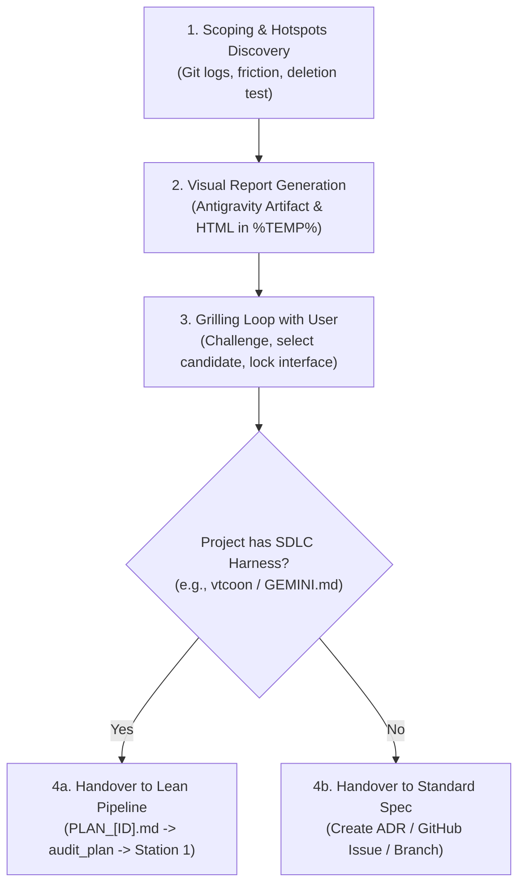

# Improve Codebase Architecture

Surface architectural friction across the codebase and propose **deepening opportunities**: high-leverage refactors that turn shallow, fragmented modules into deep ones. The primary goals are maintainability, testability, locality, and AI-navigability.

---

## 1. Role in the Engineering Ecosystem & SDLC Boundary

> [!IMPORTANT]
> **Position in SDLC Lifecycle**: This skill operates as an **Architectural Discovery & Strategic Diagnostic Tool (Pre-SDLC / On-Demand Discovery)**.
> - **DO NOT** invoke autonomously in the middle of an active implementation ticket loop (Station 1 RED $\rightarrow$ Station 2 GREEN $\rightarrow$ Station 3 $\rightarrow$ Station 4).
> - **ONLY invoke manually (On-Demand)** when:
>   1. The user explicitly requests an architecture scan ("scan architecture", "improve structure", "find shallow modules").
>   2. Preparing to launch a major Epic or broad refactoring campaign (Tech Debt Paydown).
>   3. Re-evaluating module depth after multiple iterative feature additions.

---

## 2. Shared Vocabulary & Principles

This skill strictly adheres to standard design vocabulary and principles from the **`codebase-design`** skill (and [`docs/domain/gotchas/deep_modules.md`](file:///c:/Users/HP/Documents/GitHub/vtcoon/docs/domain/gotchas/deep_modules.md)):

- **Module**: Any entity with an interface and an implementation (function, class, package, subsystem). Avoid generic labels like "component", "service", or "unit".
- **Interface**: The complete surface a caller must understand to use the module correctly: signatures, invariants, call order, error modes, configuration.
- **Seam**: An interface where behavior can be varied without editing call sites. Avoid calling this a "boundary".
- **Adapter**: A concrete object satisfying an interface at a seam. *Rule: 1 adapter = speculative seam; 2 adapters = genuine seam*.
- **Depth**: Interface leverage: ratio of internal behavior hidden behind the interface relative to the complexity of learning the interface.
- **Locality**: Changes, error modes, and knowledge consolidate in one place rather than dispersing across callers.
- **The Deletion Test**: Imagine deleting the module. If complexity disappears $\rightarrow$ shallow module (pass-through). If complexity explodes and scatters across $N$ callers $\rightarrow$ the module provides genuine depth.

---

## 3. Four-Step Execution Workflow

### Step 1: Scoping & Hotspot Discovery

- **YAGNI & Hotspots First**: Deepening delivers the highest return in frequently changing code areas.
  - If the user specifies a targeted module/subsystem: Scan that area immediately.
  - If performing a repo-wide audit: Inspect commit history (`git log --oneline -n 100`) to locate high-churn hotspots.
- **Consult Domain Knowledge**:
  - In projects with [`docs/domain/gotchas/`](file:///c:/Users/HP/Documents/GitHub/vtcoon/docs/domain/gotchas/): Review relevant gotchas before scanning (especially `deep_modules.md`, `fsm_lifecycle.md`, `economy_treasury.md`, `ui_ergonomics.md`).
  - Check `GLOSSARY.md` or `docs/adr/` to understand established domain terminology and architectural decisions.
- **Detect Architectural Smells**:
  - Does understanding a single business rule require traversing 4–5 thin wrapper files?
  - Is the interface nearly as wide as the implementation (shallow module)?
  - Were pure functions extracted solely for unit test convenience while the real failure modes live in coordination wiring (lost locality)?
  - Are seams leaking (e.g., UI component recalculating domain validation rules)?
  - Are LOC ceilings exceeded (e.g., Tier 1 $> 400$ LOC, Tier 2 $> 500$ LOC in `GEMINI.md`)?

### Step 2: Visual Report Generation (Native Artifact & HTML)

The skill supports two presentation formats, with **Antigravity IDE Native Artifact (`.md` with Mermaid) as primary**:

- **1. Primary: Native Antigravity Artifact (`.md` with Mermaid)**:
  - **Location**: Write directly to the conversation artifact directory: `<appDataDir>\brain\<conversation-id>\architecture_review.md` using `write_to_file` with `ArtifactMetadata` (`UserFacing: true`).
  - **Experience**: Antigravity renders in the side pane with full Mermaid Before/After diagrams, tables, and alert cards without opening external files.
- **2. Secondary: Standalone HTML (When external browser viewing is requested)**:
  - Write standalone HTML file to OS temp directory:
    - Windows: `%TEMP%\architecture-review-<timestamp>.html`
    - Linux/macOS: `$TMPDIR/architecture-review-<timestamp>.html` (or `/tmp/`)
  - Open automatically with platform command (`start <path>` on Windows, `open <path>` on macOS, `xdg-open <path>` on Linux).
- **Candidate Card Structure**:
  - Proposed title and target file scope.
  - Visual **Before vs. After** diagram (Mermaid flowchart/sequence).
  - Confidence badge: `Strong` (high recommendation), `Worth exploring`, `Speculative`.
  - Dependency category badge: `in-process`, `local-substitutable`, `ports & adapters`, `mock`.
  - **Top Recommendation**: Identify the #1 priority candidate with rationale.

### Step 3: Grilling Loop with User

After presenting the report, **DO NOT modify code automatically**. Solicit user input:
> *"Which candidate would you like to drill into or implement first?"*

Once the user selects a candidate:
1. Conduct grilling loop: Clarify constraints, dependency classification, hidden internals, and surviving test contracts.
2. If multiple interface designs compete, execute the **"Design It Twice"** workflow from `codebase-design`.
3. If new terminology arises, record in `GLOSSARY.md` or domain docs.

### Step 4: Seamless SDLC Handover

#### Scenario A: Harness-Governed Project (e.g. `vtcoon`)
- **Emit Micro-Slice Roadmap or Ticket Proposal**:
  - Assign canonical ticket ID (e.g. `IMP-[ID]-[slug]`).
  - Draft Lean Plan at `.agents/plans/PLAN_[ID].md` ($\le 200$ lines, zero code dumps, explicit Causal Root Scope, LOC budget).
- **Execute Mechanical Plan Audit**:
  - Run `node scripts/audit_plan.mjs .agents/plans/PLAN_[ID].md --auto-sign`.
- **Trigger Adversarial Gate** (mandatory for FSM, State, or Economy).
- **Await Human Gate**: User approves ("đồng ý" / approve).
- **Handoff to 4-Station SDLC**:
  - Station 1 (RED): `qa-tester` writes contract tests (Adversarial Inversion).
  - Station 2 (GREEN): `implementer` writes minimal code.
  - Station 3: Run `npm run prefilter` and deep architecture review.
  - Station 4: Run `npm run sentinel` and synthesize completion report via `npm run report -- [ID]`.

#### Scenario B: Standard Project (Generic / No Harness)
- Record architectural decision in `docs/adr/ADR-xxxx.md`.
- File a GitHub Issue or branch to execute standard TDD workflow.

---

## 4. Dependency Treatment Reference

When proposing deepening solutions in Candidate Cards, classify dependencies into 4 categories:

| Dependency Category | Nature | Deepening Strategy | Testing Strategy |
| :--- | :--- | :--- | :--- |
| **1. In-process** | Pure computation, in-memory, 0 I/O | Merge shallow modules directly into deep module. No adapters needed. | Test directly through the unified interface. |
| **2. Local-substitutable** | Storage with local in-memory counterpart (PGLite, SQLite in-memory, mock FS) | Deep module encapsulates query logic. Seam remains internal. | Test with local stand-in running in test runner. |
| **3. Remote but owned** | Internal microservice, backend API within team boundary | Define a single **Port** at seam. Production uses HTTP/gRPC adapter; test uses in-memory adapter. | Test deep module with in-memory adapter; separate contract test suite for network adapter. |
| **4. True external** | Third-party uncontrolled service (Stripe, Twilio, OAuth) | Inject external port at seam. | Test provides mock adapter simulating third-party behavior. |
