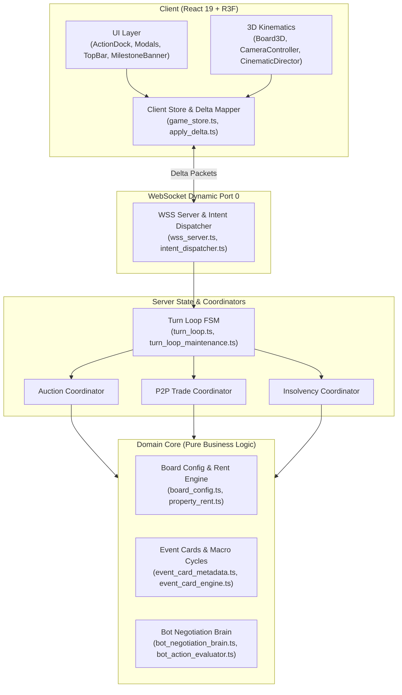

# VTCOON COMPREHENSIVE FEATURE MAP (SSOT)

> **Document Tier:** Single Source of Truth (SSOT) - Architecture Matrix & Authoritative Rules Engine.  
> **Purpose:** Eliminate Context Amnesia across incremental updates. Any engineer or AI Agent can immediately inspect authoritative game rules, core source files, active contract tests, and architectural invariants.  
> **Maintenance Invariant (Knowledge Fold Invariant):** Any ticket modifying domain rules, economic models, FSM phase transitions, network protocols, or UI affordances MUST update this matrix before Station 3 sign-off. This document is a lean rules & architecture matrix, NOT a ticket changelog. Size ceiling: <= 30 KB.

---

---

## 1. CORE SUBSYSTEMS MATRIX (14 PILLARS)

| # | Subsystem | Authoritative Rules SSOT | Core Source Files | Living Contract Tests | Invariants & Gotchas |
| :--- | :--- | :--- | :--- | :--- | :--- |
| **01** | **Board & Properties** | • 40 board tiles (0..39), 8 color groups (2–3 tiles/group). • 4 Railroad / Transit Stations: Progressive rent (250, 500, 1,000, 2,000 scaled by owned stations). • 2 Utility Companies (EVN, Sawaco): Fixed purchase price 2,000; rent = 4x or 10x dice roll. • GO Tile: Collect 2,000 on passing or landing. • Authoritative Cell Net Worth SSOT: `calculateCellNetWorth` in `property_data.ts` (`effectiveLevel = 0` when mortgaged, deducts `mortgageLoans[cellIndex]` or default `MORTGAGE_LOAN_RATE`). Unified across server, bot posture, and client UI. | • `src/domain/index.ts` • `src/domain/board_config.ts` • `src/domain/property_data.ts` • `src/domain/property_rent.ts` • `src/domain/room.ts` • `src/domain/bot/bot_posture.ts` • `src/server/room_manager_queries.ts` | • `tests/domain/board_config.test.ts` • `tests/domain/imp395_core_domain_and_bot_facades.test.ts` • `tests/client/imp393_client_ui_net_worth_ssot_and_boundary_purge.test.ts` | • FORBIDDEN from modifying prices or rent curves without baseline characterization tests. • Server, bot, and client UI MUST delegate per-tile valuation to `calculateCellNetWorth` in `property_data.ts`. • `src/domain/index.ts` must expose clean public API without leaking internal handler leaves. |
| **02** | **Mortgage & Debt Transfer** | • Mortgage value = 50% of initial purchase price. • Unmortgage cost (redemption) = Mortgage value + 10% interest (55% of initial purchase price). • Mortgaged properties collect 0 rent. • Mortgaged property trade permitted via P2P: Buyer assumes debt obligation, pays 10% transfer fee to Bank immediately or incurs deferral penalty. | • `src/domain/mortgage_constants.ts` • `src/server/mortgage_manager.ts` • `src/client/ui/title_deed_modal.tsx` • `src/client/ui/insolvency_modal.tsx` | • `tests/server/mortgage_manager.test.ts` • `tests/server/debt_mechanics.test.ts` • `tests/domain/micro_rules_monopoly_mortgage.test.ts` | • All houses/hotels across a color monopoly must be fully downgraded before mortgaging any constituent tile. • FORBIDDEN from blocking P2P trade on mortgaged assets. |
| **03** | **Insolvency & Bankruptcy** | • Triggers when cash < 0 (rent, taxes, card penalties). • FSM enters `INSOLVENT` phase with 60-second recovery window. • Allowed recovery actions: Downgrade buildings (50% refund), Mortgage properties, Sell stocks, Issue bonds, P2P trade. • Off-turn debtors retain full authority to execute recovery actions. • Symmetric restoration: When cash >= 0, FSM automatically restores pre-crisis turn state. • Expiry (> 60s) or explicit bankruptcy: Liquidate all assets to public auction; convert player to Spectator mode. | • `src/domain/bot/solvency_solver.ts` • `src/server/insolvency_manager.ts` • `src/server/turn_loop.ts` • `src/client/ui/insolvency_modal.tsx` | • `tests/server/audit_insolvency.test.ts` • `tests/server/imp327_symmetric_fsm_insolvency_restoration.test.ts` • `tests/server/imp339_bond_insolvency_and_cascade_gate.test.ts` | • Symmetric State Exit: Any action resolving insolvency must route through centralized FSM restoration helper. • FORBIDDEN from trapping bankrupted players in loops or allowing subsequent dice rolls. |
| **04** | **Bilateral P2P Trade & Diplomacy** | • Atomic 2-way exchange: Cash, Real Estate (including mortgaged tiles), HOSE Stocks. • Supports Player-Player, Player-Bot, Bot-Bot. • Dual-lock mechanism: Invalidates trade offers if offered assets are modified or mortgaged during pending state. • Out-of-turn insolvent debtors retain explicit rights to propose and accept trade offers for self-liquidation. • Bot Trade Recipient wiring routes exclusively through domain and bot facades. | • `src/server/p2p_trade_actions.ts` • `src/server/room_trade_coordinator.ts` • `src/server/trade_coordinator_helper.ts` • `src/client/ui/trade_modal.tsx` | • `tests/domain/imp396_server_session_and_trade_facade_wiring.test.ts` • `tests/server/p2p_trade.test.ts` • `tests/server/room_trade_coordinator.test.ts` | • FORBIDDEN from trading with oneself or initiating trades during active Auction or Transit Wheel phases. • Idempotent dispatch: Reject duplicate trade accept/reject intents. |
| **05** | **Event Cards & Macro Cycles** | • 36 event cards total (20 Chance cards, 16 Market cards). • Mobile Banner Text Standard: Sentence length <= 78 chars with 2-clause causal structure (`[Action/Cause] + [Outcome/Effect]`), eliminating text truncation on 360–390px viewports. • Macro impact: Real estate booms, interest rate shifts, natural disasters, tax relief, transit subsidies, get-out-of-jail cards, spatial teleports. | • `src/domain/event_card_metadata.ts` • `src/domain/event_card_engine.ts` • `src/domain/chance_card_handlers.ts` • `src/domain/market_card_handlers.ts` • `src/client/ui/milestone_banner.tsx` • `src/client/ui/event_card_modal.tsx` | • `tests/domain/imp360_concise_causal_event_descriptions.test.ts` • `tests/domain/imp343_event_card_display_data.test.ts` • `tests/domain/event_card_engine.test.ts` | • `card.effectDetail` MUST NOT exceed 78 chars. • Descriptions must preserve numerical values, percentages, and landmark names with clear causality. |
| **06** | **Transit Wheel & Special Hop** | • Triggers when player lands on a Transit Station / Railroad tile. • Choice: Take regular train or spin Transit Wheel for targeted spatial hop. • Proportional Probability Wheel: Transit Wheel sectors render proportionally to odds ($3.6^\circ$ per 1%: 35% SPEED_BOOST 126 deg, 20% SAFE_HAVEN 72 deg, 20% CASH_BACK 72 deg, 10% PASS_GO_FLIGHT 36 deg, 15% FLIGHT_DELAY 54 deg); Casino radial typography aligns text along spoke. • Hop cost scales by travel distance or renders free on bonus sectors. • Second Hop Navigation supported with synchronized presentation and haptics. | • `src/domain/transit_wheel.ts` • `src/server/transit_wheel_handler.ts` • `src/client/ui/modals/transit_wheel_modal.tsx` • `src/client/ui/modals/transit_wheel_visuals.ts` | • `tests/contracts/imp447_proportional_transit_wheel_and_tactile_modal.test.ts` • `tests/domain/transit_wheel.test.ts` • `tests/contracts/telemetry_transit_wheel_defense.test.ts` • `tests/contracts/imp248_transit_wheel_navigator.test.ts` | • Proportional Wheel Invariant: Wheel sectors MUST map proportionally to domain probabilities; uniform 72 deg division is forbidden; narrow sectors (< 45 deg) scale font to 10px and icon to 16px with outward radial offsets. • Safari Wobble Guard: Invisible bounding anchor circle with `transformOrigin: 'center'` prevents WebKit pivot wobble. • Disconnection Safety: Watchdog timer must auto-select safest default action on timeout. • Zero deadlocks in FSM if client disconnects while Transit Wheel is presented. |
| **07** | **HOSE Stock Market** | • 4 Blue-chip equities (VNM, VIC, FPT, VCB) fluctuating with dice rolls, market events, and macro cycles. • Players can Buy/Sell, earn dividends, or execute liquidation in insolvency; market value folds into Net Worth. • Authoritative HOSE Emission: Server emits `HOSE_SETTLED`; client synthesizers eliminate netting collisions with concurrent GO salary inflows. | • `src/server/hose_actions.ts` • `src/client/events/game_event_hose_helpers.ts` • `src/client/ui/stock_exchange_modal.tsx` • `src/domain/macro_cycle_engine.ts` | • `tests/client/imp387_authoritative_hose_emission.test.ts` • `tests/domain/bot_auction_hose.test.ts` • `tests/server/rate_hike_hose_overdraft.test.ts` | • Liquid cash validated before purchase. • Share price must never drop below 0 or trigger division by zero. • Server MUST authoritatively emit `HOSE_SETTLED`. |
| **08** | **Building Upgrades & Monopolies** | • Monopoly: Full color group ownership -> 2x unimproved lot rent, unlocks construction. • Even-Build Rule: Building count between properties in the same color group cannot differ by > 1. • Building tiers: 0 houses -> 1..4 houses -> Hotel. • Downgrade: Refunds 50% of initial build cost, strictly respecting even-downgrade parity. • Macro Cost Shifts: RATE_HIKE adds 25% to construction costs. | • `src/domain/property_upgrade.ts` • `src/domain/property_manager.ts` • `src/server/room_property_coordinator.ts` • `src/client/ui/property_portfolio_modal.tsx` | • `tests/domain/monopoly_even_building.test.ts` • `tests/domain/micro_rules_even_downgrade.test.ts` • `tests/domain/property_manager_upgrades.test.ts` | • FORBIDDEN from building when any tile in the color group is mortgaged. • Even-build and even-downgrade parity strictly enforced across all color group properties. |
| **09** | **Auctions & Compulsory Buyout** | • Public Auction: Triggers when player declines unowned property. Min increment 100; 15s timer auto-extends on high bid. • Foreclosure Auction: Liquidates seized assets from bankrupted players. • Compulsory Buyout: Player owning 2/3 tiles in color group may force purchase 3rd tile at 2.5x base cost. • Authoritative Auction Emission: Server emits `AUCTION_BID_PLACED` and `AUCTION_WON`; client synthesizers eliminate netting collisions. | • `src/server/auction_manager.ts` • `src/server/room_auction_coordinator.ts` • `src/domain/compulsory_buyout.ts` • `src/client/events/game_event_property_synthesizer.ts` • `src/client/ui/auction_modal.tsx` | • `tests/client/imp388_authoritative_auction_emission.test.ts` • `tests/server/room_auction_coordinator.test.ts` • `tests/server/auction_scheduler_recursion.test.ts` | • FORBIDDEN from displaying ghost auction modals after auction termination. • Bidding funds validated immediately upon bid intent dispatch. • Server MUST emit `AUCTION_BID_PLACED` and `AUCTION_WON`. |
| **10** | **Treasury, Taxes & Bonds** | • GO Salary: 2,000 collected upon landing on or passing GO tile. • Income Tax: 10% of total wealth or flat 2,000 max. Luxury Tax: Flat 1,000. • Bond Issuance: Raise liquidity, paying periodic coupon interest upon crossing GO. • Treasury Deduplication: Capital expenditures absorbed before tax evaluation via `adjustNetDeltaForPropertyTransactions`. • Authoritative Bond Emission: Server emits `BOND_REPAID` and `BOND_DEFAULT` (with `cashSeized`). | • `src/domain/index.ts` • `src/domain/bond_types.ts` • `src/server/bond_manager.ts` • `src/client/events/game_event_financial_synthesizer.ts` • `src/client/events/game_event_financial_helpers.ts` • `src/client/ui/bond_issuance_modal.tsx` | • `tests/client/imp386_authoritative_bond_lifecycle.test.ts` • `tests/client/imp380_financial_narrative_transparency.test.ts` • `tests/contracts/imp368_go_salary_deductions_transparency.test.ts` | • Bonds factored into total liabilities for Net Worth. • Capital expenditures deducted AFTER salary reconstruction and BEFORE fee evaluation. • Server MUST authoritatively emit `BOND_REPAID` and `BOND_DEFAULT`. |
| **11** | **FSM Lifecycle & WebSocket Sync** | • Phase Sequence: `WAITING_LOBBY` -> `START_TURN` -> `ROLL_DICE` -> `MOVE_PAWN` -> `RESOLVE_TILE` -> `ACTION_CHOICE` -> `END_TURN` -> `GAME_OVER`. Sub-phases: `AUCTION`, `INSOLVENT`, `TRANSIT_SELECTION`. • Watchdog: 60s per turn auto-advances or assigns bot fallback on disconnect/AFK. • Delta Sync: Server broadcasts State Delta (`delta_payload_vsc`) with sequence numbers; client applies atomically to `game_store.ts`. • Protocol Facade: Wire DTOs (`DeltaPayload`, `PlayerIntent`, `WsClientMessage`, `WsServerMessage`) centralized in `src/domain/protocol/index.ts` (@protocol). • Zero-Cycle Architecture: Event bus routes via leaf types; FSM transitions centralized in `fsm_transition_coordinator.ts` (0 SCCs repository-wide). | • `src/domain/protocol/index.ts` • `src/server/fsm_transition_coordinator.ts` • `src/server/room_manager.ts` • `src/server/turn_loop.ts` • `src/server/network/wss_server.ts` • `src/client/store/game_store.ts` • `src/client/network/apply_delta.ts` | • `tests/server/imp423_server_fsm_coordinator_seam.test.ts` • `tests/client/imp422_client_network_subscribers_zero_cycle.test.ts` • `tests/domain/imp397_reconnect_and_client_store_facade_wiring.test.ts` • `tests/domain/imp392_shared_wire_protocol_and_network_boundary.test.ts` • `tests/server/turn_loop.test.ts` | • Delta sync mandatory; broadcasting full-state snapshots per tick is FORBIDDEN. • Client components MUST NEVER import from `src/server/**`. • Protocol wiring mandatory; production code must consume canonical facades. • Centralized Transitions: FSM phase advances, skips, and restores MUST route through `fsm_transition_coordinator.ts`. |
| **12** | **Bot AI Negotiation Brain & Strategy** | • Dynamic Bot Posture: Aggressive expansion, liquidity defense, desperate salvage. • Acquisition Engine: Valuation score (`valuation_engine.ts`) + threat forecast (`threat_forecaster.ts`). • P2P Negotiation: Fair value differential calculation; blocks gifting monopolies to opponents. • Adaptive Auction: Escalates bids when property secures or breaks opponent monopoly. • Kinematic Pacing: 1200ms settle compensation in `resolveBotStepDelay`; 2200ms on `WaitingRoll`; observation pauses for transit (2000ms), cards (2500ms), composite (6400ms). • Bot Brain Facade: Pure facade in `src/domain/bot/index.ts` exposes canonical decision APIs; zero external leaf imports across server/client. | • `src/domain/bot/index.ts` • `src/domain/bot/bot_negotiation_brain.ts` • `src/domain/bot/bot_action_evaluator.ts` • `src/domain/bot/valuation_engine.ts` • `src/server/room_bot_coordinator.ts` • `src/server/network/turn_bot_timer_scheduler.ts` | • `tests/client/imp441_multi_activity_pawn_flight_and_bot_pacing.test.ts` • `tests/domain/imp397_reconnect_and_client_store_facade_wiring.test.ts` • `tests/domain/imp395_core_domain_and_bot_facades.test.ts` • `tests/contracts/bot_pacing_and_camera_lock_contract.test.ts` | • Zero Cheating: Bots must never look ahead into dice outcomes or opponents' private cash. • Bot turn pacing delays MUST respect kinematic settle windows (1200ms pawn settle, 2200ms roll breathing room). • Mid-Turn Activity Unblock: When `kinematicsServed: true`, bot observation timers MUST accommodate transit and card animations. • Zero Leaf Imports: All consumers must import bot logic strictly via `src/domain/bot/index.ts`. |
| **13** | **3D Kinematics & Presentation** | • Three.js / R3F Engine: 3D board, procedural buildings, metallic pawns, central landmark diorama (`tabletop_diorama.glb`, 60 FPS). • Board Overview & Auto-Zoom Suppression: Overview elevation unified across all phases at $Y = 25.35\text{m}$, pitch $38.6^\circ$, target $[2.2, 0, 2.2]$, eliminating Phase 3 cramped dives to $Y = 18.5\text{m}$ in deep rounds (Round > 8). • Responsive Mobile Portrait Framing: Golden Compromise optics on portrait viewports (`aspect < 1.0`) calibrate FOV to 44°-46°, elevation $Y \in [28.0\text{m}, 29.9\text{m}]$, and target shift $\le 0.4\text{m}$, expanding board height span by +39% (37.1% screen height) and visual area by +93%, keeping 32/40 tiles within screen bounds and Cell 20 free from banner occlusion ($NDC_y \le +0.41$). • Manual Overview Watchdog: 12s Dead Man's Switch watchdog clears overview lock on turn change, dice roll, or pawn movement; locks `minDistance = 14m` during overview. • Desktop Post-Processing Crispness & Anti-Flicker: Global Bloom threshold = 2.5, intensity = 0.20 (0.12 mobile, 0.30 auction) with `mipmapBlur={!isMobile}`; SelectiveBloom disabled on desktop (`enableSelectiveBloom={false}`); N8AO auto-bypassed over logarithmic depth buffers (`gl?.capabilities?.logarithmicDepthBuffer`); DoF target vector permanently memoized (`useMemo`) with `bokehScale=0` when inactive; `EffectComposer autoClear={true}` eliminates buffer ghosting. • Snappy Pawn Hop Pacing: Step durations 200ms human (0.14s hop + 0.06s landing) and 150ms bot (0.10s hop + 0.05s landing); `DICE_SETTLE_DWELL_MS = 250ms`, `PAWN_LANDING_SETTLE_MS = 250ms` (700ms saved/turn); `DEFAULT_ROLL_LEAD_MS = 1350ms`. • Bot Turn Camera Stabilization: Bot routine rolls and hops strictly retain static overview ($Y = 25.3\text{m}$, FOV $24^\circ$); camera focuses on tile ($Y = 6.4\text{m}$) only upon landing on human property or active modal; post-hop settle buffer prevents instant snap-back. • Bilateral Tile Typography: Inverted micro-title ($y=10$, $180^\circ$) on property/corner headers (`INDOCHINE_TILE_THEME.bilateral = true`); 0 extra draw calls, 0 VRAM growth. • Spatial Kinematics & Flight: `JAIL_FLIGHT_ARC = 2.8m` parabolic arc for audit, transit, and event cards; audio emits `CARD_DRAW` vs `TAX_PENALTY`; queue tail continuity chains `fromCell` without snap-back. • Dual Metropolis 50/50: Đông ($X > 0$) Hà Nội; Tây ($X < 0$) TP.HCM; Tâm: Trống Đồng mạ vàng chìm ($Y \le 0.0505$) & Metro chữ S 10 trụ. • Viewport & LOD: Desktop (1280x800) vs Mobile (360x740). Capabilities injected via `<DeviceProfileProvider>`; leaf sniffers banned in render loops. • Spatial Geometry SSOT: `computeTransformedAABB2D` calculates X-Z extents; `checkAABBCollision2D` enforces clearance; raycast datum $Y = 0.103$ (corner $0.115$). • Tabletop Inlays & Clearances: Walnut chassis, `<DiceTray hasSunkenArena={!isMobile} />`; sunken arena rim peak $\le 0.038\text{m}$ below `DICE_REST_Y = 0.26\text{m}`; `WALNUT_TABLE_Y = -0.350\text{m}`. • GPU VRAM Lifecycle: `useManagedBufferGeometry` & `useManagedCanvasTexture` in `use_managed_geometry.ts` guarantee idempotent disposal; static tiles merged to <= 3 draw calls via `<BatchedBoardTiles>`; borders pooled into 5 `InstancedMesh` nodes. | • `src/client/3d/post_processing_pipeline.tsx` • `src/client/game_canvas.tsx` • `src/client/3d/camera_kinematic_helpers.ts` • `src/client/3d/cinematic_spline_flyby.ts` • `src/client/3d/adaptive_cinematic_camera.tsx` • `src/client/3d/camera_state_machine.ts` • `src/client/3d/pawn_path.ts` • `src/client/events/pacing_context.ts` • `src/client/3d/tile_texture_drawers.ts` • `src/client/3d/single_hop_pawn.tsx` • `src/client/3d/pawn_animator.tsx` • `src/client/3d/batched_board_tiles.tsx` • `src/client/3d/miniature_city_diorama.tsx` • `src/client/3d/dice_tray.tsx` • `src/client/3d/board_layout.tsx` • `src/client/3d/hooks/use_managed_geometry.ts` • `src/client/3d/board_3d.tsx` • `public/models/board/tabletop_diorama.glb` | • `tests/client/imp449_mobile_board_framing_and_banner.test.ts` • `tests/contracts/imp448_desktop_post_processing_crispness_and_anti_flicker.test.ts` • `tests/client/imp446_board_overview_camera_tuning.test.ts` • `tests/client/imp444_snappy_pawn_hop_pacing.test.ts` • `tests/client/imp443_bot_camera_stabilization.test.ts` • `tests/client/imp442_tile_text_readability_billboard.test.ts` • `tests/client/imp441_multi_activity_pawn_flight_and_bot_pacing.test.ts` • `tests/client/imp439_indochine_tabletop_restoration.test.ts` • `tests/client/imp437_indochine_executive_atmosphere_and_esplanade.test.ts` • `tests/client/imp435_saigon_river_and_indochine_biome.test.ts` | • Post-Processing Crispness & Anti-Flicker Invariant: Global Bloom threshold >= 2.0 on standard scenes; unlit SelectiveBloom forbidden; logarithmic depth AO crash defense mandatory; EffectComposer autoClear mandatory; DoF target vector permanently memoized with zero focal churn. • Board Overview Invariant: Overview elevation unified across all phases at $Y = 25.35\text{m}$, pitch $38.6^\circ$, target $[2.2, 0, 2.2]$; Phase 3 cramped dives to $Y = 18.5\text{m}$ strictly banned. • Responsive Mobile Framing Invariant: Portrait viewports calculate responsive FOV (44°-46°) and distance scaling ($Y \approx 28.5-29.8\text{m}$, shift $\le 0.4\text{m}$) yielding +93% visual area while keeping Cell 20 at $NDC_y \le +0.45$. • Manual Overview Watchdog Invariant: 12s Dead Man's Switch watchdog clears overview lock on turn change, dice roll, or pawn movement; minDistance locked to 14m. • Snappy Pawn Hop Pacing Invariant: Human step 200ms (0.14s + 0.06s), bot step 150ms (0.10s + 0.05s); settle dwells capped at 250ms; roll lead 1350ms. • Bot Camera Anti-Whiplash Invariant: Bot routine rolls and hops MUST NOT dive camera; preserve overview ($Y \ge 22.0\text{m}$) unless landing on human tile; smooth settle buffer before returning. • Architectural Clearances: River spline clearance $R \ge 1.68\text{m}$; sunken arena rim peak $\le 0.038\text{m}$; WALNUT_TABLE_Y = -0.350 immutable. • SafeGLTFModel & Headless Guard: External GLTF models mount via SafeGLTFModel with fallback primitives for living tests. • Hardware DI Isolation: Hot loops consume capabilities via useDeviceProfile(), never leaf sniffers; DeviceProfileProvider remains Zero-DOM. • Standardized Graphics Seam: Contract tests use `tests/helpers/r3f_test_harness.ts` with `sharedR3FHarness`. Bespoke `vi.mock('@react-three/fiber')` forbidden. • Managed Three.js Disposal: Dynamic geometries and textures use managed disposal hooks to eliminate VRAM accumulation. • Ephemeral TTL & Self-Healing: Dynamic 3D animations implement watchdog timers (TTL 900-2800ms) with GPU settlement. |
| **14** | **UI & Tactile Ergonomics** | • Dual Viewport: Desktop (1280x800) & Mobile (360x740). • Desktop Left-Margin Safe Void: `FloatingNumbersOverlay` on desktop is anchored to `md:left-4 md:max-w-[280px]` with fixed ceiling `md:top-20` (80px), clearing northern board tiles #11–#20 ($Y_{edge} \ge 212\text{px}$) with $\ge 44\text{px}$ clearance; multi-line wrapping (`line-clamp-2 break-words`) preserves 100% of financial narrative text verbatim. • Collapsible Mini Player HUD: `PlayerHudList` toggles full (`w-44`/`w-64`) vs compact rail (`w-14`/`w-16`, <= 64px) via `data-testid="player-hud-collapse-btn"`, rendering tactile `PlayerHudMiniChips` with balance & bankrupt states, unblocking eastern board tiles #24-#30. • Desktop Glass & Brass HUD: PlayerCard badge 48px (`🏛️ Chưa có BĐS • 0/28`) preserving 28 `dot-cell-*` in DOM; TopBar glassmorphic capsule (`bg-[#FFFDF8]/85`, `backdrop-blur-md`). • Mobile Blur Purge: Global purge of `backdrop-filter` on mobile (< 768px). • Poka-Yoke Action Dock: Buttons derive states/costs directly from Domain Validators (`canDo`). • Financial Narrative Clarity: Contextual descriptions (`Lệ Phí Đất (Ô 04) ➔ Kho Bạc`, `giải chấp`). • Subsystem Facades: UI modals import domain symbols exclusively via `domain/index.ts`; store centralized in `src/client/store/index.ts`. • Mobile HUD Density: `PlayerHudList` w-44; tap-to-expand progressive disclosure with auto turn reset. | • `src/client/ui/floating_numbers.tsx` • `src/client/ui/market_event_ticker.tsx` • `src/client/ui/player_card.tsx` • `src/client/ui/player_card_helpers.ts` • `src/client/ui/player_hud_mini_chips.tsx` • `src/client/ui/top_bar.tsx` • `src/client/ui/player_hud_list.tsx` • `src/client/store/index.ts` • `src/client/store/game_store.ts` • `src/client/ui/modals/modal_helpers.ts` • `src/client/ui/action_dock.tsx` | • `tests/client/imp450_desktop_left_margin_notification.test.ts` • `tests/contracts/imp445_full_board_overview_and_collapsible_hud.test.ts` • `tests/client/imp430_desktop_hud_glass_and_brass.test.ts` • `tests/client/imp414_domain_facade_and_seam_01_purge.test.ts` • `tests/client/imp411_market_ticker_seam_and_store_facade.test.ts` • `tests/client/imp393_client_ui_net_worth_ssot_and_boundary_purge.test.ts` | • Desktop Safe Void Invariant: Notifications on desktop must anchor to `md:left-4 md:max-w-[280px]` with fixed `md:top-20` ceiling; stepped cascading into western board tiles is strictly forbidden. • Collapsible Rail Invariant: Collapse button satisfies Pillar V min-h-[44px] min-w-[44px], pointer-events-auto, and never uses Tailwind fixed class. • Two-Stage HUD Decoupling: PlayerCard retains 28 `dot-cell-*` DOM when 0 properties. • PlayerCard LOC Buffer: Observe 350 LOC buffer zone threshold. • Poka-Yoke Affordance: UI states/costs derived directly from domain validators. • Subsystem Facade: UI modals import domain strictly via `domain/index.ts`. • Store Facade & Decoupled Reset: Cleanups decoupled via set registry. • Mobile Backdrop Stall: Banned `backdrop-blur-*` over 3D canvas on mobile (< 768px). |

---

## 2. KNOWLEDGE FOLD PROTOCOL

To ensure this document remains continuously authoritative over time:

1. **Upon Any Ticket Modifying the System:**
   - If game rules or formulas change (rent, interest, taxes, win conditions): Update the *Authoritative Rules SSOT* column.
   - If core source files are created or refactored: Update the *Core Source Files* column.
   - If key contract tests are added: Update the *Living Contract Tests* column.
   - If new domain hazards or architectural gotchas are discovered: Add to the *Invariants & Gotchas* column.
   - **Anti-Changelog Discipline**: Do NOT append narrative ticket logs (`IMP-xxx: ...`). Keep descriptions focused purely on active rules and architecture.

2. **Mechanical Gate:**
   - Evidence audit scripts verify that `docs/FEATURE_MAP.md` is maintained and stays strictly <= 30 KB.
   - Violation of the Knowledge Fold Invariant blocks Station 3 sign-off.

---

## 3. DEEP-DIVE GOTCHAS SSOT DIRECTORY

For technical details and historical design traps across each subsystem, consult the primary pillar references at `docs/domain/gotchas/`:
- [FSM Lifecycle & State Machine (`fsm_lifecycle.md`)](file:///c:/Users/HP/Documents/GitHub/vtcoon/docs/domain/gotchas/fsm_lifecycle.md)
- [Economy, Treasury & Taxes (`economy_treasury.md`)](file:///c:/Users/HP/Documents/GitHub/vtcoon/docs/domain/gotchas/economy_treasury.md)
- [Bot AI Negotiation & Strategy (`bot_negotiation.md`)](file:///c:/Users/HP/Documents/GitHub/vtcoon/docs/domain/gotchas/bot_negotiation.md)
- [Network Delta Synchronization (`network_delta.md`)](file:///c:/Users/HP/Documents/GitHub/vtcoon/docs/domain/gotchas/network_delta.md)
- [UI Ergonomics & Tactile Controls (`ui_ergonomics.md`)](file:///c:/Users/HP/Documents/GitHub/vtcoon/docs/domain/gotchas/ui_ergonomics.md)
- [3D Graphics & Mobile Kinematics (`3d_cinematics.md`)](file:///c:/Users/HP/Documents/GitHub/vtcoon/docs/domain/gotchas/3d_cinematics.md)
- [Testing Traps & Anti-Flakiness (`testing_traps.md`)](file:///c:/Users/HP/Documents/GitHub/vtcoon/docs/domain/gotchas/testing_traps.md)
- [Deep Module Architecture, Seam Discipline & Anti-Shallow Linters (`deep_modules.md`)](file:///c:/Users/HP/Documents/GitHub/vtcoon/docs/domain/gotchas/deep_modules.md)
