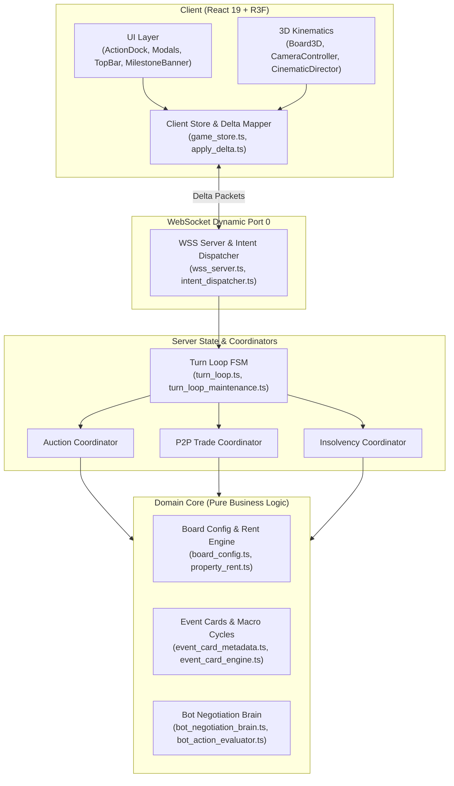

# VTCOON COMPREHENSIVE FEATURE MAP (SSOT)

> **Document Tier:** Single Source of Truth (SSOT) - Architecture Matrix & Authoritative Rules Engine.  
> **Purpose:** Eliminate Context Amnesia across incremental updates. Any engineer or AI Agent can immediately inspect authoritative game rules, core source files, active contract tests, and architectural invariants.  
> **Maintenance Invariant (Knowledge Fold Invariant):** Any ticket modifying domain rules, economic models, FSM phase transitions, network protocols, or UI affordances MUST update this matrix before Station 3 sign-off. This document is a lean rules & architecture matrix, NOT a ticket changelog. Size ceiling: <= 30 KB.

---

---

## 1. CORE SUBSYSTEMS MATRIX (14 PILLARS)

| # | Subsystem | Authoritative Rules SSOT | Core Source Files | Living Contract Tests | Invariants & Gotchas |
| :--- | :--- | :--- | :--- | :--- | :--- |
| **01** | **Board & Properties** | • 40 board tiles (0..39), 8 color groups (2–3 tiles/group). • 4 Railroad / Transit Stations: Progressive rent (250, 500, 1,000, 2,000 scaled by owned stations). • 2 Utility Companies (EVN, Sawaco): Fixed purchase price 2,000; rent = 4x or 10x dice roll. • GO Tile: Collect 2,000 on passing or landing. • Authoritative Cell Net Worth SSOT: `calculateCellNetWorth` in `property_data.ts` (`effectiveLevel = 0` when mortgaged, deducts `mortgageLoans[cellIndex]` or default `MORTGAGE_LOAN_RATE`). Unified across server, bot posture, and client UI. | • `src/domain/index.ts` • `src/domain/board_config.ts` • `src/domain/property_data.ts` • `src/domain/property_rent.ts` • `src/domain/room.ts` • `src/domain/bot/bot_posture.ts` • `src/server/room_manager_queries.ts` | • `tests/domain/board_config.test.ts` • `tests/domain/imp395_core_domain_and_bot_facades.test.ts` • `tests/client/imp393_client_ui_net_worth_ssot_and_boundary_purge.test.ts` | • FORBIDDEN from modifying prices or rent curves without baseline characterization tests. • Server, bot, and client UI MUST delegate per-tile valuation to `calculateCellNetWorth` in `property_data.ts`. • `src/domain/index.ts` must expose clean public API without leaking internal handler leaves. |
| **02** | **Mortgage & Debt Transfer** | • Mortgage value = 50% of initial purchase price. • Unmortgage cost (redemption) = Mortgage value + 10% interest (55% of initial purchase price). • Mortgaged properties collect 0 rent. • Mortgaged property trade permitted via P2P: Buyer assumes debt obligation, pays 10% transfer fee to Bank immediately or incurs deferral penalty. | • `src/domain/mortgage_constants.ts` • `src/server/mortgage_manager.ts` • `src/client/ui/title_deed_modal.tsx` • `src/client/ui/insolvency_modal.tsx` | • `tests/server/mortgage_manager.test.ts` • `tests/server/debt_mechanics.test.ts` • `tests/domain/micro_rules_monopoly_mortgage.test.ts` | • All houses/hotels across a color monopoly must be fully downgraded before mortgaging any constituent tile. • FORBIDDEN from blocking P2P trade on mortgaged assets. |
| **03** | **Insolvency & Bankruptcy** | • Triggers when cash < 0 (rent, taxes, card penalties). • FSM enters `INSOLVENT` phase with 60-second recovery window. • Allowed recovery actions: Downgrade buildings (50% refund), Mortgage properties, Sell stocks, Issue bonds, P2P trade. • Off-turn debtors retain full authority to execute recovery actions. • Symmetric restoration: When cash >= 0, FSM automatically restores pre-crisis turn state. • Expiry (> 60s) or explicit bankruptcy: Liquidate all assets to public auction; convert player to Spectator mode. | • `src/domain/bot/solvency_solver.ts` • `src/server/insolvency_manager.ts` • `src/server/turn_loop.ts` • `src/client/ui/insolvency_modal.tsx` | • `tests/server/audit_insolvency.test.ts` • `tests/server/imp327_symmetric_fsm_insolvency_restoration.test.ts` • `tests/server/imp339_bond_insolvency_and_cascade_gate.test.ts` | • Symmetric State Exit: Any action resolving insolvency must route through centralized FSM restoration helper. • FORBIDDEN from trapping bankrupted players in loops or allowing subsequent dice rolls. |
| **04** | **Bilateral P2P Trade & Diplomacy** | • Atomic 2-way exchange: Cash, Real Estate (including mortgaged tiles), HOSE Stocks. • Supports Player-Player, Player-Bot, Bot-Bot. • Dual-lock mechanism: Invalidates trade offers if offered assets are modified or mortgaged during pending state. • Out-of-turn insolvent debtors retain explicit rights to propose and accept trade offers for self-liquidation. • Bot Trade Recipient wiring routes exclusively through domain and bot facades. | • `src/server/p2p_trade_actions.ts` • `src/server/room_trade_coordinator.ts` • `src/server/trade_coordinator_helper.ts` • `src/client/ui/trade_modal.tsx` | • `tests/domain/imp396_server_session_and_trade_facade_wiring.test.ts` • `tests/server/p2p_trade.test.ts` • `tests/server/room_trade_coordinator.test.ts` | • FORBIDDEN from trading with oneself or initiating trades during active Auction or Transit Wheel phases. • Idempotent dispatch: Reject duplicate trade accept/reject intents. |
| **05** | **Event Cards & Macro Cycles** | • 36 event cards total (20 Chance cards, 16 Market cards). • Mobile Banner Text Standard: Sentence length <= 78 chars with 2-clause causal structure (`[Action/Cause] + [Outcome/Effect]`), eliminating text truncation on 360–390px viewports. • Macro impact: Real estate booms, interest rate shifts, natural disasters, tax relief, transit subsidies, get-out-of-jail cards, spatial teleports. | • `src/domain/event_card_metadata.ts` • `src/domain/event_card_engine.ts` • `src/domain/chance_card_handlers.ts` • `src/domain/market_card_handlers.ts` • `src/client/ui/milestone_banner.tsx` • `src/client/ui/event_card_modal.tsx` | • `tests/domain/imp360_concise_causal_event_descriptions.test.ts` • `tests/domain/imp343_event_card_display_data.test.ts` • `tests/domain/event_card_engine.test.ts` | • `card.effectDetail` MUST NOT exceed 78 chars. • Descriptions must preserve numerical values, percentages, and landmark names with clear causality. |
| **06** | **Transit Wheel & Special Hop** | • Triggers when player lands on a Transit Station / Railroad tile. • Choice: Take regular train or spin Transit Wheel for targeted spatial hop. • Hop cost scales by travel distance or renders free on bonus sectors. • Second Hop Navigation supported with synchronized presentation and haptics. | • `src/domain/transit_wheel.ts` • `src/server/transit_wheel_handler.ts` • `src/client/ui/transit_wheel_modal.tsx` | • `tests/domain/transit_wheel.test.ts` • `tests/contracts/telemetry_transit_wheel_defense.test.ts` • `tests/contracts/imp248_transit_wheel_navigator.test.ts` | • Disconnection Safety: Watchdog timer must auto-select safest default action on timeout. • Zero deadlocks in FSM if client disconnects while Transit Wheel is presented. |
| **07** | **HOSE Stock Market** | • 4 Blue-chip equities (VNM, VIC, FPT, VCB) fluctuating dynamically with dice rolls, market events, and macro cycles. • Players can Buy/Sell, earn dividends, or execute emergency liquidation in insolvency; market value folds into Net Worth. • Authoritative HOSE Settled Emission: Server emits `HOSE_SETTLED` into `room.pendingDomainEvents`; client synchronizes composite roll keys and `restoreDeltaOutflow` to eliminate netting collisions with concurrent GO salary inflows. | • `src/server/hose_actions.ts` • `src/client/events/game_event_hose_helpers.ts` • `src/client/ui/stock_exchange_modal.tsx` • `src/domain/macro_cycle_engine.ts` | • `tests/client/imp387_authoritative_hose_emission.test.ts` • `tests/domain/bot_auction_hose.test.ts` • `tests/server/rate_hike_hose_overdraft.test.ts` | • FORBIDDEN from allowing share purchases when liquid cash is insufficient. • Share price must never drop below 0 or trigger division by zero. • Server MUST authoritatively emit `HOSE_SETTLED`; client synthesizers prioritize authoritative domain events over balance heuristics. |
| **08** | **Building Upgrades & Monopolies** | • Monopoly: Full color group ownership -> 2x unimproved lot rent, unlocks construction. • Even-Build Rule: Building count between properties in the same color group cannot differ by > 1. • Building tiers: 0 houses -> 1..4 houses -> Hotel. • Downgrade: Refunds 50% of initial build cost, strictly respecting even-downgrade parity. • Macro Cost Shifts: RATE_HIKE adds 25% to construction costs. | • `src/domain/property_upgrade.ts` • `src/domain/property_manager.ts` • `src/server/room_property_coordinator.ts` • `src/client/ui/property_portfolio_modal.tsx` | • `tests/domain/monopoly_even_building.test.ts` • `tests/domain/micro_rules_even_downgrade.test.ts` • `tests/domain/property_manager_upgrades.test.ts` | • FORBIDDEN from building when any tile in the color group is mortgaged. • Even-build and even-downgrade parity strictly enforced across all color group properties. |
| **09** | **Auctions & Compulsory Buyout** | • Public Auction: Triggers when player declines unowned landed property. Min increment 100; 15s timer auto-extends on new high bid. • Foreclosure Auction: Liquidates seized assets from bankrupted players. • Compulsory Buyout: Player owning 2/3 tiles in color group may force purchase 3rd tile at 2.5x base cost. • Authoritative Auction Emission: Server emits `AUCTION_BID_PLACED` and `AUCTION_WON` into `room.pendingDomainEvents`. Client synthesizers order bids before gavel strikes, guard concluded auctions, and use `restoreDeltaOutflow` to prevent netting collisions. | • `src/server/auction_manager.ts` • `src/server/room_auction_coordinator.ts` • `src/domain/compulsory_buyout.ts` • `src/client/events/game_event_property_synthesizer.ts` • `src/client/ui/auction_modal.tsx` | • `tests/client/imp388_authoritative_auction_emission.test.ts` • `tests/server/room_auction_coordinator.test.ts` • `tests/server/auction_scheduler_recursion.test.ts` | • FORBIDDEN from displaying ghost auction modals after auction termination. • Bidding funds validated immediately upon bid intent dispatch. • Server MUST emit `AUCTION_BID_PLACED` and `AUCTION_WON`; client synthesizers prioritize authoritative events. |
| **10** | **Treasury, Taxes & Bonds** | • GO Salary: 2,000 collected upon landing on or passing GO tile. • Income Tax: 10% of total wealth or flat 2,000 max. Luxury Tax: Flat 1,000. • Bond Issuance: Players may issue government/corporate bonds to raise immediate liquidity, paying periodic coupon interest upon crossing GO. • Treasury Toast Deduplication: Capital expenditures absorbed before tax evaluation via `adjustNetDeltaForPropertyTransactions`. • Authoritative Bond Lifecycle: Server emits `BOND_REPAID` and `BOND_DEFAULT` (with `cashSeized`) into `room.pendingDomainEvents`. | • `src/domain/index.ts` • `src/domain/bond_types.ts` • `src/server/bond_manager.ts` • `src/client/events/game_event_financial_synthesizer.ts` • `src/client/events/game_event_financial_helpers.ts` • `src/client/ui/bond_issuance_modal.tsx` | • `tests/client/imp386_authoritative_bond_lifecycle.test.ts` • `tests/client/imp380_financial_narrative_transparency.test.ts` • `tests/contracts/imp368_go_salary_deductions_transparency.test.ts` | • Bonds factored into total liabilities when calculating Net Worth. • Capital expenditures deducted AFTER salary reconstruction and BEFORE fee evaluation. • Server MUST authoritatively emit `BOND_REPAID` and `BOND_DEFAULT`; client prioritizes authoritative events. |
| **11** | **FSM Lifecycle & WebSocket Sync** | • Phase Sequence: `WAITING_LOBBY` -> `START_TURN` -> `ROLL_DICE` -> `MOVE_PAWN` -> `RESOLVE_TILE` -> `ACTION_CHOICE` -> `END_TURN` -> `GAME_OVER`. Sub-phases: `AUCTION`, `INSOLVENT`, `TRANSIT_SELECTION`. • Watchdog Timer: 60s per turn; auto-advances or assigns bot fallback on disconnect/AFK. • Dynamic Port 0: WebSocket uses `port: 0` in tests to prevent collision. • Delta Sync: Server broadcasts State Delta (`delta_payload_vsc`) with sequence numbers; client applies via `apply_delta.ts` to `game_store.ts` atomically. Pure CQS in `delta_mapper.ts` preserved in `buildSparseDelta` and cleared after broadcast. • Wire Protocol Facade: Wire DTOs (`DeltaPayload`, `PlayerDelta`, `PlayerIntent`, `WsClientMessage`, `WsServerMessage`, `VALID_INTENTS`, `encodeMsg`) centralized in `src/domain/protocol/index.ts` (@protocol). • Client Zero-Cycle: Event bus DAG routes via leaf types (`game_event_bus_types.ts`, `event_card_constants.ts`); `room_config_helpers.ts` decouples `lobby_store.ts`; static FIFO-100 tracker (`trade_offer_tracker.ts`) purges trade offers without UI-network cycles (0 client SCC). • Server FSM Coordinator & Zero-Cycle: Transitions centralized in `fsm_transition_coordinator.ts`; leaf seams (`auction_types.ts`, `room_context_types.ts`, `room_manager_types.ts`, `turn_timer_constants.ts`, `admin_manager_types.ts`) eliminate server cycles (0 SCCs repository-wide across 438 files). | • `src/domain/index.ts` • `src/domain/protocol/index.ts` • `src/server/fsm_transition_coordinator.ts` • `src/server/auction_types.ts` • `src/server/room_context_types.ts` • `src/server/room_manager_types.ts` • `src/server/network/turn_timer_constants.ts` • `src/server/network/admin_manager_types.ts` • `src/client/network/room_config_helpers.ts` • `src/client/network/trade_offer_tracker.ts` • `src/client/events/game_event_bus_types.ts` • `src/client/events/event_card_constants.ts` • `src/server/room_manager.ts` • `src/server/turn_loop.ts` • `src/server/network/wss_server.ts` • `src/client/store/game_store.ts` • `src/client/network/apply_delta.ts` | • `tests/server/imp423_server_fsm_coordinator_seam.test.ts` • `tests/client/imp422_client_network_subscribers_zero_cycle.test.ts` • `tests/server/imp416_transitional_shims_decommission.test.ts` • `tests/domain/imp397_reconnect_and_client_store_facade_wiring.test.ts` • `tests/domain/imp392_shared_wire_protocol_and_network_boundary.test.ts` • `tests/server/turn_loop.test.ts` | • Delta sync mandatory; broadcasting full-state snapshots per tick is FORBIDDEN. • Client components MUST NEVER import from `src/server/**`. • Direct protocol wiring mandatory; production code must consume canonical facades. • Event Bus Unidirectional DAG: Event subscribers must import types from `game_event_bus_types.ts` and card constants from `event_card_constants.ts`; cross-layer cycles between network, UI, and event bus strictly banned. • Server FSM Centralization: FSM phase advances, bankrupt skips, and insolvency restore MUST route through `fsm_transition_coordinator.ts`; circular cross-calling between managers is strictly FORBIDDEN. |
| **12** | **Bot AI Negotiation Brain & Strategy** | • Dynamic Bot Posture: Aggressive expansion, liquidity defense, desperate salvage. • Acquisition Engine: Valuation score (`valuation_engine.ts`) + threat forecast (`threat_forecaster.ts`). • P2P Negotiation: Fair value differential calculation; blocks gifting monopolies to opponents. • Adaptive Auction Bidding: Escalates bids when property secures or breaks opponent monopoly. • Kinematic Pacing: 1200ms settle compensation (600ms dice + 600ms pawn) in `resolveBotStepDelay`; 2200ms breathing room on `WaitingRoll`. • Bot Brain Facade: Pure facade in `src/domain/bot/index.ts` exposes canonical decision APIs; zero external leaf imports across server/client. | • `src/domain/bot/index.ts` • `src/domain/bot/bot_negotiation_brain.ts` • `src/domain/bot/bot_action_evaluator.ts` • `src/domain/bot/valuation_engine.ts` • `src/domain/bot/threat_forecaster.ts` • `src/server/room_bot_coordinator.ts` | • `tests/domain/imp397_reconnect_and_client_store_facade_wiring.test.ts` • `tests/domain/imp395_core_domain_and_bot_facades.test.ts` • `tests/client/imp390_kinematic_pacing_restoration.test.ts` • `tests/contracts/bot_pacing_and_camera_lock_contract.test.ts` | • Zero Cheating: Bots must never look ahead into dice outcomes or opponents' private cash. • Bot turn pacing delays MUST respect kinematic settle windows (1200ms pawn settle, 2200ms roll breathing room). • Zero Leaf Imports: All consumers must import bot logic strictly via `src/domain/bot/index.ts`. |
| **13** | **3D Kinematics & Presentation** | • Three.js / R3F Engine: 3D board, procedural buildings, die-cast metallic pawns, central landmark dioramas. • Viewport & LOD: Desktop (1280x800) vs Mobile (360x740). Adaptive LOD, 30 FPS idle cooling, Android WebGL depth stabilization. • Hardware DI: Device profile (DPR, antialias, precision) injected via `<DeviceProfileProvider>` (Zero-DOM) & `useDeviceProfile()`; leaf sniffers banned in render loops; iOS Frame 0 DPR clamped `[0.75, 0.82]`. • Spatial Geometry SSOT: `computeTransformedAABB2D` calculates X-Z extents with yaw; `checkAABBCollision2D` enforces clearance; `projectToOverviewNdc` & `isOverviewFrustumSafe` map world coords to NDC. • Spatial Sector Balance & Diorama Exposure: `validateSectorBalance` locks $\max(count_i) - \min(count_i) \le 2$ across 4 quadrants ('NW', 'NE', 'SW', 'SE'); `computeQuadrantCounts` normalizes `-0` and filters `NaN`/`Infinity`; `coastal_island_environment.tsx` infers `streamlined = propStreamlined ?? isMobile`, exposing 4-quadrant `DEFAULT_BALANCED_ISLAND_DIORAMA` on Desktop while preserving 100% Mobile TBDR efficiency; `board_layout.tsx` synchronizes `streamlined={!tierProfile.enableOuterBaySanctuaries}`. • GPU VRAM Lifecycle: `useManagedBufferGeometry` & `useManagedCanvasTexture` in `src/client/3d/hooks/use_managed_geometry.ts` absorb React 18/19 StrictMode mount->unmount->remount cycles, ensure synchronous disposal on settled unmount/deps changes without wall-clock timers, and provide WeakSet-backed idempotent disposal. • Canvas Text Sanitizer: `sanitizeCanvasText` normalizes NFC, strips emojis, preserves Vietnamese diacritics, currency, math, and punctuation. • 3D Zero-Cycle Seams: Pure math (`building_lot_transform.ts`, `construction_slam_math.ts`, `monopoly_plaza_math.ts`, `board_layout_math.ts`, `penthouse_constants.ts`) decouple JSX (0 SCC in 3D). • Mobile Thermal Guards: Static shadow caching elides 100% redundant passes; mobile water shader elides fragment ALU loops. • Batching & Instancing: Static tiles merged to <= 3 draw calls via `<BatchedBoardTiles>`; 28 property borders/trays pooled into 5 `InstancedMesh` nodes; regional buildings pooled into 10 nodes; monopoly archways pooled into 8 archways with 900ms Auto-TTL Domino Shockwave. • Desktop Bay Archipelago: 4 coastal sanctuaries with Blender monuments exclusively on `!isMobile` (0 mobile draw calls). • Central Diorama Chain Reaction & War Room: Central chain reaction (2800ms TTL); War Room gavel, scale, nameplates (2600ms TTL); 0 mobile overhead. • Volumetric Depth: Road markings use `polygonOffset` (-1.0, -4.0); diorama plazas use 3D solids (height >= 0.02m); headlight fans use `depthWrite: false`. • Camera Director: Eased tracking (3.2 player chase, 3.8 bot chase, 5.2 mobile floor); pawn step 300ms human, 260ms bot. | • `src/client/3d/hooks/use_managed_geometry.ts` • `src/client/3d/device_profile_context.tsx` • `src/client/3d/coastal_island_environment.tsx` • `src/client/3d/board_layout.tsx` • `src/client/3d/coastal_island_landmarks.tsx` • `src/client/3d/sunny_island_lobby_scene.tsx` • `src/client/3d/board_3d.tsx` • `src/client/3d/board_layout_math.ts` • `src/client/3d/spatial_geometry_helpers.ts` • `src/client/3d/cinematic_director.tsx` | • `tests/client/imp426_coastal_sanctuary_desktop_exposure.test.ts` • `tests/client/imp425_gpu_vram_concurrent_lifecycle.test.ts` • `tests/client/imp421_gpu_vram_lifecycle_hooks.test.ts` • `tests/client/imp420_spatial_sector_balance.test.ts` • `tests/client/imp419_penthouse_constants_seam.test.ts` • `tests/client/imp412_device_profile_context_and_hardware_di.test.ts` • `tests/client/imp407_spatial_geometry_and_canvas_text_sanitizer.test.ts` | • Hardware DI Isolation: Hot rendering loops MUST consume device capabilities via `useDeviceProfile()`, NEVER invoking leaf sniffers (`isIOSPhone`) directly; `DeviceProfileProvider` MUST remain Zero-DOM. • Headless Child FrameLoop: Mobile animation suppression must delegate loop callbacks to headless child components mounted strictly when `!isMobile` to preserve AST structure for living tests. • Standardized Graphics Seam: Contract tests MUST use `tests/helpers/r3f_test_harness.ts` with `sharedR3FHarness`. Bespoke `vi.mock('@react-three/fiber')` forbidden. • Spatial Frustum & Canvas Text: 3D entities must verify overview frustum safety (`|NDC| <= 0.85/0.80`); WebGL text canvas textures must strip emojis and use sanitized text for texture cache keys. • Spatial Sector Balance: Outdoor props must maintain 4-quadrant balance ($\max - \min \le 2$); dynamic prop resolvers must provide poka-yoke fallback. • Managed Three.js Disposal: Dynamic BufferGeometry and CanvasTexture instances MUST use managed disposal hooks to eliminate VRAM accumulation. • Clamped Delta Kinematics: Delta-accumulated motion loops MUST enforce `Math.min(delta, 0.1)` to prevent teleportation jumps on tab resume. • Volumetric Depth: Road markings require `polygonOffset`; plazas require extruded solids >= 0.02m height; translucent headlight fans require `depthWrite: false`. • Desktop Isolation: Desktop bay sanctuaries, war room stage, and chain reactions MUST register 0 draw calls, 0 GLB loads, and 0 useSafeFrame subscribers on mobile. • Ephemeral TTL & Self-Healing: Dynamic 3D animations (chain reactions, gavel slams, archway dominoes) MUST implement watchdog timers (TTL 900-2800ms) with GPU settlement passes. |
| **14** | **UI & Tactile Ergonomics** | • Dual Viewport: Desktop (1280x800) & Mobile (360x740). • Mobile Blur Purge: Global purge of `backdrop-filter` on mobile (< 768px). • Poka-Yoke Action Dock: Buttons derive states/costs from Domain Validators (`canDo`). • Financial Narrative Clarity: Contextual descriptions (`Lệ Phí Đất (Ô 04) ➔ Kho Bạc`, `giải chấp`). • Domain Facade Invariant: UI Modals import domain symbols strictly via `domain/index.ts`, purging deep leaf imports. • Market Ticker & Store Facade: `market_event_helpers.ts` decouples formulas; `src/client/store/index.ts` centralizes store hooks. • Game Store Reset: `game_store_cleanup.ts` Set registry decouples cleanups and eliminates cycles. • Mobile HUD Density: `PlayerHudList` w-44; tap-to-expand progressive disclosure with auto turn reset. | • `src/client/store/index.ts` • `src/client/store/game_store.ts` • `src/client/store/game_store_cleanup.ts` • `src/client/ui/modals/modal_helpers.ts` • `src/client/ui/modals/title_deed_affordance.ts` • `src/client/ui/market_event_helpers.ts` • `src/client/ui/action_dock.tsx` | • `tests/client/imp414_domain_facade_and_seam_01_purge.test.ts` • `tests/client/imp413_event_synthesizers_seam_and_store_zero_cycle.test.ts` • `tests/client/imp411_market_ticker_seam_and_store_facade.test.ts` • `tests/client/imp393_client_ui_net_worth_ssot_and_boundary_purge.test.ts` | • Poka-Yoke UI Affordance: UI states and costs MUST derive directly from Domain Validators. • Subsystem Facade Invariant: UI modals MUST import domain contracts strictly via `domain/index.ts`, never reaching into domain leaves. • Store Facade & Decoupled Reset: Internal synthesizers must not import `store/index.ts`; `game_store.ts` must not import outward cleanups directly. • Mobile Backdrop Stall: FORBIDDEN from using unconditional `backdrop-blur-*` over 3D canvas on mobile (< 768px). • Progressive Disclosure: Inactive player cards afford tap-to-expand with deterministic turn-change reset. |

---

## 2. KNOWLEDGE FOLD PROTOCOL

To ensure this document remains continuously authoritative over time:

1. **Upon Any Ticket Modifying the System:**
   - If game rules or formulas change (rent, interest, taxes, win conditions): Update the *Authoritative Rules SSOT* column.
   - If core source files are created or refactored: Update the *Core Source Files* column.
   - If key contract tests are added: Update the *Living Contract Tests* column.
   - If new domain hazards or architectural gotchas are discovered: Add to the *Invariants & Gotchas* column.
   - **Anti-Changelog Discipline**: Do NOT append narrative ticket logs (`IMP-xxx: ...`). Keep descriptions focused purely on active rules and architecture.

2. **Mechanical Gate:**
   - Evidence audit scripts verify that `docs/FEATURE_MAP.md` is maintained and stays strictly <= 30 KB.
   - Violation of the Knowledge Fold Invariant blocks Station 3 sign-off.

---

## 3. DEEP-DIVE GOTCHAS SSOT DIRECTORY

For technical details and historical design traps across each subsystem, consult the primary pillar references at `docs/domain/gotchas/`:
- [FSM Lifecycle & State Machine (`fsm_lifecycle.md`)](file:///c:/Users/HP/Documents/GitHub/vtcoon/docs/domain/gotchas/fsm_lifecycle.md)
- [Economy, Treasury & Taxes (`economy_treasury.md`)](file:///c:/Users/HP/Documents/GitHub/vtcoon/docs/domain/gotchas/economy_treasury.md)
- [Bot AI Negotiation & Strategy (`bot_negotiation.md`)](file:///c:/Users/HP/Documents/GitHub/vtcoon/docs/domain/gotchas/bot_negotiation.md)
- [Network Delta Synchronization (`network_delta.md`)](file:///c:/Users/HP/Documents/GitHub/vtcoon/docs/domain/gotchas/network_delta.md)
- [UI Ergonomics & Tactile Controls (`ui_ergonomics.md`)](file:///c:/Users/HP/Documents/GitHub/vtcoon/docs/domain/gotchas/ui_ergonomics.md)
- [3D Graphics & Mobile Kinematics (`3d_cinematics.md`)](file:///c:/Users/HP/Documents/GitHub/vtcoon/docs/domain/gotchas/3d_cinematics.md)
- [Testing Traps & Anti-Flakiness (`testing_traps.md`)](file:///c:/Users/HP/Documents/GitHub/vtcoon/docs/domain/gotchas/testing_traps.md)
- [Deep Module Architecture, Seam Discipline & Anti-Shallow Linters (`deep_modules.md`)](file:///c:/Users/HP/Documents/GitHub/vtcoon/docs/domain/gotchas/deep_modules.md)
