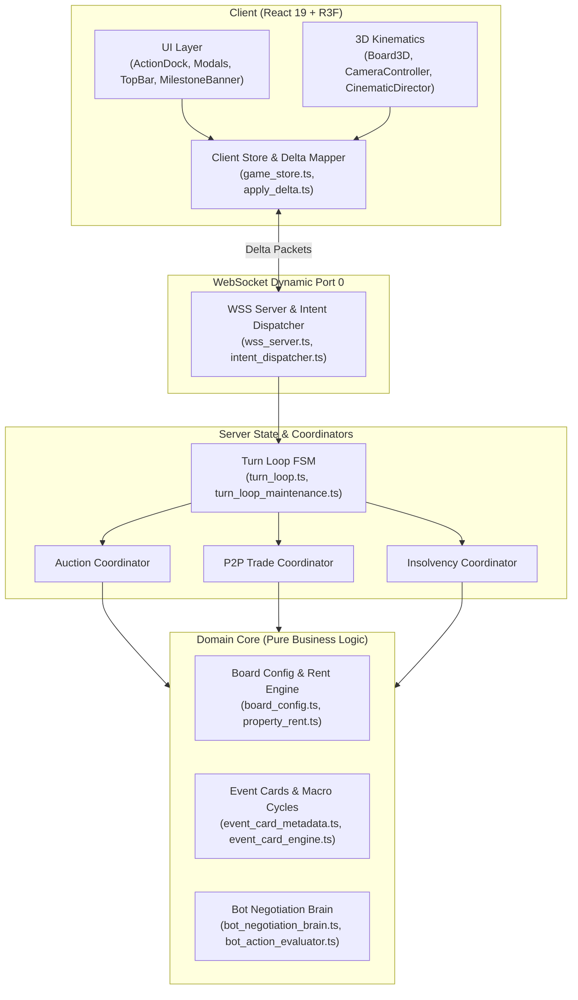

# VTCOON COMPREHENSIVE FEATURE MAP (SSOT)

> **Document Tier:** Single Source of Truth (SSOT) - Architecture Matrix & Authoritative Rules Engine.  
> **Purpose:** Eliminate Context Amnesia across hundreds of incremental updates (IMPs). Any incoming engineer or AI Agent can immediately inspect authoritative game rules, core source files, and active regression contract tests.  
> **Maintenance Invariant (Knowledge Fold Invariant):** Any ticket/IMP modifying domain rules, economic models, FSM phase transitions, network protocols, or UI affordances MUST update this matrix before Station 3 sign-off.

---

---

## 1. CORE SUBSYSTEMS MATRIX (14 PILLARS)

| # | Subsystem | Authoritative Rules SSOT | Core Source Files | Living Contract Tests | Invariants & Gotchas |
| :--- | :--- | :--- | :--- | :--- | :--- |
| **01** | **Board & Properties** | • 40 board tiles (0..39), 8 color groups (2–3 tiles/group). • 4 Railroad / Transit Stations (progressive rent: 250, 500, 1,000, 2,000 scaled by owned stations). • 2 Utility Companies (EVN, Sawaco): Fixed purchase price 2,000; rent = 4x or 10x dice roll. • GO Tile: Collect 2,000 on passing or landing. | • `src/domain/board_config.ts` • `src/domain/property_data.ts` • `src/domain/property_rent.ts` • `src/client/3d/board_3d.tsx` • `src/client/ui/title_deed_modal.tsx` | • `tests/domain/board_config.test.ts` • `tests/contracts/visual_metadata_parity.test.ts` • `tests/contracts/imp277a_utility_price_2000.test.ts` | • FORBIDDEN from modifying prices or rent curves without baseline characterization tests. • Must preserve 3D texture symmetry between client assets and server domain metadata. |
| **02** | **Mortgage & Debt Transfer** | • Mortgage value = 50% of initial purchase price. • Unmortgage cost (redemption) = Mortgage value + 10% interest (55% of initial purchase price). • Mortgaged properties collect **0 rent**. • **Mortgaged property trade permitted via P2P**: Buyer assumes debt obligation, pays 10% transfer fee to Bank immediately or incurs a deferral penalty. | • `src/domain/mortgage_constants.ts` • `src/server/mortgage_manager.ts` • `src/client/ui/title_deed_modal.tsx` • `src/client/ui/insolvency_modal.tsx` | • `tests/server/mortgage_manager.test.ts` • `tests/server/debt_mechanics.test.ts` • `tests/domain/micro_rules_monopoly_mortgage.test.ts` | • All houses/hotels across a color monopoly must be fully downgraded before mortgaging any constituent tile. • FORBIDDEN from blocking P2P trade on mortgaged assets. |
| **03** | **Insolvency & Bankruptcy** | • Triggers when cash < 0 (due to rent, taxes, or card penalties). • FSM enters `INSOLVENT` phase with a 60-second recovery window. • Allowed recovery actions: Downgrade buildings (50% refund), Mortgage properties, Sell stocks, Issue bonds, P2P trade. • Off-turn debtors retain full authority to execute recovery actions. • Symmetric restoration: When cash $\ge 0$, FSM automatically restores the pre-crisis turn state. • Expiry (> 60s) or explicit bankruptcy: Liquidate all assets to public auction; convert player to Spectator mode. | • `src/domain/bot/solvency_solver.ts` • `src/server/insolvency_manager.ts` • `src/server/turn_loop.ts` • `src/client/ui/insolvency_modal.tsx` | • `tests/server/audit_insolvency.test.ts` • `tests/server/imp327_symmetric_fsm_insolvency_restoration.test.ts` • `tests/server/imp329_afk_insolvency_fsm_restoration.test.ts` • `tests/server/imp339_bond_insolvency_and_cascade_gate.test.ts` | • **Symmetric State Exit Invariant**: Any action that resolves insolvency must route through the centralized FSM restoration helper. • FORBIDDEN from trapping bankrupted players in loops or allowing subsequent dice rolls. |
| **04** | **Bilateral P2P Trade & Diplomacy** | • Atomic 2-way exchange: Cash, Real Estate (including mortgaged tiles), HOSE Stocks. • Supports Player-Player, Player-Bot, Bot-Bot. • Dual-lock mechanism: Automatically invalidates trade offers if offered assets are modified or mortgaged during pending state. • Out-of-turn insolvent debtors retain explicit rights to propose and accept trade offers for self-liquidation. | • `src/server/p2p_trade_actions.ts` • `src/server/room_trade_coordinator.ts` • `src/server/pending_trade_manager.ts` • `src/client/ui/trade_modal.tsx` | • `tests/server/p2p_trade.test.ts` • `tests/server/room_trade_coordinator.test.ts` • `tests/contracts/imp286_p2p_trade_delta.test.ts` • `tests/contracts/imp287_out_of_turn_debtor_intent_whitelist.test.ts` | • FORBIDDEN from trading with oneself. • FORBIDDEN from initiating trades during active Auction or Transit Wheel phases. • Idempotent dispatch: Reject duplicate trade accept/reject intents. |
| **05** | **Event Cards & Macro Cycles** | • 36 event cards total (20 Chance cards, 16 Market cards). • **Mobile Banner Text Standard (IMP-360):** Sentence length $\le 78$ chars with clear 2-clause causal structure (`[Action/Cause] + [Outcome/Effect]`), eliminating 100% text truncation on small screens (360–390px). • Macro impact: Real estate booms, interest rate shifts, natural disasters, tax relief, transit subsidies, get-out-of-jail cards, spatial teleports. | • `src/domain/event_card_metadata.ts` • `src/domain/event_card_engine.ts` • `src/domain/chance_card_handlers.ts` • `src/domain/market_card_handlers.ts` • `src/client/ui/milestone_banner.tsx` • `src/client/ui/event_card_modal.tsx` | • `tests/domain/imp360_concise_causal_event_descriptions.test.ts` • `tests/domain/imp343_event_card_display_data.test.ts` • `tests/domain/event_card_engine.test.ts` • `tests/domain/event_card_rebalance_high_impact.test.ts` | • FORBIDDEN from exceeding 78 chars in `card.effectDetail`. • Descriptions must preserve numerical values, percentages, and landmark names. • Preserves clear cause-and-effect context. |
| **06** | **Transit Wheel & Special Hop** | • Triggers when player lands on a Transit Station / Railroad tile. • Choice: Take regular train or spin Transit Wheel for targeted spatial hop. • Hop cost scales by travel distance or renders free on bonus sectors. • Second Hop Navigation supported with synchronized presentation and haptics. | • `src/domain/transit_wheel.ts` • `src/server/transit_wheel_handler.ts` • `src/client/ui/transit_wheel_modal.tsx` | • `tests/domain/transit_wheel.test.ts` • `tests/contracts/telemetry_transit_wheel_defense.test.ts` • `tests/contracts/imp248_transit_wheel_navigator.test.ts` | • FORBIDDEN from deadlocking FSM phase if client disconnects while Transit Wheel is presented. • Watchdog timer must auto-select safest default action on timeout. |
| **07** | **HOSE Stock Market** | • 4 distinct Blue-chip equities (VNM, VIC, FPT, VCB). • Share prices fluctuate dynamically with dice rolls, market events, and macro cycles. • Players can Buy / Sell, earn dividend distributions, or execute emergency liquidation in insolvency. • Stock portfolio market value folds directly into Net Worth calculations. | • `src/server/hose_actions.ts` • `src/client/ui/stock_exchange_modal.tsx` • `src/domain/macro_cycle_engine.ts` | • `tests/domain/bot_auction_hose.test.ts` • `tests/contracts/imp78_hose_dice_roll_ux.test.ts` • `tests/server/rate_hike_hose_overdraft.test.ts` | • FORBIDDEN from allowing share purchases when liquid cash is insufficient. • Share price must never drop below 0 or trigger division by zero. |
| **08** | **Building Upgrades & Monopolies** | • **Monopoly:** Full color group ownership -> 2x unimproved lot rent, unlocks construction. • **Even-Build Rule:** Building count between properties in the same color group cannot differ by $> 1$. • Building tiers: 0 houses -> 1..4 houses -> Hotel. • **Downgrade:** Refunds 50% of initial build cost, strictly respecting even-downgrade parity. • Cost shifts: Modified by macroeconomic interest rates (`RATE_HIKE` adds 25% to construction costs). | • `src/domain/property_upgrade.ts` • `src/domain/property_manager.ts` • `src/server/room_property_coordinator.ts` • `src/client/ui/property_portfolio_modal.tsx` | • `tests/domain/monopoly_even_building.test.ts` • `tests/domain/micro_rules_even_downgrade.test.ts` • `tests/domain/property_manager_upgrades.test.ts` • `tests/server/downgrade_property.test.ts` • `tests/contracts/imp275_rate_hike_upgrade_cost.test.ts` | • FORBIDDEN from building when any tile in the color group is mortgaged. • FORBIDDEN from violating the even-build rule. |
| **09** | **Auctions & Compulsory Buyout** | • **Public Auction:** Triggers when player declines to buy an unowned landed property. All players with sufficient cash may bid; minimum bid increment 100; 15-second timer auto-extends on new highest bid. • **Foreclosure Auction:** Liquidates seized assets from bankrupted players. • **Compulsory Buyout:** A player owning 2/3 tiles in a color group may force purchase of the 3rd tile at 2.5x base cost. | • `src/server/auction_manager.ts` • `src/server/room_auction_coordinator.ts` • `src/domain/compulsory_buyout.ts` • `src/client/ui/auction_modal.tsx` • `src/client/ui/compulsory_buyout_modal.tsx` | • `tests/server/room_auction_coordinator.test.ts` • `tests/server/auction_scheduler_recursion.test.ts` • `tests/domain/bot_auction_personalities_and_scheduler.test.ts` | • FORBIDDEN from displaying ghost auction modals after auction termination. • Bidding funds must be escrowed or validated immediately upon bid intent dispatch. |
| **10** | **Treasury, Taxes & Bonds** | • **GO Salary:** 2,000 collected upon landing on or passing the GO tile. • **Income Tax:** 10% of total wealth or flat 2,000 maximum. • **Luxury Tax:** Flat 1,000. • **Treasury Stimulus:** Deactivated since IMP-325 to maintain currency preservation and prevent fictitious inflation. • **Bond Issuance:** Players may issue government/corporate bonds to raise immediate liquidity, paying periodic coupon interest upon crossing GO (IMP-339). | • `src/domain/treasury_stimulus.ts` • `src/domain/bond_types.ts` • `src/server/bond_manager.ts` • `src/client/ui/bond_issuance_modal.tsx` | • `tests/domain/imp114_treasury_public_stimulus.test.ts` • `tests/server/imp325_treasury_stimulus_deactivation.test.ts` • `tests/server/imp339_bond_insolvency_and_cascade_gate.test.ts` | • Bonds must be factored into total liabilities when calculating Net Worth. • FORBIDDEN from injecting unbacked stimulus cash into circulation. |
| **11** | **FSM Lifecycle & WebSocket Sync** | • Core phase sequence: `WAITING_LOBBY` -> `START_TURN` -> `ROLL_DICE` -> `MOVE_PAWN` -> `RESOLVE_TILE` -> `ACTION_CHOICE` -> `END_TURN` -> `GAME_OVER`. • Sub-phases: `AUCTION`, `INSOLVENT`, `TRANSIT_SELECTION`. • Watchdog Timer: 60s per turn; auto-advances or assigns bot fallback on player disconnect/AFK. • WebSocket dynamic port (`port: 0`) in automated tests to prevent port collision. • Server broadcasts State Delta (`delta_payload_vsc`) with sequence numbers; client applies via `apply_delta.ts` to `game_store.ts` atomically. | • `src/server/turn_loop.ts` • `src/server/turn_loop_maintenance.ts` • `src/server/network/wss_server.ts` • `src/server/delta_mapper.ts` • `src/client/store/game_store.ts` • `src/client/network/apply_delta.ts` | • `tests/server/turn_loop.test.ts` • `tests/server/net01_wss.test.ts` • `tests/server/delta_sync.test.ts` • `tests/server/persistent_room_logger.test.ts` • `tests/server/turn_timeout_scheduler.test.ts` | • FORBIDDEN from broadcasting full-state snapshots per tick (delta sync mandatory). • FORBIDDEN from importing Node runtime built-ins (`node:*`, ws) into client code. • Guarantee symmetric state restoration when resolving insolvency or interrupts. |
| **12** | **Bot AI Negotiation Brain & Strategy** | • Dynamic Bot Posture: Aggressive expansion, liquidity defense, or desperate salvage. • Acquisition decision engine: Driven by property valuation score (`valuation_engine.ts`) and cash flow threat forecast (`threat_forecaster.ts`). • P2P Negotiation Intelligence: Calculates fair value differential; blocks gifting monopolies to opponents without substantial financial compensation (`bot_negotiation_brain.ts`, IMP-347). • Adaptive Auction Bidding: Escalates bids when property secures or breaks an opponent's monopoly. | • `src/domain/bot/bot_negotiation_brain.ts` • `src/domain/bot/bot_action_evaluator.ts` • `src/domain/bot/valuation_engine.ts` • `src/domain/bot/threat_forecaster.ts` • `src/server/room_bot_coordinator.ts` • `src/server/turn_bot_timer_scheduler.ts` | • `tests/domain/imp347_bot_negotiation_brain.test.ts` • `tests/domain/bot_action_evaluator.test.ts` • `tests/domain/bot_engine.test.ts` • `tests/server/phase2_bot_turns.test.ts` | • Bots must never cheat (zero lookahead into dice outcomes or opponents' private cash). • Bots must respect turn pacing delays to simulate natural gameplay. |
| **13** | **3D Kinematics & Presentation** | • Three.js / R3F: 3D board, procedural building geometries, die-cast metallic pawns, central landmark dioramas (Bitexco, Landmark 81). • Mobile Thermal & Memory Hardening: Adaptive LOD, 30fps battery-saver cap on low-tier mobile devices, Android WebGL z-fighting fixes (IMP-336, IMP-357). • **iOS WebGL Performance & Thermal Defense (IMP-361):** Context hint `powerPreference: 'high-performance'` and `mediump` float precision on mobile; clamped Retina DPR ceiling `[0.75, 0.82]` strictly for iOS phones (`isIOSPhone`) in `perf_budget.ts` and `AdaptiveDprController`, preserving `ACESFilmicToneMapping` for HDR specular fidelity without DVFS thermal throttling. • Cinematic Camera Director: Coordinates film camera modes (`DicePan`, `StreetChase`, `MacroFlight`, `SoftReturn`); suppresses view jitter during bot turns; locks free rotation during mandatory actions. • Audio & Haptics Decoupling: Presentation subscriber pattern. | • `src/client/3d/board_3d.tsx` • `src/client/3d/device_detect.ts` • `src/client/3d/perf_budget.ts` • `src/client/3d/adaptive_dpr_controller.tsx` • `src/client/3d/camera_controller.tsx` • `src/client/3d/cinematic_director.tsx` • `src/client/3d/camera_gesture_controller.tsx` • `src/client/audio/audio_synthesizer.ts` | • `tests/client/imp361_ios_webgl_perf.test.ts` • `tests/client/imp291_spatial_kinematics_camera.test.ts` • `tests/client/imp326_smooth_pacing_camera.test.ts` • `tests/client/imp341_cinematic_camera_arbitration.test.ts` • `tests/client/imp358_bot_camera_lead.test.ts` • `tests/probes/webgl_spatial_probe.test.ts` | • **R3F Transient Unmount Invariant**: FORBIDDEN from returning `null` when `useFrame` is registered; must use `<group visible={...}>` to prevent GPU buffer reallocation churn. • Camera position must never drift to `NaN` upon sudden target movements. • **iOS Phone Clamping Isolation**: DPR clamp must differentiate phone vs tablet to prevent penalizing high-end M-series iPad Pros. |
| **14** | **UI & Tactile Ergonomics** | • Responsive Dual-Viewport: Desktop (1280x800) and Mobile (360x740). • **Mobile Backdrop Blur Purge (IMP-362):** Global stylesheet purge (`@media (max-width: 767px)`) of `-webkit-backdrop-filter` and `backdrop-filter`, combined with responsive utility classes on `ActionDock` (`backdrop-blur-none md:backdrop-blur-sm`) and `ModalBackdrop` (`backdrop-blur-none md:backdrop-blur-xs` with high-contrast `bg-slate-950/80`), completely eliminating WebKit GPU compositor framebuffer readback stalls on mobile while preserving full-fidelity blur on Desktop ($\ge 768\text{px}$). • Top Navigation Bar (TopBar): Net Worth Badge with tactile feedback (IMP-359). • Action Dock (ActionDock): Buttons strictly follow Poka-Yoke affordance (derived from Domain Validator `canDo`, never independently recalculated). • Player Cards (PlayerCard / PlayerHUD): Clear visual separation between active players and bankrupted spectators. • Notification & Event Banners (MilestoneBanner): Optimized text length preventing border clipping and board obstruction (IMP-322, IMP-360). | • `src/client/index.css` • `src/client/ui/action_dock.tsx` • `src/client/ui/modals/modal_backdrop.tsx` • `src/client/ui/top_bar.tsx` • `src/client/ui/player_card.tsx` • `src/client/ui/milestone_banner.tsx` • `src/client/ui/player_net_worth_badge.tsx` | • `tests/client/imp362_mobile_blur_purge.test.ts` • `tests/client/imp359_player_card_tactile_polish.test.ts` • `tests/contracts/imp89_action_dock_right_and_emotes_purge.test.ts` | • **Poka-Yoke UI Affordance**: Button enabled/disabled states and displayed costs MUST derive directly from Domain Validators. • **Tactile Corner Arc Invariant**: Minimum corner clearance $\ge R + 4\text{px}$. • **Mobile Backdrop Readback Stall Invariant**: FORBIDDEN from using unconditional `backdrop-blur-*` over the 3D WebGL canvas on mobile viewports (< 768px). |

---

## 2. KNOWLEDGE FOLD PROTOCOL

To ensure this document remains continuously authoritative over time:

1. **Upon Any Ticket / IMP Modifying the System:**
   - If game rules or formulas change (rent, interest, taxes, win conditions): Immediately update the *Authoritative Rules SSOT* column.
   - If core source files are created or refactored: Update the *Core Source Files* column.
   - If key contract tests are added: Update the *Living Contract Tests* column.
   - If new domain hazards or architectural gotchas are discovered: Add to the *Invariants & Gotchas* column.

2. **Mechanical Gate:**
   - Plan audit and verification scripts cross-reference declared subsystems against `FEATURE_MAP.md`.
   - Violation of the Knowledge Fold Invariant blocks Station 3 sign-off.

---

## 3. DEEP-DIVE GOTCHAS SSOT DIRECTORY

For technical details and historical design traps across each subsystem, consult the primary pillar references at `docs/domain/gotchas/`:
- [FSM Lifecycle & State Machine (`fsm_lifecycle.md`)](file:///c:/Users/HP/Documents/GitHub/vtcoon/docs/domain/gotchas/fsm_lifecycle.md)
- [Economy, Treasury & Taxes (`economy_treasury.md`)](file:///c:/Users/HP/Documents/GitHub/vtcoon/docs/domain/gotchas/economy_treasury.md)
- [Bot AI Negotiation & Strategy (`bot_negotiation.md`)](file:///c:/Users/HP/Documents/GitHub/vtcoon/docs/domain/gotchas/bot_negotiation.md)
- [Network Delta Synchronization (`network_delta.md`)](file:///c:/Users/HP/Documents/GitHub/vtcoon/docs/domain/gotchas/network_delta.md)
- [UI Ergonomics & Tactile Controls (`ui_ergonomics.md`)](file:///c:/Users/HP/Documents/GitHub/vtcoon/docs/domain/gotchas/ui_ergonomics.md)
- [3D Graphics & Mobile Kinematics (`3d_cinematics.md`)](file:///c:/Users/HP/Documents/GitHub/vtcoon/docs/domain/gotchas/3d_cinematics.md)
- [Testing Traps & Anti-Flakiness (`testing_traps.md`)](file:///c:/Users/HP/Documents/GitHub/vtcoon/docs/domain/gotchas/testing_traps.md)
- [Deep Module Architecture (`deep_modules.md`)](file:///c:/Users/HP/Documents/GitHub/vtcoon/docs/domain/gotchas/deep_modules.md)
