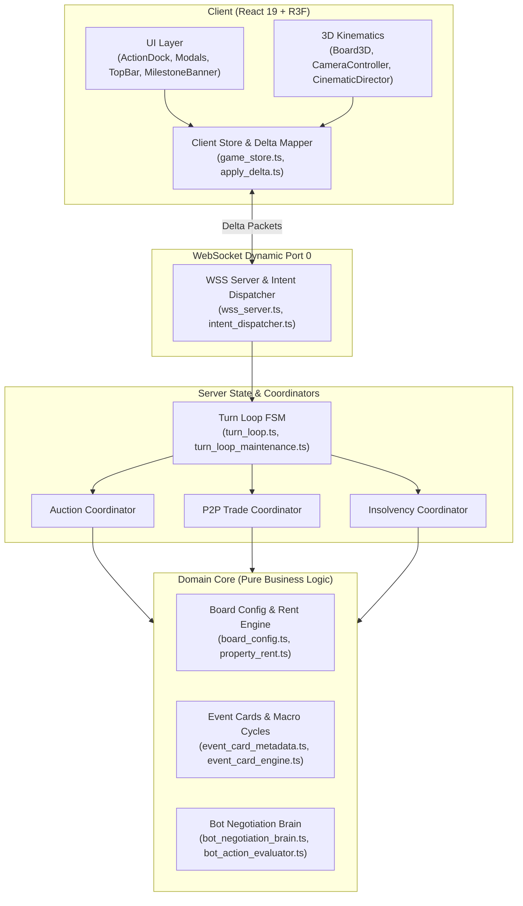

# BẢN ĐỒ TÍNH NĂNG TOÀN DIỆN CỦA DỰ ÁN VTCOON (FEATURE MAP - SSOT)

> **Cấp độ tài liệu:** Single Source of Truth (SSOT) - Hệ thống Ma trận Kiến trúc & Luật chơi Hiện hành.  
> **Mục đích:** Xóa bỏ tình trạng mất ngữ cảnh (Context Amnesia) qua hàng trăm lượt cập nhật (IMPs). Bất kỳ kỹ sư hay AI Agent nào tiếp quản dự án đều có thể tra cứu ngay luật chơi chuẩn, mã nguồn cốt lõi và các bộ test bảo vệ.  
> **Quy chuẩn cập nhật (Knowledge Fold Invariant):** Mọi ticket/IMP làm thay đổi luật chơi, công thức kinh tế, pha FSM hoặc giao diện người dùng BẮT BUỘC phải cập nhật bảng ma trận này trước khi nghiệm thu.

---

---

## 1. MA TRẬN 14 PHÂN HỆ CỐT LÕI (CORE SUBSYSTEMS MATRIX)

| STT | Phân hệ (Subsystem) | Luật chơi hiện hành (Authoritative Rules SSOT) | Tệp mã nguồn cốt lõi (Core Files) | Living Contract Tests | Bất biến & Ràng buộc (Invariants & Gotchas) |
| :--- | :--- | :--- | :--- | :--- | :--- |
| **01** | **Bàn cờ & Bất động sản** *(Board & Properties)* | • 40 ô bàn cờ (0..39), 8 nhóm màu (2-3 ô/nhóm). • 4 Tuyến đường sắt / Bến xe (tiền thuê lũy tiến: 250, 500, 1.000, 2.000 theo số bến sở hữu). • 2 Công ty tiện ích (EVN, Sawaco): Giá mua cố định 2.000, tiền thuê = 4x hoặc 10x điểm xúc xắc. • Ô Khởi hành (GO): Lĩnh 2.000 khi đi qua hoặc dừng lại. | • `src/domain/board_config.ts` • `src/domain/property_data.ts` • `src/domain/property_rent.ts` • `src/client/3d/board_3d.tsx` • `src/client/ui/title_deed_modal.tsx` | • `tests/domain/board_config.test.ts` • `tests/contracts/visual_metadata_parity.test.ts` • `tests/contracts/imp277a_utility_price_2000.test.ts` | • Cấm sửa đổi bảng giá hoặc tiền thuê mà không kiểm tra baseline characterization test. • Phải đảm bảo tính đối xứng texture 3D giữa client và server domain metadata. |
| **02** | **Thế chấp & Chuyển giao nợ** *(Mortgage & Debt Transfer)* | • Giá trị thế chấp = 50% giá mua ban đầu. • Phí giải chấp (chuộc đất) = Giá trị thế chấp + 10% lãi suất (tổng 55% giá mua). • Đất đang thế chấp **hoàn toàn thu 0 tiền thuê**. • **Được phép chuyển nhượng đất đang thế chấp qua P2P**: Người mua nhận chuyển giao nghĩa vụ nợ, nộp 10% phí chuyển nợ ngay cho Ngân hàng hoặc chịu phụ phí hoãn nộp. | • `src/domain/mortgage_constants.ts` • `src/server/mortgage_manager.ts` • `src/client/ui/title_deed_modal.tsx` • `src/client/ui/insolvency_modal.tsx` | • `tests/server/mortgage_manager.test.ts` • `tests/server/debt_mechanics.test.ts` • `tests/domain/micro_rules_monopoly_mortgage.test.ts` | • Toàn bộ nhà/khách sạn trên nhóm độc quyền phải được hạ cấp hoàn toàn trước khi được thế chấp bất kỳ ô nào. • Không được khóa quyền giao dịch P2P đối với tài sản thế chấp. |
| **03** | **Khủng hoảng thanh khoản & Phá sản** *(Insolvency & Bankruptcy)* | • Kích hoạt khi tiền mặt < 0 (do trả tiền thuê, thuế, hoặc phạt thẻ). • FSM chuyển sang pha `INSOLVENT`, mở cửa sổ cứu vãn 60 giây. • Hành động cho phép: Hạ cấp nhà (hoàn 50% tiền xây), Thế chấp đất, Bán cổ phiếu, Phát hành trái phiếu, Giao dịch P2P. • Người chơi hết lượt (off-turn debtor) vẫn được quyền thao tác cứu vãn. • Khôi phục đối xứng: Ngay khi tiền mặt $\ge 0$, FSM tự động khôi phục về trạng thái trước khủng hoảng. • Quá 60s hoặc bấm xác nhận phá sản: Tịch thu toàn bộ tài sản sang đấu giá phát mại, chuyển người chơi sang chế độ Khán giả (Spectator). | • `src/domain/bot/solvency_solver.ts` • `src/server/insolvency_manager.ts` • `src/server/turn_loop.ts` • `src/client/ui/insolvency_modal.tsx` | • `tests/server/audit_insolvency.test.ts` • `tests/server/imp327_symmetric_fsm_insolvency_restoration.test.ts` • `tests/server/imp329_afk_insolvency_fsm_restoration.test.ts` • `tests/server/imp339_bond_insolvency_and_cascade_gate.test.ts` | • **Symmetric State Exit Invariant**: Bất kỳ hành động nào giúp thoát khỏi nợ nần (hạ cấp, thế chấp, trái phiếu, trade) đều phải dùng chung hàm khôi phục FSM tập trung. • Cấm để người chơi phá sản kẹt vòng lặp hoặc tiếp tục được đổ xúc xắc. |
| **04** | **Giao dịch song phương P2P** *(Bilateral P2P Trade & Diplomacy)* | • Trao đổi nguyên tử 2 chiều: Tiền mặt, Bất động sản (gồm cả đất đã thế chấp), Cổ phiếu HOSE. • Hỗ trợ Người - Người, Người - Bot, Bot - Bot. • Cơ chế khóa kép (Dual-lock): Tự động vô hiệu hóa yêu cầu giao dịch nếu tài sản đem đổi bị thay đổi hoặc thế chấp trong thời gian chờ. • Con nợ đang mất thanh khoản ngoài lượt được quyền đề xuất và nhận đề nghị giao dịch để tự cứu vãn. | • `src/server/p2p_trade_actions.ts` • `src/server/room_trade_coordinator.ts` • `src/server/pending_trade_manager.ts` • `src/client/ui/trade_modal.tsx` | • `tests/server/p2p_trade.test.ts` • `tests/server/room_trade_coordinator.test.ts` • `tests/contracts/imp286_p2p_trade_delta.test.ts` • `tests/contracts/imp287_out_of_turn_debtor_intent_whitelist.test.ts` | • Cấm người chơi tự giao dịch với chính mình. • Cấm đề xuất giao dịch khi phòng đang trong pha Đấu giá hoặc Quay vòng quay bến xe. • Idempotent dispatch: Chặn gửi trùng lệnh đồng ý/từ chối giao dịch. |
| **05** | **Thẻ Cơ hội & Vận khí / Thị trường** *(Event Cards & Macro Cycles)* | • Tổng cộng 36 thẻ biến cố (20 Thẻ Cơ hội / Chance, 16 Thẻ Thị trường / Market). • **Quy chuẩn hiển thị Mobile Banner (IMP-360):** Độ dài câu $\le 78$ ký tự, cấu trúc 2 vế nguyên nhân - kết quả rõ ràng (`[Hành động/Nguyên nhân] + [Hậu quả/Hiệu lực]`), triệt tiêu 100% tình trạng mất chữ trên màn hình nhỏ (360-390px). • Tác động vĩ mô: Sốt đất, tăng/giảm lãi suất ngân hàng, thiên tai bão lụt, hỗ trợ thuế, miễn phí cầu đường, thẻ ra tù, dịch chuyển tức thời. | • `src/domain/event_card_metadata.ts` • `src/domain/event_card_engine.ts` • `src/domain/chance_card_handlers.ts` • `src/domain/market_card_handlers.ts` • `src/client/ui/milestone_banner.tsx` • `src/client/ui/event_card_modal.tsx` | • `tests/domain/imp360_concise_causal_event_descriptions.test.ts` • `tests/domain/imp343_event_card_display_data.test.ts` • `tests/domain/event_card_engine.test.ts` • `tests/domain/event_card_rebalance_high_impact.test.ts` | • Cấm đưa text thô dài vượt quá 78 ký tự vào `card.effectDetail`. • Toàn bộ mô tả phải giữ nguyên số tiền, tỷ lệ % và tên địa danh cụ thể. • Không được làm mất ngữ cảnh nguyên nhân - kết quả. |
| **06** | **Vòng quay Giao thông / Bến xe** *(Transit Wheel & Special Hop)* | • Kích hoạt khi người chơi dừng chân tại ô Bến xe / Tuyến đường sắt. • Quyền lựa chọn: Đi tàu thông thường hoặc Quay Vòng quay Giao thông để dịch chuyển tới ô bất kỳ. • Chi phí nhảy tàu tính toán theo khoảng cách di chuyển hoặc miễn phí khi quay trúng ô thưởng đặc biệt. • Hỗ trợ bước nhảy thứ 2 (Second Hop Navigation) với đồng bộ hiển thị và haptics. | • `src/domain/transit_wheel.ts` • `src/server/transit_wheel_handler.ts` • `src/client/ui/transit_wheel_modal.tsx` | • `tests/domain/transit_wheel.test.ts` • `tests/contracts/telemetry_transit_wheel_defense.test.ts` • `tests/contracts/imp248_transit_wheel_navigator.test.ts` | • Cấm gây kẹt pha FSM nếu người chơi ngắt kết nối trong lúc đang hiển thị vòng quay. • Watchdog timer phải tự động chọn phương án an toàn nhất sau khi hết thời gian chờ. |
| **07** | **Sàn Giao dịch Chứng khoán HOSE** *(HOSE Stock Market)* | • 4 mã cổ phiếu Blue-chip đặc thù (VNM, VIC, FPT, VCB). • Giá cổ phiếu biến động động theo điểm xúc xắc, biến cố thị trường và chu kỳ vĩ mô. • Người chơi có thể đặt lệnh Mua / Bán, nhận cổ tức chia thưởng, hoặc bán tháo khẩn cấp khi mất thanh khoản. • Giá trị thị trường của danh mục cổ phiếu được tích hợp trực tiếp vào Tổng tài sản ròng (Net Worth). | • `src/server/hose_actions.ts` • `src/client/ui/stock_exchange_modal.tsx` • `src/domain/macro_cycle_engine.ts` | • `tests/domain/bot_auction_hose.test.ts` • `tests/contracts/imp78_hose_dice_roll_ux.test.ts` • `tests/server/rate_hike_hose_overdraft.test.ts` | • Cấm cho phép mua cổ phiếu khi tiền mặt không đủ. • Giá cổ phiếu không được rớt về số âm hoặc chia cho 0. |
| **08** | **Nâng cấp Nhà, Khách sạn & Độc quyền** *(Building Upgrades & Monopolies)* | • **Độc quyền (Monopoly):** Sở hữu đủ toàn bộ nhóm màu -> Giá thuê đất trống x2, mở khóa quyền xây dựng. • **Quy tắc xây đồng đều (Even-build):** Số lượng nhà giữa các ô trong cùng nhóm không được chênh lệch quá 1 cấp. • Cấp bậc: 0 nhà -> 1..4 nhà -> Khách sạn (Hotel). • **Hạ cấp (Downgrade):** Hoàn lại 50% chi phí xây dựng ban đầu, tuân thủ nguyên tắc hạ cấp đồng đều (Even-downgrade). • Biến động chi phí: Bị tác động bởi lãi suất vĩ mô (`RATE_HIKE` tăng 25% giá xây dựng). | • `src/domain/property_upgrade.ts` • `src/domain/property_manager.ts` • `src/server/room_property_coordinator.ts` • `src/client/ui/property_portfolio_modal.tsx` | • `tests/domain/monopoly_even_building.test.ts` • `tests/domain/micro_rules_even_downgrade.test.ts` • `tests/domain/property_manager_upgrades.test.ts` • `tests/server/downgrade_property.test.ts` • `tests/contracts/imp275_rate_hike_upgrade_cost.test.ts` | • Cấm cho phép xây dựng khi có bất kỳ ô nào trong nhóm màu đang bị thế chấp. • Cấm phá vỡ quy tắc xây đồng đều (Even-build rule). |
| **09** | **Đấu giá Công khai & Mua lại Cưỡng chế** *(Auctions & Compulsory Buyout)* | • **Đấu giá công khai (Public Auction):** Kích hoạt khi người chơi dừng chân từ chối mua ô đất trống. Toàn bộ người chơi đủ tiền mặt đều được trả giá, bước giá tối thiểu 100, đồng hồ 15s tự động gia hạn khi có người trả giá cao hơn. • **Đấu giá phát mại (Foreclosure):** Bán đấu giá tài sản tịch thu từ người chơi vỡ nợ. • **Mua lại cưỡng chế (Compulsory Buyout):** Người chơi giữ 2/3 ô trong nhóm màu có quyền ép mua ô thứ 3 từ đối thủ với giá phạt 2.5x giá gốc. | • `src/server/auction_manager.ts` • `src/server/room_auction_coordinator.ts` • `src/domain/compulsory_buyout.ts` • `src/client/ui/auction_modal.tsx` • `src/client/ui/compulsory_buyout_modal.tsx` | • `tests/server/room_auction_coordinator.test.ts` • `tests/server/auction_scheduler_recursion.test.ts` • `tests/domain/bot_auction_personalities_and_scheduler.test.ts` | • Cấm hiện modal đấu giá ma (ghost auction modal) sau khi đấu giá kết thúc. • Tiền trả giá phải bị phong tỏa hoặc kiểm tra số dư ngay khi gửi lệnh bid. |
| **10** | **Kho bạc, Thuế & Trái phiếu** *(Treasury, Taxes & Bonds)* | • **Lương GO:** 2.000 khi đi qua hoặc dừng lại tại ô Bắt đầu. • **Thuế Thu nhập:** 10% tổng tài sản hoặc tối đa 2.000. • **Thuế Tiêu thụ xa xỉ:** 1.000 cố định. • **Gói kích thích kinh tế:** Đã tắt từ IMP-325 nhằm duy trì tính bảo toàn tiền tệ và tránh lạm phát ảo. • **Phát hành Trái phiếu (Bonds):** Cho phép người chơi phát hành trái phiếu chính phủ/doanh nghiệp huy động vốn tức thì, trả lãi định kỳ sau mỗi vòng qua ô GO (IMP-339). | • `src/domain/treasury_stimulus.ts` • `src/domain/bond_types.ts` • `src/server/bond_manager.ts` • `src/client/ui/bond_issuance_modal.tsx` | • `tests/domain/imp114_treasury_public_stimulus.test.ts` • `tests/server/imp325_treasury_stimulus_deactivation.test.ts` • `tests/server/imp339_bond_insolvency_and_cascade_gate.test.ts` | • Trái phiếu phải được tính vào nợ phải trả khi tính tổng tài sản ròng. • Cấm để kích thích kinh tế kho bạc tự động bơm tiền nếu chưa có cơ chế bù trừ thâm hụt. |
| **11** | **Vòng lặp Trạng thái & Đồng bộ Mạng** *(FSM Lifecycle & WebSocket Sync)* | • Chuỗi pha chính: `WAITING_LOBBY` -> `START_TURN` -> `ROLL_DICE` -> `MOVE_PAWN` -> `RESOLVE_TILE` -> `ACTION_CHOICE` -> `END_TURN` -> `GAME_OVER`. • Phân đoạn con: `AUCTION`, `INSOLVENT`, `TRANSIT_SELECTION`. • Watchdog Timer: 60s cho mỗi lượt; tự động chuyển giao hoặc đánh bot nếu người chơi mất kết nối/AFK. • WebSocket kiến trúc cổng động (`port: 0`) trong kiểm thử tự động, chống chiếm dụng cổng. • Server phát sóng State Delta (`delta_payload_vsc`) kèm số sequence, Client áp dụng qua `apply_delta.ts` vào `game_store.ts` nguyên tử. | • `src/server/turn_loop.ts` • `src/server/turn_loop_maintenance.ts` • `src/server/network/wss_server.ts` • `src/server/delta_mapper.ts` • `src/client/store/game_store.ts` • `src/client/network/apply_delta.ts` | • `tests/server/turn_loop.test.ts` • `tests/server/net01_wss.test.ts` • `tests/server/delta_sync.test.ts` • `tests/server/persistent_room_logger.test.ts` • `tests/server/turn_timeout_scheduler.test.ts` | • Cấm gửi trạng thái full-state mỗi tick (bắt buộc dùng delta sync). • Cấm gọi trực tiếp Node runtime (`node:*`, ws) từ client code. • Đảm bảo tính khôi phục đối xứng của FSM khi giải quyết xong biến cố. |
| **12** | **Trí tuệ Nhân tạo Bot** *(Bot AI Negotiation Brain & Strategy)* | • Đánh giá vị thế động (Bot Posture): Tích cực mở rộng, phòng thủ thanh khoản, hay tuyệt vọng cứu vãn. • Ra quyết định mua đất: Dựa trên điểm định giá (`valuation_engine.ts`) và dự báo đe dọa dòng tiền (`threat_forecaster.ts`). • Trí tuệ đàm phán P2P: Tự tính toán độ chênh lệch giá trị công bằng, chặn việc biếu đối thủ thế độc quyền trừ khi được bù đắp tài chính vượt trội (`bot_negotiation_brain.ts`, IMP-347). • Đấu giá linh hoạt: Tự tăng giá mua nếu ô đất giúp hoàn thành hoặc phá thế độc quyền của người chơi khác. | • `src/domain/bot/bot_negotiation_brain.ts` • `src/domain/bot/bot_action_evaluator.ts` • `src/domain/bot/valuation_engine.ts` • `src/domain/bot/threat_forecaster.ts` • `src/server/room_bot_coordinator.ts` • `src/server/turn_bot_timer_scheduler.ts` | • `tests/domain/imp347_bot_negotiation_brain.test.ts` • `tests/domain/bot_action_evaluator.test.ts` • `tests/domain/bot_engine.test.ts` • `tests/server/phase2_bot_turns.test.ts` | • Bot không được phép gian lận (biết trước kết quả xúc xắc hoặc tiền ẩn của người khác). • Bot phải tôn trọng quy tắc thời gian suy nghĩ (pacing) để tạo cảm giác tự nhiên như người chơi thật. |
| **13** | **Không gian 3D & Chuyển động Camera** *(3D Kinematics & Presentation)* | • Three.js / R3F: Bàn cờ 3D, mô hình nhà procedural, quân cờ die-cast đúc kim loại tinh xảo, sa bàn trung tâm (Bitexco, Landmark 81, Landmark diorama). • Bảo vệ thiết bị di động (Thermal & Memory Hardening): Chế độ LOD thích ứng, khóa 30fps tiết kiệm pin khi phát hiện thiết bị yếu, sửa lỗi nổi z-fighting WebGL trên Android (IMP-336, IMP-357). • Đạo diễn Camera (Cinematic Director): Điều phối các chế độ góc quay điện ảnh (`DicePan`, `StreetChase`, `MacroFlight`, `SoftReturn`), chống giật lắc góc nhìn khi bot di chuyển, khóa tự do xoay khi đang có hành động bắt buộc. • Hệ thống Âm thanh / Haptics tách rời độc lập (Presentation Subscriber Decoupling). | • `src/client/3d/board_3d.tsx` • `src/client/3d/camera_controller.tsx` • `src/client/3d/cinematic_director.tsx` • `src/client/3d/camera_gesture_controller.tsx` • `src/client/audio/audio_synthesizer.ts` | • `tests/client/imp291_spatial_kinematics_camera.test.ts` • `tests/client/imp326_smooth_pacing_camera.test.ts` • `tests/client/imp341_cinematic_camera_arbitration.test.ts` • `tests/client/imp358_bot_camera_lead.test.ts` • `tests/probes/webgl_spatial_probe.test.ts` | • **R3F Transient Unmount Invariant**: Cấm return `null` khi `useFrame` đã đăng ký; bắt buộc dùng `<group visible={...}>` để chống tràn bộ nhớ GPU. • Camera không được drift về NaN khi mục tiêu di chuyển đột ngột. |
| **14** | **Giao diện Người dùng & Công thái học Xúc giác** *(UI & Tactile Ergonomics)* | • Bố cục thích ứng Dual-Viewport: Desktop (1280x800) và Mobile (360x740). • Thanh điều hướng trên (TopBar): Điểm Net Worth Badge với hiệu ứng xúc giác (IMP-359). • Khay hành động (ActionDock): Các nút bấm tuân thủ nguyên tắc Poka-Yoke (Derive từ Domain Validator `canDo`, không tự suy đoán ở UI). • Thẻ người chơi (PlayerCard / PlayerHUD): Phân cách rõ ràng giữa người đang chơi và người đã phá sản (Spectator mode). • Khung thông báo và Biến cố (MilestoneBanner): Tối ưu độ dài chữ tránh tràn viền / che phủ bàn cờ (IMP-322, IMP-360). | • `src/client/ui/action_dock.tsx` • `src/client/ui/top_bar.tsx` • `src/client/ui/player_card.tsx` • `src/client/ui/milestone_banner.tsx` • `src/client/ui/player_net_worth_badge.tsx` | • `tests/client/imp359_player_card_tactile_polish.test.ts` • `tests/contracts/imp89_action_dock_right_and_emotes_purge.test.ts` | • **Poka-Yoke UI Affordance**: Trạng thái nút bấm và chi phí hiển thị BẮT BUỘC lấy từ Domain Validator, không tính toán độc lập tại UI. • **Tactile Corner Arc Invariant**: Khoảng cách lề chống tràn góc bo $\ge R + 4\text{px}$. |

---

## 2. QUY TRÌNH NẠP KIẾN THỨC TỰ ĐỘNG (KNOWLEDGE FOLD PROTOCOL)

Để đảm bảo tài liệu này không bao giờ bị lạc hậu qua thời gian:

1. **Khi có Ticket/IMP mới tác động lên hệ thống:**
   - Nếu thay đổi **luật chơi hoặc công thức** (tiền thuê, lãi suất, thuế, điều kiện thắng): Cập nhật ngay cột *Luật chơi hiện hành* của phân hệ tương ứng.
   - Nếu tạo mới hoặc refactor **file mã nguồn cốt lõi**: Cập nhật cột *Tệp mã nguồn cốt lõi*.
   - Nếu bổ sung **test hợp đồng quan trọng**: Bổ sung đường dẫn vào cột *Living Contract Tests*.
   - Nếu phát hiện **cạm bẫy thiết kế mới (Gotcha)**: Thêm vào cột *Bất biến & Ràng buộc*.

2. **Cổng kiểm soát cơ học (Mechanical Gate):**
   - Script audit kiểm tra tính toàn vẹn của mã nguồn sẽ quét đối chiếu các phân hệ được khai báo trong `FEATURE_MAP.md`.
   - Vi phạm luật nạp kiến thức (Knowledge Fold Invariant) sẽ chặn Station 3 Sign-off.

---

## 3. DANH MỤC TÀI LIỆU CHUYÊN SÂU (DEEP-DIVE GOTCHAS SSOT)

Khi cần đào sâu vào chi tiết kỹ thuật của từng phân hệ, tra cứu các tài liệu trụ cột tại `docs/domain/gotchas/`:
- [Vòng đời Trạng thái FSM (`fsm_lifecycle.md`)](file:///c:/Users/HP/Documents/GitHub/vtcoon/docs/domain/gotchas/fsm_lifecycle.md)
- [Kinh tế, Thuế & Ngân quỹ (`economy_treasury.md`)](file:///c:/Users/HP/Documents/GitHub/vtcoon/docs/domain/gotchas/economy_treasury.md)
- [Trí tuệ Nhân tạo & Đàm phán Bot (`bot_negotiation.md`)](file:///c:/Users/HP/Documents/GitHub/vtcoon/docs/domain/gotchas/bot_negotiation.md)
- [Đồng bộ Mạng & Gói tin Delta (`network_delta.md`)](file:///c:/Users/HP/Documents/GitHub/vtcoon/docs/domain/gotchas/network_delta.md)
- [Công thái học UI & Cảm ứng Xúc giác (`ui_ergonomics.md`)](file:///c:/Users/HP/Documents/GitHub/vtcoon/docs/domain/gotchas/ui_ergonomics.md)
- [Đồ họa 3D & Tối ưu Di động (`3d_cinematics.md`)](file:///c:/Users/HP/Documents/GitHub/vtcoon/docs/domain/gotchas/3d_cinematics.md)
- [Cạm bẫy Kiểm thử & Chống Flaky (`testing_traps.md`)](file:///c:/Users/HP/Documents/GitHub/vtcoon/docs/domain/gotchas/testing_traps.md)
- [Kiến trúc Module Sâu (`deep_modules.md`)](file:///c:/Users/HP/Documents/GitHub/vtcoon/docs/domain/gotchas/deep_modules.md)
