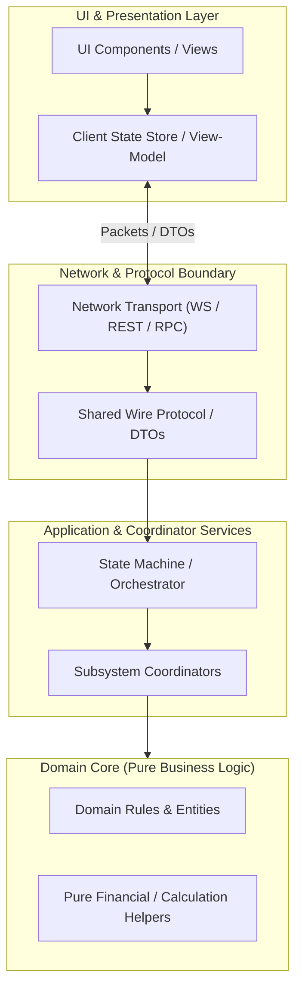

# [PROJECT_NAME] COMPREHENSIVE FEATURE MAP (SSOT)

> **Document Tier:** Single Source of Truth (SSOT) - Architecture Matrix & Authoritative Rules Engine.  
> **Purpose:** Eliminate Context Amnesia across incremental updates. Any engineer or AI Agent can immediately inspect authoritative domain rules, core source files, active contract tests, and architectural invariants.  
> **Maintenance Invariant (Knowledge Fold Invariant):** Any ticket modifying domain rules, state machines, network protocols, or UI affordances MUST update this matrix before Station 3 sign-off. This document is a lean rules & architecture matrix, NOT a ticket changelog. Size ceiling: <= 30 KB.

---

---

## 1. CORE SUBSYSTEMS MATRIX

| # | Subsystem | Authoritative Rules SSOT | Core Source Files | Living Contract Tests | Invariants & Gotchas |
| :--- | :--- | :--- | :--- | :--- | :--- |
| **01** | **[Subsystem Name]** | • Core business rules, mathematical formulas, and authoritative limits. • State transition boundaries and validation rules. | • `src/domain/subsystem_a.ts` • `src/domain/subsystem_a_types.ts` | • `tests/domain/subsystem_a.test.ts` | • Core negative constraints (FORBIDDEN behaviors). • Edge case invariants and failure recovery modes. |
| **02** | **[Subsystem Name]** | • Core business rules and authoritative constants. | • `src/domain/subsystem_b.ts` | • `tests/domain/subsystem_b.test.ts` | • System invariants and concurrency guards. |

*(Add one row per primary architectural subsystem. Keep summaries concise and authoritative. Do NOT paste ticket history or changelog narratives).*

---

## 2. KNOWLEDGE FOLD PROTOCOL

To ensure this document remains continuously authoritative over time:

1. **Upon Any Ticket Modifying the System:**
   - If domain rules or formulas change: Update the *Authoritative Rules SSOT* column.
   - If core source files are created or refactored: Update the *Core Source Files* column.
   - If key contract tests are added: Update the *Living Contract Tests* column.
   - If new domain hazards or architectural gotchas are discovered: Add to the *Invariants & Gotchas* column.
   - **Anti-Changelog Discipline**: Do NOT append narrative ticket logs (`TICKET-xxx: ...`). Keep descriptions focused purely on active rules and architecture.

2. **Mechanical Gate:**
   - Evidence audit scripts verify that this file is maintained and stays strictly <= 30 KB.
   - Violation of the Knowledge Fold Invariant blocks Station 3 sign-off.

---

## 3. DEEP-DIVE GOTCHAS SSOT DIRECTORY

For technical details and historical design traps across each subsystem, consult the primary pillar references:
- [Architecture & Deep Module Design](file:///path/to/docs/gotchas/architecture.md)
- [State Machine & Concurrency](file:///path/to/docs/gotchas/state_machine.md)
- [Testing Traps & Anti-Flakiness](file:///path/to/docs/gotchas/testing_traps.md)
