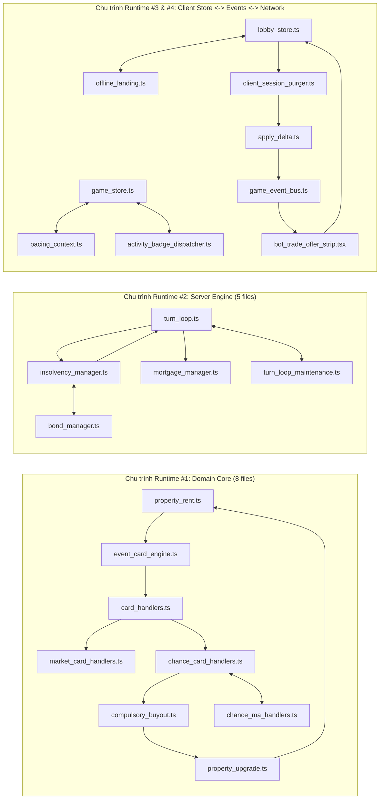
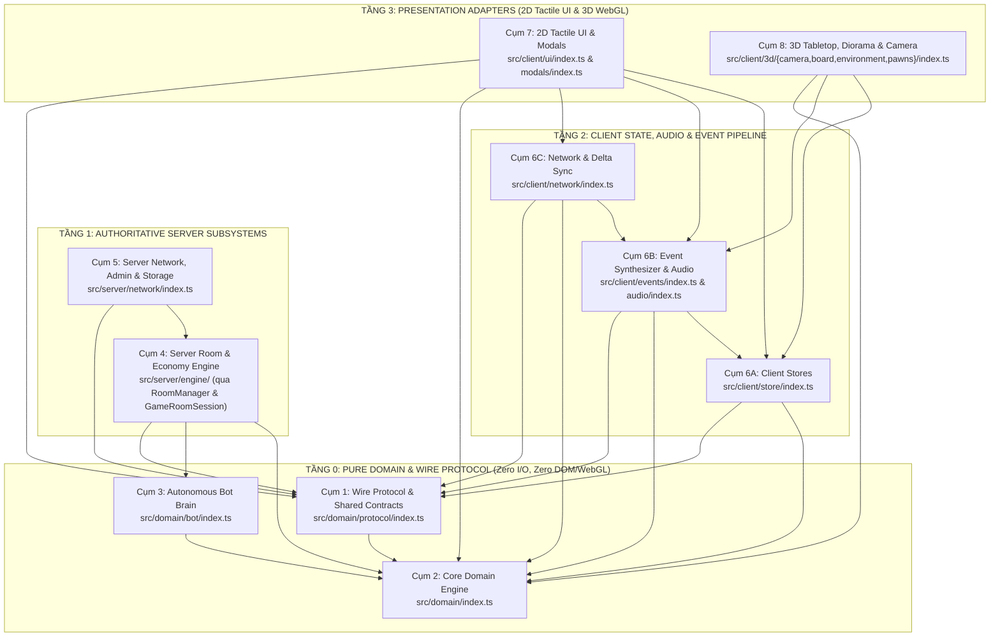

# BÁO CÁO RÀ SOÁT TOÀN CẢNH & ĐỀ XUẤT KIẾN TRÚC TỐI ƯU CHO AI (AI-NATIVE ARCHITECTURAL BLUEPRINT)

> **Phạm vi kiểm toán:** Toàn bộ `src/**` (`397 files`, `70,729 LOC`, `2,226 exported symbols`)  
> **Phương pháp đo lường:** Quét tĩnh 100% đĩa vật lý bằng TypeScript Compiler AST (`ts.createSourceFile`) kết hợp thuật toán Tarjan's Strongly Connected Components (SCC)  
> **Khung lý thuyết áp dụng:** [`codebase-design`](file:///c:/Users/HP/Documents/GitHub/vtcoon/.agents/skills/codebase-design/SKILL.md) (*Deep Modules, Seam Discipline, The Deletion Test, Interface Leverage*), [`DEEPENING.md`](file:///c:/Users/HP/Documents/GitHub/vtcoon/.agents/skills/codebase-design/DEEPENING.md), [`deep_modules.md`](file:///c:/Users/HP/Documents/GitHub/vtcoon/docs/domain/gotchas/deep_modules.md) và [`mastering-typescript`](file:///c:/Users/HP/Documents/GitHub/vtcoon/.agents/skills/mastering-typescript/SKILL.md)  
> **Trạng thái thực thi:** `READ-ONLY AUDIT` (Bảo toàn 100% mã nguồn `src/**` và `tests/**`)

---

## 1. CHẨN ĐOÁN HIỆN TRẠNG ĐĨA VẬT LÝ (`src/**`)

### 1.1. Thống kê Bề mặt Giao diện (Interface Surface) theo Phân tầng

Kết quả quét AST trên toàn bộ **397 files (`70,729 LOC`)** cho thấy kiến trúc hiện tại đang ở trạng thái **"Wide-Open Flat Surface"**: **31/32 thư mục không có file mặt tiền `index.ts` (Public Facade)**, dẫn đến **2,226 symbols** bị phơi bày trực tiếp ra toàn cục.

| Phân tầng (Layer) | Số lượng File | Tỷ trọng File | Tổng LOC | Tỷ trọng LOC | Tổng số Exports | Trung bình Exports / File | Số thư mục có `index.ts` Facade |
| :--- | :---: | :---: | :---: | :---: | :---: | :---: | :---: |
| **`src/client/**`** | 289 | 72.8% | 53,333 | 75.4% | 1,593 | 5.5 | **0 / 23** |
| **`src/server/**`** | 64 | 16.1% | 11,593 | 16.4% | 320 | 5.0 | **1 / 6** ([src/server/index.ts](file:///c:/Users/HP/Documents/GitHub/vtcoon/src/server/index.ts)) |
| **`src/domain/**`** | 44 | 11.1% | 5,803 | 8.2% | 313 | 7.1 | **0 / 3** |
| **TỔNG CỘNG** | **397 files** | **100%** | **70,729 LOC** | **100%** | **2,226 exports** | **5.6 exports/file** | **1 / 32 thư mục (3.1%)** |

#### Độ rò rỉ bề mặt tại các thư mục lớn nhất (Cluster Surface Leakage)

| Thư mục | Số File | Tổng LOC | Tổng Exports | Có `index.ts`? | Số File bị import từ bên ngoài | Số File bên ngoài gọi vào | Đánh giá theo `codebase-design` |
| :--- | :---: | :---: | :---: | :---: | :---: | :---: | :--- |
| `src/client/3d` | 97 | 17,475 | 678 | Không | **26 / 97** (26.8%) | 21 | **Quá phẳng**: 97 files về camera, bài, hiệu ứng, bàn cờ, sa bàn nằm chung 1 cấp thư mục. |
| `src/client/ui/modals` | 40 | 9,507 | 195 | Không | **13 / 40** (32.5%) | 13 | 15 loại modal khác nhau cùng các helper tài chính nằm phẳng trong 1 thư mục. |
| `src/server` | 31 | 5,773 | 180 | Có (`index.ts`) | **5 / 31** (16.1%) | **58** | 39/58 lượt gọi từ bên ngoài là do **Client import ngược vào `session_manager.ts` và `intent_dispatcher.ts`**. |
| `src/domain` | 28 | 3,059 | 207 | Không | **23 / 28** (82.1%) | **145** | **Rò rỉ 82.1% số file**: Client và Server chọc trực tiếp vào 23/28 files nội bộ của Domain. |
| `src/client/ui` | 27 | 4,568 | 127 | Không | **7 / 27** (25.9%) | 48 | [ui_helpers.ts](file:///c:/Users/HP/Documents/GitHub/vtcoon/src/client/ui/ui_helpers.ts) bị biến thành túi chứa đa năng cho 52 callers. |
| `src/server/network` | 25 | 4,178 | 119 | Không | **5 / 25** (20.0%) | 19 | Rò rỉ kiểu dữ liệu `WsClientMessage` và `AdminRoomDetail` sang Client. |
| `src/client/3d/diorama` | 22 | 4,738 | 107 | Không | **16 / 22** (72.7%) | 3 | [miniature_city_diorama.tsx](file:///c:/Users/HP/Documents/GitHub/vtcoon/src/client/3d/miniature_city_diorama.tsx) phải import thủ công từng file một (16 files). |
| `src/client/network` | 20 | 3,871 | 137 | Không | **6 / 20** (30.0%) | 5 | Ràng buộc vòng tròn hai chiều với `src/client/store` và `src/client/events`. |
| `src/domain/bot` | 15 | 2,633 | 106 | Không | **3 / 15** (20.0%) | 14 | Độ kết dính nội bộ cao (43 cạnh nội bộ), rất lý tưởng để đóng gói thành 1 Deep Module duy nhất. |
| `src/client/store` | 11 | 1,727 | 63 | Không | **9 / 11** (81.8%) | **114** | 9/11 files bị import trực tiếp từ 114 nơi trong Client. |
| `src/client/events` | 11 | 1,667 | 68 | Không | **6 / 11** (54.5%) | 13 | Các helper tổng hợp sự kiện (`*_helpers.ts`) bị lộ ra ngoài và gọi vòng tròn lẫn nhau. |

---

### 1.2. Top 10 "Điểm Nóng Phụ Thuộc" (God Files / Coupling Hubs)

#### Bảng 1.2A: Top 10 Files có Fan-In cao nhất (Nhiều nơi import nhất)

| Hạng | File | LOC | Tổng Fan-In | Runtime / Type Fan-In | Fan-Out | Số Exports | Phân bổ Callers (Client / Server / Domain) | Chẩn đoán Kiến trúc |
| :---: | :--- | :---: | :---: | :---: | :---: | :---: | :---: | :--- |
| **1** | [room.ts](file:///c:/Users/HP/Documents/GitHub/vtcoon/src/domain/room.ts) | 347 | **91** | 55 / 36 | 7 | **34** | C:30 / S:33 / D:28 | **God Hub sát ngưỡng Buffer Zone (347/400 LOC)**: Chứa đồng thời hằng số bàn cờ, công thức lương GO (`calculateGoSalary`), enum `TurnPhase`, interface `Player`/`Room`, 6 sự kiện `ServerDomainEvent` và các hàm khởi tạo phòng. |
| **2** | [game_store.ts](file:///c:/Users/HP/Documents/GitHub/vtcoon/src/client/store/game_store.ts) | 198 | **83** | 63 / 20 | 5 | 6 | C:83 / S:0 / D:0 | **Global State Hub + Cycle Anchor**: Re-export toàn bộ `game_store_types.js` và import ngược hàm dọn timer từ `events/pacing_context.ts` và `network/activity_badge_dispatcher.ts`, tạo chu trình runtime 16 files. |
| **3** | [board_config.ts](file:///c:/Users/HP/Documents/GitHub/vtcoon/src/domain/board_config.ts) | 86 | **66** | 65 / 1 | 0 | 4 | C:38 / S:4 / D:24 | **Pure Static Schema**: Leaf module chuẩn (`Fan-Out = 0`), nhưng 38 file UI/3D phải tự import lẻ tẻ thay vì qua mặt tiền `domain`. |
| **4** | [ui_helpers.ts](file:///c:/Users/HP/Documents/GitHub/vtcoon/src/client/ui/ui_helpers.ts) | 289 | **52** | 52 / 0 | 5 | **23** | C:52 / S:0 / D:0 | **Catch-All Utility Bag**: Trộn lẫn format tiền tệ, đồng hồ đếm ngược, tính Net Worth (bị trùng với Server), trạng thái nút bấm Action Dock và cả hàm tính độ phân giải bóng đổ 3D (`resolveShadowMapSize`). |
| **5** | [property_data.ts](file:///c:/Users/HP/Documents/GitHub/vtcoon/src/domain/property_data.ts) | 97 | **52** | 48 / 4 | 1 | 13 | C:28 / S:4 / D:20 | **Static Property Registry**: 28 file Client truy cập trực tiếp `PROPERTY_DEEDS` để tự tính giá/thuế trên tầng giao diện. |
| **6** | [session_manager.ts](file:///c:/Users/HP/Documents/GitHub/vtcoon/src/server/session_manager.ts) | 63 | **41** | 6 / 35 | 1 | 6 | **C:29** / S:12 / D:0 | **Điểm rò rỉ ranh giới Client $\to$ Server lớn nhất**: Do dòng `export * from './delta_mapper.js'` ở dòng 2, **29 file Client** import xuyên qua `src/server/session_manager.ts` chỉ để lấy kiểu `DeltaPayload`. |
| **7** | [event_card_types.ts](file:///c:/Users/HP/Documents/GitHub/vtcoon/src/domain/event_card_types.ts) | 57 | **27** | 26 / 1 | 1 | 11 | C:15 / S:7 / D:5 | **Shared Enum/Config**: Chứa `MarketCardId`, `ChanceCardId`, danh sách nhóm ô đất và bảng tỷ lệ `HOSE_OUTCOMES`. |
| **8** | [room_manager.ts](file:///c:/Users/HP/Documents/GitHub/vtcoon/src/server/room_manager.ts) | 351 | **25** | 1 / 24 | **23** | 7 | C:0 / S:25 / D:0 | **Shallow Coordinator Hub chạm ngưỡng Buffer Zone (351/400 LOC)**: Import 23 files khác nhau, chứa hàng loạt phương thức 1–3 dòng chuyển tiếp sang các file `do*` và `coord*`. |
| **9** | [safe_frame.ts](file:///c:/Users/HP/Documents/GitHub/vtcoon/src/client/3d/safe_frame.ts) | 14 | **22** | 22 / 0 | 0 | 1 | C:22 / S:0 / D:0 | **Deep Micro-Seam chuẩn**: Bọc vòng lặp `useFrame` của R3F bằng cơ chế bắt lỗi an toàn (Fault-Domain Bulkheading). |
| **10** | [audio_engine.ts](file:///c:/Users/HP/Documents/GitHub/vtcoon/src/client/audio/audio_engine.ts) | 350 | **20** | 20 / 0 | 3 | 1 | C:20 / S:0 / D:0 | **Chạm ngưỡng Buffer Zone (350 LOC)**: 20 file Client gọi trực tiếp singleton `audioEngine`. |

#### Bảng 1.2B: Top 10 "Hố Đen Ngữ Cảnh" theo Fan-Out (Files làm phình Context Window của AI nhất)

Khi AI Agent sửa đổi một file điều phối (Orchestrator), AI phải nạp file đó cùng các file mà nó import trực tiếp (1-Hop Direct Context LOC):

| Hạng | File Orchestrator | LOC bản thân | Fan-Out (Số file import) | 1-Hop Direct Context LOC | Nguyên nhân gây phình Context |
| :---: | :--- | :---: | :---: | :---: | :--- |
| **1** | [room_manager.ts](file:///c:/Users/HP/Documents/GitHub/vtcoon/src/server/room_manager.ts) | 351 | **23** | **4,467 LOC** | Kết nối trực tiếp 17 files trong `src/server/` và 6 files trong `src/domain/`. |
| **2** | [board_layout.tsx](file:///c:/Users/HP/Documents/GitHub/vtcoon/src/client/3d/board_layout.tsx) | 231 | **23** | **4,188 LOC** | Lắp ghép trực tiếp 17 files 3D con + 3 stores + 3 domain files. |
| **3** | [game_canvas.tsx](file:///c:/Users/HP/Documents/GitHub/vtcoon/src/client/game_canvas.tsx) | 244 | **22** | **4,461 LOC** | Import trực tiếp 18 files 3D rời rạc (camera, ánh sáng, hậu kỳ, quân cờ, hiệu ứng). |
| **4** | [wss_server.ts](file:///c:/Users/HP/Documents/GitHub/vtcoon/src/server/network/wss_server.ts) | 346 | **22** | **4,286 LOC** | Nối trực tiếp 22 modules mạng, bảo mật, admin, điều phối lượt và quản lý phòng. |
| **5** | [modal_host.tsx](file:///c:/Users/HP/Documents/GitHub/vtcoon/src/client/ui/modals/modal_host.tsx) | 297 | **20** | **4,894 LOC** | Import trực tiếp 14 modal components + audio + stores + `src/server/intent_dispatcher.ts`. |
| **6** | [main.tsx](file:///c:/Users/HP/Documents/GitHub/vtcoon/src/client/main.tsx) | 285 | **20** | **3,730 LOC** | Điểm khởi chạy phải tự import 6 stores riêng lẻ cùng 14 modules UI/Network/3D. |
| **7** | [hud_container.tsx](file:///c:/Users/HP/Documents/GitHub/vtcoon/src/client/ui/hud_container.tsx) | 138 | **18** | **3,833 LOC** | Lắp ghép trực tiếp 15 thành phần HUD con + stores + `src/server/intent_dispatcher.ts`. |
| **8** | [miniature_city_diorama.tsx](file:///c:/Users/HP/Documents/GitHub/vtcoon/src/client/3d/miniature_city_diorama.tsx) | 369 | **17** | **4,009 LOC** | Import thủ công 16/22 files trong `src/client/3d/diorama/` + `device_detect.ts`. |
| **9** | [title_deed_modal.tsx](file:///c:/Users/HP/Documents/GitHub/vtcoon/src/client/ui/modals/title_deed_modal.tsx) | 393 | **16** | **3,280 LOC** | Chạm sát mốc 400 LOC, import 5 domain files + 6 modal sub-components + 5 helpers. |
| **10** | [activity_tracker.ts](file:///c:/Users/HP/Documents/GitHub/vtcoon/src/client/network/activity_tracker.ts) | 295 | **15** | **3,121 LOC** | Kết nối trực tiếp 8 trackers con + stores + domain + `src/server/session_manager.ts`. |

---

### 1.3. Giải phẫu 16 Chu trình Phụ thuộc Vòng tròn (Circular Dependency Loops)

Quét đồ thị phụ thuộc bằng thuật toán Tarjan's SCC phát hiện **16 cụm chu trình khép kín**, trong đó có **12 chu trình Runtime Value** (import giá trị/hàm thực thi, tiềm ẩn nguy cơ lỗi khởi tạo ESM `ReferenceError: Cannot access before initialization`) và **4 chu trình Type-Only**:

| Mã SCC | Phân hệ | Loại Chu trình | Danh sách File trong Vòng lặp | Điểm cắt Chu trình (Cycle-Breaking Seam) |
| :---: | :--- | :---: | :--- | :--- |
| **SCC-01** | `src/domain/` | **Runtime (8 files)** *(Type: 13 files)* | [property_rent.ts](file:///c:/Users/HP/Documents/GitHub/vtcoon/src/domain/property_rent.ts) $\to$ [event_card_engine.ts](file:///c:/Users/HP/Documents/GitHub/vtcoon/src/domain/event_card_engine.ts) $\to$ [card_handlers.ts](file:///c:/Users/HP/Documents/GitHub/vtcoon/src/domain/card_handlers.ts) $\to$ [chance_card_handlers.ts](file:///c:/Users/HP/Documents/GitHub/vtcoon/src/domain/chance_card_handlers.ts) $\to$ [compulsory_buyout.ts](file:///c:/Users/HP/Documents/GitHub/vtcoon/src/domain/compulsory_buyout.ts) $\to$ [property_upgrade.ts](file:///c:/Users/HP/Documents/GitHub/vtcoon/src/domain/property_upgrade.ts) $\to$ `property_rent.ts` (kèm [market_card_handlers.ts](file:///c:/Users/HP/Documents/GitHub/vtcoon/src/domain/market_card_handlers.ts), [chance_ma_handlers.ts](file:///c:/Users/HP/Documents/GitHub/vtcoon/src/domain/chance_ma_handlers.ts), [room.ts](file:///c:/Users/HP/Documents/GitHub/vtcoon/src/domain/room.ts)) | Đổi import `ChanceCardId`, `MarketCardId` trong `room.ts`, `property_rent.ts`, `property_upgrade.ts` từ `event_card_engine.ts` sang leaf file [event_card_types.ts](file:///c:/Users/HP/Documents/GitHub/vtcoon/src/domain/event_card_types.ts). |
| **SCC-02** | `src/domain/bot/` | **Runtime (2 files)** | [valuation_engine.ts](file:///c:/Users/HP/Documents/GitHub/vtcoon/src/domain/bot/valuation_engine.ts) $\leftrightarrow$ [bot_softmax.ts](file:///c:/Users/HP/Documents/GitHub/vtcoon/src/domain/bot/bot_softmax.ts) | Chuyển hằng số nhiệt độ/trọng số dùng chung về [bot_types.ts](file:///c:/Users/HP/Documents/GitHub/vtcoon/src/domain/bot/bot_types.ts). |
| **SCC-03** | `src/domain/bot/` | Type-Only (2 files) | [bot_trade.ts](file:///c:/Users/HP/Documents/GitHub/vtcoon/src/domain/bot/bot_trade.ts) $\leftrightarrow$ [bot_hybrid_trade.ts](file:///c:/Users/HP/Documents/GitHub/vtcoon/src/domain/bot/bot_hybrid_trade.ts) | Chuyển kiểu dữ liệu thương lượng về [bot_types.ts](file:///c:/Users/HP/Documents/GitHub/vtcoon/src/domain/bot/bot_types.ts). |
| **SCC-04** | `src/server/` | **Runtime (5 files)** *(Type: 21 files)* | [turn_loop.ts](file:///c:/Users/HP/Documents/GitHub/vtcoon/src/server/turn_loop.ts) $\leftrightarrow$ [insolvency_manager.ts](file:///c:/Users/HP/Documents/GitHub/vtcoon/src/server/insolvency_manager.ts) $\leftrightarrow$ [bond_manager.ts](file:///c:/Users/HP/Documents/GitHub/vtcoon/src/server/bond_manager.ts) $\leftrightarrow$ [turn_loop_maintenance.ts](file:///c:/Users/HP/Documents/GitHub/vtcoon/src/server/turn_loop_maintenance.ts) $\leftrightarrow$ [mortgage_manager.ts](file:///c:/Users/HP/Documents/GitHub/vtcoon/src/server/mortgage_manager.ts) | Tách hàm chuyển pha/vòng (`advanceRoundBoundary`, `checkInsolvency`) thành tầng cơ sở để `turn_loop.ts` chỉ điều phối từ trên xuống. |
| **SCC-05** | `src/server/network/` | **Runtime (2 files)** | [turn_orchestrator.ts](file:///c:/Users/HP/Documents/GitHub/vtcoon/src/server/network/turn_orchestrator.ts) $\leftrightarrow$ [turn_bot_timer_scheduler.ts](file:///c:/Users/HP/Documents/GitHub/vtcoon/src/server/network/turn_bot_timer_scheduler.ts) | Truyền callback `onBotStep` vào scheduler thay vì import ngược `turn_orchestrator.ts`. |
| **SCC-06** | `src/server/network/` | Type-Only (2 files) | [admin_manager.ts](file:///c:/Users/HP/Documents/GitHub/vtcoon/src/server/network/admin_manager.ts) $\leftrightarrow$ [admin_message_handler.ts](file:///c:/Users/HP/Documents/GitHub/vtcoon/src/server/network/admin_message_handler.ts) | Chuyển interface context của Admin về [admin_types.ts](file:///c:/Users/HP/Documents/GitHub/vtcoon/src/server/network/admin_types.ts). |
| **SCC-07** | `src/server/logging/` | Type-Only (2 files) | [persistent_room_logger.ts](file:///c:/Users/HP/Documents/GitHub/vtcoon/src/server/logging/persistent_room_logger.ts) $\leftrightarrow$ [room_logger_cloud_sync.ts](file:///c:/Users/HP/Documents/GitHub/vtcoon/src/server/logging/room_logger_cloud_sync.ts) | Chuyển kiểu log payload về [room_logger_formatters.ts](file:///c:/Users/HP/Documents/GitHub/vtcoon/src/server/logging/room_logger_formatters.ts). |
| **SCC-08** | `src/client/store/` $\leftrightarrow$ `events/` $\leftrightarrow$ `network/` | **Runtime (3 files)** *(Type: 16 files)* | [game_store.ts](file:///c:/Users/HP/Documents/GitHub/vtcoon/src/client/store/game_store.ts) $\leftrightarrow$ [pacing_context.ts](file:///c:/Users/HP/Documents/GitHub/vtcoon/src/client/events/pacing_context.ts) $\leftrightarrow$ [activity_badge_dispatcher.ts](file:///c:/Users/HP/Documents/GitHub/vtcoon/src/client/network/activity_badge_dispatcher.ts) | Gỡ bỏ import `clearPendingPacingTimers` và `clearPendingBadgeTimers` khỏi [game_store.ts](file:///c:/Users/HP/Documents/GitHub/vtcoon/src/client/store/game_store.ts#L13-L14); thực hiện dọn timer tại [client_session_purger.ts](file:///c:/Users/HP/Documents/GitHub/vtcoon/src/client/network/client_session_purger.ts) hoặc qua listener đăng ký một chiều. |
| **SCC-09** | `src/client/events/` | **Runtime (4 files)** | [game_event_financial_helpers.ts](file:///c:/Users/HP/Documents/GitHub/vtcoon/src/client/events/game_event_financial_helpers.ts) $\leftrightarrow$ [game_event_bond_helpers.ts](file:///c:/Users/HP/Documents/GitHub/vtcoon/src/client/events/game_event_bond_helpers.ts) $\leftrightarrow$ [game_event_buyout_helpers.ts](file:///c:/Users/HP/Documents/GitHub/vtcoon/src/client/events/game_event_buyout_helpers.ts) $\leftrightarrow$ [game_event_hose_helpers.ts](file:///c:/Users/HP/Documents/GitHub/vtcoon/src/client/events/game_event_hose_helpers.ts) | Tách các hàm tiện ích nguyên thủy dùng chung xuống leaf helper, chấm dứt việc `bond/buyout/hose` gọi ngược lại `game_event_financial_helpers.ts`. |
| **SCC-10** | `src/client/store/` $\leftrightarrow$ `network/` $\leftrightarrow$ `ui/` | **Runtime (12 files)** *(Type: 15 files)* | [lobby_store.ts](file:///c:/Users/HP/Documents/GitHub/vtcoon/src/client/store/lobby_store.ts) $\leftrightarrow$ [offline_landing.ts](file:///c:/Users/HP/Documents/GitHub/vtcoon/src/client/offline_landing.ts) $\leftrightarrow$ [client_session_purger.ts](file:///c:/Users/HP/Documents/GitHub/vtcoon/src/client/network/client_session_purger.ts) $\leftrightarrow$ [apply_delta.ts](file:///c:/Users/HP/Documents/GitHub/vtcoon/src/client/network/apply_delta.ts) $\leftrightarrow$ [game_event_bus.ts](file:///c:/Users/HP/Documents/GitHub/vtcoon/src/client/events/game_event_bus.ts) $\leftrightarrow$ [bot_trade_offer_strip.tsx](file:///c:/Users/HP/Documents/GitHub/vtcoon/src/client/ui/modals/bot_trade_offer_strip.tsx) | Store (`lobby_store.ts`) phải là leaf state thuần túy, không được import ngược `offline_landing.ts` hay `client_session_purger.ts`. |
| **SCC-11** | `src/client/3d/` | **Runtime (2 files)** *(Type: 3 files)* | [camera_state_machine.ts](file:///c:/Users/HP/Documents/GitHub/vtcoon/src/client/3d/camera_state_machine.ts) $\leftrightarrow$ [cinematic_spline_flyby.ts](file:///c:/Users/HP/Documents/GitHub/vtcoon/src/client/3d/cinematic_spline_flyby.ts) ($\leftrightarrow$ [cinematic_chase_camera.ts](file:///c:/Users/HP/Documents/GitHub/vtcoon/src/client/3d/cinematic_chase_camera.ts)) | Đưa các hằng số tọa độ camera và kiểu `Vec3Tuple` về 1 leaf file `camera_types.ts`. |
| **SCC-12** | `src/client/3d/` | **Runtime (3 files)** | [board_layout.tsx](file:///c:/Users/HP/Documents/GitHub/vtcoon/src/client/3d/board_layout.tsx) $\leftrightarrow$ [batched_board_tiles.tsx](file:///c:/Users/HP/Documents/GitHub/vtcoon/src/client/3d/batched_board_tiles.tsx) $\leftrightarrow$ [instanced_toy_buildings.tsx](file:///c:/Users/HP/Documents/GitHub/vtcoon/src/client/3d/instanced_toy_buildings.tsx) | Chuyển các hằng số kích thước bàn cờ đang export từ `board_layout.tsx` về [board_coords.ts](file:///c:/Users/HP/Documents/GitHub/vtcoon/src/client/3d/board_coords.ts). |
| **SCC-13** | `src/client/3d/` | **Runtime (2 files)** | [procedural_building.tsx](file:///c:/Users/HP/Documents/GitHub/vtcoon/src/client/3d/procedural_building.tsx) $\leftrightarrow$ [construction_slam_vfx.tsx](file:///c:/Users/HP/Documents/GitHub/vtcoon/src/client/3d/construction_slam_vfx.tsx) | Tách hằng số thời gian/chiều cao hiệu ứng xây dựng ra khỏi `procedural_building.tsx`. |
| **SCC-14** | `src/client/3d/` | **Runtime (2 files)** | [penthouse_enclosure.tsx](file:///c:/Users/HP/Documents/GitHub/vtcoon/src/client/3d/penthouse_enclosure.tsx) $\leftrightarrow$ [penthouse_lobby_scene.tsx](file:///c:/Users/HP/Documents/GitHub/vtcoon/src/client/3d/penthouse_lobby_scene.tsx) | Tách hằng số bố cục Penthouse ra khỏi component con. |
| **SCC-15** | `src/client/3d/` | Type-Only (2–3 files) | [building_typology.ts](file:///c:/Users/HP/Documents/GitHub/vtcoon/src/client/3d/building_typology.ts) $\leftrightarrow$ [landmark_registry.ts](file:///c:/Users/HP/Documents/GitHub/vtcoon/src/client/3d/landmark_registry.ts); [luxury_pawn_models.tsx](file:///c:/Users/HP/Documents/GitHub/vtcoon/src/client/3d/luxury_pawn_models.tsx) $\leftrightarrow$ [luxury_pawn_fallbacks.tsx](file:///c:/Users/HP/Documents/GitHub/vtcoon/src/client/3d/luxury_pawn_fallbacks.tsx) | Chuyển kiểu props dùng chung về file types/configs gốc. |
| **SCC-16** | `src/client/ui/` | **Runtime (2 files)** | [event_card_visuals.ts](file:///c:/Users/HP/Documents/GitHub/vtcoon/src/client/ui/modals/event_card_visuals.ts) $\leftrightarrow$ [market_event_ticker.tsx](file:///c:/Users/HP/Documents/GitHub/vtcoon/src/client/ui/market_event_ticker.tsx) | Đảo chiều: pure helper `event_card_visuals.ts` tuyệt đối không được import từ component `.tsx`. |

---

### 1.4. Các Vi phạm Ranh giới Module & Seam Discipline

#### A. 52 Lệnh Import Xuyên Ranh giới từ `src/client/**` sang `src/server/**`

| File Đích bên trong `src/server/**` | Số lượng File Client gọi vào | Các Symbols bị Client import | Hậu quả đối với AI & Kiến trúc |
| :--- | :---: | :--- | :--- |
| [src/server/session_manager.ts](file:///c:/Users/HP/Documents/GitHub/vtcoon/src/server/session_manager.ts) | **30 files** | `DeltaPayload`, `CellDelta`, `PlayerDelta`, `PendingTradeOfferDelta`, `DiplomaticEventDelta`, `TradeResultInfo` | Khi AI làm việc trên `src/client/events/**` hoặc `src/client/network/**`, AI buộc phải đọc sang `src/server/session_manager.ts` và `delta_mapper.ts`. Nếu thiếu từ khóa `type`, trình đóng gói Client sẽ kéo theo code của Server. |
| [src/server/intent_dispatcher.ts](file:///c:/Users/HP/Documents/GitHub/vtcoon/src/server/intent_dispatcher.ts) | **10 files** | `PlayerIntent` | 7 components UI ([hud_container.tsx](file:///c:/Users/HP/Documents/GitHub/vtcoon/src/client/ui/hud_container.tsx), [modal_host.tsx](file:///c:/Users/HP/Documents/GitHub/vtcoon/src/client/ui/modals/modal_host.tsx), 4 files `modals/hosts/*.tsx`, [bot_trade_offer_strip.tsx](file:///c:/Users/HP/Documents/GitHub/vtcoon/src/client/ui/modals/bot_trade_offer_strip.tsx)) phụ thuộc trực tiếp vào bộ điều phối của Server. |
| [src/server/network/network_types.ts](file:///c:/Users/HP/Documents/GitHub/vtcoon/src/server/network/network_types.ts) | **7 files** | `WsClientMessage`, `WsServerMessage`, `ReasonCode` | Giao thức mạng dùng chung giữa 2 đầu nhưng lại đặt sâu trong thư mục `src/server/network/`. |
| [src/server/network/admin_manager.ts](file:///c:/Users/HP/Documents/GitHub/vtcoon/src/server/network/admin_manager.ts) & [admin_types.ts](file:///c:/Users/HP/Documents/GitHub/vtcoon/src/server/network/admin_types.ts) | **5 files** | `AdminRoomDetail`, `AdminRoomLogEntry`, `AdminArchivedRoomSummary`, `AdminPlayerSummary`, `RoomHealthStatus`, `ServerVitals` | Các trang Admin trên Client ([admin_archive_view.tsx](file:///c:/Users/HP/Documents/GitHub/vtcoon/src/client/ui/admin/admin_archive_view.tsx), [admin_repro.ts](file:///c:/Users/HP/Documents/GitHub/vtcoon/src/client/ui/admin/admin_repro.ts)) trỏ thẳng vào class quản trị của Server. |

#### B. Nhân bản Công thức Nghiệp vụ giữa Client và Server (Vi phạm Poka-Yoke & Locality)
* **Bằng chứng trên đĩa vật lý**:
  * Tại Client: [src/client/ui/ui_helpers.ts](file:///c:/Users/HP/Documents/GitHub/vtcoon/src/client/ui/ui_helpers.ts#L30-L79) định nghĩa `const LEVEL_MULTIPLIER: Record<number, number> = { 0: 1, 1: 1.5, 2: 2.5, 3: 4 }` và hàm `calculatePlayerNetWorth(...)` (27 LOC).
  * Tại Server: [src/server/room_manager_queries.ts](file:///c:/Users/HP/Documents/GitHub/vtcoon/src/server/room_manager_queries.ts#L9-L49) (và re-export qua [insolvency_manager.ts](file:///c:/Users/HP/Documents/GitHub/vtcoon/src/server/insolvency_manager.ts#L15-L16)) định nghĩa lại y hệt `export const LEVEL_MULTIPLIER: Record<number, number> = { 0: 1, 1: 1.5, 2: 2.5, 3: 4 }` và hàm `calculateNetWorth(...)` (27 LOC).
* **Hệ lụy**: Nếu thay đổi hệ số nhân cấp công trình hoặc cách khấu trừ khoản vay thế chấp/trái phiếu ở một nơi mà quên nơi kia, bảng xếp hạng trên HUD của người chơi sẽ lệch với kết quả xét thắng thua/phá sản của Server.

#### C. Rò rỉ Sâu vào Ruột `src/domain/**` (189 Lệnh Import từ Client vào 20/28 Files Domain) & 345 Deep Relative Imports
* Do `src/domain/` không có `index.ts` Facade, các file UI và Event của Client đang phải nhớ chính xác tên của 20 file con trong `src/domain/` để lấy hằng số (ví dụ: [game_rules_modal.tsx](file:///c:/Users/HP/Documents/GitHub/vtcoon/src/client/ui/modals/game_rules_modal.tsx) phải mở cùng lúc `treasury_stimulus.ts`, `mortgage_constants.ts`, `property_upgrade.ts`; [player_card.tsx](file:///c:/Users/HP/Documents/GitHub/vtcoon/src/client/ui/player_card.tsx) import `ChanceCardId` từ `event_card_engine.ts` thay vì `event_card_types.ts`).
* Toàn bộ `src/**` hiện có **345 vị trí dùng đường dẫn tương đối sâu ($\ge 2$ cấp `../../`, `../../../`, `../../../../`)**, khiến AI dễ đếm nhầm bậc thư mục khi tạo file mới hoặc di chuyển component.

#### D. Monkey-Patch Schema `Room` bằng Module Augmentation trong `src/server/insolvency_manager.ts`
* Tại [src/server/insolvency_manager.ts](file:///c:/Users/HP/Documents/GitHub/vtcoon/src/server/insolvency_manager.ts#L8-L13), Server đang dùng `declare module '../domain/room'` để tiêm ngầm 2 trường `pendingInsolvencyQueue?: string[]` và `preInsolvencyPhase?: TurnPhase` vào interface `Room`. Cách làm này khiến định nghĩa thực sự của `Room` bị phân mảnh giữa `src/domain/` và `src/server/`, vi phạm tính toàn vẹn của Domain Model.

#### E. Cảnh báo Chạm Trần "LOC Buffer Zone Guard" ($\ge 350$ LOC) tại 3 Điểm Nóng
* Theo luật **LOC Buffer Zone Guard** trong [GEMINI.md](file:///c:/Users/HP/Documents/GitHub/vtcoon/GEMINI.md) (*"When a target file reaches >= 350 LOC (Tier 1 ceiling 400), adding new logic directly into the file is FORBIDDEN. Plans touching files >= 350 LOC MUST declare a Refactor-First step"*), hiện có **4 files cốt lõi** đang chạm hoặc vượt ngưỡng 350 LOC:
  1. [src/server/insolvency_manager.ts](file:///c:/Users/HP/Documents/GitHub/vtcoon/src/server/insolvency_manager.ts): **355 LOC** *(Đã vượt ngưỡng khóa 350 LOC)*
  2. [src/server/room_manager.ts](file:///c:/Users/HP/Documents/GitHub/vtcoon/src/server/room_manager.ts): **351 LOC** *(Đã vượt ngưỡng khóa 350 LOC)*
  3. [src/server/network/admin_manager.ts](file:///c:/Users/HP/Documents/GitHub/vtcoon/src/server/network/admin_manager.ts): **351 LOC** *(Đã vượt ngưỡng khóa 350 LOC)*
  4. [src/client/audio/audio_engine.ts](file:///c:/Users/HP/Documents/GitHub/vtcoon/src/client/audio/audio_engine.ts): **350 LOC** & [src/domain/room.ts](file:///c:/Users/HP/Documents/GitHub/vtcoon/src/domain/room.ts): **347 LOC** *(Sát ngưỡng khóa)*

---

## 2. ĐỀ XUẤT GIẢI PHÁP KIẾN TRÚC "AI-NATIVE" (ARCHITECTURAL BLUEPRINT)

### 2.1. Bản đồ 8 Cụm Phân hệ Tự nhiên (Subsystem Clusters — High Cohesion)

Áp dụng nguyên lý **Deep Modules** (*nhiều năng lực xử lý ẩn sau một giao diện nhỏ gọn*) và **Strict Acyclic Dependency Graph (DAG)**, 397 files trong `src/**` được quy hoạch vào **8 Cụm Phân hệ Tự nhiên**:

---

### 2.2. Thiết kế Mặt tiền Public Facade (`index.ts`) cho từng Cụm

Bảng dưới đây xác định rõ **Public Interface** (những gì được phép xuất hiện trong `index.ts`) và **Internal Implementation** (những file được đóng kín bên trong cụm, không cho phép tầng khác gọi trực tiếp):

| Cụm Phân hệ | Mặt tiền Public Facade (`index.ts`) — Symbols Công khai | Thành phần Nội bộ Cần Ẩn Giấu (Internal Implementation) | Tỷ lệ Thu hẹp Bề mặt (Surface Reduction) |
| :--- | :--- | :--- | :---: |
| **C1. Wire Protocol** `src/domain/protocol/index.ts` | • **Delta Contracts**: `DeltaPayload`, `CellDelta`, `PlayerDelta`, `AuctionDelta`, `PendingTradeOfferDelta`, `DiplomaticEventDelta` • **Intent & WS**: `PlayerIntent`, `WsClientMessage`, `WsServerMessage`, `ReasonCode` • **Admin Contracts**: `AdminRoomSummary`, `AdminRoomDetail`, `AdminRoomLogEntry`, `AdminArchivedRoomSummary`, `ServerVitals` | • Ẩn hoàn toàn [session_manager.ts](file:///c:/Users/HP/Documents/GitHub/vtcoon/src/server/session_manager.ts), [delta_mapper.ts](file:///c:/Users/HP/Documents/GitHub/vtcoon/src/server/delta_mapper.ts), [intent_dispatcher.ts](file:///c:/Users/HP/Documents/GitHub/vtcoon/src/server/intent_dispatcher.ts), [admin_manager.ts](file:///c:/Users/HP/Documents/GitHub/vtcoon/src/server/network/admin_manager.ts) khỏi toàn bộ `src/client/**`. | **Xóa 52/52 (100%)** lệnh import từ Client sang Server |
| **C2. Core Domain** `src/domain/index.ts` | • **Core Entities & Enums**: `Room` (đã hợp nhất `pendingInsolvencyQueue`, `preInsolvencyPhase`), `Player`, `TurnPhase`, `ActionRejectReason`, `CellType`, `ColorGroup`, `MacroCycleType`, `MarketCardId`, `ChanceCardId`, `BondTrancheId`, `BondContract`, `TransitWheelOutcome` • **Static Registries**: `BOARD_CONFIG`, `PROPERTY_DEEDS`, `LEVEL_MULTIPLIER`, `TABLETOP_THEME`, `COLOR_GROUP_HEX`, `PLAYER_TOKEN_PALETTE`, `BOND_TRANCHES`, `TRANSIT_WHEEL_CONFIGS`, `VI_MESSAGES` • **Authoritative Calculators (SSOT)**: `calculateNetWorth` (hợp nhất Client/Server), `calculateRent`, `calculateUpgradeCost`, `calculateBailAmount`, `calculateGoSalary`, `checkPassedGo`, `evaluateMacroCycle` | • **Ẩn 18/28 files nội bộ**: [chance_card_handlers.ts](file:///c:/Users/HP/Documents/GitHub/vtcoon/src/domain/chance_card_handlers.ts), [chance_ma_handlers.ts](file:///c:/Users/HP/Documents/GitHub/vtcoon/src/domain/chance_ma_handlers.ts), [market_card_handlers.ts](file:///c:/Users/HP/Documents/GitHub/vtcoon/src/domain/market_card_handlers.ts), [card_handlers.ts](file:///c:/Users/HP/Documents/GitHub/vtcoon/src/domain/card_handlers.ts), [compulsory_buyout.ts](file:///c:/Users/HP/Documents/GitHub/vtcoon/src/domain/compulsory_buyout.ts), [mortgage_constants.ts](file:///c:/Users/HP/Documents/GitHub/vtcoon/src/domain/mortgage_constants.ts), [types.ts](file:///c:/Users/HP/Documents/GitHub/vtcoon/src/domain/types.ts). | **Từ 28 files (207 exports)** $\to$ **1 Facade (~28 exports)** |
| **C3. Bot Brain** `src/domain/bot/index.ts` | • **6 Public Symbols**: `BotPersonality`, `decideBotAction`, `decideBotAuctionAction`, `evaluateBotTradeOffer`, `decideBotProactiveTrade`, `recordTradeRejection` | • **Ẩn 13/15 files (`2,431 LOC`)**: [threat_forecaster.ts](file:///c:/Users/HP/Documents/GitHub/vtcoon/src/domain/bot/threat_forecaster.ts), [valuation_engine.ts](file:///c:/Users/HP/Documents/GitHub/vtcoon/src/domain/bot/valuation_engine.ts), [solvency_solver.ts](file:///c:/Users/HP/Documents/GitHub/vtcoon/src/domain/bot/solvency_solver.ts), [bot_softmax.ts](file:///c:/Users/HP/Documents/GitHub/vtcoon/src/domain/bot/bot_softmax.ts), [bot_posture.ts](file:///c:/Users/HP/Documents/GitHub/vtcoon/src/domain/bot/bot_posture.ts), [bot_redeem.ts](file:///c:/Users/HP/Documents/GitHub/vtcoon/src/domain/bot/bot_redeem.ts), [bot_audit.ts](file:///c:/Users/HP/Documents/GitHub/vtcoon/src/domain/bot/bot_audit.ts), [bot_auction.ts](file:///c:/Users/HP/Documents/GitHub/vtcoon/src/domain/bot/bot_auction.ts), [bot_trade.ts](file:///c:/Users/HP/Documents/GitHub/vtcoon/src/domain/bot/bot_trade.ts), [bot_hybrid_trade.ts](file:///c:/Users/HP/Documents/GitHub/vtcoon/src/domain/bot/bot_hybrid_trade.ts), [bot_action_evaluator.ts](file:///c:/Users/HP/Documents/GitHub/vtcoon/src/domain/bot/bot_action_evaluator.ts). | **Từ 15 files (106 exports)** $\to$ **1 Facade (6 exports — giảm 94.3%)** |
| **C4. Server Engine** `src/server/index.ts` | • **Core Entrypoints**: `startServer`, `RoomManager`, `GameRoomSession`, `SessionManager`, `RoomCleanupScheduler`, `dispatchPlayerIntent` | • **Ẩn 25/31 files (`4,768 LOC`)**: [turn_loop.ts](file:///c:/Users/HP/Documents/GitHub/vtcoon/src/server/turn_loop.ts), [turn_loop_maintenance.ts](file:///c:/Users/HP/Documents/GitHub/vtcoon/src/server/turn_loop_maintenance.ts), [insolvency_manager.ts](file:///c:/Users/HP/Documents/GitHub/vtcoon/src/server/insolvency_manager.ts), [bond_manager.ts](file:///c:/Users/HP/Documents/GitHub/vtcoon/src/server/bond_manager.ts), [mortgage_manager.ts](file:///c:/Users/HP/Documents/GitHub/vtcoon/src/server/mortgage_manager.ts), [auction_manager.ts](file:///c:/Users/HP/Documents/GitHub/vtcoon/src/server/auction_manager.ts), [audit_manager.ts](file:///c:/Users/HP/Documents/GitHub/vtcoon/src/server/audit_manager.ts), [special_cell_handler.ts](file:///c:/Users/HP/Documents/GitHub/vtcoon/src/server/special_cell_handler.ts), các file `room_*_coordinator.ts` và `session_proxy_facade.ts`. | **Từ 31 files (180 exports)** $\to$ **1 Facade (12 exports — giảm 93.3%)** |
| **C6. Client Pipeline & Audio** `src/client/{store,events,network,audio}/index.ts` | • `store/index.ts`: `useGameStore`, `useLobbyStore`, `useEnvironmentStore`, `useVfxStore` + State Types • `events/index.ts`: `gameEventBus`, `synthesizeAndPublishDeltaEvents`, `initEventSubscribers` • `network/index.ts`: `useAppSession`, `useAppTurnControls`, `applyDeltaToStore`, `purgeClientSession` • `audio/index.ts`: `audioEngine`, `soundEngine`, `SoundEffect`, `MusicTrack` | • **Ẩn 47/58 files (`8,616 LOC`)**: Toàn bộ `game_event_*_synthesizer.ts`, `game_event_*_helpers.ts`, `subscribers/*`, `apply_delta_*.ts`, `activity_*_tracker.ts`, `ws_message_handler.ts`, `audio_bgm_synth.ts`, `audio_sfx_synth.ts`. | **Từ 58 files (300 exports)** $\to$ **4 Facades (22 exports — giảm 92.7%)** |
| **C7. 2D UI & Modals** `src/client/ui/modals/index.ts` | • `modals/index.ts`: `ModalHost`, `BotTradeOfferStrip`, `MiniAuctionStrip` • `ui/index.ts`: `HudContainer`, `ErrorBoundary`, `Diagnostic3dOverlay`, `formatCurrency`, `formatTimeRemaining` | • **Ẩn 37/40 files trong `modals/` (`9,150 LOC`)** và **22/27 files trong `ui/`**: Toàn bộ 15 modal con, rent tables, art showcases, purchase decision cards. | **Từ 67 files (322 exports)** $\to$ **2 Facades (10 exports — giảm 96.9%)** |
| **C8. 3D Tabletop & Diorama** `src/client/3d/{camera,board,environment,pawns}/index.ts` | • `camera/index.ts`: `AdaptiveCinematicCamera`, `useGameCamera` • `board/index.ts`: `BoardLayout`, `getCellWorldCoords` • `environment/index.ts`: `MiniatureCityDiorama`, `CoastalIslandEnvironment`, `TimeOfDayLighting`, `PostProcessingPipeline` • `pawns/index.ts`: `PawnAnimator`, `DiceTray`, `EventCard3D`, `Coronation3DStage` | • **Ẩn 114/126 files (`21,450 LOC`)**: Toàn bộ 22 files `diorama/*`, `cinematic_spline_flyby.ts`, `camera_arbitration_engine.ts`, `batched_board_tiles.tsx`, `tile_texture_atlas.ts`, `luxury_pawn_fallbacks.tsx`, v.v. | **Từ 126 files (813 exports)** $\to$ **4 Facades (14 exports — giảm 98.2%)** |

---

### 2.3. Định lượng Mức độ Giải phóng Context cho AI (Context Window Savings)

Đo lường từ đồ thị AST thực tế cho thấy lượng file và dòng code (LOC) mà AI Agent phải nạp vào Context Window trước và sau khi áp dụng kiến trúc **Deep Module Facades**:

| Kịch bản Tác vụ của AI Agent | Hiện trạng: Số File & LOC phải đọc | Thiết kế Mới: Số File & LOC phải đọc | Số File Tiết kiệm | Số Dòng Code (LOC) Giải phóng |
| :--- | :---: | :---: | :---: | :---: |
| **1. Chỉnh sửa logic nhận `DeltaPayload` / gửi `PlayerIntent` ở Client** | **14 files** (`2,850 LOC`) | **1 file** (`src/domain/protocol/index.ts`) (`~180 LOC`) | **-13 files** *(-92.8%)* | **-2,670 LOC** *(Giải phóng 93.7%)* |
| **2. Chỉnh sửa bố cục 3D Scene tại [game_canvas.tsx](file:///c:/Users/HP/Documents/GitHub/vtcoon/src/client/game_canvas.tsx) & [board_layout.tsx](file:///c:/Users/HP/Documents/GitHub/vtcoon/src/client/3d/board_layout.tsx)** | **45 files** (`8,649 LOC`) | **6 files** (Canvas + 4 Facades 3D + Store) (`~920 LOC`) | **-39 files** *(-86.7%)* | **-7,729 LOC** *(Giải phóng 89.4%)* |
| **3. Bảo trì hệ thống Modal tại [modal_host.tsx](file:///c:/Users/HP/Documents/GitHub/vtcoon/src/client/ui/modals/modal_host.tsx) / [title_deed_modal.tsx](file:///c:/Users/HP/Documents/GitHub/vtcoon/src/client/ui/modals/title_deed_modal.tsx)** | **30 files** (`4,894 LOC`) | **5 files** (`modals/index.ts` + `domain/index.ts` + `protocol/index.ts`) (`~850 LOC`) | **-25 files** *(-83.3%)* | **-4,044 LOC** *(Giải phóng 82.6%)* |
| **4. Sửa đổi vòng lượt Server tại [room_manager.ts](file:///c:/Users/HP/Documents/GitHub/vtcoon/src/server/room_manager.ts) & [turn_loop.ts](file:///c:/Users/HP/Documents/GitHub/vtcoon/src/server/turn_loop.ts)** | **34 files** (vướng SCC 21 files Server + 13 files Domain) (`7,411 LOC`) | **4 files** (`GameRoomSession` + `domain/index.ts` + `bot/index.ts`) (`~1,120 LOC`) | **-30 files** *(-88.2%)* | **-6,291 LOC** *(Giải phóng 84.9%)* |
| **5. Sửa đổi tổng hợp sự kiện Tài chính tại [apply_delta.ts](file:///c:/Users/HP/Documents/GitHub/vtcoon/src/client/network/apply_delta.ts) & `events/`** | **31 files** (vướng SCC 16 files & 15 files Client) (`5,538 LOC`) | **3 files** (`events/index.ts` + `store/index.ts` + `protocol/index.ts`) (`~540 LOC`) | **-28 files** *(-90.3%)* | **-4,998 LOC** *(Giải phóng 90.2%)* |
| **TRUNG BÌNH MỖI TÁC VỤ CỦA AI** | **28.8 files (`5,868 LOC`)** | **3.8 files (`722 LOC`)** | **-25.0 files (-86.8%)** | **-5,146 LOC (-87.7%)** |

---

## 3. ĐÁNH GIÁ CHUYÊN SÂU LỘ TRÌNH 5 PHA (PROS, CONS, ĐỘ PHỨC TẠP & ĐỘ PHỤ THUỘC GIỮA CÁC FILE)

### 3.1. Ma trận Tổng hợp So sánh 5 Pha Triển khai

| Pha | Mục tiêu Cốt lõi | Độ phức tạp | Rủi ro Regression | Số File Hạt nhân (Core) | Số File Gọi (Call-sites) | Phụ thuộc vào Pha trước? | Cổng Kiểm định Quan trọng nhất |
| :-: | :--- | :---: | :---: | :---: | :---: | :---: | :--- |
| **Pha 1** | Tách `src/domain/protocol/` & Xóa 52 vi phạm `Client -> Server` | **2 / 10** *(Rất Thấp)* | **Cực Thấp** *(100% Type-Level)* | **5 files** (`delta_types`, `session_manager`, `intent_dispatcher`, `network_types`, `admin_types`) | **42 files** trên Client *(có thể chia làm 2 đợt)* | **Độc lập 100%** (Làm ngay được) | `npm run prefilter` (TypeScript check + Bundle boundary check) |
| **Pha 2** | Chặt đứt 12 Chu trình Runtime (`SCC-01..16`) & Xóa `declare module` | **4 / 10** *(Thấp – TB)* | **Thấp** *(Chú ý `resetGameState`)* | **3 cụm độc lập**: • 2A (Domain): 7 files • 2B (Client Store/Event): 9 files • 2C (3D): 8 files | **0 files ngoài cụm** *(nhờ re-export tại chỗ)* | **Độc lập** (Nên làm sau Pha 1 để `protocol` đã sạch) | Unit tests của `game_store`, `lobby_store`, `domain` + AST Cycle Check = 0 |
| **Pha 3** | Thiết lập Facade `domain/`, `domain/bot/`, `client/audio/` + Hợp nhất Net Worth SSOT | **5 / 10** *(Trung bình)* | **Trung bình** *(Đụng phép tính Net Worth)* | **6 files** (`domain/index.ts`, `bot/index.ts`, `audio/index.ts`, `property_data.ts`, `ui_helpers.ts`, `room_manager_queries.ts`) | **8–12 Orchestrators** chuyển sang dùng Facade | Cần **Pha 2A** hoàn tất trước (để `domain/` không còn cycle khi gom vào `index.ts`) | Contract tests tính Net Worth + `npm run sentinel` tại `ui_helpers.ts` & `room_manager_queries.ts` |
| **Pha 4** | Thiết lập Facades cho Client (`store/`, `events/`, `network/`, `modals/`) & 4 Cụm con `3d/` | **6.5 / 10** *(Khá)* | **Trung bình** *(Cẩn trọng Barrel Cycle & Lazy Chunks)* | **8 files `index.ts`** + **5 Orchestrators** (`game_canvas`, `board_layout`, `modal_host`, `main`, `miniature_city_diorama`) | **5–10 files** điều phối cấp cao | Cần **Pha 2B & 2C** hoàn tất trước (không tạo `index.ts` trên thư mục đang có vòng lặp) | `npm run build` (kiểm tra Vite bundle chunks) + R3F Harness Tests |
| **Pha 5** | Làm sâu (Deepening) `GameRoomSession` & Giải cứu `room_manager.ts` (351 LOC), `insolvency_manager.ts` (355 LOC) | **8.5 / 10** *(Cao)* | **Cao** *(Chạm trực tiếp FSM & Proxy Maps)* | **10 files** trong `src/server/` (`room_manager`, `game_room_session`, `turn_loop`, `insolvency_manager`, `bond_manager`, `room_*_coordinator`) | **0–2 files** (Giữ nguyên chữ ký public của `RoomManager`) | Nên làm sau **Pha 1 & Pha 3** | **Full Chaos Sentinel (`port: 0`)** + Adversarial Gate (Station 1.5) |

---

### 3.2. Phân tích Chi tiết Từng Pha (Pros, Cons, Liên kết File & Bẫy Kỹ thuật)

#### PHA 1: Tách `src/domain/protocol/` & Xóa sổ 52 Vi phạm Ranh giới Client $\to$ Server

* **Cấu trúc Phụ thuộc Giữa Các File**:
  * **5 File Nguồn trên Server**:
    1. [src/server/delta_types.ts](file:///c:/Users/HP/Documents/GitHub/vtcoon/src/server/delta_types.ts) (138 LOC) $\to$ đang được re-export qua [src/server/delta_mapper.ts](file:///c:/Users/HP/Documents/GitHub/vtcoon/src/server/delta_mapper.ts) $\to$ [src/server/session_manager.ts](file:///c:/Users/HP/Documents/GitHub/vtcoon/src/server/session_manager.ts) và bị **30 files Client** import. Bản thân `delta_types.ts` chỉ phụ thuộc `src/domain/room.ts` và `src/domain/property_data.ts`.
    2. `PlayerIntent` trong [src/server/intent_dispatcher.ts](file:///c:/Users/HP/Documents/GitHub/vtcoon/src/server/intent_dispatcher.ts) (202 LOC) $\to$ bị **10 files Client** import. Bản thân `PlayerIntent` chỉ phụ thuộc `BondTrancheId` của `src/domain/bond_types.ts`.
    3. [src/server/network/network_types.ts](file:///c:/Users/HP/Documents/GitHub/vtcoon/src/server/network/network_types.ts) (145 LOC) & [src/server/network/admin_types.ts](file:///c:/Users/HP/Documents/GitHub/vtcoon/src/server/network/admin_types.ts) $\to$ bị **12 files Client** import.
* **Ưu điểm (Pros)**:
  * **Rủi ro bằng 0 đối với Runtime**: Toàn bộ các symbol di chuyển đều là `interface` và `type` (bị xóa hoàn toàn khi biên dịch sang JavaScript).
  * **Tương thích ngược 100% với Test Suites**: Nhờ giữ `export type * from '../domain/protocol/index.js'` tại `session_manager.ts` và `intent_dispatcher.ts`, toàn bộ các file test trong `tests/**` vẫn chạy xanh 100% mà không cần sửa 1 dòng test nào.
  * **Ngăn chặn đứt gãy Bundle**: Loại bỏ hoàn toàn khả năng một lập trình viên hay AI vô tình xóa chữ `type` trong `import type { ... } from '../../server/session_manager'` làm Vite kéo code Server vào trình duyệt.
* **Nhược điểm & Bẫy cần lưu ý (Cons / Gotchas)**:
  * Số lượng file Client cần đổi đường dẫn import là **42 files** (52 dòng import). Nếu đưa cả 42 files vào 1 ticket duy nhất sẽ làm phạm vi `check_scope.mjs` quá rộng.
  * **Giải pháp khắc phục**: Chia Pha 1 thành **2 Slice nhỏ gọn**:
    * *Slice 1A*: Tạo `src/domain/protocol/` + cập nhật 5 file Server gốc + sửa **15 files trong `src/client/ui/**` và `src/client/store/**`**.
    * *Slice 1B*: Sửa nốt **27 files trong `src/client/events/**`, `src/client/network/**` và `src/client/telemetry/**`**.

---

#### PHA 2: Chặt đứt 12 Chu trình Phụ thuộc Vòng tròn Runtime & Xóa `declare module '../domain/room'`

* **Cấu trúc Phụ thuộc Giữa Các File**:
  * Pha này gồm **3 cụm hoàn toàn cô lập với nhau** (có thể triển khai độc lập từng cụm một):
    * **Cụm 2A (Domain & Bot — 7 files)**: [room.ts](file:///c:/Users/HP/Documents/GitHub/vtcoon/src/domain/room.ts) (Fan-In: 91), [property_rent.ts](file:///c:/Users/HP/Documents/GitHub/vtcoon/src/domain/property_rent.ts) (Fan-In: 17), [property_upgrade.ts](file:///c:/Users/HP/Documents/GitHub/vtcoon/src/domain/property_upgrade.ts) (Fan-In: 16), [insolvency_manager.ts](file:///c:/Users/HP/Documents/GitHub/vtcoon/src/server/insolvency_manager.ts) (Fan-In: 8), [valuation_engine.ts](file:///c:/Users/HP/Documents/GitHub/vtcoon/src/domain/bot/valuation_engine.ts), [bot_softmax.ts](file:///c:/Users/HP/Documents/GitHub/vtcoon/src/domain/bot/bot_softmax.ts), [bot_types.ts](file:///c:/Users/HP/Documents/GitHub/vtcoon/src/domain/bot/bot_types.ts).
    * **Cụm 2B (Client Store $\leftrightarrow$ Events $\leftrightarrow$ Network — 9 files)**: [game_store.ts](file:///c:/Users/HP/Documents/GitHub/vtcoon/src/client/store/game_store.ts) (Fan-In: 83), [lobby_store.ts](file:///c:/Users/HP/Documents/GitHub/vtcoon/src/client/store/lobby_store.ts) (Fan-In: 24), [pacing_context.ts](file:///c:/Users/HP/Documents/GitHub/vtcoon/src/client/events/pacing_context.ts), [activity_badge_dispatcher.ts](file:///c:/Users/HP/Documents/GitHub/vtcoon/src/client/network/activity_badge_dispatcher.ts), 4 files `game_event_*_helpers.ts`, [event_card_visuals.ts](file:///c:/Users/HP/Documents/GitHub/vtcoon/src/client/ui/modals/event_card_visuals.ts).
    * **Cụm 2C (3D Camera & Board — 8 files)**: [camera_state_machine.ts](file:///c:/Users/HP/Documents/GitHub/vtcoon/src/client/3d/camera_state_machine.ts), [cinematic_spline_flyby.ts](file:///c:/Users/HP/Documents/GitHub/vtcoon/src/client/3d/cinematic_spline_flyby.ts), [board_layout.tsx](file:///c:/Users/HP/Documents/GitHub/vtcoon/src/client/3d/board_layout.tsx), [batched_board_tiles.tsx](file:///c:/Users/HP/Documents/GitHub/vtcoon/src/client/3d/batched_board_tiles.tsx), [instanced_toy_buildings.tsx](file:///c:/Users/HP/Documents/GitHub/vtcoon/src/client/3d/instanced_toy_buildings.tsx), [board_coords.ts](file:///c:/Users/HP/Documents/GitHub/vtcoon/src/client/3d/board_coords.ts).
* **Ưu điểm (Pros)**:
  * **Xóa bỏ nguy cơ lỗi khởi tạo ESM (`ReferenceError`)**: Khi không còn chu trình Runtime, việc tạo `index.ts` Facade ở Pha 3 và Pha 4 sẽ an toàn tuyệt đối (nếu tạo `index.ts` trên một thư mục đang có vòng lặp Runtime, thứ tự nạp module qua barrel file rất dễ làm phát nổ `undefined` lúc khởi chạy!).
  * **Không ảnh hưởng Callers bên ngoài**: Dù `room.ts` có Fan-In = 91 và `game_store.ts` có Fan-In = 83, ta chỉ sửa các lệnh `import` **bên trong** chúng mà không đổi bất kỳ `export` nào của chúng.
* **Nhược điểm & Bẫy cần lưu ý (Cons / Gotchas)**:
  * **Bẫy tại `game_store.resetGameState()` (Cụm 2B)**: Hiện tại `resetGameState()` trong [game_store.ts](file:///c:/Users/HP/Documents/GitHub/vtcoon/src/client/store/game_store.ts#L22-L26) gọi trực tiếp `clearPendingPacingTimers()` và `clearPendingBadgeTimers()`. Nếu chỉ xóa 2 lệnh gọi này khỏi `resetGameState()`, các bài unit test gọi `useGameStore.getState().resetGameState()` sẽ bị rò rỉ timer!
  * **Giải pháp khắc phục**: Dùng mẫu **Store Reset Hook Registry** ngay trong `game_store_types.ts` (`registerStoreResetCleanup(fn: () => void)`). Khi `pacing_context.ts` và `activity_badge_dispatcher.ts` được nạp, chúng tự đăng ký hàm cleanup của mình vào store. Nhờ đó, `game_store.ts` **không cần import** `pacing_context.ts` hay `activity_badge_dispatcher.ts` (cắt đứt hoàn toàn chu trình 16 files), trong khi `resetGameState()` vẫn gọi dọn sạch 100% timers như cũ!

---

#### PHA 3: Thiết lập Public Facades (`domain/`, `domain/bot/`, `client/audio/`) & Hợp nhất Net Worth SSOT

* **Cấu trúc Phụ thuộc Giữa Các File**:
  * `src/domain/bot/index.ts` gom 15 files trong `src/domain/bot/`, chỉ phục vụ 4 callers bên ngoài ([room_manager.ts](file:///c:/Users/HP/Documents/GitHub/vtcoon/src/server/room_manager.ts), [room_bot_coordinator.ts](file:///c:/Users/HP/Documents/GitHub/vtcoon/src/server/room_bot_coordinator.ts), [room_bot_manager.ts](file:///c:/Users/HP/Documents/GitHub/vtcoon/src/server/room_bot_manager.ts), [lobby_store.ts](file:///c:/Users/HP/Documents/GitHub/vtcoon/src/client/store/lobby_store.ts)).
  * `src/client/audio/index.ts` gom 9 files trong `src/client/audio/`, phục vụ 20 callers trên Client.
  * Hợp nhất `LEVEL_MULTIPLIER` và công thức tính Net Worth giữa [ui_helpers.ts](file:///c:/Users/HP/Documents/GitHub/vtcoon/src/client/ui/ui_helpers.ts#L30-L79) (52 callers) và [room_manager_queries.ts](file:///c:/Users/HP/Documents/GitHub/vtcoon/src/server/room_manager_queries.ts#L9-L49) (9 callers).
* **Ưu điểm (Pros)**:
  * **Đạt chuẩn Poka-Yoke 100% cho Net Worth**: Đảm bảo công thức tính tổng tài sản trên HUD của người chơi và công thức xét thắng/thua trên Server lấy từ 1 nguồn duy nhất trong `src/domain/`.
  * **Đóng kín toàn bộ hộp đen Bot AI (`2,633 LOC`)**: AI khi làm việc ở Server hoặc Client chỉ nhìn thấy đúng 6 hàm giao diện của Bot.
* **Nhược điểm & Bẫy cần lưu ý (Cons / Gotchas)**:
  * **Bẫy Khác biệt Cấu trúc Dữ liệu giữa Client và Server khi tính Net Worth**:
    * Server lưu quyền sở hữu bằng `Map<number, string>` (`PropertyRegistry`), trong khi Client lưu bằng mảng `readonly number[]` (`ownedCellIndices`).
    * **Giải pháp**: Đặt hằng số `LEVEL_MULTIPLIER` và hàm toán học nguyên tử `calculatePropertyCellNetValue(cellIndex, level, isMortgaged, customLoanAmount)` tại `src/domain/property_data.ts`. Cả `ui_helpers.ts` (duyệt mảng) và `room_manager_queries.ts` (duyệt Map) đều ủy quyền phép tính từng ô đất cho hàm Domain chuẩn này, vừa tránh cấp phát bộ nhớ chuyển đổi `Map <-> Array`, vừa giữ nguyên chữ ký hàm cho 52 callers ở Client và 9 callers ở Server.
  * **Bẫy Luật `Anti-TIDD` & `zero-passthrough-proxies` của Dự án**:
    * Theo luật [GEMINI.md](file:///c:/Users/HP/Documents/GitHub/vtcoon/GEMINI.md), mọi export mới trong `src/**` phải có consumer thực sự ngoài `tests/**`. Do đó, ngay khi tạo `src/domain/bot/index.ts`, `src/domain/index.ts` và `src/client/audio/index.ts`, phải cập nhật ngay các file gọi chính (`room_bot_coordinator.ts`, `modal_host.tsx`, `main.tsx`) trỏ vào `index.ts` trong cùng ticket.
  * **Cảnh báo về TypeScript Path Aliases (`@domain`, `@store`)**:
    * Báo cáo Cũ từng đề xuất thêm `@domain/*`, `@store/*` vào `tsconfig.json`. **Khuyến nghị kỹ thuật**: **KHÔNG NÊN bật Path Aliases ở giai đoạn này**, vì các script kiểm định cơ khí của dự án (`scripts/check_scope.mjs`, `scripts/sentinel/`, `scripts/slop_linter/`) và Node ESM runtime trên Server đang phân giải đường dẫn tương đối (`./`, `../`). Dùng chuẩn `index.ts` với đường dẫn tương đối (`../domain/index.js`) vừa giải phóng 87% Context cho AI, vừa tương thích 100% với toàn bộ toolchain hiện có mà không cần sửa script hệ thống!

---

#### PHA 4: Thiết lập Facades cho Client Pipeline (`store/`, `events/`, `network/`, `modals/`) & 4 Cụm Con `src/client/3d/`

* **Cấu trúc Phụ thuộc Giữa Các File**:
  * Tác động vào các Orchestrator có Fan-Out lớn nhất hệ thống: [board_layout.tsx](file:///c:/Users/HP/Documents/GitHub/vtcoon/src/client/3d/board_layout.tsx) (23 imports), [game_canvas.tsx](file:///c:/Users/HP/Documents/GitHub/vtcoon/src/client/game_canvas.tsx) (22 imports), [modal_host.tsx](file:///c:/Users/HP/Documents/GitHub/vtcoon/src/client/ui/modals/modal_host.tsx) (20 imports), [main.tsx](file:///c:/Users/HP/Documents/GitHub/vtcoon/src/client/main.tsx) (20 imports), [miniature_city_diorama.tsx](file:///c:/Users/HP/Documents/GitHub/vtcoon/src/client/3d/miniature_city_diorama.tsx) (17 imports).
* **Ưu điểm (Pros)**:
  * **Giải phóng lượng Context lớn nhất (`-7,729 LOC` ở 3D và `-4,998 LOC` ở Events/Network)**: Giúp AI chỉnh sửa giao diện 2D/3D nhanh và chuẩn xác hơn gấp nhiều lần.
* **Nhược điểm & Bẫy cần lưu ý (Cons / Gotchas)**:
  * **Bẫy Tự Import Qua Barrel (Self-Barrel Circular Trap)**:
    * Nếu một file con bên trong `src/client/3d/` lại import một file anh em cùng thư mục thông qua `./index.ts`, nó sẽ tạo ra chu trình phụ thuộc giả qua file `index.ts`!
    * **Quy tắc bắt buộc**: Các file **bên trong** cùng một cụm chỉ import trực tiếp nhau; file `index.ts` chỉ dành cho các phân hệ **bên ngoài** cụm gọi vào.

---

#### PHA 5: Làm sâu (Deepening) Aggregate Root `GameRoomSession` & Thu gọn Passthrough Coordinators trong `src/server/`

* **Cấu trúc Phụ thuộc Giữa Các File**:
  * Trọng tâm là cụm 10 files có độ kết dính chặt nhất Server: [room_manager.ts](file:///c:/Users/HP/Documents/GitHub/vtcoon/src/server/room_manager.ts) (351 LOC — vượt ngưỡng 350 LOC), [game_room_session.ts](file:///c:/Users/HP/Documents/GitHub/vtcoon/src/server/game_room_session.ts) (131 LOC), [insolvency_manager.ts](file:///c:/Users/HP/Documents/GitHub/vtcoon/src/server/insolvency_manager.ts) (355 LOC — vượt ngưỡng 350 LOC), [turn_loop.ts](file:///c:/Users/HP/Documents/GitHub/vtcoon/src/server/turn_loop.ts) (289 LOC), [bond_manager.ts](file:///c:/Users/HP/Documents/GitHub/vtcoon/src/server/bond_manager.ts) (266 LOC) và 5 files `room_*_coordinator.ts`.
* **Ưu điểm (Pros)**:
  * **Giải phóng khóa `LOC Buffer Zone Guard` ($\ge 350$ LOC)** cho cả `room_manager.ts` (351 LOC $\to$ ~220 LOC) và `insolvency_manager.ts` (355 LOC $\to$ ~240 LOC), mở đường cho mọi tính năng gameplay mới trên Server trong tương lai mà không bị chặn bởi trần LOC.
  * **Xóa bỏ chu trình Runtime 5 files trên Server (`SCC-04`)** giữa `turn_loop.ts`, `insolvency_manager.ts`, `bond_manager.ts`.
* **Nhược điểm & Bẫy cần lưu ý (Cons / Gotchas)**:
  * **Độ phức tạp và rủi ro cao nhất (8.5/10)**:
    * `RoomManager` đang duy trì **9 Proxy Maps** (`registries`, `propertyStates`, `auctions`, `rolledThisTurn`, `activeTimersMap`, `lastAuctionResults`, `roomMap`, `rooms`, `botPersonalities`) qua [session_proxy_facade.ts](file:///c:/Users/HP/Documents/GitHub/vtcoon/src/server/session_proxy_facade.ts) để phục vụ các bài test trực tiếp thao tác trên Map (theo [`deep_modules.md`](file:///c:/Users/HP/Documents/GitHub/vtcoon/docs/domain/gotchas/deep_modules.md) §1–4).
    * Bắt buộc phải giữ nguyên 100% các thuộc tính Proxy Map này trên `RoomManager` và kiểm chứng bằng **Adversarial Gate (Station 1.5)** + **Chaos Sentinel (`npm run sentinel`)**.

