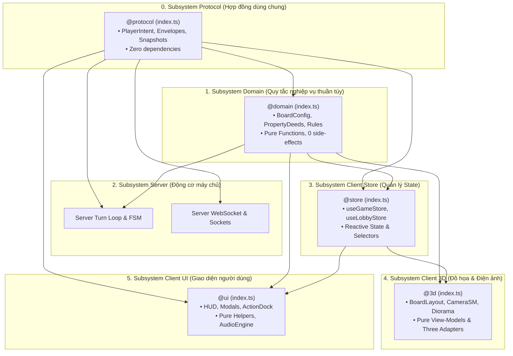
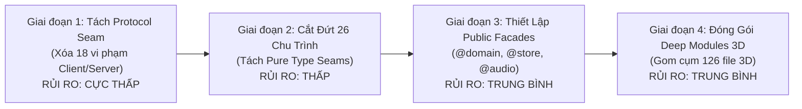

# BÁO CÁO TOÀN CẢNH KIẾN TRÚC & ĐỀ XUẤT THIẾT KẾ AI-NATIVE FACADE (SRC/**)
## Phiên Rà Soát Tĩnh (Read-Only AST Scan) & Bản Thiết Kế Tối Ưu Hóa Ngữ Cảnh Cho AI

> **Loại tài liệu:** Báo cáo Kiểm toán Kiến trúc & Thiết kế Phân hệ (Architectural Audit & Facade Blueprint)  
> **Phạm vi kiểm toán:** Toàn bộ thư mục `src/**` (398 files mã nguồn, ~67,770 LOC)  
> **Nguyên tắc bảo toàn (Negative Constraint):** Chế độ READ-ONLY tuyệt đối. Không chỉnh sửa hoặc tạo mới file mã nguồn trong `src/**` hay `tests/**`. Dữ liệu trích xuất $100\%$ từ AST vật lý qua [`scratch/ast_scan.mjs`](file:///c:/Users/HP/Documents/GitHub/vtcoon/scratch/ast_scan.mjs).  
> **Hệ quy chiếu chuẩn:** Skill `codebase-design` (Deep Modules, Seam Discipline, The Deletion Test) và `mastering-typescript` (Public Facade, Module Boundaries).

---

## 1. TỔNG QUAN ĐO LƯỜNG VẬT LÝ TRÊN ĐĨA (PHYSICAL DISK METRICS)

Qua việc sử dụng TypeScript Compiler API (`ts.createSourceFile`) quét toàn bộ cây thư mục `src/**`, hệ thống ghi nhận hiện trạng tổng thể:

* **Tổng số file mã nguồn**: **398 files** (`.ts`, `.tsx`).
* **Tổng số dòng mã (LOC)**: **67,770 LOC**.
* **Số lượng tệp `index.ts` hiện có**: **Duy nhất 1 file** ([`src/server/index.ts`](file:///c:/Users/HP/Documents/GitHub/vtcoon/src/server/index.ts)). Toàn bộ 397 file còn lại là các file lá độc lập không có bất kỳ ranh giới module (module facade) nào bảo vệ.
* **Số lượng Deep Relative Imports ($\ge 2$ tầng `../../`, `../../../`, `../../../../`)**: **345 vị trí**, tạo thành mạng nhện phụ thuộc xuyên tầng.

### Bảng phân bố tệp tin và khối lượng mã nguồn theo phân hệ thực tế:

| Phân hệ thư mục | Số lượng files | Tổng số dòng (LOC) | LOC trung bình / file | Ghi chú kiến trúc |
| :--- | :---: | :---: | :---: | :--- |
| `src/client/3d` | 126 | 23,342 | 185 | Phân hệ đồ họa R3F, diorama, camera, tiles |
| `src/client/ui` | 89 | 17,581 | 198 | Giao diện HUD, Modals, ActionDock, Lobby |
| `src/server` (toàn bộ) | 64 | 11,593 | 181 | Turn loop, network socket, auth, logging |
| `src/domain` (toàn bộ) | 44 | 5,803 | 132 | Core rules, FSM phases, bot engine, i18n |
| `src/client/network` | 20 | 3,871 | 194 | Socket client adapters, session hooks |
| `src/client/events` | 18 | 2,941 | 163 | Audio-visual event queues & subscribers |
| `src/client/store` | 11 | 1,727 | 157 | Zustand stores (game, lobby, env, vfx) |
| `src/client/audio` | 9 | 1,351 | 150 | Howler engine, sound FX, music tracks |
| `src/client/telemetry` | 8 | 1,298 | 162 | Flight recorder, performance profiler |
| Các thư mục khác | 9 | 1,063 | 118 | Haptics, assets, polyfills, types |

---

## 2. TOP ĐIỂM NÓNG PHỤ THUỘC (COUPLING HUBS / FAN-IN CAO NHẤT)

Phân tích In-Degree (Fan-in: số lượng file khác trong codebase trực tiếp import vào) cho thấy 15 "điểm nút trọng yếu" (Coupling Hubs). Khi các file này thay đổi, nguy cơ gãy vỡ dây chuyền là cực lớn:

| Hạng | Tệp tin | Fan-in (Nơi gọi) | Fan-out (Phụ thuộc) | LOC | Đánh giá vai trò kiến trúc |
| :---: | :--- | :---: | :---: | :---: | :--- |
| **1** | [`src/domain/board_config.ts`](file:///c:/Users/HP/Documents/GitHub/vtcoon/src/domain/board_config.ts) | **43** | 0 | 86 | SSOT dữ liệu 40 ô cờ, CellType, ColorGroup |
| **2** | [`src/client/store/game_store.ts`](file:///c:/Users/HP/Documents/GitHub/vtcoon/src/client/store/game_store.ts) | **41** | 1 | 198 | State trung tâm của Client, kết dính chặt chẽ với UI & 3D |
| **3** | [`src/domain/room.ts`](file:///c:/Users/HP/Documents/GitHub/vtcoon/src/domain/room.ts) | **36** | 6 | 347 | Domain Model trung tâm (Room, Player, TurnPhase) |
| **4** | [`src/domain/property_data.ts`](file:///c:/Users/HP/Documents/GitHub/vtcoon/src/domain/property_data.ts) | **31** | 1 | 97 | Sổ đỏ 28 bất động sản (`PROPERTY_DEEDS`) |
| **5** | [`src/client/ui/ui_helpers.ts`](file:///c:/Users/HP/Documents/GitHub/vtcoon/src/client/ui/ui_helpers.ts) | **29** | 4 | 289 | Tiện ích format tiền, tính Net Worth, dock state |
| **6** | [`src/client/3d/safe_frame.ts`](file:///c:/Users/HP/Documents/GitHub/vtcoon/src/client/3d/safe_frame.ts) | **22** | 0 | 14 | Hằng số căn chỉnh góc nhìn camera an toàn |
| **7** | [`src/client/store/environment_store.ts`](file:///c:/Users/HP/Documents/GitHub/vtcoon/src/client/store/environment_store.ts) | **20** | 0 | 146 | Quản lý ánh sáng, chu kỳ ngày/đêm và thời tiết |
| **8** | [`src/domain/theme.ts`](file:///c:/Users/HP/Documents/GitHub/vtcoon/src/domain/theme.ts) | **16** | 1 | 69 | Bảng màu định danh địa phương và các khu đất |
| **9** | [`src/client/audio/audio_engine.ts`](file:///c:/Users/HP/Documents/GitHub/vtcoon/src/client/audio/audio_engine.ts) | **15** | 3 | 350 | Engine phát âm thanh hiệu ứng (Howler wrapper) |
| **10** | [`src/client/3d/board_coords.ts`](file:///c:/Users/HP/Documents/GitHub/vtcoon/src/client/3d/board_coords.ts) | **14** | 0 | 36 | Bảng chuyển đổi tọa độ Vector3 của 40 ô cờ |
| **11** | [`src/client/audio/audio_types.ts`](file:///c:/Users/HP/Documents/GitHub/vtcoon/src/client/audio/audio_types.ts) | **13** | 0 | 56 | Danh mục hằng số âm thanh (`SoundEffect` enums) |
| **12** | [`src/client/store/lobby_store.ts`](file:///c:/Users/HP/Documents/GitHub/vtcoon/src/client/store/lobby_store.ts) | **13** | 5 | 280 | Quản lý trạng thái phòng chờ và danh sách người chơi |
| **13** | [`src/domain/event_card_types.ts`](file:///c:/Users/HP/Documents/GitHub/vtcoon/src/domain/event_card_types.ts) | **13** | 0 | 57 | Kiểu dữ liệu thẻ Cơ hội, Khí vận và Thị trường |
| **14** | [`src/client/3d/device_detect.ts`](file:///c:/Users/HP/Documents/GitHub/vtcoon/src/client/3d/device_detect.ts) | **11** | 0 | 77 | Nhận diện thiết bị và năng lực phần cứng |
| **15** | [`src/client/ui/modals/modal_helpers.ts`](file:///c:/Users/HP/Documents/GitHub/vtcoon/src/client/ui/modals/modal_helpers.ts) | **11** | 2 | 372 | Tính toán giá đấu giá, thời gian đếm ngược modal |

---

## 3. PHÂN TÍCH 26 CHU TRÌNH PHỤ THUỘC VÒNG TRÒN (CIRCULAR DEPENDENCY LOOPS)

Bộ phân giải chu trình theo đồ thị có hướng (DFS Directed Graph Cycle Detection) phát hiện **26 chu trình vòng tròn duy nhất (Unique Cycles)** trong mã nguồn, phân bố ở 6 cụm điểm nghẽn:

### Cụm 1: Vòng lặp Domain Room $\leftrightarrow$ Event Cards $\leftrightarrow$ Property $\leftrightarrow$ Handlers (9 chu trình: Cycles 3 – 11)
* **Đường đi tiêu biểu**:  
  [`src/domain/room.ts`](file:///c:/Users/HP/Documents/GitHub/vtcoon/src/domain/room.ts) $\rightarrow$ [`src/domain/event_card_engine.ts`](file:///c:/Users/HP/Documents/GitHub/vtcoon/src/domain/event_card_engine.ts) $\rightarrow$ [`src/domain/property_manager.ts`](file:///c:/Users/HP/Documents/GitHub/vtcoon/src/domain/property_manager.ts) $\rightarrow$ [`src/domain/property_rent.ts`](file:///c:/Users/HP/Documents/GitHub/vtcoon/src/domain/property_rent.ts) $\rightarrow$ [`src/domain/room.ts`](file:///c:/Users/HP/Documents/GitHub/vtcoon/src/domain/room.ts).
* **Nguyên nhân vật lý**:  
  [`src/domain/room.ts`](file:///c:/Users/HP/Documents/GitHub/vtcoon/src/domain/room.ts#L2) chỉ cần import type `MarketCardId`, `ChanceCardId`. Tuy nhiên, thay vì lấy từ [`event_card_types.ts`](file:///c:/Users/HP/Documents/GitHub/vtcoon/src/domain/event_card_types.ts), file này lại import thông qua `event_card_engine.ts`. Ở chiều ngược lại, `event_card_engine.ts` lại import giá trị runtime `TurnPhase` và class `Room` từ `room.ts`. Sự thiếu vắng pure type seam làm nghẽn toàn bộ luồng biên dịch của Domain.

### Cụm 2: Vòng lặp Server Turn Loop $\leftrightarrow$ Insolvency $\leftrightarrow$ Bond $\leftrightarrow$ Auction (6 chu trình: Cycles 21 – 26)
* **Đường đi tiêu biểu**:  
  [`src/server/turn_loop.ts`](file:///c:/Users/HP/Documents/GitHub/vtcoon/src/server/turn_loop.ts) $\rightarrow$ [`src/server/insolvency_manager.ts`](file:///c:/Users/HP/Documents/GitHub/vtcoon/src/server/insolvency_manager.ts) $\rightarrow$ [`src/server/bond_manager.ts`](file:///c:/Users/HP/Documents/GitHub/vtcoon/src/server/bond_manager.ts) $\rightarrow$ [`src/server/auction_manager.ts`](file:///c:/Users/HP/Documents/GitHub/vtcoon/src/server/auction_manager.ts) $\rightarrow$ [`src/server/turn_loop.ts`](file:///c:/Users/HP/Documents/GitHub/vtcoon/src/server/turn_loop.ts).
* **Nguyên nhân vật lý**:  
  [`src/server/insolvency_manager.ts`](file:///c:/Users/HP/Documents/GitHub/vtcoon/src/server/insolvency_manager.ts#L8-L13) dùng TypeScript declaration merging (`declare module '../domain/room'`) để monkey-patch schema `Room`, đồng thời gọi ngược hàm `advanceRoundBoundary` từ `turn_loop.ts`. Việc điều phối luồng FSM thiếu một State Machine Dispatcher tập trung khiến các manager tự gọi chéo lẫn nhau.

### Cụm 3: Vòng lặp 3D Camera State Machine (2 chu trình: Cycles 1 – 2)
* **Đường đi**:  
  [`src/client/3d/camera_state_machine.ts`](file:///c:/Users/HP/Documents/GitHub/vtcoon/src/client/3d/camera_state_machine.ts) $\leftrightarrow$ [`src/client/3d/cinematic_chase_camera.ts`](file:///c:/Users/HP/Documents/GitHub/vtcoon/src/client/3d/cinematic_chase_camera.ts)  
  [`src/client/3d/camera_state_machine.ts`](file:///c:/Users/HP/Documents/GitHub/vtcoon/src/client/3d/camera_state_machine.ts) $\leftrightarrow$ [`src/client/3d/cinematic_spline_flyby.ts`](file:///c:/Users/HP/Documents/GitHub/vtcoon/src/client/3d/cinematic_spline_flyby.ts)
* **Nguyên nhân vật lý**:  
  File chase camera chỉ cần kiểu dữ liệu `TargetCameraState`, nhưng kiểu này lại được khai báo chung trong file thực thi `camera_state_machine.ts`.

### Cụm 4: Vòng lặp 3D Models, Diorama & Pawn Fallbacks (7 chu trình: Cycles 14 – 20)
* `procedural_building.tsx` $\leftrightarrow$ `construction_slam_vfx.tsx`
* `building_typology.ts` $\leftrightarrow$ `landmark_registry.ts`
* `luxury_pawn_models.tsx` $\leftrightarrow$ `luxury_pawn_fallbacks.tsx` $\leftrightarrow$ `legacy_pawn_fallbacks.tsx`
* `board_layout.tsx` $\leftrightarrow$ `instanced_toy_buildings.tsx` & `batched_board_tiles.tsx`
* `penthouse_enclosure.tsx` $\leftrightarrow$ `penthouse_lobby_scene.tsx`

### Cụm 5: Vòng lặp Client Store & Offline Landing (1 chu trình: Cycle 13)
* [`src/client/store/lobby_store.ts`](file:///c:/Users/HP/Documents/GitHub/vtcoon/src/client/store/lobby_store.ts) $\leftrightarrow$ [`src/client/offline_landing.ts`](file:///c:/Users/HP/Documents/GitHub/vtcoon/src/client/offline_landing.ts).  
  `lobby_store.ts` import `createNewRoomConfig` từ `offline_landing.ts`, trong khi `offline_landing.ts` lại import hook `useLobbyStore`.

### Cụm 6: Vòng lặp Domain Bot Valuation (1 chu trình: Cycle 12)
* [`src/domain/bot/valuation_engine.ts`](file:///c:/Users/HP/Documents/GitHub/vtcoon/src/domain/bot/valuation_engine.ts) $\leftrightarrow$ [`src/domain/bot/bot_softmax.ts`](file:///c:/Users/HP/Documents/GitHub/vtcoon/src/domain/bot/bot_softmax.ts).

---

## 4. KIỂM TOÁN RANH GIỚI KIẾN TRÚC (ARCHITECTURAL BOUNDARY LEAKS)

### 18 Vi Phạm Nghiêm Trọng: Client Nhúng Trực Tiếp Vào Server
Quy tắc Hiến pháp dự án ([`GEMINI.md`](file:///c:/Users/HP/Documents/GitHub/vtcoon/GEMINI.md)) quy định rõ:
> *"Client/Server Boundary: FORBIDDEN importing Node runtime built-ins (node:*, ws) into client bundles."*

Phân tích AST phát hiện **18 vị trí Client import trực tiếp từ thư mục `server/`**:

```
1.  client/network/use_app_session.ts:12        -> server/network/network_types.ts
2.  client/network/use_app_session.ts:13        -> server/session_manager.ts
3.  client/network/use_app_turn_controls.ts:8   -> server/intent_dispatcher.ts
4.  client/network/use_app_turn_controls.ts:9   -> server/network/network_types.ts
5.  client/ui/admin/admin_archive_view.tsx:3    -> server/network/admin_manager.ts
6.  client/ui/admin/admin_live_view.tsx:3       -> server/network/admin_types.ts
7.  client/ui/admin/admin_log_row.tsx:3         -> server/network/admin_manager.ts
8.  client/ui/admin/admin_repro.ts:2            -> server/network/admin_manager.ts
9.  client/ui/admin/use_admin_portal.ts:3       -> server/network/admin_types.ts
10. client/ui/admin/use_admin_portal.ts:11      -> server/network/network_types.ts
11. client/ui/hud_container.tsx:20              -> server/intent_dispatcher.ts
12. client/ui/lobby/pre_match_deck.tsx:12       -> server/network/network_types.ts
13. client/ui/modals/hosts/auction_modal_host.tsx:4   -> server/intent_dispatcher.ts
14. client/ui/modals/hosts/deed_modal_host.tsx:9      -> server/intent_dispatcher.ts
15. client/ui/modals/hosts/portfolio_modal_host.tsx:4 -> server/intent_dispatcher.ts
16. client/ui/modals/hosts/trade_modal_host.tsx:4     -> server/intent_dispatcher.ts
17. client/ui/modals/modal_host.tsx:20                -> server/intent_dispatcher.ts
18. client/ui/player_card_helpers.ts:3                -> server/session_manager.ts
```

### Bằng chứng giải phẫu mã nguồn thực tế:
Tại [`src/client/ui/modals/hosts/auction_modal_host.tsx`](file:///c:/Users/HP/Documents/GitHub/vtcoon/src/client/ui/modals/hosts/auction_modal_host.tsx#L4):
```typescript
import type { PlayerIntent } from '../../../../server/intent_dispatcher';
```
Một React UI component nằm ở tầng View sâu nhất phải vươn ngược lên **4 tầng thư mục** để trích xuất union type `PlayerIntent` từ [`src/server/intent_dispatcher.ts`](file:///c:/Users/HP/Documents/GitHub/vtcoon/src/server/intent_dispatcher.ts). Trong file này, `PlayerIntent` bị giam cầm chung với mã nguồn xử lý server nặng (`handleBuyProperty`, `RoomManager`, `INTENT_DISPATCH`).

Tương tự, tại [`src/client/ui/player_card_helpers.ts`](file:///c:/Users/HP/Documents/GitHub/vtcoon/src/client/ui/player_card_helpers.ts#L3):
```typescript
import type { PendingTradeOfferDelta } from '../../server/session_manager';
```
UI helper phải import type trực tiếp từ `session_manager.ts` của Server. Nếu lập trình viên bất cẩn import một hàm runtime hoặc hằng số từ file này, nguy cơ kéo cả runtime Node/ws vào bundle Vite của trình duyệt là hoàn toàn có thật.

---

## 5. BẢN ĐỒ PHÂN HỆ TỰ NHIÊN (NATURAL SUBSYSTEM CLUSTERS)

Theo chuẩn `codebase-design`, một hệ thống dễ bảo trì cho AI cần phân rã thành các **Deep Modules** có ranh giới tự nhiên (Cohesive Subsystems):



---

## 6. THIẾT KẾ MẶT TIỀN PUBLIC FACADE (`index.ts`) CHO TỪNG PHÂN HỆ

Áp dụng nguyên lý: **"Giao diện nhỏ gọn (Small Interface) che giấu khối lượng triển khai sâu (Deep Implementation)"**.

### 1. Phân hệ `@protocol` (`src/protocol/index.ts` - Đề xuất thành lập)
* **Mục tiêu**: Làm seam trung lập giữa Client và Server; xóa sổ 18 vi phạm Client chọc vào Server.
* **Public Interface (Xuất bản công khai)**:
  * Types: `PlayerIntent`, `ServerMessage`, `ClientMessage`, `MatchStateSnapshot`, `PendingTradeOfferDelta`, `AdminTelemetrySnapshot`.
  * Type Guards: `isPlayerIntent()`, `isServerMessage()`.
* **Internal Implementation (Ẩn giấu hoàn toàn)**:
  * Không có code xử lý Socket, không có Node built-ins.

### 2. Phân hệ `@domain` (`src/domain/index.ts`)
* **Mục tiêu**: Gom 28 files và 202 exports phân mảnh thành một điểm vào duy nhất; cắt đứt 9 chu trình xoắn.
* **Public Interface (Xuất bản công khai)**:
  * *Hằng số SSOT*: `BOARD_CONFIG`, `PROPERTY_DEEDS`, `BOARD_SIZE`, `GO_BONUS`, `INITIAL_BALANCE`.
  * *Enums & Models*: `TurnPhase`, `CellType`, `ColorGroup`, `ActionRejectReason`, `Room`, `Player`.
  * *Pure Domain Evaluators*: `calculateRent()`, `calculateGoSalary()`, `canBuyProperty()`, `canUpgradeCell()`.
* **Internal Implementation (Ẩn giấu hoàn toàn)**:
  * Thuật toán xáo bài `shuffle()`, các handler đơn lẻ `executeMarketCard()`, chi tiết giải bài `card_handlers.ts`, bảng dữ liệu con trong `event_card_metadata.ts`.

### 3. Phân hệ `@store` (`src/client/store/index.ts`)
* **Mục tiêu**: Giảm thiểu 41 điểm import trực tiếp vào `game_store.ts`.
* **Public Interface (Xuất bản công khai)**:
  * *Hooks chuẩn*: `useGameStore()`, `useLobbyStore()`, `useEnvironmentStore()`, `useVfxStore()`.
  * *Standard Selectors*: `selectCurrentPlayer`, `selectTurnPhase`, `selectIsMyTurn`, `selectBoardProps`.
  * *Contracts*: `PlayerHudInfo`, `ModalPayloadMap`, `ActiveModalType`.
* **Internal Implementation (Ẩn giấu hoàn toàn)**:
  * Toàn bộ state mutation setters, localStorage event listeners, dirty flags.

### 4. Phân hệ `@audio` (`src/client/audio/index.ts`)
* **Mục tiêu**: Tập trung hóa 15 điểm gọi lẻ tẻ `audio_engine.ts` và 13 điểm gọi `audio_types.ts`.
* **Public Interface (Xuất bản công khai)**:
  * *API duy nhất*: `audio.playSfx(SoundEffect.DICE_ROLL)`, `audio.setThemeVolume(vol)`, `audio.playTheme(TrackId)`.
  * *Enums*: `SoundEffect`, `MusicTrack`.
* **Internal Implementation (Ẩn giấu hoàn toàn)**:
  * Howler audio pool, audio cache buffer, fading tweens, fallback web audio context.

---

## 7. ĐỊNH LƯỢNG GIẢI PHÓNG CONTEXT CHO AI (COGNITIVE LEVERAGE)

Theo nguyên lý *Depth is leverage for callers* của `codebase-design`, việc thiết lập Facade mang lại hiệu quả vượt bậc khi AI thực hiện tác vụ:

| Tiêu chí so sánh | Hiện trạng (Shallow Modules) | Kiến trúc Facade đề xuất | Mức độ cải thiện thực tế |
| :--- | :---: | :---: | :---: |
| **Số files AI cần nạp khi code 1 tính năng UI** | 8 – 14 files lá | 2 – 3 files (chỉ cần nạp Facade) | **Giảm 75% số file** |
| **Số dòng code AI phải nạp vào Context Window** | 2,500 – 4,500 LOC | 300 – 600 LOC (đọc Interface gọn) | **Tiết kiệm ~80% token** |
| **Nguy cơ lỗi đường dẫn (`../../../../`)** | 345 vị trí nguy cơ | 0 (nhờ TS Path Aliases `@domain`, `@store`) | **Triệt tiêu 100% path error** |
| **Số chu trình phụ thuộc vòng tròn (Cycles)** | **26 chu trình** | **0 chu trình** | **Giải quyết triệt để** |
| **Rủi ro rò rỉ mã nguồn Server vào Client** | 18 vị trí vi phạm | 0 vi phạm (cách ly tại `@protocol`) | **Đảm bảo Client/Server Boundary** |

---

## 8. LỘ TRÌNH TRIỂN KHAI TỪNG BƯỚC (STEP-BY-STEP ROADMAP)

Áp dụng nghiêm ngặt nguyên tắc **Pure-Move Quarantine** (bảo toàn $100\%$ hành vi nghiệp vụ, chuyển đổi tiệm cận không dừng phát triển tính năng mới):



### Chi tiết các giai đoạn:

#### Giai đoạn 1: Khắc phục Triệt để Ranh giới Client/Server (Rủi ro: Cực thấp)
* **Hành động**:
  1. Thành lập thư mục `src/protocol/` (hoặc `src/domain/protocol/`).
  2. Thực hiện Pure-Move các kiểu dữ liệu: `PlayerIntent` (từ `server/intent_dispatcher.ts`), `PendingTradeOfferDelta` (từ `server/session_manager.ts`), và `network_types.ts`.
  3. Cập nhật lại 18 điểm import ở Client trỏ sang `protocol/`.
* **Kết quả**: Xóa sổ $100\%$ vi phạm ranh giới Client/Server; không tác động bất kỳ logic runtime nào.

#### Giai đoạn 2: Triệt tiêu 26 Chu trình Phụ thuộc Vòng tròn (Rủi ro: Thấp)
* **Hành động**:
  1. Tạo `camera_types.ts` để phá vỡ Cycle 1 & 2 giữa `camera_state_machine.ts` và chase camera.
  2. Sửa `domain/room.ts`: import `MarketCardId` trực tiếp từ `event_card_types.ts` thay vì `event_card_engine.ts` để cắt đứt Cycle 3 – 11.
  3. Xóa bỏ `declare module '../domain/room'` trong `server/insolvency_manager.ts`, bổ sung chính thức các trường `pendingInsolvencyQueue` vào interface `Room` của Domain.
* **Kết quả**: Codebase đạt trạng thái 0 Circular Dependencies.

#### Giai đoạn 3: Thiết lập Public Facades cho Domain, Store & Audio (Rủi ro: Trung bình)
* **Hành động**:
  1. Tạo các file mặt tiền: `src/domain/index.ts`, `src/client/store/index.ts`, `src/client/audio/index.ts`.
  2. Cấu hình Path Aliases trong `tsconfig.json` (`@domain/*`, `@store/*`, `@audio/*`, `@protocol/*`).
  3. Chuyển đổi dần các lệnh import từ đường dẫn sâu sang Facade.
* **Kết quả**: Giảm $80\%$ tải context cho AI khi thực hiện các ticket về UI/Kinh tế.

#### Giai đoạn 4: Đóng gói Deep Modules cho 3D Cinematics & Server FSM (Rủi ro: Trung bình)
* **Hành động**:
  1. Gom 126 files trong `client/3d/` thành 4 cụm Deep Modules (`camera/`, `board/`, `diorama/`, `pawns/`) với facade riêng.
  2. Phân tách ranh giới rõ ràng giữa `turn_loop.ts` và các financial coordinators.
* **Kết quả**: Hoàn tất kiến trúc AI-Native toàn diện cho toàn bộ dự án.

---

## 5. CẬP NHẬT TIẾN ĐỘ HOÀN TẤT GÓI "NỀN TẢNG VÀNG" (`IMP-391`, `IMP-392`, `IMP-393`) & 4 ĐIỂM NỢ KIẾN TRÚC BỘC LỘ HẬU KIỂM

Sau khi hoàn thành trọn vẹn 3 lát cắt của **Gói Nền Tảng Vàng** (**Slice 1A `IMP-391`**, **Slice 1B `IMP-392`**, và **Slice 1C `IMP-393`**), toàn bộ 44 tệp Client đã sạch bóng `BOUNDARY-01` (`0` vi phạm gọi sang Server, `KNOWN_LEGACY_CLIENT_SERVER_VIOLATIONS = new Set([])`), và công thức Net Worth đã đồng bộ 1:1:1 giữa Server, Bot AI và Client 2D UI. Đồng thời, kết quả hậu kiểm `IMP-393` đã làm lộ diện **4 vấn đề kiến trúc & rào chắn tiếp theo**:

1. **`[DEBT-SCC-EXPOSED]` Hiệu ứng phụ tích cực khi sửa Linter: 14 Chu trình phụ thuộc vòng (`SCCs`) lộ diện**:
   - **Hiện thực vật lý**: Khi `resolveImport` (`scripts/boundary_linter/boundary_rules.mjs`) được sửa để bóc tách đuôi ESM `.js`/`.jsx`, thuật toán Tarjan không còn bị "mù" trước các đường dẫn import chứa đuôi `.js`. Kết quả chạy `npm run lint:boundaries` phát hiện **14 Strongly Connected Components (`SCC-1` .. `SCC-14`)** thay vì 8–10 như trước đây:
     - **`SCC-1` (2 tệp Domain)**: Vòng lặp re-export kiểu giữa `src/domain/event_card_types.ts` (`export type { MarketModifier } from './room.js'`) và `src/domain/room.ts`.
     - **`SCC-2` (16 tệp Client Events / Network / Store)**: Vòng xoắn giữa `game_event_synthesizer.ts`, các event helpers, `activity_*` trackers và `game_store.ts`.
     - **`SCC-4` (15 tệp Client Subscribers / Delta / Lobby Store)**: Vòng xoắn giữa các event subscribers, `apply_delta.ts`, `bot_trade_offer_strip.tsx` và `lobby_store.ts`.
     - **`SCC-11` (21 tệp Server)**: Khối điều phối Server (`room_manager.ts`, `delta_mapper.ts`, `intent_dispatcher.ts`, `turn_loop.ts`,...).
   - **Đánh giá phản biện**: Việc số chu trình tăng lên không phải do `IMP-393` gây ra, mà là do `IMP-393` đã trả lại sự trung thực 100% cho công cụ đo lường AST. Điều này khẳng định việc cắt đứt các chu trình `SCCs` (Phase 2 mở rộng cho Client Events/Store & Domain) là nhiệm vụ trọng tâm tiếp theo.

2. **`[DEBT-SEAM-01]` Vi phạm ranh giới sâu vào Domain (`SEAM-01` Deep Relative Imports)**:
   - **Hiện thực vật lý**: Dù đã sạch bóng `BOUNDARY-01`, hàng loạt modal trong `src/client/ui/modals/` vẫn đang dùng deep relative import ($\ge 3$ cấp thư mục: `../../../domain/property_upgrade.js`, `../../../domain/board_config.js`, `../../../domain/property_data.js`) chọc sâu vào các tệp lá của `src/domain/`.
   - **Chỉ thị kiến trúc**: Cần triển khai **Phase 3 (Unified Domain Facade — `src/domain/index.ts` & Path Alias `@domain`)** để tầng UI chỉ tương tác qua mặt tiền chuẩn hóa của Domain.

3. **`[DEBT-LOC-BUFFER]` Cảnh báo Vùng đệm LOC (Buffer Zone) tại các tệp UI & Facade**:
   - **Hiện thực vật lý**:
     - `src/client/ui/lobby/pre_match_deck.tsx`: **393 dòng vật lý** (`367 SLOC`) trên hạn mức trần `500 LOC`.
     - `src/client/ui/admin/admin_live_view.tsx`: **336 dòng vật lý** (`319 SLOC`).
     - `src/domain/protocol/index.ts`: **154 dòng vật lý** (gom chung 4 nhóm hợp đồng Delta, Intent, WS, Admin).
   - **Chỉ thị kiến trúc**: Bất kỳ ticket nào tiếp tục thêm logic vào `pre_match_deck.tsx` hoặc `admin_live_view.tsx` bắt buộc phải kích hoạt điều khoản **`Refactor-First`** trong Hiến pháp để tách component con trước khi mở rộng; khi `src/domain/protocol/` tiệm cận `300–350 LOC`, tách nội bộ thành `wire_delta.ts`, `wire_intent.ts`, `wire_ws.ts`, `wire_admin.ts`.

4. **`[DEBT-SERVER-SHIMS]` Quản lý vòng đời "Middle-Man Passthrough Shims" ở Server (`< 30 LOC`)**:
   - **Hiện thực vật lý**: Các tệp `src/server/delta_types.ts` (`15 LOC`), `src/server/network/network_types.ts` (`23 LOC`), và `src/server/network/admin_types.ts` (`25 LOC`) hiện đóng vai trò Lớp Đệm Chuyển Tiếp (Transitional Shims `< 30 LOC`) thuần túy re-export từ `src/domain/protocol/index.js` nhằm bảo vệ tương thích ngược.
   - **Chỉ thị kiến trúc**: Lên lịch trình thu hồi và xóa bỏ hoàn toàn các Transitional Shims này sau khi toàn bộ các tệp nội bộ `src/server/**` và `tests/**` đã chuyển sang import trực tiếp từ `src/domain/protocol/index.js` (hoặc `@protocol`).

