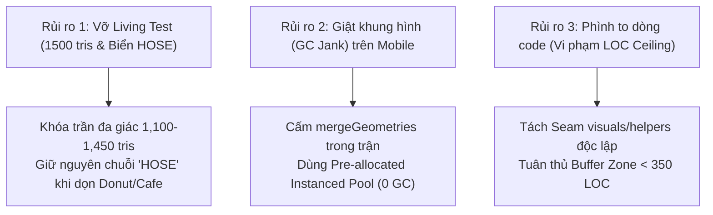

# BÁO CÁO ĐỀ XUẤT DỰ ÁN: ĐẠI TU TOÀN DIỆN MỸ THUẬT KIẾN TRÚC, ĐÔ THỊ DI SẢN & TÔNG GIỌNG CHIẾN LƯỢC VIỆT TÀI PHÚ (VTCOON)
## Tờ Trình Phê Duyệt Kế Hoạch Hành Động & Dự Toán Kỹ Thuật (Executive Action Memorandum)

> **Mã văn kiện:** `PROP-VTCOON-ARCH-TONE-2026-V1.0`  
> **Cơ quan thẩm định:** Nhóm Kiến trúc Hệ thống & Giám đốc Mỹ thuật 3D Antigravity  
> **Phạm vi tác động:** Toàn bộ hệ thống Mỹ thuật 3D, Quy hoạch Sa bàn Đô thị (Diorama), Trải nghiệm Giao diện Di động (Mobile UX) và Từ điển Thuật ngữ Kinh tế Vĩ mô  
> **Tài liệu tham chiếu cốt lõi:**
> * Master Report V4.0: [`docs/reports/analysis/VTCOON_UNIFIED_BLENDER_MOBILE_AND_CROSSPLATFORM_REPORT.md`](file:///c:/Users/HP/Documents/GitHub/vtcoon/docs/reports/analysis/VTCOON_UNIFIED_BLENDER_MOBILE_AND_CROSSPLATFORM_REPORT.md)
> * Báo cáo Nghiên cứu Thẩm mỹ: [`docs/reports/analysis/VTCOON_ARCHITECTURAL_REALISM_AND_MATURE_TONE_REPORT.md`](file:///c:/Users/HP/Documents/GitHub/vtcoon/docs/reports/analysis/VTCOON_ARCHITECTURAL_REALISM_AND_MATURE_TONE_REPORT.md)
> * Bộ 3 Kế hoạch Kỹ thuật: [`PLAN_IMP_404`](file:///c:/Users/HP/Documents/GitHub/vtcoon/.agents/plans/PLAN_IMP_404_RENDER_TIER_PROFILE_AND_INSTANCED_REGIONAL_BUILDINGS_POOL.md), [`PLAN_IMP_405`](file:///c:/Users/HP/Documents/GitHub/vtcoon/.agents/plans/PLAN_IMP_405_DIORAMA_STATIC_BLENDER_BATCHES_AND_MOBILE_DRAWCALL_DIET.md), [`PLAN_IMP_406`](file:///c:/Users/HP/Documents/GitHub/vtcoon/.agents/plans/PLAN_IMP_406_MOBILE_INSTANCED_MONOPOLY_ARCHWAY_AND_DOMINO_SHOCKWAVE.md)

---

## I. TÓM TẮT ĐIỀU HÀNH & TÍNH CẤP BÁCH (EXECUTIVE SUMMARY & URGENCY)

### 1.1. Bối Cảnh Thực Tế & Lời Phê Bình Trực Diện
Dự án **Việt Tài Phú (VTCOON)** được định vị là tựa game chiến lược kinh tế tài chính đỉnh cao, nơi người chơi bước vào vai những nhà đầu tư sừng sỏ tái thiết và chi phối thị trường bất động sản Việt Nam. Tuy nhiên, sau các đợt phát triển nhanh nhằm tối ưu hiệu năng mobile, hệ thống đang bộc lộ **3 khuyết tật nghiêm trọng làm suy giảm nghiêm trọng giá trị thương hiệu**:

1. **Khủng hoảng Tông giọng & Ngôn từ ("Game con nít / Kiếm hiệp rẻ tiền"):**
   * Các khẩu hiệu như `"👑 Bá Chủ Độc Quyền"`, `"📈 Mở Rộng Đế Chế"`, `"🛡️ Phòng Thủ Vốn"`, `"🚨 Cứu Thanh Khoản"` mang nặng tính giật gân, trẻ con, biến một tựa game tài chính trí tuệ thành một trò chơi casual kiếm hiệp mạng thiếu chiều sâu.
2. **Thẩm mỹ 3D nghèo nàn ("Chỉ hơn Three.js thuần một chút"):**
   * Mặc dù đã trang bị đường ống Blender 5.2, mã nguồn trên Mobile vẫn rơi vào cái bẫy *Primitive Box-Reductionism*: ghép các khối hộp lập phương (`RoundedBox`) phẳng lì, tô màu bệt, thiếu vắng hoàn toàn các chi tiết kiến trúc đặc sắc (hốc cửa lõm, phào chỉ mái, ngói vảy, tỷ lệ bóng đổ).
3. **Quy hoạch Đô thị Thiếu Tôn trọng Di sản:**
   * **Nhà thờ Đức Bà Sài Gòn** — biểu tượng lịch sử kiệt tác — bị dìm lấp bởi bức tường Shophouse Chợ Lớn cao tới `0.8m`, bị quây kín bởi các biển hiệu hoạt hình Bánh Donut hồng (`🍩`) và Ly Cà phê (`☕`), đồng thời bị cụm cao ốc phía Tây Bắc chắn ngang tầm nhìn đại cảnh.

### 1.2. Mục Tiêu Đề Xuất
Báo cáo này đề xuất kế hoạch **Đại tu Toàn diện trong 3 Giai đoạn Khép kín (`IMP-404`, `IMP-405`, `IMP-406`)**, giải quyết triệt để 3 khuyết tật trên nhằm đưa *Việt Tài Phú* đạt chuẩn thẩm mỹ của một sản phẩm thương mại cao cấp (AAA Tactile Aesthetics) dành cho giới đầu tư trưởng thành, đồng thời **giảm tải 58 Draw Calls và duy trì 60 FPS mượt mà trên mọi dòng điện thoại thông minh**.

---

## II. MA TRẬN ĐỐI CHIẾU NÂNG CẤP CHIẾN LƯỢC (TRANSFORMATION MATRIX)

```mermaid
flowchart LR
    subgraph Hiện_Trạng_Cũ["HIỆN TRẠNG (CŨ)"]
        direction TB
        O1["Ngôn ngữ: 'Bá chủ độc quyền', 'Cứu thanh khoản'"]
        O2["3D: Hộp phẳng lì, tô màu bệt, 0 hốc cửa"]
        O3["Đô thị: Nhà thờ Đức Bà bị quây bởi Donut/Cafe"]
        O4["Hiệu năng: 60-80 draw calls rải rác"]
    end

    subgraph Đề_Xuất_Mới["ĐỀ XUẤT ĐẠI TU (MỚI)"]
        direction TB
        N1["Ngôn ngữ: Kinh tế Vĩ mô & Ngân hàng Đầu tư"]
        N2["3D: Low-Poly Tectonics + Baked AO + Sun Gradient"]
        N3["Đô thị: Nhà thờ 1.42m độc tôn + Thềm gạch bông"]
        N4["Hiệu năng: 1 Draw Call Instanced Pool (-58 calls)"]
    end

    Hiện_Trạng_Cũ ==>|3 Kế Hoạch Tuần Tự| Đề_Xuất_Mới
```



| Tiêu chí | Trạng thái Hiện tại (Cần Loại Bỏ) | Trạng thái Đề xuất Mới (Chuẩn Hóa) | Đơn vị Triển khai |
| :--- | :--- | :--- | :--- |
| **Hệ Thống Thuật Ngữ** | Khẩu hiệu game con nít: `"Bá Chủ Độc Quyền"`, `"Mở Rộng Đế Chế"`, `"Phòng Thủ Vốn"`, `"Cứu Thanh Khoản"`. | Hệ từ vựng Kinh tế Vĩ mô: **`"Vị Thế Chi Phối"`**, **`"Tích Lũy Tài Sản"`**, **`"Bảo Toàn Thanh Khoản"`**, **`"Tái Cơ Cấu Vốn"`**. | `IMP-406` |
| **Quy Hoạch Lõi Di Sản** | Nhà thờ Đức Bà bị lấp bởi shophouse cao 0.8m; bao quanh bởi biển Donut/Cafe; cao ốc chắn mặt tiền. | Độc tôn uy nghiêm cao **`1.42m`**; shophouse hạ xuống **`0.22m–0.32m`**; mặt tiền thoáng đãng; thềm gạch bông `1.7m × 2.6m`. | `IMP-405` |
| **Độ Sâu Điêu Khắc 3D** | Khối hộp phẳng bệt, 0 chi tiết khe kẽ, trông thô sơ như Three.js cơ bản. | Điêu khắc **Low-Poly Tectonics**: khoét hốc cửa lõm, gờ phào chỉ mái, nướng **Baked AO** ($\Delta L \ge 0.22$) + Sun Gradient. | `IMP-404` & `IMP-405` |
| **Bản Sắc Kiến Trúc** | Nhà cửa 4 miền trộn lẫn lộn xộn, không phản ánh phong cách vùng miền. | **8 Mẫu Nhà Chuẩn Vùng Miền** (C1/C2): Bắc Bộ (ngói vảy, cửa lim), Miền Trung (vòm vàng Hội An), Tây Nam Bộ (cột gỗ, hiên rộng). | `IMP-404` |
| **Tối Ưu Phần Cứng Mobile** | 60–80 Draw Calls rải rác; giật khung hình do gọi `RoundedBox` trong render loop. | **Instanced Pool 1 Draw Call**; gộp cụm tĩnh Diorama (giảm 58 draw calls); Zero GC Jank. | `IMP-404`, `IMP-405`, `IMP-406` |

---

## III. NỘI DUNG 3 GÓI ĐỀ XUẤT THỰC THI CHI TIẾT

### 1. Gói Đề Xuất 1: `IMP-404` — Kiến Trúc 4 Vùng Miền Tectonics & Instanced Pool Mobile
* **Mục tiêu:** Xóa bỏ sự thô kệch của nhà phố trên điện thoại; đưa 8 mẫu nhà điêu khắc tinh xảo vào trận đấu với chi phí chỉ **1 Draw Call**.
* **Giải pháp Kỹ thuật:**
  1. Xây dựng kịch bản Blender 5.2 (`scripts/blender/build_mobile_regional_archetypes.py`) xuất 8 mẫu nhà:
     * Cấp 1 (C1): $\ge 160$ đỉnh, khoét hốc cửa âm $\ge 0.04\text{m}$, gờ mái chìa $\ge 0.06\text{m}$.
     * Cấp 2 (C2): $\ge 220$ đỉnh, ban công 2 tầng, lam chắn nắng, tỷ lệ bóng đổ chuẩn xác.
     * Nướng độ sáng bóng kẽ `Baked AO` chênh lệch tối thiểu $\Delta L \ge 0.22$ vào thuộc tính đỉnh `COLOR_0`.
  2. Xây dựng tầng trung gian [`InstancedRegionalBuildingsPool`](file:///c:/Users/HP/Documents/GitHub/vtcoon/src/client/3d/instanced_regional_buildings_pool.tsx) cấp phát sẵn mảng ma trận tĩnh (`Zero-GC`), cập nhật qua `setMatrixAt` với chi phí CPU $< 0.02\text{ms}$.
  3. Tái cấu trúc (Refactor) [`procedural_building.tsx`](file:///c:/Users/HP/Documents/GitHub/vtcoon/src/client/3d/procedural_building.tsx) và [`board_tile.tsx`](file:///c:/Users/HP/Documents/GitHub/vtcoon/src/client/3d/board_tile.tsx) giúp giảm hơn 100 dòng code thừa.

---

### 2. Gói Đề Xuất 2: `IMP-405` — Tái Thiết Lõi Di Sản Nhà Thờ Đức Bà & Sa Bàn Diorama
* **Mục tiêu:** Khôi phục vị thế tôn nghiêm của Nhà thờ Đức Bà Sài Gòn, quy hoạch lại lõi trung tâm Quận 1 và cắt giảm 58 Draw Calls sa bàn trên Mobile.
* **Giải pháp Kỹ thuật:**
  1. Kịch bản Blender (`scripts/blender/build_heritage_cathedral_and_diorama.py`) điêu khắc `landmark_cathedral.glb`:
     * Chiều cao nâng vọt lên **`1.42m`** (so với nền sàn `0.16m`), 2 tháp chuông vươn cao kiêu hãnh.
     * Khống chế ngân sách đa giác nghiêm ngặt: **`1,100 – 1,450 triangles`** (tuân thủ trần `<= 1,500 tris` của Living Test `TC-IMP29.5`).
     * Tọa lạc trên thềm gạch bông Đông Dương kích thước `1.7m × 2.6m`.
  2. Xử lý quy hoạch đô thị phụ cận:
     * Dọn dẹp sạch sẽ biển Donut hồng và Ly Cà phê trong [`diorama_shophouse_blocks.tsx`](file:///c:/Users/HP/Documents/GitHub/vtcoon/src/client/3d/diorama/diorama_shophouse_blocks.tsx), **nhưng giữ lại biển Sàn HOSE** để bảo toàn 100% test `TC-CPTB02.15`.
     * Hạ chiều cao dãy Shophouse Chợ Lớn từ `0.8m` xuống **`0.22m – 0.32m`** tạo hành lang thị giác `0.65m`.
     * Thu gọn cụm cao ốc Tây Bắc để mở rộng chân trời.
  3. Gộp tĩnh sa bàn (`diorama_static_blender_batches.ts`): Hợp nhất Cảng Container, Phố Di sản và Vành đai Bàn cờ thành các khối lưới tĩnh duy nhất, **tiết kiệm 58 Draw Calls** cho điện thoại.

---

### 3. Gói Đề Xuất 3: `IMP-406` — Chuẩn Hóa Ngôn Ngữ Vĩ Mô & Cổng Chào Art Deco
* **Mục tiêu:** Loại bỏ hoàn toàn ngôn ngữ rẻ tiền trên biển 3D; đưa Cổng chào Độc quyền Art Deco lên Mobile đồng bộ với bản Desktop Ultra.
* **Giải pháp Kỹ thuật:**
  1. Chuẩn hóa bộ 4 trạng thái tài chính vĩ mô trong [`war_room_stage_visuals.ts`](file:///c:/Users/HP/Documents/GitHub/vtcoon/src/client/3d/war_room_stage_visuals.ts):
     * *Vị Thế Chi Phối* (`#10B981` Ngọc lục bảo): Khi giá trị ròng dẫn đầu bàn cờ $\ge 35\%$.
     * *Tích Lũy Tài Sản* (`#3B82F6` Xanh sapphire): Khi sở hữu $\ge 2$ bộ độc quyền hoặc dòng tiền dương.
     * *Bảo Toàn Thanh Khoản* (`#F59E0B` Vàng hổ phách): Khi thanh khoản $< 15\%$ tài sản hoặc chuẩn bị vào ô thuế/phí.
     * *Tái Cơ Cấu Vốn* (`#EF4444` Đỏ ruby): Khi tài sản âm hoặc đối mặt nguy cơ mất thanh khoản.
  2. Chuyển đổi bảng tên lơ lửng sang phong cách đá phiến đen `#0F172A` viền đồng thanh mảnh, chữ in hoa trang nhã.
  3. Triển khai Cổng chào Art Deco và Thảm nhung đại lộ lên Mobile thông qua Instanced Mesh Pool 8 nhóm màu, tái hiện hiệu ứng nảy sóng lò xo Domino khi người chơi thâu tóm trọn cụm đất.

---

## IV. BẢO TOÀN KIỂM SOÁT KỸ THUẬT & QUẢN TRỊ RỦI RO (RISK GOVERNANCE)

Để dự án tuyệt đối không gặp sự cố gián đoạn hay phá vỡ hệ thống kiểm thử tự động, đề xuất áp dụng **3 Rào Chắn Quản Trị Rủi Ro**:



1. **Rào chắn 1 — Phòng vệ Living Tests (Zero Test Breakage):**
   * Living Test `TC-IMP29.5` và script `optimize_assets.mjs` khóa cứng trần `maxTriangles: 1500` cho danh thắng. Mô hình Nhà thờ Đức Bà được tính toán chuẩn xác ở mức `1,100 – 1,450 tris`, đạt độ nét điêu khắc tối đa mà không vượt ngưỡng đỏ.
   * Khi dọn dẹp biển quảng cáo hoạt hình, giữ nguyên biển sàn chứng khoán `HOSE` để bảo toàn trọn vẹn test `TC-CPTB02.15`.
2. **Rào chắn 2 — Phòng vệ Hiệu năng & Rác Bộ Nhớ (Zero-GC Instancing):**
   * Tuyệt đối cấm tạo mới `BufferGeometry` hay gọi `mergeGeometries` động khi xây/bán nhà trong trận đấu. Toàn bộ 22 ô đất sử dụng chung 1 Instanced Mesh Pool, chỉ cập nhật ma trận biến đổi tọa độ trên CPU ($< 0.02\text{ms}$).
3. **Rào chắn 3 — Phòng vệ Giới hạn Dòng Code (LOC Buffer Zone):**
   * Các file liên quan (`procedural_building.tsx`, `board_tile.tsx`) đang tiệm cận mức 350 LOC. Quá trình triển khai sẽ trích xuất logic tính toán sang các file twin helper (`*_visuals.ts`, `*_helpers.ts`) để đưa dung lượng các file chính về vùng an toàn $\le 280\text{ LOC}$.

---

## V. LỘ TRÌNH THỰC THI TUẦN TỰ (PHASED ROADMAP)

Quá trình thực thi tuân thủ nghiêm ngặt **Quy trình 4 Trạm Công tác (Universal 4-Station SDLC Pipeline)** theo trật tự tuần tự:

```
[PHA 1: IMP-404] ──────────► [PHA 2: IMP-405] ──────────► [PHA 3: IMP-406]
• Đúc 8 mẫu nhà vùng miền      • Điêu khắc Nhà thờ 1.42m      • Chuẩn hóa Ngôn ngữ Vĩ mô
• Instanced Building Pool      • Dọn dẹp Donut/Cafe           • Cổng chào Art Deco Mobile
• Tiết kiệm Draw Calls Nhà     • Gộp sa bàn (-58 draw calls)  • Nghiệm thu Toàn diện V4.0
```

1. **Pha 1 (`IMP-404`) — Kiến trúc Vùng Miền & Instanced Pool:**
   * Station 2 (RED): Tạo test suite `tests/client/imp404_render_tier_and_instanced_buildings_pool.test.ts`.
   * Station 2.5 (GREEN): Viết script Blender đúc 8 mẫu nhà và triển khai `InstancedRegionalBuildingsPool`.
   * Station 3 & 3.5: Kiểm tra prefilter, linter boundaries và chạy Sentinel mutation lock.
2. **Pha 2 (`IMP-405`) — Di Sản Nhà Thờ & Sa Bàn Diorama:**
   * Station 2 (RED): Tạo test suite `tests/client/imp405_diorama_static_blender_batches.test.ts`.
   * Station 2.5 (GREEN): Xuất `landmark_cathedral.glb`, dọn dẹp shophouse, tạo `diorama_static_blender_batches.ts`.
   * Station 3 & 3.5: Kiểm tra prefilter và thẩm định không gian thị giác.
3. **Pha 3 (`IMP-406`) — Ngôn Ngữ Vĩ Mô & Cổng Chào Art Deco:**
   * Station 2 (RED): Tạo test suite `tests/client/imp406_mobile_instanced_monopoly_archway.test.ts`.
   * Station 2.5 (GREEN): Cập nhật từ vựng trong `war_room_stage_visuals.ts` và tích hợp cổng chào Art Deco.
   * Station 4: Tổng hợp báo cáo nghiệm thu hoàn tất đề án.

---

## VI. ĐỀ XUẤT PHÊ DUYỆT & LỰA CHỌN MỞ (CALL FOR DECISION)

Để chính thức khởi động dự án, kính trình bạn xem xét và phê duyệt 2 nội dung:

### 1. Phê Duyệt Lựa Chọn Thẩm Mỹ Bảng Tên 3D Trên Biển (Cho Pha IMP-406)
* **Phương án A (Khuyến nghị): Bảng Tên Đá Đen Viền Đồng Sang Trọng:**
  * Giữ bảng tên 3D kích thước nhỏ gọn, chất liệu đá phiến đen `#0F172A` viền đồng mạ vàng thanh mảnh, chữ khắc in hoa không chân trang nhã (`"VỊ THẾ CHI PHỐI"`). Mang lại cảm giác bàn cờ vật lý cao cấp.
* **Phương án B: Tối Giản Tuyệt Đối (Ẩn Bảng Tên 3D, Chỉ Dùng Vòng Hào Quang Chân Đế):**
  * Ẩn hoàn toàn bảng tên lơ lửng trong không gian 3D. Trạng thái chiến lược chỉ được biểu thị qua vòng tròn ánh sáng phản chiếu dưới chân đế bàn cờ và hiển thị chi tiết trong bảng HUD 2D.

### 2. Lệnh Khởi Động Triển Khai
Nếu bạn đồng thuận với bản đề xuất này, xin hãy phê duyệt để chúng ta tiến hành ngay **Pha 1 (`IMP-404`)**.

---
*Báo cáo được lập bởi Antigravity System Architecture & 3D Art Direction.*
