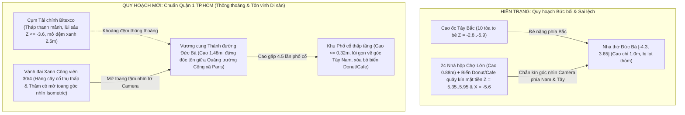

# BÁO CÁO ĐỊNH HƯỚNG MỸ THUẬT KIẾN TRÚC, QUY HOẠCH ĐÔ THỊ & NGÔN NGỮ TÀI CHÍNH TRƯỞNG THÀNH (ARCHITECTURAL REALISM & MATURE FINANCIAL TONE MASTER REPORT)

- **Mã báo cáo**: `REPORT-ARCH-REALISM-AND-MATURE-TONE-2026-V1.0`
- **Ngày lập**: 15/10/2026
- **Phạm vi**: Chấn chỉnh toàn diện (1) Ngôn ngữ & Tông giọng Tài chính Trưởng thành, (2) Quy hoạch Đô thị Khu Di sản Nhà thờ Đức Bà TP.HCM & Cao ốc Tài chính, và (3) Tiêu chuẩn Điêu khắc Kiến trúc 3D bằng Blender 5.2 (chấm dứt tình trạng ghép khối hộp sơ sài kiểu Three.js thuần).
- **Mối liên hệ chiến lược**: Là **Tiền đề Mỹ thuật & Quy hoạch Bắt buộc (Pre-requisite Art & Urban Charter)** trước và trong khi triển khai [`VTCOON_UNIFIED_BLENDER_MOBILE_AND_CROSSPLATFORM_REPORT.md`](file:///c:/Users/HP/Documents/GitHub/vtcoon/docs/reports/analysis/VTCOON_UNIFIED_BLENDER_MOBILE_AND_CROSSPLATFORM_REPORT.md).

---

## 1. CHẨN ĐOÁN THẲNG THẮN 3 KHUYẾT ĐIỂM CỐT LÕI HIỆN TẠI

Qua đối chiếu trực tiếp ảnh chụp thực tế ([`imp-403_desktop.jpg`](file:///c:/Users/HP/Documents/GitHub/vtcoon/.agents/tmp/imp-403_desktop.jpg)) và mã nguồn hiện hành, giao diện 3D của game đang mắc phải **3 điểm nghẽn làm giảm sự nghiêm túc và đẳng cấp kiến trúc**:

### 1.1. Ngôn ngữ "Game trẻ con / Kiếm hiệp rẻ tiền" & Bảng hiệu 2D lơ lửng phản cảm
* **Hiện trạng trong mã nguồn** ([`src/client/3d/war_room_stage_visuals.ts`](file:///c:/Users/HP/Documents/GitHub/vtcoon/src/client/3d/war_room_stage_visuals.ts#L300-L310)):
  * Đang sử dụng các khẩu hiệu mang âm hưởng game nhập vai trẻ con: `"👑 Bá Chủ Độc Quyền"`, `"📈 Mở Rộng Đế Chế"`, `"🛡️ Phòng Thủ Vốn"`, `"🚨 Cứu Thanh Khoản"`.
  * Về mặt thị giác: Các khẩu hiệu này được vẽ lên **4 tấm bảng chữ nhật nền nâu viền vàng/xanh chói (`1.65m × 0.52m`)** treo lơ lửng trên đầu 4 tượng đài ngoài biển. Những tấm biển 2D thô kệch này phá vỡ hoàn toàn tính thẩm mỹ của một sa bàn chiến thuật bất động sản – tài chính dành cho người trưởng thành.

### 1.2. Mô hình 3D xuất từ Blender "chỉ nhỉnh hơn Three.js thuần một chút"
* **Nguyên nhân kỹ thuật gốc rễ** ([`scripts/blender/build_monopoly_archway.py`](file:///c:/Users/HP/Documents/GitHub/vtcoon/scripts/blender/build_monopoly_archway.py#L57-L81)):
  * Các script Python chạy Blender vừa qua thực chất chỉ gọi hàm `bmesh.ops.create_cube()` (tạo các khối hộp/lăng trụ cơ bản), vát cạnh nhẹ và tô **một màu bệt đơn sắc (`Principled BSDF` phẳng lì, không có Ambient Occlusion, không có độ chuyển sắc, không có hốc cửa hay gờ chỉ kiến trúc)**.
  * Khi dùng Blender mà chỉ ghép các khối hộp đơn sắc thì kết quả xuất ra `.glb` không khác gì gọi `<RoundedBox>` hay `<coneGeometry>` trong Three.js thuần.

### 1.3. Thảm họa Quy hoạch & Kiến trúc quanh Vương cung Thánh đường Đức Bà Sài Gòn
* **Sai lầm Quy hoạch Đô thị (Urban Planning Failure)** tại [`diorama_heritage_district.tsx`](file:///c:/Users/HP/Documents/GitHub/vtcoon/src/client/3d/diorama/diorama_heritage_district.tsx#L201-L237) và [`diorama_shophouse_blocks.tsx`](file:///c:/Users/HP/Documents/GitHub/vtcoon/src/client/3d/diorama/diorama_shophouse_blocks.tsx#L17-L35):
  * Ngoài đời thực tại Quận 1 (TP.HCM), Nhà thờ Đức Bà đứng độc tôn, uy nghi giữa **Quảng trường Công xã Paris và Công viên 30/4 rợp bóng cây xanh**, bốn bề thông thoáng.
  * Trong game hiện tại:
    1. Nhà thờ Đức Bà đặt tại tọa độ thế giới `[-4.3, 0.16, 3.65]` với chiều cao quá thấp (`~1.0m`).
    2. Ngay trước mặt tiền hướng Nam (`Z = 5.35` và `Z = 5.95`) và sát vách hướng Tây (`X = -5.6, Z = 1.8..4.5`), Nhà thờ bị **24 căn nhà hộp Chợ Lớn (`CHO_LON_SHOPHOUSES`, cao tới `0.88m` — gần bằng nóc Nhà thờ!)** xếp dày đặc thành bức tường chữ L quây kín mít.
    3. Phản cảm hơn, ngay trên nóc dãy nhà chắn trước mặt Nhà thờ Đức Bà lại đặt **biển hiệu Bánh Donut màu hồng (`🍩`) và Ly Cà phê (`☕`)** ([`diorama_shophouse_blocks.tsx`](file:///c:/Users/HP/Documents/GitHub/vtcoon/src/client/3d/diorama/diorama_shophouse_blocks.tsx#L98-L119)).
    4. Phía sau lưng (hướng Bắc, `Z = -2.8..-5.9`), **10 tòa cao ốc (`HIGHRISE_CONFIGS`)** có thân to bè mọc cụm lại như bức tường bê tông đè nặng lên toàn bộ nửa trái bàn cờ.
* **Sai lầm Kiến trúc Công trình (`landmark_cathedral.glb`)**:
  * Mô hình Nhà thờ Đức Bà hiện tại chỉ là một khối hộp chữ nhật màu cam ghép với 2 ống trụ đội 2 hình nón nhọn — hoàn toàn thiếu vắng tỷ lệ kiến trúc Romanesque – Gothic thực tế (thân chữ thập, mái ngói giao nhau, mặt đứng 3 nhịp, gờ đá trắng Marseille, cửa sổ hoa hồng chạm nổi và tháp chuông 6 tầng có cửa lá sách).

---

## 2. TRỤC GIẢI PHÁP 1: CHUẨN HÓA NGÔN NGỮ TÀI CHÍNH TRƯỞNG THÀNH & THẨM MỸ TỐI GIẢN (MATURE FINANCIAL IDENTITY)

### 2.1. Từ điển Thuật ngữ Vĩ mô & Đầu tư Chuyên nghiệp (Institutional Lexicon)
Xóa bỏ toàn bộ các từ ngữ mang tính "game con nít / kiếm hiệp" và thay bằng thuật ngữ **Tài chính – Đầu tư Bất động sản** chuẩn mực:

| Chế độ Chiến thuật (`TycoonTacticalMode`) | Từ ngữ cũ (Cần xóa bỏ) | Thuật ngữ Tài chính Trưởng thành (Mới) | Ý nghĩa Chiến lược trong Game |
| :--- | :--- | :--- | :--- |
| `MONOPOLY_OVERLORD` | ~~`👑 Bá Chủ Độc Quyền`~~ | **`Vị Thế Chi Phối`** *(Market Dominance)* | Nắm giữ chuỗi đất độc quyền và kiểm soát dòng tiền thuê trên bàn cờ. |
| `EXPANSION` | ~~`📈 Mở Rộng Đế Chế`~~ | **`Tích Lũy Tài Sản`** *(Asset Accumulation)* | Đang giải ngân mạnh để thâu tóm quỹ đất và nâng cấp hạ tầng. |
| `DEFENSIVE` | ~~`🛡️ Phòng Thủ Vốn`~~ | **`Bảo Toàn Thanh Khoản`** *(Capital Preservation)* | Duy trì dự trữ tiền mặt cao để phòng vệ trước các ô thuế và tiền thuê lớn. |
| `RESCUE` | ~~`🚨 Cứu Thanh Khoản`~~ | **`Tái Cơ Cấu Vốn`** *(Liquidity Restructuring)* | Đang chịu áp lực dòng tiền, ưu tiên thế chấp hoặc đàm phán bán tài sản. |

### 2.2. Triệt tiêu "Biển quảng cáo 2D lơ lửng" trên không gian 3D
* **Quy tắc Mỹ thuật**: Không gian 3D của bàn cờ chỉ dành cho **Kiến trúc, Ánh sáng và Vật phẩm Sa bàn (Diegetic Tabletop Objects)** — tuyệt đối không treo các tấm bảng chữ nhật nền nâu viền neon bay lơ lửng trên đầu tượng.
* **Giải pháp thay thế sang trọng**:
  1. **Trong không gian 3D (`WarRoomStageLayer`)**: Vị thế của từng nhà đầu tư trên 4 Đảo Danh Vọng được thể hiện thuần túy bằng **Vòng Đai Khắc Kim Loại & Đá Cẩm Thạch (`Architectural Plinth Ring`)** ôm sát chân đế tượng đài (Vàng Champagne cho *Vị Thế Chi Phối*, Ngọc Lục Bảo Trầm cho *Tích Lũy Tài Sản*, Xanh Lam Thép cho *Bảo Toàn Thanh Khoản*, Đỏ Đô cho *Tái Cơ Cấu Vốn*).
  2. **Trên giao diện HUD 2D**: Nhãn trạng thái (`"Vị Thế Chi Phối"`, `"Tích Lũy Tài Sản"`...) chỉ hiển thị tinh tế dưới dạng **Tag phân tích tài chính nhỏ gọn** trong bảng thông tin người chơi hoặc khi người chơi mở bảng Đàm phán/Đấu giá.

---

## 3. TRỤC GIẢI PHÁP 2: QUY HOẠCH ĐÔ THỊ THỰC TẾ KHU DI SẢN SÀI GÒN & CAO ỐC TÀI CHÍNH (AUTHENTIC URBAN MASTERPLAN)

### 3.1. Giải phóng Tầm nhìn (Sightline Cone) quanh Vương cung Thánh đường Đức Bà
1. **Xóa bỏ vĩnh viễn các biển hiệu kệch cỡm (`Bánh Donut hồng 🍩`, `Ly Cà phê ☕`)** trong [`diorama_shophouse_blocks.tsx`](file:///c:/Users/HP/Documents/GitHub/vtcoon/src/client/3d/diorama/diorama_shophouse_blocks.tsx#L95-L132) đang cắm ngay trước mặt Nhà thờ Đức Bà.
2. **Mở toang Quảng trường Công xã Paris & Công viên 30/4**:
   * Từ góc máy Isometric chủ đạo (`[17.5, 18.5, 17.5]` nhìn về `[0, 0, 0]`), đường nhìn chiếu vào Nhà thờ Đức Bà (`[-4.3, 0.16, 3.65]`) đi qua vùng `X ∈ [-4.8, -2.5], Z ∈ [2.5, 5.8]`.
   * **Giải tỏa hoàn toàn các dãy nhà hộp chắn ngang hành lang này**: Quy hoạch lại các căn nhà phố cổ (`CHO_LON_SHOPHOUSES`) thành **quần thể nhà ngói thấp tầng truyền thống (chiều cao chỉ `0.24m – 0.34m`, thấp hơn 1/4 chiều cao Nhà thờ)** và bố trí lùi gọn về rìa Tây Nam, nhường toàn bộ không gian trung tâm bán đảo Tây Nam cho **Quảng trường gạch bông Đông Dương, Tượng Đức Mẹ Hòa Bình và đại lộ cây xanh Công viên 30/4**.
3. **Tái lập Tỷ lệ Kiến trúc Độc tôn & Khớp nối AABB Không Va Chạm (Monumental Scale & AABB Clearance)**:
   * Nâng chiều cao tổng thể của Vương cung Thánh đường Đức Bà từ `~1.0m` lên **`1.42m`** (cao gấp `4.2 lần` các dãy nhà phố cổ thấp tầng `0.32m`), nhưng kiểm soát chặt chẽ diện tích đế (**Footprint: Rộng `0.68m` [cánh chữ thập `0.74m`] × Dài `0.76m`** đặt tại `local Z = 0.88m`, tức `local Z ∈ [0.50m, 1.26m]`) để:
     * Cách tâm Hoa viên & Tượng Đức Mẹ Hòa Bình (`cong-xa-paris-plaza` tại `local Z = 0.15m`) một khoảng thông thoáng hoàn toàn.
     * Nằm gọn 100% bên trong thềm gạch bông Đông Dương (`1.7m × 2.6m`, `local Z ∈ [-1.28m, +1.32m]`).
     * Duy trì khoảng cách an toàn `> 2.3m` so với tuyến đường ray xe lửa Metro chạy dọc biên Tây (`X = -7.0m`) và biên Nam (`Z = +6.85m`).

### 3.2. Tinh chỉnh Cụm Cao ốc Tài chính Tây Bắc (`DioramaHighriseBlocks`)
* **Vấn đề hiện tại**: 10 tòa tháp trong `HIGHRISE_CONFIGS` có bề ngang quá thô (`width = 0.46m – 0.52m`) đứng sát nhau từ `Z = -2.8` đến `Z = -5.9`, nhìn giống một cụm ống khói/hộp bê tông chắn kín hậu cảnh.
* **Quy hoạch lại**:
  1. **Giảm tiết diện ngang 25%–30% (`width/depth = 0.32m – 0.38m`)** để các tòa tháp có tỷ lệ thanh mảnh, cao ráo (Slenderness Ratio chuẩn kiến trúc cao tầng).
  2. **Đẩy lùi hàng tháp tiền cảnh về phía Bắc (`Z ≤ -3.4`)**, tạo ra một **Khoảng đệm Đô thị (Urban Breathing Buffer rộng `> 2.5m`)** ngăn cách rõ rệt giữa Khu Tài chính hiện đại (Bitexco) và Khu Di sản cổ điển (Nhà thờ Đức Bà).

---

## 4. TRỤC GIẢI PHÁP 3: NĂM (05) QUY CHUẨN ĐIÊU KHẮC KIẾN TRÚC BLENDER 5.2 & 3 RÀO CHẮN KỸ THUẬT

Để các công trình xuất từ Blender 5.2 thực sự đạt đẳng cấp mỹ thuật cao cấp (như *Monopoly Plus* / *Anno 1800* / *Townscaper*) thay vì "chỉ hơn Three.js thuần một chút", mọi script sinh mô hình Blender (`.py`) bắt buộc phải tuân thủ **5 Quy chuẩn Điêu khắc Kiến trúc** và **3 Rào chắn Kỹ thuật**:

### Quy chuẩn 1: Dựng đúng Hình thái & Tỷ lệ Kiến trúc Thật theo phong cách "Low-Poly Tectonics Tinh Xảo"
Không được phép quy giảm công trình biểu tượng thành "1 hộp + 2 ống + 2 nón", nhưng cũng không chia lưới thừa gây nổ đa giác:
1. **Mặt bằng Chữ thập chuẩn (Cruciform Plan & Apse)**: Có thân chính (Nave), cánh ngang (Transept) giao nhau, và phần Hậu cung bán nguyệt (Semi-circular Apse `6 segments`) ở phía sau.
2. **Mặt đứng Romanesque 3 nhịp (Tripartite Facade)**:
   * Tầng trệt có **3 cổng vòm cuốn thụt sâu (Recessed Arch Portals, `5–6 segments`)** với gờ đá trắng Marseille bao quanh.
   * Tầng giữa có **Cửa sổ Hoa hồng (Rose Window, `6–8 segments` kết hợp extrude gờ viền nổi)** và hệ trụ bổ tường (Buttress Pilasters) chạy dọc từ chân lên đỉnh.
3. **Hai Tháp chuông 6 tầng thanh thoát (Twin Six-Tier Bell Towers)**:
   * Thân tháp gạch đỏ Marseille chia tầng rõ rệt bằng các đường gờ đá trắng ngang (Stringcourses).
   * Tầng chuông tạo **rãnh bậc thang nghiêng giả lập cửa lá sách (Stepped Louvred Lancets)** thay vì cắt từng thanh nan rời để vừa bắt bóng đổ sắc nét vừa tiết kiệm tối đa số tam giác.
   * Đỉnh tháp là **chóp bát giác cao vút (Octagonal Spire)** có 4 tháp kim nhỏ (Low-poly 4-sided Pinnacles) ở 4 góc chân chóp và Thánh giá đồng mạ vàng trên đỉnh.

### Quy chuẩn 2: Mặt đứng có Chiều sâu Hốc & Gờ (Recessed Openings & Extruded Cornices)
* **Cấm tuyệt đối mặt tường phẳng trơn (`Flat Cube Wall`)**:
  * Mọi ô cửa sổ, cửa chính, cổng vòm trên cả **Nhà 4 vùng miền (`IMP-404`)** lẫn **Danh thắng Trung tâm (`IMP-405`)** đều phải được khoét lõm vào trong mặt tường (`Inset + Extrude Inward 0.02m–0.04m`).
  * Mọi đầu hồi, phân tầng và chân mái đều phải có **Gờ phào chỉ nhô ra (`Extruded Cornices & Belt Courses`)** và **Hệ cột trụ nổi (`Pilasters / Columns`)** để khi ánh sáng chiếu xiên sẽ tạo ra bóng đổ tự thân (Self-Shadowing) sắc nét trên từng tầng nhà.

### Quy chuẩn 3: Nướng Bóng đổ Tiếp xúc & Chuyển sắc Đỉnh (Baked Ambient Occlusion & Vertical Weathering Gradient)
Đây là yếu tố quyết định tạo nên sự khác biệt một trời một vực giữa **Mô hình Blender chuyên nghiệp** và **Hình học Three.js thuần**:
* Trước khi xuất `.glb`, script Blender phải chạy thuật toán **Raycast Ambient Occlusion + Vertical Gradient Baking** trực tiếp vào thuộc tính đỉnh `COLOR_0`:
  * **Hốc tối tiếp xúc (Crevice AO)**: Dưới gầm mái hiên, trong hốc cửa vòm, kẽ giao giữa các khối tường và sát chân đế tiếp xúc mặt đất được làm trầm xuống tự nhiên (`AO Factor = 0.55 – 0.75`).
  * **Chuyển sắc đón nắng theo chiều cao (Vertical Sun Gradient)**: Chân công trình mang sắc độ trầm ấm, vững chãi; càng lên cao về phía mái và đỉnh tháp càng sáng dần và rực rỡ hơn (`+12% Luminance`, biên độ chênh lệch độ sáng đỉnh $\Delta L \ge 0.22$).

### Quy chuẩn 4: Chi tiết Mái đặc trưng Văn hóa (Authentic Roof Craft)
* **Mái ngói Di sản & Cố đô**: Phải tạo hình các **sống mái uốn cong nhẹ (Swept Roof Ridges)**, gờ bờ nóc, bờ chảy và diềm mái thay vì một khối chóp 4 cạnh phẳng lì.
* **Kiến trúc Đông Dương (Indochine / Chợ Bến Thành / Bưu điện)**: Phải có mái ngói xếp tầng thông gió (Clerestory Roof), tháp đồng hồ có gờ chỉ Art Deco và hệ cửa vòm có khung lam.
* **Kiến trúc Đô thị hiện đại (`Metropolis`)**: Có hệ khung đố kính dọc/ngang (Mullion Grid), khối đế thương mại (Podium) tách biệt với khối tháp kính (Tower Shaft) và tầng đỉnh giật cấp (Crown).

### Quy chuẩn 5: Ba (03) Rào chắn Kỹ thuật Bắt buộc (Engineering Watchouts)
1. **Rào chắn 1 – Khống chế Trần Đa Giác theo Ngân sách Cứng của Dự án (`Polygon Budget <= 1,500 Tris`)**:
   * **Lưu ý cực kỳ quan trọng từ mã nguồn**: Bài kiểm thử sống [`tests/client/landmark_models.test.ts` (TC-IMP29.5/MSS-03 & 04)](file:///c:/Users/HP/Documents/GitHub/vtcoon/tests/client/landmark_models.test.ts#L52-L77) và [`scripts/optimize_assets.mjs`](file:///c:/Users/HP/Documents/GitHub/vtcoon/scripts/optimize_assets.mjs) đang khóa cứng ngân sách danh mục `landmarks` ở mức **`maxTriangles = 1,500 tris`** và **`maxBytes = 200 KB`** (chứ không được vượt lên `2,200 – 3,500 tris`).
   * Do đó, kỹ thuật **Low-Poly Tectonics tinh xảo** (vòm cuốn `5–6 segments`, cửa lá sách bậc thang, tháp kim 4 cạnh + nướng AO vào `COLOR_0`) sẽ giữ tổng số đa giác của `landmark_cathedral.glb` trong dải vàng **`1,100 – 1,450 triangles`** (`< 1,500 tris`), vừa đạt độ tinh xảo kiến trúc vượt trội vừa vượt qua 100% cổng kiểm duyệt tự động `optimize_assets.mjs`!
2. **Rào chắn 2 – Kiểm tra Va chạm Không gian Nội khu & Ngoại khu (AABB Footprint Clearance)**:
   * **Nội khu Di sản (`DioramaHeritageDistrict` tại `[-4.5, 0.16, 2.9]`)**: Tâm Hoa viên Công xã Paris (`cong-xa-paris-plaza`) nằm tại `local Z = 0.15m` (vòng tròn bán kính `0.55m`). Để Hậu cung và Mặt tiền Nhà thờ Đức Bà không chạm vào bồn hoa hay tràn khỏi thềm gạch bông (`1.7m × 2.6m`), footprint của Nhà thờ được khóa ở **`0.68m × 0.76m`** (vươn cao `1.42m`), đảm bảo khe hở an toàn tuyệt đối với cả Tượng Đức Mẹ phía trước lẫn Đại lộ đi bộ.
   * **Ngoại khu (Tuyến tàu Metro & Bờ kè)**: Tuyến đường sắt trên cao (`TRACK_POINTS` trong [`diorama_train_kinematics.ts`](file:///c:/Users/HP/Documents/GitHub/vtcoon/src/client/3d/diorama/diorama_train_kinematics.ts#L28-L56)) chạy ở `X = -7.0m` và `Z = +6.85m`, đảm bảo khoảng cách an toàn `> 2.3m` không bao giờ cắt qua Hậu cung Nhà thờ.
3. **Rào chắn 3 – Đồng bộ Hóa Kiểm thử Hợp đồng Sống (Living Contract Reconciliation)**:
   * [`tests/client/imp403_war_room_gavel_scale_and_diplomacy_halos.test.ts`](file:///c:/Users/HP/Documents/GitHub/vtcoon/tests/client/imp403_war_room_gavel_scale_and_diplomacy_halos.test.ts): Cập nhật sang bộ thuật ngữ Tài chính trưởng thành (`"Vị Thế Chi Phối"`, `"Tích Lũy Tài Sản"`, `"Bảo Toàn Thanh Khoản"`, `"Tái Cơ Cấu Vốn"`).
   * [`tests/contracts/imp68_cathedral_breathing_room_and_financial_skyline.test.ts`](file:///c:/Users/HP/Documents/GitHub/vtcoon/tests/contracts/imp68_cathedral_breathing_room_and_financial_skyline.test.ts) & [`tests/client/dense_metropolis_core_visual.test.ts`](file:///c:/Users/HP/Documents/GitHub/vtcoon/tests/client/dense_metropolis_core_visual.test.ts): Cập nhật quy chuẩn chiều cao thấp tầng (`<= 0.36m`) của khu phố cổ `CHO_LON_SHOPHOUSES`, tăng khoảng cách thông thoáng mặt tiền Nhà thờ Đức Bà và loại bỏ các biển hiệu Donut/Cafe.
   * [`tests/client/landmark_models.test.ts`](file:///c:/Users/HP/Documents/GitHub/vtcoon/tests/client/landmark_models.test.ts): Bảo toàn 100% ràng buộc `sizeBytes <= 200 KB` và `triangles <= 1,500`.

---

## 5. LỘ TRÌNH THỰC THI ĐỀ XUẤT (TÍCH HỢP VÀO 3 PLAN 404, 405, 406)

Để không phát sinh thêm ticket lẻ bên ngoài mà giải quyết triệt để mọi vấn đề ngay trong chuỗi 3 Plan `IMP-404..406`:

1. **Trong `PLAN_IMP_404` (Nhà 4 Vùng miền & RenderTierProfile)**:
   * Siết chặt `TC-404.02`: Nâng yêu cầu số đỉnh mỗi mẫu nhà vùng miền lên `>= 160 vertices` (C1) và `>= 220 vertices` (C2) với hốc cửa khoét lõm + gờ mái + biên độ màu đỉnh Baked AO $\Delta L \ge 0.22$, kèm hàm `getTypologyAwningTransform(typology, level)` khớp chính xác cao độ dải màu nhóm đất cho từng vùng miền.
2. **Trong `PLAN_IMP_405` (Diorama Trung tâm & Giải cứu Khu Di sản Nhà thờ Đức Bà)**:
   * Bổ sung `scripts/blender/build_heritage_cathedral_and_diorama.py` điêu khắc lại **`landmark_cathedral.glb`** (`1,100 – 1,450 tris <= 1,500 tris`, cao `1.42m`, mặt bằng chữ thập Romanesque-Gothic + Baked AO) cho cả Desktop và Mobile.
   * Bổ sung [`diorama_shophouse_blocks.tsx`](file:///c:/Users/HP/Documents/GitHub/vtcoon/src/client/3d/diorama/diorama_shophouse_blocks.tsx) và [`diorama_highrise_blocks.tsx`](file:///c:/Users/HP/Documents/GitHub/vtcoon/src/client/3d/diorama/diorama_highrise_blocks.tsx) vào phạm vi để **xóa bỏ biển Bánh Donut hồng (`🍩`) / Ly Cà phê (`☕`)**, hạ thấp khu phố cổ xuống `0.24m – 0.34m`, thu gọn tiết diện cao ốc Tây Bắc và giải phóng hoàn toàn tầm nhìn mặt tiền Nhà thờ Đức Bà.
3. **Trong `PLAN_IMP_406` (Đại lộ Độc quyền, Sóng Domino & Ngôn ngữ Tài chính Trưởng thành)**:
   * Tích hợp chấn chỉnh [`war_room_stage_visuals.ts`](file:///c:/Users/HP/Documents/GitHub/vtcoon/src/client/3d/war_room_stage_visuals.ts): Thay toàn bộ từ ngữ trẻ con (`"Bá Chủ Độc Quyền"`...) sang thuật ngữ Tài chính trưởng thành (`"Vị Thế Chi Phối"`, `"Tích Lũy Tài Sản"`, `"Bảo Toàn Thanh Khoản"`, `"Tái Cơ Cấu Vốn"`).

