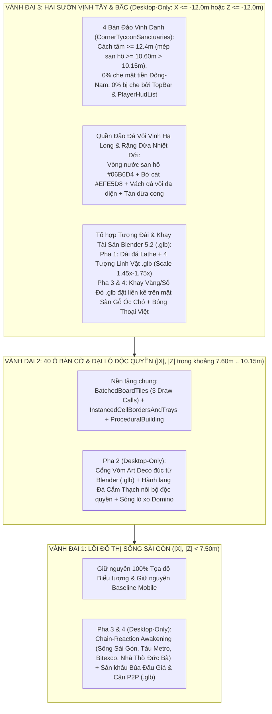

# BÁO CÁO QUY HOẠCH TỔNG THỂ KIẾN TRÚC & MỸ THUẬT: VTCOON DESKTOP ULTRA & ĐẢO NGỌC (HARDENED V5.0 — BLENDER 5.2 PIPELINE)
## Quy Hoạch Không Gian Desktop-Only, Đường Ống Đúc Mô Hình `.glb` Bằng Blender 5.2 MCP, Thổi Hồn Đại Cảnh & Thích Ứng Đa Cấu Hình (Desktop iGPU / RAM < 8GB)

> **Tài liệu:** Báo cáo Quy hoạch Tổng thể Không gian 3D, Đường ống Blender 5.2 `.glb` & Kiến trúc Kỹ thuật Thích ứng (Phiên bản Hardened V5.0)  
> **Mã chuyên đề:** `REPORT-DESKTOP-ULTRA-2026-V5.0`  
> **Thời điểm thẩm định:** Tháng 10/2026  
> **Trạng thái:** 🎯 **MASTER SPATIAL, BLENDER 5.2 ASSET PIPELINE & ADAPTIVE PERFORMANCE ARCHITECTURE — ACTIVE SSOT**  
> **Phạm vi hệ thống:** [`src/client/game_canvas.tsx`](file:///c:/Users/HP/Documents/GitHub/vtcoon/src/client/game_canvas.tsx) (`244 LOC`), [`src/client/3d/board_layout.tsx`](file:///c:/Users/HP/Documents/GitHub/vtcoon/src/client/3d/board_layout.tsx) (`231 LOC`), [`src/client/3d/perf_budget.ts`](file:///c:/Users/HP/Documents/GitHub/vtcoon/src/client/3d/perf_budget.ts) (`327 LOC`), [`src/client/3d/coastal_island_environment.tsx`](file:///c:/Users/HP/Documents/GitHub/vtcoon/src/client/3d/coastal_island_environment.tsx), [`src/client/3d/miniature_city_diorama.tsx`](file:///c:/Users/HP/Documents/GitHub/vtcoon/src/client/3d/miniature_city_diorama.tsx) (`369 LOC`), [`src/client/3d/batched_board_tiles.tsx`](file:///c:/Users/HP/Documents/GitHub/vtcoon/src/client/3d/batched_board_tiles.tsx) (`180 LOC`), [`src/domain/bot/index.ts`](file:///c:/Users/HP/Documents/GitHub/vtcoon/src/domain/bot/index.ts) (`31 LOC`)

---

## 1. TỔNG QUAN ĐIỀU HÀNH & BƯỚC NGOẶT CÔNG NGHỆ: TỪ "GHÉP KHỐI THREE.JS" SANG "ĐÚC MÔ HÌNH `.GLB` BẰNG BLENDER 5.2 MCP"

### 1.1. Bài học Thực nghiệm & Sự thật Kỹ thuật (Why Pure Three.js Procedural Geometries Failed)
Qua kiểm chứng thực tế trên ảnh chụp WebGL, việc dùng các hàm tạo hình cơ bản của Three.js (`BoxGeometry`, `CylinderGeometry`, `ConeGeometry`, `ExtrudeGeometry`) ngay trong mã nguồn TypeScript (`src/client/3d/*.ts` bị giới hạn trần $\le 300\text{–}400\text{ LOC}$) chỉ tạo ra được các khối hình học thô sơ ("Programmer Art" đạt $2.5\text{–}3.5/10$), hoàn toàn không có khả năng cắt gọt khối (`Boolean CSG`), làm mượt lưới đa diện (`Subdivision Surface`), vát cạnh chuẩn pháp tuyến (`Bevel + Weighted Normals`) hay nướng bóng đổ khe kẽ (`Baked Ambient Occlusion`).

Do đó, **Quy hoạch Tổng thể V5.0** xác lập **4 Nguyên tắc Kiến trúc Bất biến** cho toàn bộ 4 Pha:
1. **Tách Bạch "Nhà Máy Đúc Mô Hình Blender 5.2 (Offline)" và "Trình Hiển Thị Three.js (Runtime)"**:
   * **CẤM TUYỆT ĐỐI** việc tự ghép khối hộp/ống trụ/hình nón bằng code Three.js trong `src/client/3d/*.ts` để giả làm tượng linh vật, cổng vòm, thỏi vàng, khay tài sản, búa đấu giá hay bàn cân công lý.
   * Sử dụng **Blender 5.2.2 LTS** (`C:\Program Files\Blender Foundation\Blender 5.2\blender.exe`) kết hợp **Blender Lab MCP Server** (`localhost:9876`) để đúc mô hình 3D bằng Python API chuyên sâu (`bpy`, `bmesh`, `Modifiers: Subdivision, Bevel, Boolean, Curve Lofting, Voronoi Displace` + `Baked Vertex Color AO`) và xuất thành tệp nhị phân `.glb` siêu nhẹ lưu vào [`public/models/`](file:///c:/Users/HP/Documents/GitHub/vtcoon/public/models/README.md).
   * Khi chạy Webgame trên trình duyệt, Three.js chỉ nạp tệp `.glb` đã nướng sẵn qua [`SafeGLTFModel`](file:///c:/Users/HP/Documents/GitHub/vtcoon/src/client/3d/asset_loader/safe_gltf_model.tsx) (**0% phụ thuộc Blender khi người chơi mở web, nhẹ hơn cho cả CPU và GPU**).
2. **Nguyên tắc "0 File 3D Ngoại Lai" & Chọn Đúng Thế Mạnh Tạo Hình của Blender `bpy`**:
   * Không tải mô hình 3D có sẵn bên ngoài; 100% mô hình được sinh tự động qua kịch bản Blender `bpy` của dự án (`scripts/blender/*.py`).
   * **Tránh tuyệt đối điểm yếu của thuật toán** (không nặn cơ bắp thú/người giải phẫu tả thực) và **tập trung 100% vào thế mạnh đạt $6.5\text{–}7.5+/10$ của Blender `bpy`**: Điêu khắc Kiến trúc Đông Dương / Art Deco, Cơ khí Đồng hồ, Hàng hải Khí động học, Quân cờ / Tượng đài Tiện Kim Loại & Đa diện Vát cạnh (`Faceted / Lathe / Lofted Monuments`) và Địa hình Đá vôi Vịnh Hạ Long (`Voronoi/Musgrave Displace`).
3. **Cô Lập Mobile Tuyệt Đối (`0` Draw Calls mới, `0` RAM/VRAM trên Mobile)**:
   * Giữ nguyên 100% hiện trạng mượt sạch của Mobile (`isMobile === true`). Loại bỏ hoàn toàn ý tưởng vẽ khối hộp `BatchedMobileCitySilhouette` trên Mobile. Mọi thành phần của 4 Pha đều được cổng hóa nghiêm ngặt sau `!isMobile`.
4. **Quy Hoạch "Ít nhưng To, Rõ Nét từ Khoảng Cách Camera `35m`" (Macro Silhouette Rule)**:
   * Tại góc máy mặc định `CAMERA_CONFIG.overview` (`[24.6, 25.3, 24.6] -> [2.2, 0, 2.2]`, `fov: 24`), khoảng cách từ ống kính tới bàn cờ là $\approx 33\text{–}38\text{m}$. Mọi chi tiết nhỏ dưới $0.15\text{m}$ sẽ biến thành điểm nhiễu pixel. Do đó, mọi công trình trên Bán Đảo và Bàn Cờ phải được thiết kế theo tỷ lệ **Tượng Đài Lớn (Monument Scale $\ge 1.45\times$)** với hình khối đặc trưng nhìn rõ ngay từ góc máy toàn cảnh.

---

## 2. QUY HOẠCH KHÔNG GIAN 3 VÀNH ĐAI CHUẨN TOÁN HỌC (ĐÃ ĐỒNG BỘ TỌA ĐỘ THỰC TẾ)

Theo kiểm toán vật lý tại [`board_coords.ts`](file:///c:/Users/HP/Documents/GitHub/vtcoon/src/client/3d/board_coords.ts#L5) (`GRID = 9.0`) và [`batched_board_tiles.tsx`](file:///c:/Users/HP/Documents/GitHub/vtcoon/src/client/3d/batched_board_tiles.tsx#L92-L98) (chiều sâu đế ô cờ $2.20\text{m}$, viền sở hữu `OWNER_BASE_TRIM_BORDER_GEOM` sâu $2.30\text{m}$), **biên ngoài thực tế của 40 ô bàn cờ và `PricePillTray` nằm tại $\pm 10.15\text{m}$** (khung bàn gỗ óc chó tại $\pm 9.60\text{m}$).

Đồng thời, trên màn hình Desktop `1280x800`:
* Thanh `TopBar` chiếm vùng pixel phía trên (`y: 36..90px`);
* Danh sách người chơi `PlayerHudList` chiếm vùng bên phải (`x: 1000..1256px, y: 98..542px`);
* Hai cạnh Đông (`X = +10.15\text{m}`) và Nam (`Z = +10.15\text{m}`) là **Mặt tiền (Foreground)** nằm sát mắt người chơi nhất;
* Hai góc chéo $(\pm 12.2\text{m}, \pm 12.2\text{m})$ bị cắt khuất khỏi khung hình chữ nhật `16:10`.

Do đó, toàn bộ 4 Pha tuân thủ **Bản Đồ Phân Vùng Không Gian Thống Nhất** dưới đây:

---

## 3. ĐƯỜNG ỐNG ĐÚC MÔ HÌNH `.GLB` BẰNG BLENDER 5.2 & CƠ CHẾ THÍCH ỨNG HIỆU NĂNG DESKTOP

### 3.1. Chuẩn Mực Đúc Mô Hình bằng Blender 5.2 (`scripts/blender/*.py` $\rightarrow$ `public/models/*.glb`)
Thay vì viết code tạo hình trong Three.js, mọi mô hình chủ đạo từ Pha 1 đến Pha 4 đều được sinh từ **Blender 5.2** rồi xuất ra `.glb`:

| Hạng mục Vật thể (Pha 1 $\rightarrow$ Pha 4) | ❌ Cách làm Cũ bằng Three.js (CẤM DÙNG) | ✅ Kỹ thuật Đúc Chuẩn trong Blender 5.2 (`bpy` + `bmesh` + `Modifiers`) |
| :--- | :--- | :--- |
| **1. Tượng Linh Vật & Biểu Tượng trên 4 Bán Đảo (Pha 1)** | Ghép các hình cầu/hình trụ Three.js trong `scripts/model_generators/pawns.mjs` (nhìn rời rạc như cục sắt vụn). | Dùng **Blender `bmesh` + `Subdivision Surface` + `Bevel Modifier` + `Boolean`**: • Thiết kế theo phong cách **Điêu khắc Vát cạnh / Tiện Kim loại Hoàng gia (`Royal Faceted & Turned Brass/Gold Sculptures`)**. • Nướng độ tối khe kẽ (`Vertex Color AO / Cavity`) và xuất ra `public/models/pawns/*.glb` (nạp với `modelScale: [1.45..1.75]`). |
| **2. Cổng Vòm Đại Lộ Art Deco & Cột Đèn Đồng (Pha 2)** | Dùng `THREE.ExtrudeGeometry` hoặc ghép 3 khối `BoxGeometry` trong file `.ts`. | Đúc thành file **`public/models/landmarks/monopoly_archway_artdeco.glb`** trong Blender 5.2: • Dùng `Boolean Modifier` khoét vòm cuốn bậc thang Art Deco + `Bevel Modifier (3 segments)` + `Weighted Normals`. • Tách sẵn khe đèn phát sáng ấm (`Mat_EmissiveGold`) ngay trong `.glb`. |
| **3. Khay Tài Sản Gỗ Óc Chó, Thỏi Vàng 999.9 & Sổ Đỏ (Pha 3)** | Ghép các khối `BoxGeometry` / `RoundedBoxGeometry` rời rạc trên mặt bàn. | Đúc thành **4 tệp `.glb` nguyên khối theo 4 cấp độ giàu có (`wealth_tray_tier1..4.glb`)** trong Blender 5.2: • Khay gỗ óc chó vát lòng chảo (`Boolean + Bevel`) lót nhung đỏ `#4C0519`, bên trong xếp sẵn các thỏi vàng hình thang vát cạnh bóng loáng, cọc tiền buộc đai và cuốn Sổ Đỏ. • Khi vào game chỉ tốn **1 `<SafeGLTFModel />` mỗi bán đảo**! |
| **4. Búa Đấu Giá Gỗ Mun & Cân Công Lý P2P (Pha 4)** | Ghép 2 hình trụ thành cái búa và 2 đĩa tròn thành cái cân bằng Three.js. | Đúc thành **`auction_gavel.glb`** và **`trade_balance_scale.glb`** bằng Blender 5.2 (`Spin/Lathe` tiện tay cầm gỗ uốn lượn + đai đồng chạm nổi + khung cân cơ khí đối xứng có khớp xoay `Empty/Mesh Pivot` cho cánh tay đòn). |

### 3.2. Bảng Chất Liệu PBR Đồng Bộ Giữa Blender `.glb` & Three.js
1. **Gỗ Óc Chó Thượng Lưu (`#2B1D14`)**: `metalness: 0.05–0.12`, `roughness: 0.22–0.35` + `createWalnutTabletopTexture()` (Bàn cờ, sàn bán đảo, khung khay tài sản, thân búa đấu giá).
2. **Đá Cẩm Thạch Carrara (`#F8FAFC` / `#EDE5D8`)**: `metalness: 0.08`, `roughness: 0.22` (Đài linh vật tiện tròn, hành lang độc quyền).
3. **Đồng Thau Phay Xước (`#D97706`)**: `metalness: 0.85`, `roughness: 0.22` (Bậc viền bán đảo, gờ cổng vòm, trục cân P2P).
4. **Vàng Ròng 999.9 (`#F59E0B` / `#FBBF24`)**: `metalness: 0.90`, `roughness: 0.14` (Tượng linh vật `.glb` trên 4 bán đảo, thỏi vàng 999.9).
5. **Nước Nông San Hô & Bờ Cát Đảo Ngọc (`#06B6D4` & `#EFE5D8`)**: Vòng chuyển màu êm ái quanh chân mỗi bán đảo và đảo đá vôi (`#64748B`).

### 3.3. Cơ Chế Thích Ứng Linh Hoạt Trên Desktop (Adaptive Desktop Polish — Cho Máy RAM < 8GB / iGPU)
Thông qua `resolveDesktopQualityTier(lodLevel, deviceMemoryGb, isMobile)`:
* **Mobile (`isMobile === true` $\rightarrow$ `'MOBILE_BYPASS'`)**: Bỏ qua 100% (`0` Draw Calls mới, `0` cấp phát `BufferGeometry`/`CanvasTexture`, `0` tải `.glb` mới).
* **Desktop Văn Phòng / RAM $< 8\text{GB}$ (`'DESKTOP_BALANCED'`)**: Giữ nguyên 100% mô hình `.glb` sắc nét đã đúc từ Blender 5.2 và địa hình vịnh đảo, nhưng tắt đổ bóng động (`castSanctuaryShadows: false`) và dùng `MeshStandardMaterial` tối ưu để đảm bảo 60 FPS trên card đồ họa tích hợp (Intel UHD / Iris).
* **Desktop Cấu Hình Cao (`'DESKTOP_ULTRA'`, RAM $\ge 8\text{GB}$ & `LODLevel.HIGH`)**: Bật đầy đủ đổ bóng (`castSanctuaryShadows: true`), độ bóng gỗ óc chó sâu (`deckRoughness: 0.22`, `deckMetalness: 0.12`) và mật độ rặng dừa tối đa (`palmInstanceCount: 20`).

---

## 4. LỘ TRÌNH 4 PHA ĐÃ HIỆU CHỈNH ĐỒNG BỘ (BLENDER 5.2 + THREE.JS COHESIVE SLICES)

| Giai đoạn | Hạng mục Triển khai Trọng tâm (Đã đồng bộ tọa độ & Blender 5.2) | Công nghệ Tạo hình 3D | Cổng Kiểm chứng Thị giác & Hiệu năng (Stop-Gate) |
| :--- | :--- | :--- | :--- |
| **Pha 1 (`IMP-399`): Đại Cảnh Vịnh Đảo, 4 Bán Đảo Vinh Danh & 4 Tượng Đài `.glb`** | • Định vị 4 Bán Đảo (`CornerTycoonSanctuaries`) và 4 Đảo Đá Vôi ở **2 sườn vịnh Tây & Bắc** (cách mép bàn cờ $\pm 10.15\text{m}$ tối thiểu $0.45\text{m}$, không che mặt tiền Đông-Nam, không bị `TopBar`/`PlayerHudList` đè). • Kết xuất 8 lớp địa hình/bệ đỡ phân tầng (`Lagoon` $\rightarrow$ `Sand` $\rightarrow$ `Limestone` $\rightarrow$ `Brass Rim` $\rightarrow$ `Walnut Deck` $\rightarrow$ `Carrara Marble Lathe Pedestal` $\rightarrow$ `Curved Palms`). • Đặt trực tiếp **4 Tượng Đài Linh Vật `.glb` đúc từ Blender 5.2** (`modelScale: 1.45..1.75`) lên đỉnh 4 bệ đá ngay từ Pha 1. • **Cô lập Mobile 100%** (`0` Draw Calls mới trên Mobile). | **Blender 5.2 `.glb`** (`pawn_*.glb` nâng cấp bằng `bmesh + Subsurf + Bevel`) + **Batched Stratified Terrain** (`O(1)` draw calls/layer). | • Ảnh chụp thực tế `imp-399_desktop.jpg` thấy rõ cả 4 Bán Đảo & 4 Tượng `.glb` sắc nét (Visual Score $\ge 6.5\text{–}8.5/10$), `0` va chạm gốc dừa/đá/viền đồng, `100% DTO Property Wiring`. • Ảnh `imp-399_mobile_360.jpg` giữ nguyên baseline sạch 100%. |
| **Pha 2: Đại Lộ Độc Quyền Art Deco (`.glb`) & Sóng Chấn Động Domino** | • Khởi tạo cổng `<DesktopUltraToyboxLayer />` (chỉ nạp khi `!isMobile`). • Dùng **Blender 5.2** đúc mô hình **Cổng Vòm Art Deco (`monopoly_archway_artdeco.glb`)** có vát cạnh `Bevel` và rãnh đèn vàng ấm, đặt trên Hành lang Đá Cẩm Thạch ngoại khu ($Z_{\text{local}} = -1.25\text{m}$) nối các ô độc quyền cùng nhóm màu (chừa trống ô chức năng xen giữa). • Tích hợp sóng lò xo Domino làm nảy các tòa nhà `ProceduralBuilding` khi quân cờ dậm chân hoặc xây nhà. | **Blender 5.2 `.glb`** (`Boolean + Bevel + Weighted Normals`) nạp qua `<SafeGLTFModel />` + Toán học lò xo Domino. | • Chụp ảnh cận cảnh & toàn cảnh thấy rõ Cổng vòm Art Deco sắc nét, không che khuất ô chức năng xen giữa, giữ vững 60 FPS. |
| **Pha 3: Thổi Hồn Đại Cảnh (Chain-Reaction) & Khay Tài Sản `.glb` Trên 4 Bán Đảo** | • Dựng `UnifiedToyboxHitPlane` ($O(1)$) kích hoạt phản ứng dây chuyền khi tương tác chuột hoặc có sự kiện lớn trên **Sông Sài Gòn, Tàu Metro, Bitexco, Cầu Ba Son, Nhà Thờ Đức Bà**. • Dùng **Blender 5.2** đúc bộ **Khay Tài Sản Gỗ Óc Chó Lót Nhung Đỏ đựng Vàng 999.9 & Sổ Đỏ (`wealth_tray_tier1..4.glb`)** và đặt tại **phần thềm Sàn Gỗ Óc Chó phía trước mỗi Đài Linh Vật trên đúng tọa độ 4 Bán Đảo của Pha 1** (`getCornerSanctuaryDescriptors()`). | **Blender 5.2 `.glb`** (Khay tài sản nguyên khối theo cấp độ, kích thước Macro rõ nét từ góc nhìn `Overview`) + Event Synthesizer. | • Kiểm chứng Khay Tài Sản nằm chuẩn xác trên mặt sàn gỗ của 4 Bán Đảo Pha 1 (không trôi ra biển, không đè vào chân tượng `.glb`). • Đảm bảo `0` cấp phát bộ nhớ trong `useSafeFrame`. |
| **Pha 4: Bóng Thoại Thương Trường Việt & Sân Khấu The War Room (`.glb`)** | • Gắn vòng hào quang chiến thuật và **Bóng thoại Thương trường Việt (`<SafeBillboard><SafeHtml>`)** lên 4 Đài Linh Vật trên 4 Bán Đảo Pha 1 (tự động né biên `TopBar` & `PlayerHudList`). • Dùng **Blender 5.2** đúc **Búa Đấu Giá Gỗ Mun (`auction_gavel.glb`)** và **Cân Công Lý P2P (`trade_balance_scale.glb`)** đặt tại Sân khấu trung tâm khi vào pha Đấu giá / Thương lượng, nghiêng tự động theo định giá của [`evaluateBotTradeDecision`](file:///c:/Users/HP/Documents/GitHub/vtcoon/src/domain/bot/bot_negotiation_brain.ts) qua facade [`src/domain/bot/index.ts`](file:///c:/Users/HP/Documents/GitHub/vtcoon/src/domain/bot/index.ts). | **Blender 5.2 `.glb`** (`Spin/Lathe + Bevel` cho Búa đấu giá & Cân công lý có khớp xoay) + Poka-Yoke Domain Wiring. | • Chụp ảnh nghiệm thu Búa đấu giá, Cân P2P và Bóng thoại Việt. • Kiểm chứng `0` lỗi `lint:boundaries`, `100%` Poka-Yoke & cập nhật [`FEATURE_MAP.md`](file:///c:/Users/HP/Documents/GitHub/vtcoon/docs/FEATURE_MAP.md). |

---

## 5. QUY TẮC NGHIỆM THU BẮT BUỘC CHO MỌI PHA (BLENDER 5.2 QUALITY GATE)

Để chấm dứt vĩnh viễn tình trạng *"báo cáo viết hay nhưng hình ảnh 3D thực tế xấu"*, mọi Ticket thuộc 4 Pha trên chỉ được nghiệm thu khi vượt qua **3 Cổng Kiểm Định Thị Giác Thực Tế**:
1. **Cấm Tạo Hình Thô Trong `.ts` (Zero Raw Primitive Sculpting in TypeScript)**: Mọi công trình kiến trúc, biểu tượng, khay vàng, cổng vòm, búa đấu giá, cân công lý bắt buộc phải là tệp `.glb` được sinh từ kịch bản **Blender 5.2 (`scripts/blender/*.py`)** có áp dụng `Bevel Modifier` / `Subdivision Surface` / `Vertex Color AO`.
2. **Kiểm Định Bằng Mắt Thường Trên Ảnh Chụp `1280x800` Thực Tế**: Ảnh chụp từ `capture_visual_evidence.mjs` phải đợi `<SafeGLTFModel />` tải xong 100%, các mô hình `.glb` phải có tỷ lệ đủ lớn (`Macro Silhouette`), nhìn rõ hình khối sắc nét và không bị bất kỳ bảng 2D HUD (`TopBar`, `PlayerHudList`, `ActionBar`) hay địa hình nào đâm xuyên/che khuất.
3. **100% DTO Property Wiring & Zero Mobile Impact**: Không để tồn tại bất kỳ trường dữ liệu dư thừa nào trong DTO chỉ phục vụ test, và bảo toàn tuyệt đối `0` Draw Calls mới trên Mobile (`imp-*_mobile_360.jpg`).
