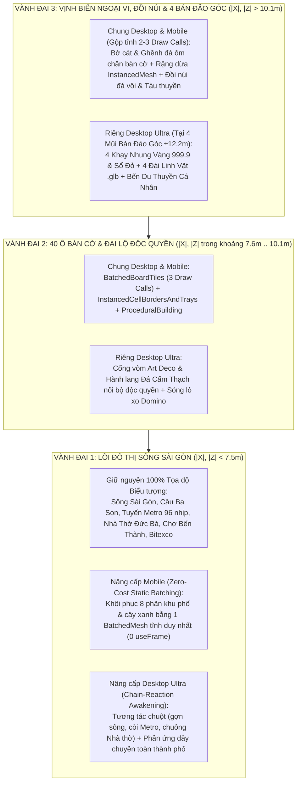
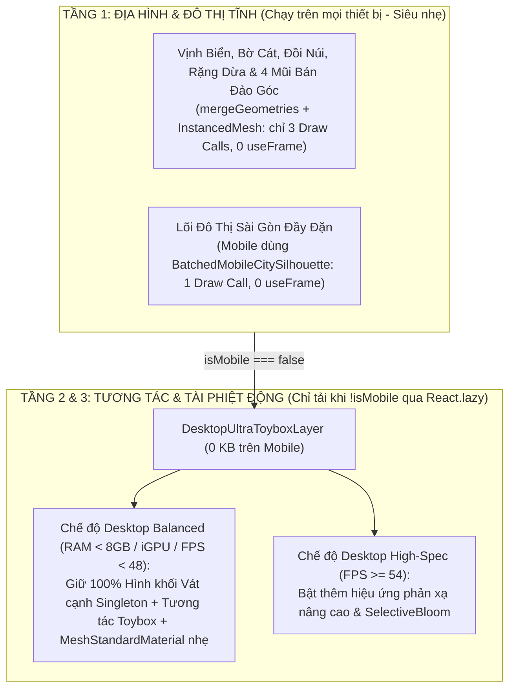

# BÁO CÁO QUY HOẠCH TỔNG THỂ KIẾN TRÚC & MỸ THUẬT: VTCOON DESKTOP ULTRA & ĐẢO NGỌC (HARDENED V4.1)
## Quy Hoạch Không Gian 3 Vành Đai, Mô Hình "Indochine Executive Tabletop", Thổi Hồn Đại Cảnh & Thích Ứng Đa Cấu Hình (Desktop iGPU / RAM < 8GB & Mobile)

> **Tài liệu:** Báo cáo Quy hoạch Tổng thể Không gian 3D, Mỹ thuật Lookbook & Kiến trúc Kỹ thuật Thích ứng (Phiên bản Hardened V4.1)  
> **Mã chuyên đề:** `REPORT-DESKTOP-ULTRA-2026-V4.1`  
> **Thời điểm thẩm định:** Tháng 10/2026  
> **Trạng thái:** 🎯 **MASTER SPATIAL, ART & ADAPTIVE PERFORMANCE ARCHITECTURE — SẴN SÀNG REVIEW**  
> **Phạm vi hệ thống:** [`src/client/game_canvas.tsx`](file:///c:/Users/HP/Documents/GitHub/vtcoon/src/client/game_canvas.tsx) (`244 LOC`), [`src/client/3d/board_layout.tsx`](file:///c:/Users/HP/Documents/GitHub/vtcoon/src/client/3d/board_layout.tsx) (`231 LOC`), [`src/client/3d/perf_budget.ts`](file:///c:/Users/HP/Documents/GitHub/vtcoon/src/client/3d/perf_budget.ts) (`327 LOC`), [`src/client/3d/coastal_island_environment.tsx`](file:///c:/Users/HP/Documents/GitHub/vtcoon/src/client/3d/coastal_island_environment.tsx) (`237 LOC`), [`src/client/3d/miniature_city_diorama.tsx`](file:///c:/Users/HP/Documents/GitHub/vtcoon/src/client/3d/miniature_city_diorama.tsx) (`369 LOC`), [`src/client/3d/batched_board_tiles.tsx`](file:///c:/Users/HP/Documents/GitHub/vtcoon/src/client/3d/batched_board_tiles.tsx) (`180 LOC`), [`src/domain/bot/index.ts`](file:///c:/Users/HP/Documents/GitHub/vtcoon/src/domain/bot/index.ts) (`31 LOC`)

---

## 1. TỔNG QUAN ĐIỀU HÀNH & BẢN VẼ LOOKBOOK MỸ THUẬT ĐÍCH

### 1.1. Bước ngoặt tư duy: Từ "Đồ họa hậu kỳ thụ động" sang "Đại Cảnh Quần Đảo Sống Động & Sa Bàn Xúc Giác"
Ở thời điểm tháng 10/2026, phiên bản nâng cấp của `vtcoon` không đi theo lối mòn đốt GPU vào các bộ lọc làm mờ hậu kỳ, mà tập trung giải quyết **3 mục tiêu chiến lược song hành**:
1. **Quy hoạch lại Tổng thể Không gian 3 Vành Đai (Cho cả Desktop & Mobile)**: Kết nối liền mạch **Lõi Đô thị Sông Sài Gòn** $\leftrightarrow$ **Vành đai 40 Ô Bàn cờ** $\leftrightarrow$ **4 Mũi Bán Đảo Tài Phiệt & Quần Đảo Vịnh Biển (Đồi núi, Bờ cát, Rặng dừa, Tàu thuyền)**, xóa bỏ hoàn toàn các khoảng trống do cờ `streamlined = true` và `!isMobile` để lại từ các bản trước.
2. **Đúc Tác Phẩm Xúc Giác "Indochine Executive Tabletop" (Độc quyền Desktop Ultra)**: Biến mặt bàn thành một món đồ chơi cơ khí xa xỉ với Cổng vòm Đại lộ Art Deco, Khay nhung đựng Vàng 999.9 & Sổ Đỏ, Đài Linh Vật đúc vàng, Cân công lý P2P và Hệ sinh thái Phản ứng Dây chuyền (*Chain-Reaction Awakening*) của toàn bộ Sông Sài Gòn, Metro, Nhà Thờ Đức Bà, Bitexco.
3. **Thích ứng Linh hoạt theo Thực tế Phần cứng Desktop (Adaptive Desktop Polish)**: Để ngỏ khả năng tinh chỉnh linh hoạt trong quá trình implement nhằm đảm bảo máy tính văn phòng (RAM $< 8\text{GB}$, card onboard Intel UHD/Iris, các trình duyệt Chrome/Edge/Firefox/Safari khác nhau) vẫn vừa đạt độ "Wow" thẩm mỹ vừa giữ vững 60 FPS mượt mà.

---

## 2. QUY HOẠCH TỔNG THỂ KHÔNG GIAN 3 VÀNH ĐAI (MASTER SPATIAL LAYOUT)

Qua kiểm toán vật lý tại [`coastal_island_environment.tsx`](file:///c:/Users/HP/Documents/GitHub/vtcoon/src/client/3d/coastal_island_environment.tsx#L44-L216) và [`miniature_city_diorama.tsx`](file:///c:/Users/HP/Documents/GitHub/vtcoon/src/client/3d/miniature_city_diorama.tsx#L332-L361), hiện tại vùng biển sát ngoài bàn cờ đang bị trống (do `streamlined = true` ẩn mất bờ cát/rặng dừa) và lòng bàn cờ trên Mobile đang bị thưa (do `IMP-371` ẩn 8 phân khu phố). Nếu đặt thẳng Khay Tài Sản ra ngoài bàn cờ, khay sẽ bị trôi lơ lửng trên mặt nước biển.

Do đó, **Quy hoạch Tổng thể V4.1** giữ nguyên 100% tọa độ gốc của các công trình biểu tượng (bảo toàn hơn 5,400 bài Living Contract Tests), đồng thời tái cấu trúc không gian thành **3 Vành Đai Đồng Tâm Liền Mạch**:

### 2.1. Chi Tiết Vành Đai 3 (Ngoại Vi Bàn Cờ: $|X|, |Z| > 10.1\text{m}$)
1. **Bờ Đảo, Rặng Dừa, Đồi Núi & Tàu Thuyền (Nâng cấp cho cả Desktop & Mobile)**:
   * Khôi phục vành đai bờ cát thoải và ghềnh đá ôm sát chân bàn cờ ($R \in [10.2\text{m}, 14.8\text{m}]$) để bàn cờ thực sự tọa lạc trên một **Hòn Đảo Nhiệt Đới** vững chãi giữa vịnh biển.
   * Bổ sung các cụm đảo đá vôi / đồi núi xanh ven vịnh và rặng dừa nhiệt đới nghiêng bóng.
   * **Kỷ luật hiệu năng**: Toàn bộ bờ cát, ghềnh đá, đồi núi ngoại vi được gộp cứng bằng `mergeGeometries` thành **2 `BufferGeometry` tĩnh** và **1 `InstancedMesh`** cho rặng dừa (`castShadow={false}`, `raycast={noopRaycast}`, `0 useFrame`). Cả Mobile và Laptop văn phòng đều có đầy đủ núi non, cây cối, biển đảo mà chỉ tốn thêm đúng **3 Draw Calls**.
2. **4 Mũi Bán Đảo Tài Phiệt ở 4 Góc Bàn Cờ ($(\pm 12.2\text{m}, \pm 12.2\text{m})$)**:
   * Vươn ra từ 4 góc bàn cờ (Ô GO, Kiểm Toán, Nghỉ Dưỡng, Thuế) là **4 Mũi Bán Đảo Đá Hoa Cương & Sàn Gỗ Óc Chó** có bọt sóng trắng vỗ quanh chân.
   * Trên **Desktop Ultra**, mỗi mũi bán đảo là "Tổng hành dinh" của 1 người chơi, đặt trang trọng **Khay Tài Sản Lót Nhung Đỏ** và **Đài Vinh Danh Linh Vật Đúc Vàng** (hóa giải triệt để lỗi khay tiền trôi lơ lửng trên mặt nước).

### 2.2. Chi Tiết Vành Đai 1 (Lòng Bàn Cờ: $|X|, |Z| < 7.5\text{m}$)
1. **Bảo toàn 100% Tọa độ Gốc của Các Biểu Tượng Hiện Hữu**:
   * **Sông Sài Gòn** ($X \in [-0.9\text{m}, +0.9\text{m}]$), **Tuyến Metro số 1** (96 nhịp cầu cạn U-Girder tại $X, Z \approx \pm 6.9\text{m}$), **Tháp Bitexco** ($[-4.5, 0.16, -4.4]$), **Nhà Thờ Đức Bà & Chợ Bến Thành** ($[-2.7, 0, -2.5]$), **Cầu Ba Son & Cầu Long Biên** ($Z = \pm 3.8\text{m}$) giữ nguyên tuyệt đối vị trí và cấu trúc AST để bảo vệ 100% các bài kiểm thử hợp đồng.
2. **Khôi phục Phố Phường trên Mobile bằng 1 Batched Mesh Tĩnh (`BatchedMobileCitySilhouette`)**:
   * Thay vì ẩn trắng 8 phân khu đô thị trên Mobile như `IMP-371`, hệ thống gộp tĩnh hình học của các dãy Shophouse Chợ Lớn, Cao ốc Thủ Thiêm, Công viên bờ sông và 2 Nhà ga Metro thành **1 khối `BufferGeometry` tĩnh duy nhất** nạp trên Mobile (`1 Draw Call`, `0 useFrame`).
3. **"Thổi Hồn Đại Cảnh" (Chain-Reaction Awakening) trên Desktop Ultra**:

| Công trình Biểu tượng | Phản hồi Tương tác Chuột (Tactile Toybox) | Phản ứng Dây chuyền theo Sự kiện Ván đấu (Macro Chain-Reaction) |
| :--- | :--- | :--- |
| **1. Sông Sài Gòn & Du Thuyền** | • Rê chuột trên sông tạo vòng sóng nước lan tỏa theo mũi trỏ. • Lướt qua du thuyền làm thuyền dập dềnh rẽ nước. | • Khi có người chơi qua ô GO hoặc thắng Đấu giá lớn: Du thuyền bật đèn hội trường vàng rực và bắn pháo sáng dọc hai bờ kè. |
| **2. Tàu Metro Số 1** | • Click vào đoàn tàu: Tàu kéo còi vang dội, bật đèn pha sáng rực và tăng tốc (`boostMultiplier`) vọt về ga kế tiếp. | • Khi quay **Vòng Quay Bến Xe (`TransitWheel`)**: Tàu Metro tăng tốc chạy hộ tống theo hướng di chuyển của người chơi. |
| **3. Tháp Bitexco & Cầu Ba Son** | • Click vào Bitexco: Chạy vòng sóng LED xoắn ốc từ chân đế cánh sen lên sân đáp trực thăng kèm chùm sáng quét lên trời. | • Khi một người chơi lập **Đại Lộ Độc Quyền (Monopoly)**: Đèn dây văng Cầu Ba Son và đỉnh Bitexco đồng loạt đổi sang **màu cờ của chủ đất** trong 5 giây ăn mừng! |
| **4. Nhà Thờ Đức Bà & Chợ Bến Thành** | • Click vào Nhà Thờ: Ngân tiếng chuông đồng trầm ấm, cửa sổ hoa hồng sáng rực, đàn chim câu trắng bay vút quanh tháp chuông. • Click vào Chợ Bến Thành: Mặt đồng hồ phát sáng vàng ấm kèm tiếng nhịp phố Sài Gòn. | • Khi chuyển sang **Pha Đêm / Hoàng Hôn** hoặc rút **Thẻ Sự Kiện Vĩ Mô**: Quảng trường gạch bông Đông Dương thắp sáng hệ thống đèn lồng cổ điển. |

---

## 3. KỸ THUẬT "ĐÚC TÁC PHẨM" & CƠ CHẾ GỌT GIŨA HIỆU NĂNG TRÊN DESKTOP (RAM < 8GB / ĐA TRÌNH DUYỆT)

### 3.1. 4 Kỹ Thuật Đúc Hình Học Tinh Xảo (Nướng Tĩnh 1 Lần — 0% Gánh Nặng GPU Mỗi Frame)
Bí quyết để hình ảnh 3D đạt 90% độ "Wow" như Lookbook mà **không làm nặng máy RAM dưới 8GB** là dồn sự tinh xảo vào **Hình khối Vát cạnh Singleton (khởi tạo 1 lần duy nhất lúc tải trang)** thay vì đốt Fragment Shader mỗi khung hình:

| Vật thể Tác phẩm | ❌ Cách làm Thô sơ (CẤM DÙNG) | ✅ Kỹ thuật Đúc Tinh xảo trong Three.js (Singleton — Siêu nhẹ) |
| :--- | :--- | :--- |
| **1. Cổng Vòm Đại Lộ (Art Deco Archway)** | Ghép 3 khối hộp vuông `boxGeometry` thành hình chữ U cứng nhắc. | Dùng **`THREE.ExtrudeGeometry`** từ đường cong `THREE.Shape` hình vòm bán nguyệt đồng tâm có bật vát cạnh `bevelEnabled: true, bevelThickness: 0.015, bevelSegments: 3`. Lồng bên trong 1 ống `TorusGeometry` ($\pi\text{ rad}$) phát sáng `emissive` tạo rãnh đèn âm trần mượt mà. |
| **2. Thỏi Vàng 999.9 (Bullion Ingot)** | Dùng 1 khối `boxGeometry` sơn màu vàng phẳng lì. | Dùng **`ExtrudeGeometry` vát 4 mặt nghiêng $18^\circ$** tạo khối hình thang cân chuẩn vàng thỏi ngân hàng, kết hợp `CanvasTexture` vẽ chữ dập chìm `999.9 VTCOON`. |
| **3. Cọc Tiền Polymer & Cuốn "SỔ ĐỎ"** | Khối chữ nhật sơn màu xanh/đỏ trơn, không có chi tiết. | Dùng **`RoundedBoxGeometry`** (từ `three-stdlib` sẵn có trong [`batched_board_tiles.tsx`](file:///c:/Users/HP/Documents/GitHub/vtcoon/src/client/3d/batched_board_tiles.tsx#L8)) kết hợp **`CanvasTexture` 512x512** vẽ hoa văn tờ tiền xanh ngọc `500.000` có đai giấy trắng quấn ngang, và bìa đỏ thẫm `#991B1B` in quốc huy + chữ vàng `SỔ ĐỎ`. |
| **4. Đài Đá Cẩm Thạch & Cân Công Lý** | Xếp chồng các hình trụ `cylinderGeometry` thô. | Dùng **`THREE.LatheGeometry`** quay quanh trục $Y$ một biên dạng 2D (chân đế loe $\rightarrow$ cổ thắt đồng thau $\rightarrow$ mặt bàn đá bo tròn) tạo đường cong tiện đá cổ điển, đặt trực tiếp mô hình `.glb` thật từ [`LUXURY_PAWN_CONFIGS`](file:///c:/Users/HP/Documents/GitHub/vtcoon/src/domain/pawn_configs.ts) lên trên. |

### 3.2. Bảng Chất Liệu PBR Chuẩn Hóa (6 Vật Liệu Đồng Bộ Mặt Bàn)
1. **Gỗ Óc Chó Thượng Lưu (`#2B1D14`)**: `metalness: 0.05`, `roughness: 0.28–0.45` (Khung khay tài sản, sàn bán đảo góc, thân búa đấu giá).
2. **Đá Cẩm Thạch Kem Ngà (`#EDE5D8`)**: `metalness: 0.06`, `roughness: 0.35` (Nền hành lang đại lộ, đài linh vật).
3. **Đá Đen Huyền Vũ (`#1E293B`)**: `metalness: 0.25`, `roughness: 0.16` (Thân cổng vòm, viền bậc thềm, đế gõ búa).
4. **Đồng Thau Phay Xước (`#D97706`)**: `metalness: 0.85`, `roughness: 0.25` (Gờ viền cổng vòm, mép khay tiền, cột đèn, trục cân P2P).
5. **Vàng Ròng 999.9 (`#F59E0B` / `#FBBF24`)**: `metalness: 0.90`, `roughness: 0.12` (Thỏi vàng, tượng linh vật `.glb` 4 góc).
6. **Nhung Đỏ Rượu Vang (`#4C0519`)**: `metalness: 0.00`, `roughness: 0.88` (Lót đáy khay tài sản tạo độ tương phản tôn độ bóng của vàng).

### 3.3. Cơ Chế Thích Ứng Linh Hoạt Trên Desktop (Adaptive Desktop Polish — Dành Cho Máy RAM < 8GB / iGPU / Đa Trình Duyệt)
Rút kinh nghiệm trực tiếp từ bài học tối ưu trên Mobile (nơi việc tắt các hiệu ứng bóng loáng đa lớp giúp tăng vọt FPS), báo cáo **để mở cơ chế tinh chỉnh thực nghiệm ở từng Pha** thông qua bộ điều phối [`perf_budget.ts`](file:///c:/Users/HP/Documents/GitHub/vtcoon/src/client/3d/perf_budget.ts#L183-L204) (`LODLevel.HIGH` vs `LODLevel.MEDIUM`/`LOW` và `navigator.deviceMemory`):

| Thành phần Mỹ thuật | Desktop Cấu hình Cao (`LODLevel.HIGH`: RAM $\ge 8\text{GB}$, FPS $\ge 54$) | Desktop Văn phòng / Máy yếu (`LODLevel.MEDIUM/LOW`: RAM $< 8\text{GB}$, Safari/Firefox iGPU, hoặc FPS $< 48$) |
| :--- | :--- | :--- |
| **Hình khối Vát cạnh (`Extrude`, `Lathe`, `RoundedBox`) & `CanvasTexture` 512px** | **Bật 100%** (Singleton BufferGeometry không tốn CPU/GPU mỗi frame). | **Bật 100%** — Giữ nguyên vẹn 100% dáng vòm Art Deco, thỏi vàng hình thang, Sổ Đỏ và đài đá tiện tròn. |
| **Lớp Phủ Bóng Kính & Lông Nhung (`MeshPhysicalMaterial`: `clearcoat`, `sheen`)** | Có thể bật cho các vật thể Hero Props (Khay gỗ, Sổ Đỏ, Thảm nhung) nếu đo thực tế đạt $\ge 60$ FPS. | **Tự động rút gọn về `MeshStandardMaterial` tinh chỉnh (`metalness`/`roughness`)** — Bỏ tính toán shader lớp phủ kép để giải phóng ngay 30%–40% tải Fragment Shader trên card onboard. |
| **Bóng Tiếp Xúc & Phát Sáng (`N8AO`, `SelectiveBloom`)** | Bật ở độ phân giải một nửa (`aoHalfRes: true`). | **Tự động tắt `N8AO` và hạ `DPR` về `1.0`** thông qua [`AdaptiveDprController`](file:///c:/Users/HP/Documents/GitHub/vtcoon/src/client/3d/adaptive_dpr_controller.tsx), dùng màu `emissive` ấm tự nhiên trên vật liệu thay cho post-processing pass. |
| **Dung lượng Bộ nhớ Texture (VRAM Guard cho máy $< 8\text{GB}$ RAM)** | Tối đa `512x512` POT Atlas dùng chung. | Dùng chung **1 Texture Atlas `512x512` duy nhất** cho toàn bộ Tiền 500k + Sổ Đỏ + Nhãn Vàng 999.9 (chỉ tốn **1 MB VRAM**), tuyệt đối không sinh nhiều texture rời rạc gây tràn bộ nhớ trình duyệt. |

> [!TIP]
> **Nguyên tắc Thực thi Linh hoạt (Empirical Tuning Gate)**: Trong quá trình implement từng Pha, bất kỳ hiệu ứng bóng loáng (`clearcoat`, `sheen`, `bumpMap`, `N8AO`) nào làm FPS trên máy chuẩn tụt xuống dưới ngưỡng mục tiêu hoặc gây tốn VRAM đều sẽ được cắt gọn về `MeshStandardMaterial` + `Singleton Beveled Geometry` ngay lập tức.

---

## 4. NĂM TRỤ CỘT TƯƠNG TÁC DESKTOP ULTRA (ĐÃ HIỆU CHỈNH THEO QUY HOẠCH V4.1)

1. **Trụ Cột 1 — Living Monopoly District Transformation (Vành đai 2)**:
   * Dựng **Hành Lang Đá Cẩm Thạch Ngoại Khu ($Z_{\text{local}} = -1.25\text{m}$)** nối phần đất phía sau các công trình cùng nhóm màu, kết hợp **Cổng Vòm Art Deco (`ExtrudeGeometry`)** và cột đèn đồng thau mang ánh sáng màu cờ chủ đất, **chừa trống mặt ô chức năng xen giữa** (Ô 2, 7, 12, 17, 22, 28, 33, 38 trong [`BOARD_CONFIG`](file:///c:/Users/HP/Documents/GitHub/vtcoon/src/domain/board_config.ts)).
2. **Trụ Cột 2 — Tactile Board Toybox & Domino Structure Wave (Vành đai 1 & 2)**:
   * Sóng chấn động lò xo Domino làm nảy **các tòa nhà (`ProceduralBuilding`), hàng cây và xe cộ trên [`LayeredDioramaTile`](file:///c:/Users/HP/Documents/GitHub/vtcoon/src/client/3d/board_tile.tsx)** khi quân cờ dậm chân hoặc xây nhà, bảo toàn 100% 3 mesh mặt bàn tĩnh của [`BatchedBoardTiles`](file:///c:/Users/HP/Documents/GitHub/vtcoon/src/client/3d/batched_board_tiles.tsx).
   * Mặt phẳng toán học duy nhất `UnifiedToyboxHitPlane` ($O(1)$) điều phối toàn bộ tương tác rê/bấm chuột vào Sông Sài Gòn, Tàu Metro, Bitexco, Nhà Thờ Đức Bà và các tòa nhà.
3. **Trụ Cột 3 — Die-Cast Crest Rivals & Vietnamese Table Talk (Vành đai 3 - 4 Bán Đảo Góc)**:
   * Đặt trên 4 Mũi Bán Đảo Góc là 4 Đài Đá Cẩm Thạch tiện tròn (`LatheGeometry`) trưng bày linh vật `.glb` mạ vàng ròng kèm vòng hào quang chiến thuật và bóng thoại thương trường Việt (`<SafeBillboard><SafeHtml>`).
4. **Trụ Cột 4 — 4-Corner Tycoon Wealth Trays (Vành đai 3 - 4 Bán Đảo Góc)**:
   * Cạnh mỗi Đài Linh Vật trên 4 Mũi Bán Đảo Góc là **Khay Tài Sản Gỗ Óc Chó Lót Nhung Đỏ** hiển thị 4 cấp độ giàu có (Xấp tiền 500k buộc đai $\rightarrow$ Thỏi vàng 999.9 hình thang $\rightarrow$ Xấp Sổ Đỏ & Trái phiếu) cùng hiệu ứng cọc tiền/vàng bay theo đường Parabol khi thanh toán.
5. **Trụ Cột 5 — The War Room Stage (Búa Gỗ Đấu Giá & Cân Công Lý P2P)**:
   * Búa gỗ mun gõ theo từng lượt trả giá `AUCTION_BID_PLACED` và giáng mạnh khi chốt `AUCTION_WON`.
   * Cân tiểu ly bằng đồng thau nghiêng tự động theo đúng định giá của [`evaluateBotTradeDecision`](file:///c:/Users/HP/Documents/GitHub/vtcoon/src/domain/bot/bot_negotiation_brain.ts) qua facade [`src/domain/bot/index.ts`](file:///c:/Users/HP/Documents/GitHub/vtcoon/src/domain/bot/index.ts) (tuân thủ 100% Poka-Yoke).

---

## 5. KIẾN TRÚC PHÂN TẦNG 3 CẤP: "MOBILE TBDR $\rightarrow$ DESKTOP BALANCED (< 8GB RAM) $\rightarrow$ DESKTOP ULTRA"

---

## 6. LỘ TRÌNH TRIỂN KHAI 4 PHA (COHESIVE FEATURE SLICES) & CỔNG ĐO ĐẠC THỰC NGHIỆM

| Giai đoạn | Hạng mục Triển khai Trọng tâm | Tác động Desktop vs Mobile | Cổng Kiểm chứng Thị giác & Hiệu năng (Performance Gate) |
| :--- | :--- | :--- | :--- |
| **Pha 1: Quy Hoạch Đại Cảnh Vịnh Đảo, 4 Bán Đảo Góc & Lấp Đầy Đô Thị Mobile** | • Mở lại và gộp tĩnh (`mergeGeometries`) Bờ cát, Đồi núi ven vịnh, Rặng dừa `InstancedMesh` và **4 Mũi Bán Đảo Góc** tại $(\pm 12.2\text{m}, \pm 12.2\text{m})$. • Tạo `BatchedMobileCitySilhouette` khôi phục 8 phân khu phố trong lòng bàn cờ cho Mobile. | **Cả Desktop & Mobile** đều có cảnh quan biển đảo, đồi núi, cây cối và phố phường đầy đặn (`0 useFrame` mới). | • Chụp ảnh toàn cảnh Overview cả Desktop ($1280\times 800$) & Mobile ($360\times 740$) qua `capture:visual`. • Đo đạc Draw Calls & VRAM, pass `npm run prefilter` & `npm run sentinel`. |
| **Pha 2: Đại Lộ Độc Quyền Art Deco & Sóng Chấn Động Domino** | • Khởi tạo cổng `<DesktopUltraToyboxLayer />`. • Đúc Cổng vòm Art Deco (`ExtrudeGeometry` vát cạnh + rãnh đèn LED ấm) & Hành lang đá cẩm thạch nối các ô độc quyền. • Tích hợp sóng lò xo Domino trên công trình lân cận. | **Độc quyền Desktop** (`0 KB` trên Mobile). Gọt giũa chất liệu để chạy mượt trên mọi trình duyệt. | • Chụp ảnh cận cảnh Macro Cổng vòm ngày & đêm. • Kiểm chứng không che khuất ô chức năng xen giữa và giữ vững 60 FPS. |
| **Pha 3: Thổi Hồn Đại Cảnh (Chain-Reaction) & Khay Tài Sản 4 Bán Đảo** | • Dựng `UnifiedToyboxHitPlane` ($O(1)$) + kích hoạt phản ứng dây chuyền cho **Sông Sài Gòn, Tàu Metro, Bitexco, Cầu Ba Son, Nhà Thờ Đức Bà**. • Đúc 4 Khay Nhung Đỏ đựng **Tiền 500k, Vàng 999.9 hình thang, Sổ Đỏ** (dùng chung 1 Atlas `512x512` tốn $\le 1\text{MB}$ VRAM) trên 4 Mũi Bán Đảo Góc + hiệu ứng tiền bay. | **Độc quyền Desktop** (`0 KB` trên Mobile). Tối ưu cho cả máy RAM $< 8\text{GB}$. | • Chụp ảnh cận cảnh Khay Tài Sản 4 cấp độ & hiệu ứng LED Bitexco/Ba Son. • Đảm bảo `0` cấp phát bộ nhớ trong `useSafeFrame`. |
| **Pha 4: Đài Linh Vật Bóng Thoại Việt & Sân Khấu The War Room** | • Đúc 4 Đài đá cẩm thạch tiện tròn (`LatheGeometry`) + tượng `.glb` mạ vàng + Bóng thoại Thương trường Việt (`<SafeHtml>`). • Đúc Búa gỗ đấu giá 3D & Cân công lý P2P dẫn xuất từ [`evaluateBotTradeDecision`](file:///c:/Users/HP/Documents/GitHub/vtcoon/src/domain/bot/bot_negotiation_brain.ts). | **Độc quyền Desktop** (`0 KB` trên Mobile). | • Chụp ảnh cận cảnh Đài linh vật, Búa đấu giá và Cân P2P. • Kiểm chứng `0` lỗi `lint:boundaries`, Poka-Yoke & cập nhật [`FEATURE_MAP.md`](file:///c:/Users/HP/Documents/GitHub/vtcoon/docs/FEATURE_MAP.md). |
