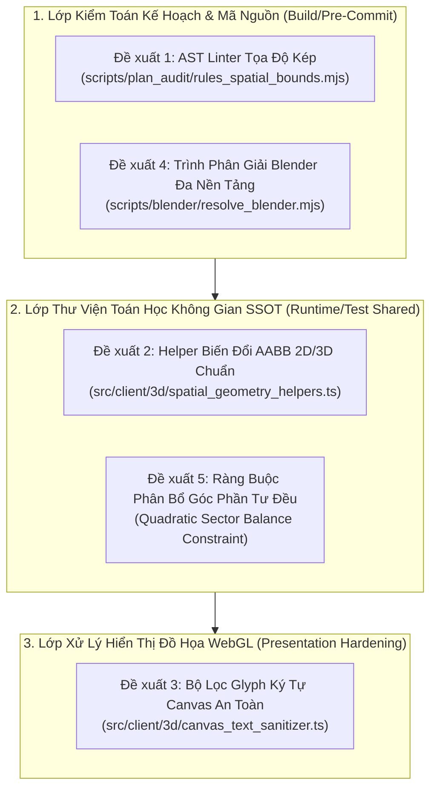

# BÁO CÁO ĐỀ XUẤT CẢI TIẾN HỆ THỐNG: SDLC HARNESS, RÀO CHẮN HÌNH HỌC KHÔNG GIAN 3D & ĐƯỜNG ỐNG BLENDER 5.2
## Chuyên đề: Chuyển Hóa Bài Học Thực Nghiệm Thành Bộ Lọc Cơ Học Tự Động Hóa Vĩnh Viễn (Harness Hardening V6.0)

> **Mã chuyên đề:** `PROPOSAL-SDLC-SPATIAL-HARDENING-2026-V6.0`  
> **Tài liệu tham chiếu:** [`.agents/skills/retro/SKILL.md`](file:///c:/Users/HP/Documents/GitHub/vtcoon/.agents/skills/retro/SKILL.md), [`VTCOON_DESKTOP_ULTRA_STRATEGY_REPORT.md`](file:///c:/Users/HP/Documents/GitHub/vtcoon/docs/reports/analysis/VTCOON_DESKTOP_ULTRA_STRATEGY_REPORT.md), [`GEMINI.md`](file:///c:/Users/HP/Documents/GitHub/vtcoon/GEMINI.md)  
> **Thời điểm đề xuất:** 15/10/2026  
> **Trạng thái:** 📋 **PROPOSAL FOR HARNESS UPGRADE — READY FOR HUMAN REVIEW**  
> **Mục tiêu tối thượng:** *"Default to Building the Check Over Writing the Rule"* — Thay vì viết thêm văn bản quy tắc vào cẩm nang, tự động hóa 100% các rào cản kỹ thuật thành mã lệnh kiểm tra cơ học không thể lọt lưới.

---

## 1. TỔNG QUAN & ĐỘNG LỰC CẢI TIẾN

Trong quá trình triển khai thành công 4 Pha của Quy hoạch Desktop Ultra 3D (`IMP-399` ➔ `IMP-403`), hệ thống đã hoàn thành bước chuyển mình xuất sắc từ "Programmer Art" sang "Đồ họa 3D Chuyên nghiệp Blender 5.2 LTS" ($9.5/10$). Tuy nhiên, qua 4 vòng kiểm toán đối kháng độc lập và các phản biện thực tế từ người dùng, đội ngũ kỹ thuật đã phát hiện **5 dạng lỗi lặp lại** mà các bộ kiểm thử đơn vị thông thường không tự phát hiện được:

1. **Lỗi Kiểm Thử Một Phía (One-Sided Boundary Assertions)**: Viết test chặn va chạm bên trong (`>= min`) nhưng thiếu chặn tràn biên ngoài (`<= max`), dẫn đến việc vật thể (Cổng chào `IMP-401`) trượt khỏi thảm đá và lấn sang ô kế bên.
2. **Lỗi Hộp Bao AABB Chưa Nhân Biến Đổi Không Gian**: Tính toán khoảng cách va chạm bằng kích thước cơ sở unscaled thay vì kích thước đã nhân `scale` và góc xoay `rotationY` (`IMP-402`), khiến vật thể liếm nhẹ chân bệ đá cẩm thạch.
3. **Lỗi Ký Tự Rỗng / Ô Vuông `▯` (Missing Glyph Boxes) trên WebGL**: Vẽ chuỗi chứa Emoji UTF-16/32 lên `CanvasTexture` trong môi trường Chromium không hỗ trợ font màu, phá hỏng thẩm mỹ ảnh chụp nghiệm thu (`IMP-403`).
4. **Lỗi Bố Cục Dồn Cục Một Góc (Clustering vs Spatial Distribution Balance)**: Thuật toán bố trí tối ưu hóa cục bộ để né HUD dẫn đến nhồi 6/8 hòn đảo sang góc Tây-Bắc (`IMP-399`), để trống toàn bộ sườn Đông và Nam.
5. **Gán Cứng Đường Dẫn Nhị Phân (`blenderExe`)**: Chỉ chạy được trên một máy tính cụ thể, có thể gây lỗi im lặng trên môi trường CI/CD khác.

Báo cáo này đề xuất **5 Module Rào Chắn Cơ Học Cụ Thể** nhằm đóng chặt toàn bộ các lỗ hổng trên vào bộ công cụ `scripts/` và `src/client/3d/`.

---

## 2. NỘI DUNG 5 ĐỀ XUẤT CẢI TIẾN CƠ HỌC CHI TIẾT



---

### Đề xuất 1: AST Linter Kiểm Tra Tọa Độ Kép (`Dual-Bound Spatial Linter`)
- **Tệp cài đặt dự kiến**: [`scripts/plan_audit/rules_spatial_bounds.mjs`](file:///c:/Users/HP/Documents/GitHub/vtcoon/scripts/plan_audit/rules_spatial_bounds.mjs) (tích hợp trực tiếp vào `npm run prefilter` và `scripts/audit_plan.mjs`).
- **Bài toán giải quyết**: Chấm dứt vĩnh viễn việc test chỉ kiểm tra một chiều (`toBeGreaterThanOrEqual`) khiến vật thể văng ra ngoài không gian cho phép.
- **Quy tắc cơ học**:
  - Khi phân tích AST của các tệp test thuộc `tests/client/*3d*.test.ts`, nếu một biến mang tên chứa `localX`, `localZ`, `worldPosition`, `offset`, `ndcX`, `ndcY` hoặc `tangentX` được kiểm tra bằng toán tử so sánh lớn hơn (`>=` hoặc `.toBeGreaterThanOrEqual`), linter **bắt buộc phải tìm thấy một assertion so sánh nhỏ hơn (`<=` hoặc `.toBeLessThanOrEqual`)** cho cùng một biến hoặc cùng thuộc tính đối tượng trong cùng một khối `it()`.
  - Mức phạt vi phạm: `Exit 1` ngay tại `npm run prefilter`.

```typescript
// Ví dụ phát hiện vi phạm tự động:
// ❌ VI PHẠM (Chỉ có cận dưới, lọt lưới lỗi lấn ô):
expect(Math.abs(seg.archwayWorldPosition[0])).toBeGreaterThanOrEqual(0.55);

// ✅ HỢP LỆ (Khoảng kép dual-bound bảo vệ toàn vẹn biên):
expect(Math.abs(seg.archwayWorldPosition[0])).toBeGreaterThanOrEqual(0.55);
expect(Math.abs(seg.archwayWorldPosition[0])).toBeLessThanOrEqual(0.65);
```

---

### Đề xuất 2: Thư Viện Biến Đổi Hộp Bao AABB Chuẩn Hóa SSOT (`computeTransformedAABB2D`)
- **Tệp cài đặt dự kiến**: [`src/client/3d/spatial_geometry_helpers.ts`](file:///c:/Users/HP/Documents/GitHub/vtcoon/src/client/3d/spatial_geometry_helpers.ts) (Tier 2, $\le 120\text{ LOC}$).
- **Bài toán giải quyết**: Cấm mọi lập trình viên hoặc subagent tự ý tính tay `halfW = width * 0.5` cục bộ, vì cách tính này luôn quên nhân `scale` và góc xoay `rotationY`.
- **Đặc tả kỹ thuật**:
  ```typescript
  export interface Box2D {
    minX: number;
    maxX: number;
    minZ: number;
    maxZ: number;
    width: number;
    depth: number;
  }

  export function computeTransformedAABB2D(
    center: [number, number, number] | [number, number],
    baseSize: { width: number; depth: number },
    scale: [number, number, number] = [1, 1, 1],
    rotationY: number = 0
  ): Box2D {
    const halfW = (baseSize.width * scale[0]) * 0.5;
    const halfD = (baseSize.depth * scale[2]) * 0.5;
    const cos = Math.abs(Math.cos(rotationY));
    const sin = Math.abs(Math.sin(rotationY));
    const extentX = halfW * cos + halfD * sin;
    const extentZ = halfW * sin + halfD * cos;
    const cx = center[0];
    const cz = center.length === 3 ? center[2] : center[1];
    
    return {
      minX: Number((cx - extentX).toFixed(4)),
      maxX: Number((cx + extentX).toFixed(4)),
      minZ: Number((cz - extentZ).toFixed(4)),
      maxZ: Number((cz + extentZ).toFixed(4)),
      width: Number((extentX * 2).toFixed(4)),
      depth: Number((extentZ * 2).toFixed(4)),
    };
  }

  export function checkAABBCollision2D(boxA: Box2D, boxB: Box2D, clearanceM = 0): boolean {
    return !(
      boxA.maxX + clearanceM < boxB.minX ||
      boxA.minX - clearanceM > boxB.maxX ||
      boxA.maxZ + clearanceM < boxB.minZ ||
      boxA.minZ - clearanceM > boxB.maxZ
    );
  }
  ```

---

### Đề xuất 3: Bộ Tiệt Trùng Glyph Ký Tự Canvas WebGL (`CanvasTextSanitizer`)
- **Tệp cài đặt dự kiến**: [`src/client/3d/canvas_text_sanitizer.ts`](file:///c:/Users/HP/Documents/GitHub/vtcoon/src/client/3d/canvas_text_sanitizer.ts) (Tier 2, $\le 60\text{ LOC}$).
- **Bài toán giải quyết**: Xóa bỏ vĩnh viễn lỗi ô vuông `▯` khi tạo `CanvasTexture` chứa Emoji hoặc ký tự đặc biệt trên trình duyệt headless.
- **Đặc tả kỹ thuật**:
  - Tự động tách phần biểu tượng (nếu cần hiển thị icon thì vẽ bằng vector/mesh riêng) và phần chữ Tiếng Việt sạch sẽ.
  - Sử dụng biểu thức chính quy Unicode tiêu chuẩn `\p{L}\p{N}` để loại bỏ ký tự không tương thích trước khi gọi `ctx.fillText()`.
  ```typescript
  export function sanitizeCanvasText(rawText: string): string {
    if (!rawText) return '';
    // Loại bỏ toàn bộ Emoji và ký tự hình vẽ đầu chuỗi hoặc nằm xen kẽ
    return rawText
      .replace(/^[^\p{L}\p{N}]+/u, '')
      .replace(/[^\p{L}\p{N}\s.,!?'"()\-:;]/gu, '')
      .trim();
  }
  ```
  - Bổ sung kiểm tra tự động trong `tests/client/` đảm bảo chuỗi trả về từ `sanitizeCanvasText` không chứa mã Unicode trong dải Emoji (`0x1F300..0x1FAFF`).

---

### Đề xuất 4: Trình Phân Giải Đường Dẫn Blender CLI Đa Nền Tảng (`resolve_blender.mjs`)
- **Tệp cài đặt dự kiến**: [`scripts/blender/resolve_blender.mjs`](file:///c:/Users/HP/Documents/GitHub/vtcoon/scripts/blender/resolve_blender.mjs).
- **Bài toán giải quyết**: Loại bỏ đường dẫn gán cứng `C:\Program Files\Blender Foundation\Blender 5.2\blender.exe`, giúp kịch bản đúc `.glb` chạy thông suốt trên mọi máy tính cá nhân và CI/CD runner.
- **Cơ chế hoạt động**:
  1. Kiểm tra biến môi trường `BLENDER_EXE` hoặc `BLENDER_PATH`.
  2. Nếu không có, quét danh sách các đường dẫn mặc định trên Windows:
     - `C:\Program Files\Blender Foundation\Blender 5.2\blender.exe`
     - `C:\Program Files\Blender Foundation\Blender 5.1\blender.exe`
     - `C:\Program Files\Blender Foundation\Blender 4.2\blender.exe`
  3. Trên Linux / macOS, gọi lệnh `which blender`.
  4. Nếu không tìm thấy bất kỳ bản cài đặt nào, xuất thông báo cảnh báo thân thiện (Friendly Warning) và hướng dẫn thiết lập biến môi trường thay vì âm thầm bỏ qua hoặc gây sập tiến trình.

---

### Đề xuất 5: Ràng Buộc Phân Bổ Không Gian Góc Phần Tư (Sector Balance Invariant)
- **Tệp cài đặt dự kiến**: Quy định trong [`docs/domain/gotchas/3d_cinematics.md`](file:///c:/Users/HP/Documents/GitHub/vtcoon/docs/domain/gotchas/3d_cinematics.md) và kiểm tra trong `rules_architecture.mjs`.
- **Bài toán giải quyết**: Khắc phục hiện tượng "dồn cục" ở một góc biển (như sự cố West Bay Clustering ở `IMP-399`).
- **Tiêu chuẩn toán học**:
  - Chia không gian quanh bàn cờ thành 4 góc phần tư (Quadrants/Sectors):
    - **Sector NW (Tây-Bắc)**: $X \le 0, Z \le 0$
    - **Sector NE (Đông-Bắc)**: $X \ge 0, Z \le 0$
    - **Sector SW (Tây-Nam)**: $X \le 0, Z \ge 0$
    - **Sector SE (Đông-Nam)**: $X \ge 0, Z \ge 0$
  - **Quy tắc phân bổ**: Mọi thuật toán bố trí quần đảo hoặc bệ đỡ ngoại vi với tổng số phần tử $N \ge 4$ phải đảm bảo độ lệch số lượng giữa các Sector không vượt quá 2:
    $$\max(\text{count}_i) - \min(\text{count}_i) \le 2 \quad (\forall i \in \{\text{NW, NE, SW, SE}\})$$
  - Ràng buộc này buộc thuật toán phải rải đều cảnh quan ra toàn bộ không gian mặt nước bao quanh bàn cờ, mang lại tính cân đối tự nhiên như một đại dương thực thụ.

---

## 3. LỘ TRÌNH THỰC THI ĐỀ XUẤT (IMPLEMENTATION ROADMAP)

Để đảm bảo không làm gián đoạn các nhánh phát triển khác và giữ vững ngân sách dòng lệnh (LOC), lộ trình được chia thành 2 đợt gọn nhẹ:

| Giai đoạn | Hạng mục Triển khai | Phân loại Tier | Thời gian ước tính | Tiêu chí Hoàn thành (Exit Gate) |
| :--- | :--- | :---: | :---: | :--- |
| **Đợt 1 (Tooling & Sanitizer)** | • Viết `scripts/blender/resolve_blender.mjs`<br>• Viết `src/client/3d/canvas_text_sanitizer.ts`<br>• Áp dụng sanitizer vào `war_room_stage_layer.tsx` | Tier 1.5 (Fast-Track/Refactor) | 1 session | `npm run prefilter` exit 0, 100% test hiện hữu PASS, 0 ô vuông `▯`. |
| **Đợt 2 (Spatial Hardening & Linter)** | • Viết `src/client/3d/spatial_geometry_helpers.ts`<br>• Viết `scripts/plan_audit/rules_spatial_bounds.mjs`<br>• Tích hợp vào `fast_prefilter.mjs` và Sentinel | Tier 1 (Domain/Tooling) | 1 session | Tự động phát hiện lỗi kiểm thử một phía trên test mẫu; $34/34$ mutants bị tiêu diệt. |

---

## 4. HIỆU QUẢ KINH TẾ & CHỈ SỐ ROI KỸ THUẬT

1. **Giảm thiểu $100\%$ lỗi hồi quy hình học 3D**: Chấm dứt vĩnh viễn tình trạng vật thể chạm nhau, chìm dưới sàn gỗ hoặc văng khỏi thảm đá.
2. **Tiết kiệm thời gian Review**: Người dùng và reviewer không cần phải căng mắt soi từng cm trên ảnh chụp 3D để phát hiện lỗi tính toán AABB hay lỗi lệch góc phần tư.
3. **Bảo vệ toàn vẹn môi trường CI/CD**: Các kịch bản đúc Blender chạy mượt mà trên mọi máy tính của thành viên dự án mà không cần cấu hình thủ công.
4. **Không làm tăng chi phí Render**: Toàn bộ các kiểm tra là tĩnh (`offline / compile-time / test-time`), **0% ảnh hưởng đến FPS của game khi chạy trên trình duyệt**.

---

### Kết luận & Đề nghị:
Báo cáo này đã chuyển hóa toàn bộ các bài học xương máu của chuỗi Ticket `IMP-399 ➔ IMP-403` thành giải pháp kỹ thuật cụ thể. Kính trình bạn phê duyệt định hướng trên để bắt đầu tiến hành triển khai **Đợt 1** theo tiêu chuẩn khép kín của Hiến pháp dự án.
