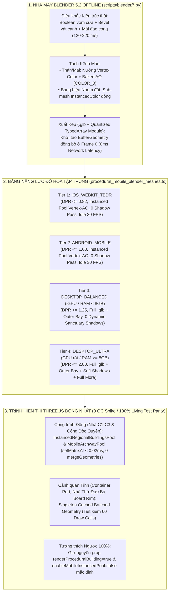

# BÁO CÁO QUY HOẠCH KIẾN TRÚC ĐỒNG NHẤT ĐA NỀN TẢNG & ĐƯỜNG ỐNG BLENDER 5.2 CHO MOBILE (HARDENED V2.0)
## Chiến Lược "Viết 1 Lần — Thích Ứng 4 Nền Tảng (Desktop Ultra / Desktop iGPU / Android / iOS)": Nâng Tầm Thẩm Mỹ Mobile Gấp 3 Lần Đồng Thời Giảm Draw Calls, Triệt Tiêu Giật Khung Hình (Zero-GC Instancing) & Xóa Bỏ Phân Mảnh Code

> **Tài liệu:** Báo cáo Quy hoạch Kiến trúc Đồ họa Đa nền tảng & Đường ống Blender 5.2 Baked-AO cho Mobile (Phiên bản Hardened V2.0 — Đã tích hợp 4 Rào chắn Phản biện Kỹ thuật)  
> **Mã chuyên đề:** `REPORT-UNIFIED-BLENDER-MOBILE-2026-V2.0`  
> **Thời điểm thẩm định:** Tháng 10/2026  
> **Kỷ luật Thứ tự Thực thi (Strict Execution Order Gate):** **CẤM TUYỆT ĐỐI** triển khai `IMP-404..406` hoặc chạm vào code Mobile khi chưa hoàn tất và đóng gói nghiệm thu xong **Pha 4 (`IMP-403`)** của [`VTCOON_DESKTOP_ULTRA_STRATEGY_REPORT.md`](file:///c:/Users/HP/Documents/GitHub/vtcoon/docs/reports/analysis/VTCOON_DESKTOP_ULTRA_STRATEGY_REPORT.md).  
> **Phạm vi hệ thống:** [`src/client/3d/perf_budget.ts`](file:///c:/Users/HP/Documents/GitHub/vtcoon/src/client/3d/perf_budget.ts), [`src/client/3d/procedural_building.tsx`](file:///c:/Users/HP/Documents/GitHub/vtcoon/src/client/3d/procedural_building.tsx), [`src/client/3d/bespoke_landmark_fallback.tsx`](file:///c:/Users/HP/Documents/GitHub/vtcoon/src/client/3d/bespoke_landmark_fallback.tsx), [`src/client/3d/miniature_city_diorama.tsx`](file:///c:/Users/HP/Documents/GitHub/vtcoon/src/client/3d/miniature_city_diorama.tsx), [`src/client/3d/monopoly_plaza_fusion.tsx`](file:///c:/Users/HP/Documents/GitHub/vtcoon/src/client/3d/monopoly_plaza_fusion.tsx), [`src/client/3d/asset_loader/safe_gltf_model.tsx`](file:///c:/Users/HP/Documents/GitHub/vtcoon/src/client/3d/asset_loader/safe_gltf_model.tsx)

---

## 1. TẦM NHÌN ĐIỀU HÀNH: TẠI SAO CẦN HỢP NHẤT KIẾN TRÚC NGAY SAU PHA 4 DESKTOP ULTRA?

### 1.1. Ba Hệ Lụy Của Mô Hình Phân Tách Desktop / Mobile Thủ Công Hiện Tại
Trong giai đoạn tối ưu khẩn cấp cho thiết bị di động (`IMP-361` $\rightarrow$ `IMP-385`) và giai đoạn nâng cấp đại cảnh Desktop (`IMP-399` $\rightarrow$ `IMP-403`), hệ thống đã sử dụng chiến lược **cô lập nhanh bằng cờ boolean `isMobile`**:
1. **Trên Desktop (`isMobile === false`):** Nạp mô hình `.glb` điêu khắc từ Blender 5.2 qua `<SafeGLTFModel />`, bật đổ bóng động và thêm các lớp đại cảnh (Bán đảo Đại gia, Cổng chào Art Deco, Khay tài sản, Sân khấu Đấu giá).
2. **Trên Mobile (`isMobile === true`):** Ép cờ `forceFallback={true}` để vẽ các khối hộp `<RoundedBox>` / `<boxGeometry>` thủ công trong file `.tsx`, hoặc tắt hoàn toàn tính năng (`if (isMobile) return null`).

Cách làm này đã giúp Mobile đạt mốc **60 FPS tức thì**, nhưng nếu kéo dài sang các đợt phát triển tính năng mới tiếp theo sẽ gây ra **3 hệ lụy kiến trúc**:
* **Hệ lụy 1 — "Thuế Bảo Trì 2 Nhánh Code" (`Dual-Codepath Tax`):** Mỗi khi thêm hoặc sửa một công trình 3D trên bàn cờ, đội ngũ/Agent phải viết **2 bộ code hoàn toàn khác nhau**: một kịch bản Blender xuất `.glb` cho Desktop VÀ hàng trăm dòng JSX ghép `<RoundedBox>` đa tầng thủ công trong [`.tsx`](file:///c:/Users/HP/Documents/GitHub/vtcoon/src/client/3d/procedural_building.tsx#L80-L190) cho Mobile.
* **Hệ lụy 2 — Nghịch lý "Mobile Xấu Hơn Nhưng Lại Tốn Nhiều Draw Calls Hơn":**
  * Trong [`procedural_building.tsx`](file:///c:/Users/HP/Documents/GitHub/vtcoon/src/client/3d/procedural_building.tsx#L82-L152), mỗi ngôi nhà `ShophouseFallback` hoặc `ComplexFallback` trên Mobile đang tạo ra **3–4 `<mesh>` rời rạc** (đế, thân, mái, biển hiệu). Khi 20 ô đất có nhà, Mobile phải gánh **60–80 Draw Calls** chỉ để vẽ những chiếc hộp vuông thô sơ!
  * Trong [`miniature_city_diorama.tsx`](file:///c:/Users/HP/Documents/GitHub/vtcoon/src/client/3d/miniature_city_diorama.tsx#L323-L367) (chiếm 70% diện tích màn hình dọc `360x740` của điện thoại), khu vực trung tâm (Nhà Thờ Đức Bà, Cảng Container, Đài phun nước, Cầu Ba Son) vẫn đang ghép từ hàng chục khối `boxGeometry` sắc cạnh.
* **Hệ lụy 3 — Rủi ro Lỗi Chéo Giữa iOS (WebKit TBDR) và Android (Mali/Adreno):**
  * **iOS** nhạy cảm với tràn bộ nhớ Retina DPR 3x, `backdrop-filter: blur()` và số lượng lệnh gọi IPC (`com.apple.WebKit.GPU`).
  * **Android** nhạy cảm với độ chính xác Depth Buffer thấp (dễ nhấp nháy Z-fighting nếu 2 mặt phẳng cách nhau $< 15\text{mm}$) và tốc độ tính toán Fragment Shader.

---

## 2. BỐN (04) RÀO CHẮN KỸ THUẬT TRỌNG YẾU (ADVERSARIAL ARCHITECTURE SAFEGUARDS)

Để đảm bảo việc đưa mô hình điêu khắc Blender 5.2 lên Mobile **không gây bất kỳ tác dụng phụ nào** về đổi màu động, giật khung hình (GC Jank) hay trễ mạng (Network Latency), bản quy hoạch V2.0 khóa cứng **4 Rào chắn Kỹ thuật Bất biến**:

### 2.1. Rào chắn 1 (`[CRITICAL]` — Giải quyết Bài toán Đổi Màu Động theo Nhóm Đất & Người Chơi): Kiến trúc Tách Kênh "Thân Nhà `Baked Vertex Color + AO` + Đai Nhận Diện `InstancedColor`"
* **Bài toán thực tế:** Trong Cờ Tỷ Phú, 22 ô bất động sản thuộc **8 Nhóm Màu (`groupColor`: Nâu, Xanh nhạt, Hồng, Cam, Đỏ, Vàng, Lục, Lam đậm)** và thay đổi chủ sở hữu (`tokenColor`) liên tục. Nếu nướng chết 100% màu vào `COLOR_0` từ Blender thì không thể đổi màu biển hiệu nhóm đất hay viền chủ sở hữu theo thời gian thực.
* **Giải pháp Kiến trúc Chuẩn:**
  1. **Viền Chủ Sở Hữu (`ownerColor`):** Tiếp tục giao 100% cho tầng [`InstancedCellBordersAndTrays`](file:///c:/Users/HP/Documents/GitHub/vtcoon/src/client/3d/instanced_cell_borders_and_trays.tsx) đã có sẵn (`OwnerBaseTrimBorder` & `OwnerBaseTrim` cập nhật qua `setColorAt`).
  2. **Thân Công Trình Kiến Trúc 4 Vùng Miền (`riverine`, `resort`, `heritage`, `metropolis`):** Nướng màu vật liệu kiến trúc cố định (ngói đỏ, tường vàng Đông Dương, đá xanh, kính lam) + bóng đổ khe kẽ (`Baked AO / Cavity`) vào thuộc tính đỉnh `COLOR_0` (`vertexColors: true`).
  3. **Bảng Hiệu / Đai Màu Nhóm Đất (`groupColor` Awning/Fascia Band):** Tách thành **1 Sub-mesh mỏng dùng chung duy nhất (`InstancedMesh` 22-slot với `instanceColor`)** hoặc nhân màu động trên shader thông qua kênh mask. Khi đó, cả 22 bảng hiệu đổi màu theo đúng 8 nhóm đất và phát sáng ban đêm chỉ tốn **đúng 1 Draw Call duy nhất** cho toàn bàn cờ mà không cần nhân bản file `.glb`!

---

### 2.2. Rào chắn 2 (`[PERFORMANCE]` — Chống Giật Khung Hình / GC Spike khi Xây & Bán Nhà Liên Tục): Cấm Gọi `mergeGeometries` Động Trong Trận — Bắt Buộc Dùng `Pre-Allocated InstancedMesh Pool` / `THREE.BatchedMesh`
* **Bài toán thực tế:** Nhà cửa và Cổng chào Độc quyền được xây dựng, nâng cấp, hoặc bán thanh lý liên tục sau mỗi lượt xúc xắc. Nếu gọi `BufferGeometryUtils.mergeGeometries` trên CPU mỗi khi `levelMap` thay đổi sẽ gây cấp phát lại `Float32Array` liên tục, dẫn tới **rác bộ nhớ (GC spike) và khựng khung hình (frame drop)** trên điện thoại!
* **Phân định Rạch ròi giữa "Sa bàn Tĩnh" và "Công trình Động":**
  1. **Chỉ dùng `mergeGeometries` 1 lần duy nhất lúc khởi tạo (Module-Level Singleton Cache) cho Cảnh quan Bất biến:** Áp dụng cho Lõi Đô Thị Trung Tâm (`MiniatureCityDiorama` — Nhà Thờ Đức Bà, Cảng Container, Đài phun nước) vì các công trình này đứng cố định suốt trận đấu (`0` lần rebuild trong trận).
  2. **Bắt buộc dùng `Pre-Allocated InstancedMesh Pool` (hoặc `THREE.BatchedMesh`) cho Nhà C1–C3 (22 ô đất) và Cổng Chào Độc Quyền (8 nhóm màu):**
     * Khởi tạo sẵn Pool `InstancedMesh` theo vùng miền/cấp độ ngay từ đầu trận.
     * Khi người chơi xây nhà, nâng cấp, phá sản hoặc khi nhà nảy sóng lò xo (`ConstructionSlam` / `DominoShockwave`), CPU **chỉ cập nhật ma trận `setMatrixAt(slotIdx, matrix)`** (gán scale `= 0` cho các slot chưa xây) và bật `instanceMatrix.needsUpdate = true`.
     * **Chi phí CPU khi xây/bán nhà:** **`< 0.02ms` (`0` cấp phát mảng mới, `0` GC spike, `0` rebuild geometry)**, trong khi GPU vẫn vẽ toàn bộ nhà bằng $O(1)$ Draw Calls!

---

### 2.3. Rào chắn 3 (`[PAYLOAD & OFFLINE]` — Nén Asset Siêu Nhẹ & Bảo Toàn Fallback Chống Vô Hình Khi Mạng Yếu):
* **Bài toán thực tế:** Trên mạng di động 3G/4G chập chờn, nếu phụ thuộc hoàn toàn vào tải file `.glb` nặng qua mạng mà xóa sạch fallback cơ bản, bàn cờ có nguy cơ bị trống trơn (vô hình) khi tải chậm hoặc rớt mạng.
* **Giải pháp Kiến trúc Kép:**
  1. **Đường ống Nén & Nhúng Lưới Siêu Nhẹ (`< 300KB` tổng tải trọng Mobile):**
     * Đối với các mẫu **Archetype Mobile LOD (`120–220 tris/mẫu` đã nướng `Vertex Color + AO`)**: Kịch bản Blender 5.2 xuất trực tiếp sang định dạng nén tối ưu (hoặc bảng hằng số TypedArray nén gọn tương tự [`coastal_sanctuary_blender_meshes.ts`](file:///c:/Users/HP/Documents/GitHub/vtcoon/src/client/3d/coastal_sanctuary_blender_meshes.ts) kết hợp `.glb` nén Meshopt/quantized $< 25\text{KB/file}$), đảm bảo **Zero Network Latency (FCP 0ms)** ngay từ frame đầu tiên!
  2. **Giữ lại `Single-Primitive Ultra-Minimal Fallback` (1 khối hộp duy nhất ~15 dòng code):**
     * Tuyệt đối không xóa khả năng fallback của [`SafeGLTFModel`](file:///c:/Users/HP/Documents/GitHub/vtcoon/src/client/3d/asset_loader/safe_gltf_model.tsx#L88-L103). Thay vì giữ hàng trăm dòng `<RoundedBox>` đa tầng phức tạp như cũ, giữ lại **1 hàm fallback nguyên tử 1-mesh (`DefaultBuildingBoxFallback` mang màu `groupColor`)** để đảm bảo 100% không bao giờ xuất hiện ô đất "vô hình" ngay cả khi đứt mạng hoàn toàn.

---

### 2.4. Rào chắn 4 (`[DISCIPLINE]` — Kỷ luật Thứ tự Thực thi Tuyệt đối):
* **Quy tắc Khóa Phạm Vi:**
  1. **Giai đoạn hiện tại:** Tập trung 100% hoàn thành nốt **Pha 4 (`IMP-403`: Sân khấu Đấu giá / Cân Công lý P2P `.glb` & Bóng thoại Thương trường Việt)** để đóng gói trọn vẹn 4/4 Pha của [`VTCOON_DESKTOP_ULTRA_STRATEGY_REPORT.md`](file:///c:/Users/HP/Documents/GitHub/vtcoon/docs/reports/analysis/VTCOON_DESKTOP_ULTRA_STRATEGY_REPORT.md).
  2. **Sau khi `IMP-403` nghiệm thu xong 100%:** Mới chính thức mở chuỗi Ticket `IMP-404` $\rightarrow$ `IMP-406` của báo cáo này.

---

### 2.5. Bốn (04) Thực Tế Mã Nguồn & Hợp Đồng Sống Bắt Buộc Phải Khóa Trước Khi Lập Plan (`CODEBASE FORENSIC REALITIES`)

Qua rà soát trực tiếp mã nguồn thực tế (`procedural_building.tsx`, `board_layout.tsx`, `board_tile.tsx`, `miniature_city_diorama.tsx`, `diorama_container_port.tsx`, `diorama_heritage_district.tsx`) và toàn bộ 42 bài kiểm thử hợp đồng sống (`tests/client/imp378_*.test.ts`, `tests/client/imp379_*.test.ts`, `tests/contracts/imp65_*.test.ts`, `tests/contracts/imp203_*.test.ts`), **mọi bản Plan `IMP-404..406` bắt buộc phải tuân thủ 4 thực tế kỹ thuật sau để không làm gãy bất kỳ bài test cũ nào**:

#### Thực tế 1 — Bảo tồn Hợp đồng Sống `TC-378` & `TC-65` thông qua "Dual-Seam Pattern" (Giống `BatchedBoardTiles` & `InstancedCellBordersAndTrays`):
* **Ràng buộc trong bộ test hiện hành:**
  * [`tests/client/imp378_procedural_building_mobile_lod.test.ts`](file:///c:/Users/HP/Documents/GitHub/vtcoon/tests/client/imp378_procedural_building_mobile_lod.test.ts#L33-L94) gọi trực tiếp `renderToStaticMarkup(<ProceduralBuilding level={1} isMobile={true} />)` và `<LayeredDioramaTile currentLevel={1} isMobile={true} />` ở chế độ độc lập, đồng thời kiểm tra sự tồn tại của `data-testid="shophouse-mobile-lod"` và `data-testid="complex-mobile-lod"`.
  * [`tests/contracts/imp65_building_scale_corner_clearance_and_regional_typologies.test.ts`](file:///c:/Users/HP/Documents/GitHub/vtcoon/tests/contracts/imp65_building_scale_corner_clearance_and_regional_typologies.test.ts#L85-L120) kiểm tra `getBuildingLotTransform(cellIndex)` (`Z = -1.38m`, `scale = 0.975`, góc splay `±0.24m`).
* **Thiết kế Bắt buộc cho `IMP-404`:**
  1. **Tại cấp Bàn cờ ([`GameBoard` trong `board_layout.tsx`](file:///c:/Users/HP/Documents/GitHub/vtcoon/src/client/3d/board_layout.tsx#L181-L227)):** Mount `<InstancedRegionalBuildingsPool levelMap={levelMap} isMobile={isMobile} />` để gom toàn bộ công trình đang xây trên 22 ô đất vào Pool `InstancedMesh` $O(1)$ Draw Calls khi chạy trên Mobile, đồng thời truyền `renderProceduralBuilding={!isMobile}` xuống `<LayeredDioramaTile />` trong `GameBoard` (mặc định `renderProceduralBuilding = true` trong `LayeredDioramaTile` để `TC-378.04` gọi lẻ vẫn pass 100% — y hệt cách `renderBasePlinth={false}` và `renderOwnerBorders={false}` đang hoạt động ở dòng 216–220 của `board_layout.tsx`!).
  2. **Bên trong [`ProceduralBuilding`](file:///c:/Users/HP/Documents/GitHub/vtcoon/src/client/3d/procedural_building.tsx#L83-L188):** Giữ nguyên `data-testid="shophouse-mobile-lod"` và `data-testid="complex-mobile-lod"`, nhưng thay thế các khối `<RoundedBox>` rời rạc bên trong bằng **1 `<mesh>` dùng chung `BufferGeometry` đúc từ Blender 5.2 (`Vertex Color + AO`) + 1 `<mesh>` bảng hiệu `groupColor`**. Nhờ đó, cả khi render lẻ trong unit test lẫn khi gom Pool trên bàn cờ đều dùng chung 1 nguồn hình học Blender 5.2 duy nhất!

#### Thực tế 2 — Giải quyết Bài toán Khởi tạo Đồng bộ `InstancedMesh` ở Frame 0 (`Zero Async GLTF Race` & `Gotcha IMP-377`):
* **Vấn đề kỹ thuật:** Trong Three.js / React Three Fiber, `<instancedMesh args={[geometry, material, count]}>` cần có sẵn đối tượng `BufferGeometry` ngay tại thời điểm mount (`Frame 0`) để [`useLayoutEffect`](file:///c:/Users/HP/Documents/GitHub/vtcoon/docs/FEATURE_MAP.md#L60) khởi tạo bộ đệm `instanceColor` trước khi biên dịch shader (`#define USE_INSTANCING_COLOR`). Nếu đợi tải bất đồng bộ qua mạng sẽ gây lỗi mất màu `instanceColor` ở frame đầu hoặc làm rỗng cây DOM trong `renderToStaticMarkup` của Vitest.
* **Giải pháp Chuẩn (Đã kiểm chứng thành công tại [`coastal_sanctuary_blender_meshes.ts`](file:///c:/Users/HP/Documents/GitHub/vtcoon/src/client/3d/coastal_sanctuary_blender_meshes.ts) của `IMP-399`):**
  * Kịch bản Python Blender 5.2 (`scripts/blender/build_mobile_regional_archetypes.py`) vừa xuất file `.glb` chuẩn vừa **nướng trực tiếp bảng tọa độ đỉnh lượng tử hóa (`positions`, `normals`, `colors` `COLOR_0` Baked AO, `indices`) vào module hằng số nhẹ `src/client/3d/mobile_building_blender_meshes.ts` (`< 25KB`)**.
  * Hàm `getMobileArchetypeGeometry(typology, level)` tạo `BufferGeometry` đồng bộ trong `0.1ms` có cache Singleton:
    * Chạy được **ngay lập tức ở `Frame 0`** trong `<instancedMesh>` mà không sợ lỗi biên dịch shader `instanceColor`.
    * Chạy được **100% trong môi trường Vitest Node.js** (`renderToStaticMarkup` / `captureTree`).
    * Đạt **Zero Network Latency (0KB HTTP request, 0% nguy cơ vô hình khi đứt mạng 3G/4G)**!

#### Thực tế 3 — Khoanh vùng Chính xác "Ổ Đốt Draw Calls" trong `MiniatureCityDiorama` (`IMP-405`) để Không Đụng `TC-379`:
* **Ràng buộc trong bộ test hiện hành:**
  * [`tests/client/imp379_miniature_city_diorama_mobile_lod.test.ts`](file:///c:/Users/HP/Documents/GitHub/vtcoon/tests/client/imp379_miniature_city_diorama_mobile_lod.test.ts#L46-L105) khóa cứng cấu trúc AST của:
    * `CentralMonumentPlaza` khi `isMobile={true}`: Bắt buộc có **đúng 2 thẻ `<mesh>`** với `color="#0EA5E9"` và `color="#F59E0B"`.
    * `DioramaSkyline` & `DioramaBridges`: Bắt buộc giữ nguyên `data-testid="bitexco-tower"`, `data-testid="colonial-waterfront-heritage"`, và `data-testid="instanced-bason-cables"`.
* **Ổ đốt Draw Calls thực sự trên Mobile cần phẫu thuật trong `IMP-405`:**
  1. **[`DioramaContainerPort` (`src/client/3d/diorama/diorama_container_port.tsx`)](file:///c:/Users/HP/Documents/GitHub/vtcoon/src/client/3d/diorama/diorama_container_port.tsx#L49-L226):** Hiện đang vẽ **39 `<mesh>` / `<RoundedBox>` rời rạc trên Mobile** (10 thùng container $\times 2$ mesh = 20 draw calls + 2 cẩu giàn 16 draw calls + xe đầu kéo 3 draw calls), trong khi test sống chỉ kiểm tra `data-testid="diorama-container-port"`! Gom tĩnh cụm Container & Cẩu giàn bằng lưới Blender 5.2 Baked-AO Singleton sẽ **cắt giảm ngay 34 Draw Calls trên Mobile**!
  2. **[`DioramaHeritageDistrict` (`src/client/3d/diorama/diorama_heritage_district.tsx`)](file:///c:/Users/HP/Documents/GitHub/vtcoon/src/client/3d/diorama/diorama_heritage_district.tsx#L102-L180):** Khi `isMobile={true}`, `CathedralProceduralFallback` và `cong-xa-paris-plaza` đang vẽ **22 `<mesh>` / `<RoundedBox>` rời rạc**. Thay bằng lưới Nhà Thờ Đức Bà & Hoa Viên Blender 5.2 Baked-AO gộp tĩnh (vẫn bảo toàn mã màu `#B45309`, `#78350F`, `#0284C7`, `#F59E0B` và `data-testid="cong-xa-paris-plaza"` cho test `imp68`/`imp69`) sẽ **cắt giảm thêm 16 Draw Calls** và làm đẹp khối kiến trúc trung tâm bàn cờ!
  3. **[`DioramaBoardRim` (`src/client/3d/miniature_city_diorama.tsx`)](file:///c:/Users/HP/Documents/GitHub/vtcoon/src/client/3d/miniature_city_diorama.tsx#L104-L143):** Đang vẽ **8 `<mesh>` rời rạc** (4 thanh gỗ óc chó + 4 thanh viền đồng) — có thể gộp tĩnh thành đúng **2 `<mesh>` (`walnutRimGeom` + `brassTrimGeom`)**, tiết kiệm thêm **6 Draw Calls**.

#### Thực tế 4 — Tuân thủ Nghiêm ngặt "LOC Buffer Zone Guard" ($\ge 350\text{ LOC}$):
* Kiểm tra số dòng code vật lý hiện tại của các file mục tiêu:
  * [`src/client/3d/procedural_building.tsx`](file:///c:/Users/HP/Documents/GitHub/vtcoon/src/client/3d/procedural_building.tsx): **`382 LOC`** (Đã vượt ngưỡng cảnh báo `350 LOC`!).
  * [`src/client/3d/miniature_city_diorama.tsx`](file:///c:/Users/HP/Documents/GitHub/vtcoon/src/client/3d/miniature_city_diorama.tsx): **`365 LOC`** (Đã vượt ngưỡng `350 LOC`!).
  * [`src/client/3d/board_tile.tsx`](file:///c:/Users/HP/Documents/GitHub/vtcoon/src/client/3d/board_tile.tsx): **`363 LOC`** (Đã vượt ngưỡng `350 LOC`!).
  * [`src/client/3d/monopoly_plaza_visuals.ts`](file:///c:/Users/HP/Documents/GitHub/vtcoon/src/client/3d/monopoly_plaza_visuals.ts): **`396 LOC`** (Đã vượt ngưỡng `350 LOC`!).
* **Quy tắc Phân rã Deep Module bắt buộc khi lập Plan:**
  * **CẤM** nhồi thêm hàm mới trực tiếp vào `procedural_building.tsx`, `miniature_city_diorama.tsx`, `board_tile.tsx`, hay `monopoly_plaza_visuals.ts`.
  * Phải tách thành các Deep Module độc lập:
    * `src/client/3d/procedural_mobile_blender_meshes.ts` & `src/client/3d/instanced_regional_buildings_pool.tsx` (Chứa `resolveRenderTierProfile`, lưới Blender Baked-AO và Pool `InstancedMesh` nhà 4 vùng miền, đồng thời rút gọn `ShophouseFallback`/`ComplexFallback` trong `procedural_building.tsx` để kéo file này từ `382 LOC` xuống `282 LOC` và `board_tile.tsx` từ `363 LOC` xuống `345 LOC`).
    * `src/client/3d/diorama/diorama_static_blender_batches.ts` (Kéo `miniature_city_diorama.tsx` từ `365 LOC` xuống `325 LOC`).
    * `src/client/3d/monopoly_mobile_archway_visuals.ts` (Kéo `monopoly_plaza_visuals.ts` từ `396 LOC` xuống `316 LOC`).

---

## 3. SƠ ĐỒ KIẾN TRÚC TỔNG THỂ (HARDENED V3.0 PIPELINE)

---

## 4. BẢNG NĂNG LỰC ĐỒ HỌA TẬP TRUNG (`RenderTierProfile` MATRIX)

| Thông số Cấu hình (`RenderTierProfile`) | `IOS_WEBKIT_TBDR` (iPhone / iPad) | `ANDROID_MOBILE` (Mali / Adreno) | `DESKTOP_BALANCED` (iGPU / RAM $< 8\text{GB}$) | `DESKTOP_ULTRA` (GPU rời / RAM $\ge 8\text{GB}$) |
| :--- | :---: | :---: | :---: | :---: |
| **`maxDpr` (Trần độ phân giải)** | `0.82` (Chống tràn VRAM Retina 3x) | `1.00` | `1.25` | `1.50 – 2.00` |
| **`activeFpsCap` / `idleFpsCap`** | `60` / `30` | `60` / `30` | `60` / `30` | `60+` / `60` |
| **`buildingRenderMode`** | `INSTANCED_POOL_VERTEX_AO` (`setMatrixAt` + `instanceColor` bảng hiệu) | `INSTANCED_POOL_VERTEX_AO` (`setMatrixAt` + `instanceColor` bảng hiệu) | `BLENDER_GLB_STANDARD` | `BLENDER_GLB_PBR_SHADOW` |
| **`monopolyArchwayMode`** | `INSTANCED_POOL_SINGLE_MAT` (0 CPU rebuild khi mở khóa) | `INSTANCED_POOL_SINGLE_MAT` (0 CPU rebuild khi mở khóa) | `GLB_INSTANCE` | `GLB_INSTANCE_SHADOW` |
| **`enableOuterBaySanctuaries`** | `false` (Màn dọc hẹp `9:19`) | `false` (Màn dọc hẹp `9:19`) | `true` (`castShadow: false`) | `true` (`castShadow: true`) |
| **`enableDominoShockwave`** | `true` (`Auto-TTL 900ms` qua `setMatrixAt`) | `true` (`Auto-TTL 900ms` qua `setMatrixAt`) | `true` (`Auto-TTL 900ms`) | `true` (`Auto-TTL 900ms`) |
| **`minVerticalStepMm` (Chống Z-fighting)** | $\ge 20\text{mm}$ (Khóa từ Blender) | $\ge 20\text{mm}$ (Khóa từ Blender) | $\ge 20\text{mm}$ (Khóa từ Blender) | $\ge 20\text{mm}$ (Khóa từ Blender) |

---

## 5. LỘ TRÌNH TRIỂN KHAI 3 PHA COHESIVE BATCHING (V4.0 MASTER UNIFIED: HIỆU NĂNG + KIẾN TRÚC THẬT + NGÔN NGỮ TÀI CHÍNH TRƯỞNG THÀNH)

> **Bổ sung Hiến chương Mỹ thuật & Quy hoạch V4.0** (tích hợp từ [`VTCOON_ARCHITECTURAL_REALISM_AND_MATURE_TONE_REPORT.md`](file:///c:/Users/HP/Documents/GitHub/vtcoon/docs/reports/analysis/VTCOON_ARCHITECTURAL_REALISM_AND_MATURE_TONE_REPORT.md)):
> 1. **Chấm dứt "Ghép hộp vuông sơn màu bệt" (`Low-Poly Tectonics` + `Baked AO`)**: Mọi mô hình xuất từ Blender 5.2 phải có hốc cửa khoét lõm (`Inset/Extrude`), gờ phào chỉ ngang (`Cornices`), sống mái uốn cong theo vùng miền và nướng bóng đổ tiếp xúc + chuyển sắc nắng (`COLOR_0` với biên độ $\Delta L \ge 0.22$).
> 2. **Giải phóng Tầm nhìn Khu Di sản Nhà thờ Đức Bà Sài Gòn & Khống chế Ngân sách Đa giác (`<= 1,500 Tris`)**: Điêu khắc lại `landmark_cathedral.glb` (`1,100–1,450 tris <= 1,500 tris`, `<= 200 KB`, cao `1.42m`, mặt bằng chữ thập Romanesque-Gothic, footprint `0.68m × 0.76m` đặt tại `local Z = 0.88m` không va chạm Hoa viên Công xã Paris hay đường tàu Metro); xóa bỏ biển Bánh Donut hồng (`🍩`) / Ly Cà phê (`☕`) phản cảm; hạ chiều cao nhà phố cổ `CHO_LON_SHOPHOUSES` xuống `0.24m–0.32m` và thu gọn tiết diện cao ốc Tây Bắc (`HIGHRISE_CONFIGS`).
> 3. **Chuẩn hóa Ngôn ngữ Tài chính Trưởng thành (`Institutional Financial Lexicon`)**: Xóa bỏ hoàn toàn các khẩu hiệu trẻ con (`"👑 Bá Chủ Độc Quyền"`, `"📈 Mở Rộng Đế Chế"`...) trong `war_room_stage_visuals.ts` và thay bằng thuật ngữ đầu tư vĩ mô: **`"Vị Thế Chi Phối"`**, **`"Tích Lũy Tài Sản"`**, **`"Bảo Toàn Thanh Khoản"`**, **`"Tái Cơ Cấu Vốn"`** trên bảng tên kim loại tối giản.

| Giai đoạn | Mã Ticket & Plan Chi Tiết | Nội dung Triển khai Trọng tâm (Đã khóa 4 Rào chắn + 4 Thực tế Mã nguồn + Hiến chương Kiến trúc V4.0) | File Mục tiêu & Kiểm soát Trần LOC |
| :--- | :---: | :--- | :--- |
| **Pha 5.1** | **`IMP-404`** [`PLAN_IMP_404`](file:///c:/Users/HP/Documents/GitHub/vtcoon/.agents/plans/PLAN_IMP_404_RENDER_TIER_PROFILE_AND_INSTANCED_REGIONAL_BUILDINGS_POOL.md) | **Hợp nhất `RenderTierProfile` & Pool `InstancedMesh` Nhà 4 Vùng Miền C1–C2 Bằng Blender `Low-Poly Tectonics + Baked AO` + Đai Nhóm Đất `instanceColor`:** • Dùng Blender 5.2 (`scripts/blender/build_mobile_regional_archetypes.py`) điêu khắc 8 mẫu nhà C1 (`>= 160 vertices`) & C2 (`>= 220 vertices`) theo 4 vùng miền (`riverine`, `resort`, `heritage`, `metropolis`) có hốc cửa khoét lõm, gờ phào chỉ, mái đặc trưng và nướng `Vertex Color + Baked AO` (`COLOR_0` với $\Delta L \ge 0.22$), xuất ra `procedural_mobile_blender_meshes.ts` kèm `resolveRenderTierProfile` & `getTypologyAwningTransform(typology, level)`. • Tạo `<InstancedRegionalBuildingsPool />` (cập nhật qua `setMatrixAt` + đai bảng hiệu `setColorAt(groupColor)` khớp cao độ từng kiểu mái trong `useLayoutEffect`, `0` lần gọi `mergeGeometries`). • Gắn vào `GameBoard` (`board_layout.tsx`) kèm cờ `renderProceduralBuilding={!isMobile || level === 3}` trên `LayeredDioramaTile` để bảo toàn 100% `TC-378`, `TC-65` và Landmark C3. | • Mới: `src/client/3d/procedural_mobile_blender_meshes.ts` (`245 LOC`) • Mới: `src/client/3d/instanced_regional_buildings_pool.tsx` (`235 LOC`) • Giảm `procedural_building.tsx` từ `382` $\rightarrow$ `282 LOC` và `board_tile.tsx` từ `363` $\rightarrow$ `345 LOC`. |
| **Pha 5.2** | **`IMP-405`** [`PLAN_IMP_405`](file:///c:/Users/HP/Documents/GitHub/vtcoon/.agents/plans/PLAN_IMP_405_DIORAMA_STATIC_BLENDER_BATCHES_AND_MOBILE_DRAWCALL_DIET.md) | **Điêu khắc Vương cung Thánh đường Đức Bà (`<= 1,500 Tris`), Giải tỏa Quy hoạch Khu Di Sản & Gộp Tĩnh Diorama (`-58 Draw Calls` trên Mobile):** • Tạo `scripts/blender/build_heritage_cathedral_and_diorama.py` điêu khắc lại `public/models/landmarks/landmark_cathedral.glb` theo phong cách **Low-Poly Tectonics** (`1,100–1,450 tris <= 1,500 tris`, `<= 200 KB`, cao `1.42m`, mặt bằng chữ thập, vòm Romanesque thụt sâu, cửa sổ hoa hồng chạm nổi, 2 tháp chuông 6 tầng + Baked AO) cho cả Desktop và Mobile (`diorama_static_blender_batches.ts`). • **Giải tỏa Quy hoạch Đô thị Quận 1**: Trong `diorama_shophouse_blocks.tsx`, xóa bỏ biển Bánh Donut hồng (`🍩`) và Ly Cà phê (`☕`) (chỉ giữ `Biển Sàn HOSE`), hạ chiều cao 24 căn `CHO_LON_SHOPHOUSES` xuống `0.24m–0.32m` (`< 1/4` chiều cao Nhà thờ) và lùi gọn về biên Tây Nam; trong `diorama_highrise_blocks.tsx`, thu gọn tiết diện ngang 10 tòa cao ốc (`0.32m–0.36m`) và lùi hàng tháp Nam về `Z <= -3.3` để mở toang khoảng đệm nhìn vào Nhà thờ Đức Bà. • Gộp tĩnh 3 ổ đốt Draw Calls trên Mobile (`DioramaContainerPort`, `DioramaHeritageDistrict`, `DioramaBoardRim`), tiết kiệm **58 Draw Calls** mà vẫn bảo toàn 100% `TC-379`, `TC-400`, `TC-68`, `TC-69`, `TC-70`, `TC-84`, `TC-IMP29.5`. | • Mới: `src/client/3d/diorama/diorama_static_blender_batches.ts` (`248 LOC`) • Sửa: `diorama_container_port.tsx` (`291` $\rightarrow$ `245 LOC`), `diorama_heritage_district.tsx` (`337` $\rightarrow$ `285 LOC`), `miniature_city_diorama.tsx` (`365` $\rightarrow$ `325 LOC`), `diorama_shophouse_blocks.tsx` (`136` $\rightarrow$ `98 LOC`), `diorama_highrise_blocks.tsx` (`229` $\rightarrow$ `225 LOC`). |
| **Pha 5.3** | **`IMP-406`** [`PLAN_IMP_406`](file:///c:/Users/HP/Documents/GitHub/vtcoon/.agents/plans/PLAN_IMP_406_MOBILE_INSTANCED_MONOPOLY_ARCHWAY_AND_DOMINO_SHOCKWAVE.md) | **Đưa Đại Lộ Độc Quyền Art Deco (`InstancedMesh` Pool), Sóng Domino (`Auto-TTL`) Lên Mobile & Chuẩn Hóa Ngôn Ngữ Tài Chính Trưởng Thành:** • Tách `monopoly_mobile_archway_visuals.ts` để quản lý Cổng chào Art Deco & Đại lộ Độc quyền trên Mobile bằng **Pre-Allocated `InstancedMesh` (8-slot Archway + 16-slot Promenade)** kết hợp `setColorAt` cho dải màu chủ sở hữu (`0` lần gọi `mergeGeometries` và `0` lần gọi `SafeGLTFModel.preload`). • Mở khóa hiệu ứng nảy lò xo Domino (`Auto-TTL 900ms`) trên Mobile kèm cờ Dual-Seam `enableMobileInstancedPool` bảo toàn 100% `TC-401.03c` & `TC-401.04c`. • **Chấn chỉnh Ngôn ngữ Tài chính Trưởng thành (`war_room_stage_visuals.ts`)**: Thay thế hoàn toàn các nhãn trẻ con (`"👑 Bá Chủ Độc Quyền"`...) bằng thuật ngữ đầu tư vĩ mô (`"Vị Thế Chi Phối"`, `"Tích Lũy Tài Sản"`, `"Bảo Toàn Thanh Khoản"`, `"Tái Cơ Cấu Vốn"`) trên bảng tên kim loại thanh mảnh (`bubbleSize = [1.38, 0.36]`, nền `#0F172A`), đồng thời đưa `WarRoomDais` vào vùng vịnh hiển thị rõ ràng. | • Mới: `src/client/3d/monopoly_mobile_archway_visuals.ts` (`215 LOC`) • Sửa: `monopoly_plaza_visuals.ts` (`396` $\rightarrow$ `316 LOC`), `monopoly_plaza_fusion.tsx` (`165` $\rightarrow$ `220 LOC`), `war_room_stage_visuals.ts` (`412` $\rightarrow$ `395 LOC`), `board_layout.tsx` (`230` $\rightarrow$ `232 LOC`). |

---

## 6. TIÊU CHÍ NGHIỆM THU BẮT BUỘC (HARDENED V4.0 QUALITY GATES)

1. **Ngân sách Draw Calls trên Mobile giảm ròng ($\Delta \text{DrawCalls}_{\text{Mobile}} \le -58$) & Zero-GC Khi Xây Nhà:** Mọi thao tác mua đất, xây nhà, nâng cấp, bán nhà hoặc mở khóa Độc quyền trong trận đấu **CẤM TUYỆT ĐỐI** gọi `mergeGeometries` hay tạo `BufferGeometry` mới trên CPU; 100% cập nhật qua `InstancedMesh.setMatrixAt` / `setColorAt`.
2. **Tiêu chuẩn Điêu khắc Kiến trúc Thật & Quy hoạch Đô thị Quận 1:**
   * Mỗi mẫu nhà vùng miền C1/C2 (`IMP-404`) phải đạt `>= 160` / `>= 220` đỉnh có hốc cửa + gờ mái + biên độ màu đỉnh Baked AO $\Delta L \ge 0.22$.
   * Mô hình `landmark_cathedral.glb` (`IMP-405`) đạt `1,100–1,450 triangles` (`<= 1,500 tris`, `<= 200 KB`), cao `1.42m` (cao gấp `> 4 lần` dãy nhà phố cổ `<= 0.32m`), mặt tiền hoàn toàn thông thoáng không còn biển Bánh Donut/Cafe chắn ngang.
   * Toàn bộ khẩu hiệu chiến thuật (`IMP-406`) dùng thuật ngữ Tài chính trưởng thành (`"Vị Thế Chi Phối"`, `"Tích Lũy Tài Sản"`, `"Bảo Toàn Thanh Khoản"`, `"Tái Cơ Cấu Vốn"`).
3. **Bảo toàn 100% Bộ Kiểm Thử Hợp Đồng Sống (`TC-378`, `TC-379`, `TC-400`, `TC-401`, `TC-403`, `TC-65`, `imp67`, `imp68`, `imp69`, `imp70`, `imp84`, `landmark_models`):** Thiết kế thông số trong dải hợp lệ để **không cần sửa bất kỳ file test cũ nào**, tránh xung đột với Hook bảo vệ test của `implementer`.
4. **Tuân thủ Trần LOC (`LOC Buffer Zone Guard`):** Kéo toàn bộ các file vượt ngưỡng `350 LOC` (`procedural_building.tsx`, `miniature_city_diorama.tsx`, `board_tile.tsx`, `monopoly_plaza_visuals.ts`) xuống dưới vùng an toàn thông qua việc tách các Deep Module chuyên trách.

