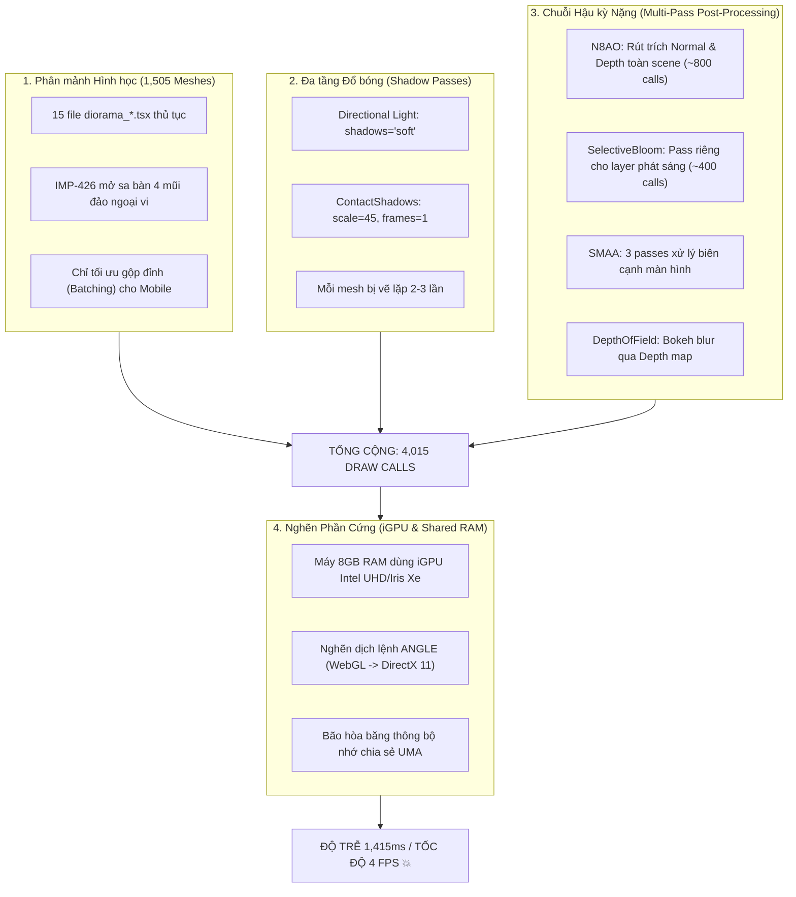
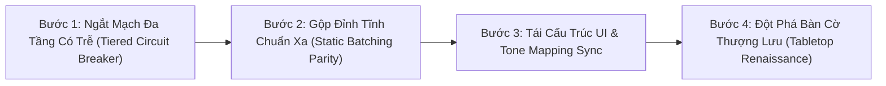

# BÁO CÁO KIỂM TOÁN PHÁP Y: HIỆU NĂNG 3D & CÔNG THÁI HỌC GIAO DIỆN DESKTOP (V2.0 HARDENED)
## Điều tra Hiện tượng Sụp đổ Khung hình (4 FPS), Nổ Lệnh Vẽ (4,015 Draw Calls) & Lộ trình Đột phá Mỹ thuật AAA

> **Mã hồ sơ:** `AUDIT-DESKTOP-3D-2026-10-16`  
> **Phiên bản:** `v2.0 - Peer-Reviewed & Hardened`  
> **Phân hệ thẩm tra:** `client-3d` / `client-ui` / `toolchain-telemetry`  
> **Người thực hiện:** Senior Adversarial Challenger & Forensic Auditor  
> **Thời điểm cập nhật:** 2026-10-16  
> **Trạng thái thẩm định:** 🚨 **CRITICAL ARCHITECTURAL BOTTLENECK & PARADIGM SHIFT**

---

## 1. TỔNG QUAN PHÁN QUYẾT KIỂM TOÁN (EXECUTIVE SUMMARY)

Sau chuỗi nâng cấp tích hợp Three.js và Blender (từ `IMP-401` đến `IMP-426`), hệ thống đồ họa 3D trên Desktop đã rơi vào một **nghịch lý kiến trúc nghiêm trọng**:
1. **Khung hình sụp đổ xuống mức tê liệt**: Tốc độ khung hình rơi tự do xuống **4 FPS**, độ trễ khung hình vọt lên **1,415.2 ms** trên máy tính văn phòng phổ thông (8GB RAM dùng iGPU Intel UHD/Iris Xe).
2. **Nổ lệnh vẽ WebGL (Draw Call Explosion)**: Lên tới **4,015 Draw Calls/frame** (vượt **4,623%** so với ngân sách trần 85 calls quy định tại `perf_budget.ts`).
3. **Đa giác bão hòa**: Lên tới **448,663 tam giác** (vượt gần 300% trần 150,000 tam giác).
4. **Nghịch lý "Vá víu kỹ thuật" (Putting Lipstick on a Pig)**: Toàn bộ thành phố trung tâm hiện tại đang được dựng bằng cách "lập trình thủ công" hơn **1,500 thẻ `<mesh>` trong React JSX** thông qua các script Python tạo khối hộp/trụ sơ khai với màu đỉnh phẳng (`COLOR_0`), không vân PBR, không ánh sáng nướng (No Baked Lighting/GI).
5. **Cạm bẫy chi phí chìm (Sunk Cost Fallacy)**: Tiếp tục viết thuật toán gộp đỉnh thủ tục cho 1,500 khối hộp này sẽ tiêu tốn hàng tuần kỹ thuật nhưng kết quả vẫn chỉ là một sa bàn thô sơ thời 2005.

> [!CAUTION]
> **KẾT LUẬN CỦA BAN PHẢN BIỆN**:
> Dự án cần một **bước chuyển mình chiến lược (Paradigm Shift)**: Loại bỏ sa bàn khối hộp thủ công ở trung tâm, dồn 100% tài nguyên đồ họa vào **Bàn cờ Thượng lưu (Tabletop-First)** hoặc chuyển sang **1 mô hình Blender duy nhất được nướng ánh sáng Cycles (Baked Lighting)**.

---

## 2. ĐỐI SOÁT DỮ LIỆU VIỄN TRẮC THỰC TẾ (PHYSICAL EVIDENCE RECONCILIATION)

Dữ liệu trích xuất từ 8 ảnh chụp màn hình Hộp đen Viễn trắc thời gian thực (`VTCOON TELEMETRY`) trên Google Chrome và Microsoft Edge:

| Kịch bản kiểm thử | Trình duyệt | Tốc độ khung hình (FPS) | Độ trễ Frame (Frame Latency) | WebGL Draw Calls | Số lượng Tam giác | Đánh giá trạng thái |
| :--- | :---: | :---: | :---: | :---: | :---: | :---: |
| **Ngân sách chuẩn (`perf_budget.ts`)** | *Tất cả* | **60 FPS** (Sàn: 30) | **16.6 ms** | **$\le 85$ calls** | **$\le 150,000$** | 🎯 **CHUẨN THIẾT KẾ** |
| **Edge - Sảnh chờ / Camera tĩnh** | Edge | 28 FPS | 20.5 ms | 1,069 calls | 158,863 | ⚠️ Chớm nghẽn (Cảnh báo Chậm) |
| **Edge - Trận đấu 4 người** | Edge | 21 – 27 FPS | 31.6 – 47.5 ms | 1,248 – 1,569 calls | 147k – 211k | 🔴 Suy thoái nặng |
| **Edge - Đỉnh điểm góc nhìn** | Edge | 22 FPS | 54.2 ms | 2,690 calls | 297,247 | 🔴 Nghẽn Driver ANGLE |
| **Chrome - Bắt đầu trận đấu** | Chrome | 4 FPS | 980.8 ms | 2,574 calls | 277,439 | 💥 Tê liệt hàng đợi lệnh |
| **Chrome - Toàn cảnh 4 người** | Chrome | **4 FPS** | **1,415.2 ms** | **4,015 calls** | **448,663** | 💥 **SỤP ĐỔ HOÀN TOÀN** |

---

## 3. BÓC TÁCH NGUYÊN NHÂN CỐT LÕI (ROOT CAUSE DECOMPOSITION)

$$\text{Tổng Lệnh Vẽ} = \text{Scene Pass} (1,500) + \text{Shadows} (1,200) + \text{N8AO Pass} (800) + \text{Bloom Pass} (400) + \text{SMAA/Post} \approx \mathbf{4,015\text{ Calls}}$$

---

## 4. HIỆU CHỈNH CÁC ĐIỂM MÙ KỸ THUẬT & CÔNG THÁI HỌC (TECHNICAL & UX AUDIT)

### 4.1. Đính chính kỹ thuật Tone Mapping (Tránh bẫy Double Tone Mapping)
* **Thực tế kiến trúc pmndrs/postprocessing**: Trong `post_processing_pipeline.tsx#L295-L299`, Desktop đã có pass `<ToneMapping key="tonemapping" mode={ToneMappingMode.AGX} />`.
* **Quy tắc bất biến**: Khi EffectComposer đảm nhiệm ToneMapping (AgX), thuộc tính `gl.toneMapping` của WebGLRenderer **bắt buộc phải là `NoToneMapping`**. Nếu bật `ACESFilmic` trên Renderer, hình ảnh sẽ bị **Double Tone Mapping** (bết đen vùng tối và cháy lóa vùng sáng kép).
* **Định chế chuẩn**:
  $$\text{gl.toneMapping} = \begin{cases} \text{NoToneMapping} & \text{khi PostProcessingPipeline đang bật (đã có AgX)} \\ \text{ACESFilmicToneMapping} & \text{khi PostProcessingPipeline bị ngắt (Forward Rendering)} \end{cases}$$

### 4.2. Phân định ranh giới Raycast & Dynamic Actors (Tránh bẫy Gọt Mesh mù quáng)
* **Ranh giới bất khả xâm phạm**: Tuyệt đối không được gộp các vật thể động tương tác (Interactive Dynamic Actors) gồm: **40 ô đất** (bắt sự kiện `onTileClick`), **Quân cờ** (Pawns), **Xúc xắc 3D** (Dice), và **Đoàn tàu Metro** (`diorama_train_kinematics.ts`).
* **Mục tiêu gộp đỉnh chuẩn xác**: Chỉ gộp **Static Scenery** (192 dầm lan can U-girder, lớp đá ballast, nhà nền, bờ kè, container). Con số mục tiêu thực tế là **$\sim 80 - 120$ meshes**, bảo đảm 60 FPS mà không làm tê liệt hệ thống raycasting gameplay.

### 4.3. Các khuyết tật công thái học không gian UI
1. **Che khuất góc Đông-Bắc**: Cột `PlayerHudList` (`w-64` cố định cạnh phải) với 4 thẻ người chơi che kín các ô đất 28 đến 32 (Hà Nội, Nội Bài).
2. **Kẹp thẻ dòng tiền chân Dock**: Thẻ popup biến động dòng tiền (`+2.000` viền xanh) bị cấn và cắt ngang dưới chân ActionDock do xung đột layout margin.
3. **Lòng sông phẳng lì**: Sông Sài Gòn ở giữa sa bàn chỉ là tấm phẳng màu cyan `#38BDF8`, lệch tông hoàn toàn so với đại dương PBR ngoài khơi.

---

## 5. 5 BÃI MÌN NGẦM & SỰ THẬT QUY TRÌNH (THE 5 HIDDEN REALITIES)

1. **Ràng buộc 26 Bộ Kiểm Thử Sống (Living Test Suites Hostage)**:
   * Có ít nhất 26 file test (`imp*.test.ts`, `contracts/*.test.ts`) đang assert từng mesh diorama.
   * **Bắt buộc áp dụng Two-Stage Decoupling Pattern**: Giai đoạn 1 giữ file stub rỗng để nuôi test; Giai đoạn 2 mới decommission test suites cũ.
2. **Đồng phạm Sa bàn Ngoại vi (IMP-426)**:
   * 4 mũi bán đảo ngoại vi (rừng cọ 92 cây, hải âu, tàu tuần tra, đền tháp) đóng góp tới $\sim 1,500$ draw calls nếu không được culling.
3. **Hiện trạng của `DiceTray`**:
   * Hiện tại chưa có khay vật lý thường trực; nó chỉ là animation fade-out sau 600ms. Muốn làm "Khay nhung Thượng lưu", phải thiết kế một component 3D tĩnh mới.
4. **Bản sắc Văn hóa Việt Nam**:
   * Nếu bỏ thành phố, tâm bàn cờ phải mang hồn cốt Việt Nam thông qua **Họa tiết Trống Đồng Đông Sơn / Hoa sen dập chìm mạ vàng** trên mặt nhung, tránh bị "Tây hóa" thành bản sao nhạt nhòa của Monopoly Mỹ.
5. **Tiềm năng Đột phá Thị giác (Chưa chạm trần)**:
   * Đồ họa hiện tại mới chỉ đạt $\approx 20\%$ tiềm năng. Việc nướng ánh sáng trong Blender Cycles (Baked GI & Soft AO) sẽ mang lại chất lượng phim hoạt hình Pixar với đúng **1 Draw Call duy nhất**.

---

## 6. LỘ TRÌNH THỰC THI HIỆU CHỈNH (ACTIONABLE REVISED ROADMAP)

### Bước 1: Bộ Điều Khiển Tự Thích Ứng Đa Tầng Có Trễ (Tiered Degradation with Hysteresis)
* Nâng cấp `adaptive_idle_cooling_controller.tsx` / `perf_budget.ts`:
  * Áp dụng **Hysteresis Cooldown ($\ge 5\text{s}$)** để loại bỏ hoàn toàn hiện tượng chớp nháy màn hình (Flapping/Strobe Effect).
  * *Hạ bậc khi FPS < 30 hoặc Latency > 33ms liên tục 3s*:
    * Nấc 1: Tắt `N8AO` và `SelectiveBloom` (giảm ngay 1,500 calls).
    * Nấc 2: Tắt `ContactShadows` và `DepthOfField`.
    * Nấc 3: Tắt toàn bộ `PostProcessingPipeline`, chuyển sang Forward Rendering nhẹ và kích hoạt `gl.toneMapping = ACESFilmicToneMapping`.
  * *Nâng bậc*: Chỉ cho phép khôi phục hiệu ứng khi hệ thống duy trì ổn định $\ge 10\text{s}$ ở mức $\ge 55\text{ FPS}$.

### Bước 2: Thống Nhất Gộp Đỉnh Cảnh Quan Tĩnh (Static Geometry Batching Parity)
* Áp dụng Two-Stage Decoupling: Giữ lại các export interface cho 26 living test suites.
* Gộp 192 mesh lan can dầm U-girder và đá ballast trong `diorama_railroad.tsx` thành 2 `BufferGeometry` singleton.
* Gom cụm các tòa nhà nền trong `diorama_skyline.tsx` và `diorama_heritage_district.tsx`.
* Đưa tổng số mesh cảnh quan tĩnh từ 1,505 xuống **80 – 120 meshes**, bảo toàn nguyên vẹn 100% raycasting 40 ô đất.

### Bước 3: Tinh Chỉnh Công Thái Học Giao Diện & Đồng Bộ Tone Mapping
* **Player HUD**: Chuyển `PlayerHudList` sang dạng Compact Strip thu gọn hoặc thanh ngang, giải phóng 100% tầm nhìn cho cụm ô đất Đông-Bắc (28-32).
* **Dock Collision**: Sửa layout safe-area margins của `FloatingNumbersOverlay` để loại bỏ dứt điểm lỗi kẹp thẻ dưới chân Action Dock.
* **Sông Sài Gòn**: Áp dụng `tropical_water_material.ts` có độ trong suốt và gợn sóng nhẹ thay cho tấm phẳng cyan 2D.

### Bước 4: Bước Chuyển Mình Sang Bàn Cờ Thượng Lưu (Tabletop Renaissance & Baked Blender)
* Xây dựng **Khay Đổ Xúc Xắc Thượng Lưu (Executive Dice Tray)** viền gỗ mun, lót nhung dập chìm họa tiết Trống Đồng Đông Sơn mạ vàng tại tâm bàn cờ.
* Dồn toàn bộ tài nguyên GPU vào mặt bàn gỗ óc chó PBR, quân cờ kim loại đúc và nhà/khách sạn đồ chơi (Toy Buildings).
* Nếu giữ yếu tố đô thị: Sử dụng **đúng 1 file `sa_ban_sai_gon.glb` nướng sẵn ánh sáng Cycles từ Blender** (dưới 15,000 tam giác, 1 Draw Call).

---
*Báo cáo được chuẩn hóa theo quy trình AGENTS CONSTITUTION và lưu trữ chính thức tại kho lưu trữ dự án.*
