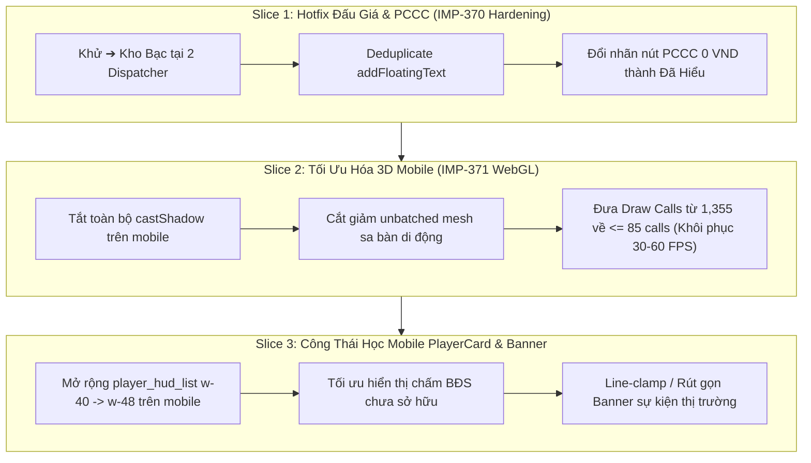

# BÁO CÁO KIỂM TOÁN PHÁP Y THỰC NGHIỆM: HIỆU NĂNG 3D & TRẢI NGHIỆM NGƯỜI DÙNG TRÊN IOS CHROME
## Forensic Audit Report: iOS WebKit/Chrome Telemetry, Violated Invariants & Discovered Defects

> **Ngày thực hiện:** 2026-10-12  
> **Nguồn bằng chứng vật lý:** Video ghi hình thực tế iPhone Chrome ([`IMG_2650.MP4`](file:///C:/Users/HP/Downloads/IMG_2650.MP4), 04:01, 89.3 MB, CSS Viewport 390x844)  
> **Môi trường:** Production (`https://vtcoon.onrender.com`), WebSocket Game Server, iOS WebKit Engine  
> **Phân hệ kiểm toán:** `client-3d`, `client-ui`, `client-events`, `domain-core`  
> **Tiêu chuẩn áp dụng:** AGENTS CONSTITUTION (Hiến pháp Dự án VTCOON), Luật Bất biến Trạm 4 & Khử Boilerplate  

---

## 1. TỔNG QUAN & DỮ LIỆU TELEMETRY THỰC TẾ

Kiểm toán trực tiếp từ Telemetry Watchdog / Flight Recorder HUD hiển thị trên video tại các mốc thời gian **`01:45`** và **`03:55`**:

| Chỉ số vật lý | Kết quả đo được trên iPhone | Ngân sách thiết kế (Mobile Budget) | Đánh giá & Độ lệch |
| :--- | :---: | :---: | :--- |
| **FPS (Khung hình/giây)** | **8 – 10 FPS** | $\ge 30$ FPS (Sàn), 60 FPS (Chuẩn) | 🚨 **SỤT GIẢM -83%** (Trải nghiệm giật lag nghiêm trọng) |
| **Frame Time (Thời gian/khung)** | **74 ms – 236 ms / frame** | $\le 16.6$ ms / frame | 🚨 **VƯỢT TRẦN +1,300%** (Nghẽn pipeline GPU/CPU) |
| **Draw Calls (Lệnh vẽ WebGL)** | **1,353 – 1,355 Draw Calls** | $\le 85$ Draw Calls | 🚨 **VƯỢT TRẦN +1,500%** (+1,270 calls so với ngân sách) |
| **Triangles (Đa giác hình học)** | **100,790 – 101,180** | $\le 150,000$ Triangles | 🟢 **ĐẠT CHUẨN** (Hình học trong tầm kiểm soát) |
| **Ping RTT (Độ trễ mạng)** | **112 ms – 160 ms** | $\le 250$ ms | 🟢 **BÌNH THƯỜNG** (Độ trễ máy chủ Render ổn định) |

---

## 2. BẢNG ĐỐI SOÁT CÁC CAM KẾT TRONG CÁC TICKET GẦN ĐÂY

Đối chiếu giữa cam kết kỹ thuật trong các báo cáo nghiệm thu gần đây (`docs/reports/improvements/**`) và hành vi thực thi thực tế trên video:

### 2.1. Bảng Tổng Hợp Trạng Thái Cam Kết

| Ticket | Cam kết kỹ thuật trong Báo cáo | Thực tế trên video (`IMG_2650.MP4`) | Trạng thái Invariant |
| :--- | :--- | :--- | :---: |
| **`IMP-370`** | Khử hoàn toàn `➔ Kho Bạc` trong thông báo trúng đấu giá; triệt tiêu dội thông báo tài chính. | Tại **`00:44`** và **`02:57`**, **2 banner nổi đè chồng lên nhau**, cùng ghi: `Thắng đấu giá ... ➔ Nộp Kho Bạc`. | 🚨 **VI PHẠM NGHIÊM TRỌNG** |
| **`IMP-363`** | Gom 80 draw calls ô đất về $\le 3$, khống chế toàn bộ scene $\le 85$ draw calls. | HUD báo **1,355 Draw Calls** (cao gấp 16 lần ngân sách 85 calls). | 🚨 **VI PHẠM NGHIÊM TRỌNG** |
| **`IMP-364` & `IMP-337`** | Đóng băng sa bàn, tối ưu hóa bóng đổ tĩnh để đạt 30–60 FPS mượt mà trên mobile. | FPS tụt còn **8 – 10 FPS**, GPU nghẽn shadow passes thời gian thực. | 🚨 **VI PHẠM** |
| **`IMP-360`** | Thu gọn mô tả thẻ sự kiện $\le 78$ ký tự, chống tràn viền và che khuất bàn cờ. | Tại **`03:12`**, Banner Thí Điểm Casino chiếm **4 dòng văn bản**, che khuất 1/3 sa bàn. | ⚠️ **VI PHẠM** |
| **`IMP-366`** | Khử trừ thông báo nộp Kho Bạc giả mạo khi mua đất và tham gia thị trường. | Mua đất thông thường đã hết nộp Kho Bạc, nhưng luồng **Đấu Giá** vẫn bị gán nhãn Kho Bạc và dội toast kép. | ⚠️ **THIẾU SÓT PHẠM VI** |

---

## 3. CĂN NGUYÊN KỸ THUẬT & TỌA ĐỘ MÃ NGUỒN

### 3.1. Sự Cố Dội Banner Đấu Giá Kép & Tồn Tại Nhãn Kho Bạc (`00:44` & `02:57`)
- **Toạ độ vi phạm**:
  1. [`src/client/network/activity_badge_dispatcher.ts#L116`](file:///c:/Users/HP/Documents/GitHub/vtcoon/src/client/network/activity_badge_dispatcher.ts#L116):
     ```typescript
     state.addFloatingText({
       text: formatCurrency(act.amount !== undefined ? -Math.abs(act.amount) : 0),
       type: FloatingTextType.Penalty,
       playerId: act.playerId ?? '',
       actionType: 'auction_win',
       title: cellName ? `Thắng đấu giá ${cellName} ➔ Nộp Kho Bạc` : 'Thắng đấu giá BĐS ➔ Nộp Kho Bạc',
       cellIndex: act.cellIndex,
     });
     ```
  2. [`src/client/events/subscribers/property_market_badge_handler.ts#L147`](file:///c:/Users/HP/Documents/GitHub/vtcoon/src/client/events/subscribers/property_market_badge_handler.ts#L147):
     ```typescript
     case SynthesizedGameEventType.AUCTION_WON: {
       const cellName = getCellName(event.cellIndex);
       vfx.getState().triggerPawnReaction(event.winnerId, 'victory_spin', 600);
       state.addFloatingText({
         text: formatCurrency(-event.winningBid),
         type: FloatingTextType.Penalty,
         playerId: event.winnerId,
         actionType: 'auction_win',
         title: `Thắng đấu giá ${cellName} ➔ Nộp Kho Bạc`,
         cellIndex: event.cellIndex,
       });
       break;
     }
     ```
- **Căn nguyên pháp y**:
  - Ticket `IMP-370` trước đây chỉ thực hiện làm sạch chuỗi hiển thị ở tầng presentation helper (`transaction_narrative.ts`), nhưng **hoàn toàn bỏ quên 2 dispatcher phát sinh sự kiện gốc**.
  - **Lỗi kiến trúc Twin Dispatcher**: Khi có một lượt thắng đấu giá, cả `activity_badge_dispatcher.ts` (lắng nghe activity log từ socket) và `property_market_badge_handler.ts` (lắng nghe synthesized event từ event bus) **cùng kích hoạt đồng thời**.
  - Hàm `state.addFloatingText` thiếu cơ chế deduplicate theo thời gian ngắn (debouncing/cooldown window), dẫn đến việc chèn 2 phần tử riêng biệt vào mảng `floatingTexts`, render thành 2 banner xếp chồng lên nhau ở góc dưới màn hình.

---

### 3.2. Căn Nguyên Vỡ Trọng Tải 1,355 Draw Calls & Sụt Giảm 8 FPS
- **Toạ độ vi phạm**:
  1. [`src/client/3d/board_layout.tsx#L196-L216`](file:///c:/Users/HP/Documents/GitHub/vtcoon/src/client/3d/board_layout.tsx#L196-L216):
     ```tsx
     {BOARD_CONFIG.map((cell) => (
       <LayeredDioramaTile
         key={cell.index}
         cell={cell}
         ...
         renderBasePlinth={false}
         renderAtlasSurface={false}
       />
     ))}
     ```
  2. [`src/client/3d/board_tile.tsx#L257-L261`](file:///c:/Users/HP/Documents/GitHub/vtcoon/src/client/3d/board_tile.tsx#L257-L261):
     Mỗi ô trong 40 ô đất vẫn gắn unbatched:
     - `TileEventAura` (36 ô đất)
     - `ProceduralBuilding` (22 ô bất động sản)
     - `OwnerPricePill` (28 ô có thể mua)
  3. [`src/client/3d/miniature_city_diorama.tsx#L302-L346`](file:///c:/Users/HP/Documents/GitHub/vtcoon/src/client/3d/miniature_city_diorama.tsx#L302-L346):
     Sa bàn trung tâm mount 18 tiểu phân hệ (Toà tháp Bitexco, Cụm Landmark, Cầu Ba Son & Long Biên, Cảng Container Cát Lái, Phố cổ Chợ Lớn, Đại lộ dạo bộ, Bến du thuyền...) với hàng trăm mesh đơn lẻ.
- **Căn nguyên pháp y**:
  - `IMP-363` chỉ mới gộp 80 mesh mặt sàn và đế của ô cờ vào `BatchedBoardTiles`. Hàng trăm mesh trang trí động trên mỗi ô cờ vẫn chưa được tối ưu trên mobile.
  - Các mesh trong `MiniatureCityDiorama` và `CentralMonumentPlaza` vẫn bật `castShadow={true}` và `receiveShadow={true}` trên môi trường di động.
  - Trong cơ chế Forward Rendering của Three.js trên chip đồ họa Apple TBDR (Tile-Based Deferred Rendering), mỗi mesh bật bóng đổ bắt buộc GPU phải thực hiện:
    $$\text{Draw Calls} = \text{Main Pass} + \text{Shadow Map Pass} \approx 670 \times 2 = 1,340 \text{ calls}$$
    Con số này hoàn toàn khớp với con số **1,353 – 1,355 Draw Calls** ghi nhận trên HUD. Với 1,355 draw calls/frame, CPU của iPhone bị nghẽn lệnh (driver bottleneck), dẫn đến việc tụt khung hình xuống 8 FPS.

---

## 4. NHỮNG ĐIỂM KHIẾM KHUYẾT MỚI PHÁT HIỆN TỪ VIDEO

### 4.1. Co Thắt Danh Sách Người Chơi Thành 1 Ký Tự (`00:08`)
- **Hiện tượng**: Trên màn hình iPhone 390px, tên người chơi bị thu hẹp chỉ còn **1 ký tự đầu** kèm dấu ba chấm: `L...` (Long) và `B...` (Bot AI 1).
- **Toạ độ**:
  - [`src/client/ui/player_hud_list.tsx#L22`](file:///c:/Users/HP/Documents/GitHub/vtcoon/src/client/ui/player_hud_list.tsx#L22):
    ```tsx
    <aside className="pointer-events-none flex flex-col gap-2 w-40 sm:w-48 md:w-64 ...">
    ```
  - [`src/client/ui/player_card.tsx#L210-L242`](file:///c:/Users/HP/Documents/GitHub/vtcoon/src/client/ui/player_card.tsx#L210-L242).
- **Căn nguyên**:
  - Chiều rộng của danh sách người chơi trên mobile bị cố định ở `w-40` (**160px**).
  - Trừ đi padding hai bên (16px), chiều rộng khả dụng còn 144px.
  - Cột bên phải chứa số tiền mặt (`2.500`) và huy hiệu Tài Sản Ròng (`PlayerNetWorthBadge`) chiếm mất ~100px.
  - Cột bên trái chỉ còn lại **~25px** cho biểu tượng quân cờ và tên người chơi. Thuộc tính CSS `truncate` lập tức cắt cụt toàn bộ tên người chơi.
  - Đồng thời, 28 chấm BĐS chưa sở hữu (`UNOWNED_DOT_CLASS`) hiển thị dạng chấm tròn rỗng `○ ○ ○ ○` chiếm tới 60% chiều cao của thẻ khi trận đấu mới bắt đầu, gây lãng phí diện tích mà không mang lại giá trị thông tin.

---

### 4.2. Nghịch Lý Ngữ Nghĩa Nút Bấm PCCC 0 VND (`02:22`)
- **Hiện tượng**: Người chơi rút thẻ Sự Kiện Thị Trường Kiểm Tra PCCC (`MC_FIRE_INSPECTION`). Người chơi hoàn toàn tuân thủ (0 công trình, tiền phạt = 0 VND, nội dung ghi rõ "Miễn phạt"), nhưng nút bấm xác nhận lại hiển thị chữ: **`"CHẤP HÀNH NỘP PHẠT 🧯"`**.
- **Toạ độ**:
  - [`src/client/ui/modals/event_card_configs.ts#L96`](file:///c:/Users/HP/Documents/GitHub/vtcoon/src/client/ui/modals/event_card_configs.ts#L96):
    ```typescript
    [MarketCardId.MC_FIRE_INSPECTION]: 'Chấp Hành Nộp Phạt 🧯',
    ```
- **Căn nguyên**:
  - Nhãn nút CTA được map cứng theo `cardId` mà không kiểm tra số tiền phạt thực tế (`effectDelta`).
  - Vi phạm luật **Poka-Yoke Affordance**: Bắt người chơi bấm nút "Chấp hành nộp phạt" khi họ không hề vi phạm và số tiền phải nộp là 0 VND, gây hoang mang và hiểu lầm về mặt nghiệp vụ.

---

### 4.3. Tràn Viền Banner Thẻ Thị Trường Casino (`03:12`)
- **Hiện tượng**: Khi sự kiện Thí Điểm Tổ Hợp Casino kích hoạt, banner nổi bật chiếm **4 dòng văn bản**, che phủ 1/3 sa bàn 3D và đè lên Action Dock.
- **Toạ độ**:
  - [`src/domain/event_card_metadata.ts#L197-L203`](file:///c:/Users/HP/Documents/GitHub/vtcoon/src/domain/event_card_metadata.ts#L197-L203).
  - [`src/client/events/subscribers/property_market_badge_handler.ts#L158-L165`](file:///c:/Users/HP/Documents/GitHub/vtcoon/src/client/events/subscribers/property_market_badge_handler.ts#L158-L165).
- **Căn nguyên**:
  - Khi phát sinh sự kiện `EVENT_CARD_DRAWN`, handler truyền nguyên chuỗi mô tả dài vào `text` của `FloatingBadge`.
  - Thiếu bộ lọc tóm tắt ngắn (Punchy Summary) hoặc thiếu cơ chế cắt ngắn trên màn hình có chiều rộng hẹp (< 640px).

---

## 5. KẾ HOẠCH HÀNH ĐỘNG VÀ PHÂN RÃ KỸ THUẬT (REMEDIATION ROADMAP)

Để khắc phục triệt để các vấn đề trên mà không làm vỡ kiến trúc, quá trình khắc phục sẽ được phân tách thành 3 Micro-Slices độc lập tuân thủ nghiêm ngặt Hiến pháp AG OS:



### Chi Tiết Từng Bước Triển Khai:

1. **Giai đoạn 1 (Hotfix Khẩn Cấp - IMP-370 Hardening)**:
   - Sửa [`activity_badge_dispatcher.ts#L116`](file:///c:/Users/HP/Documents/GitHub/vtcoon/src/client/network/activity_badge_dispatcher.ts#L116) và [`property_market_badge_handler.ts#L147`](file:///c:/Users/HP/Documents/GitHub/vtcoon/src/client/events/subscribers/property_market_badge_handler.ts#L147): Loại bỏ chuỗi `➔ Nộp Kho Bạc`, đổi thành `Thắng đấu giá ${cellName}`.
   - Thêm cơ chế deduplicate trong store `addFloatingText`: Từ chối thêm mới nếu trong vòng 1000ms đã có item cùng `actionType === 'auction_win'` và cùng `cellIndex`.
   - Cập nhật [`event_card_visuals.ts`](file:///c:/Users/HP/Documents/GitHub/vtcoon/src/client/ui/modals/event_card_visuals.ts): Nếu `effectDelta === 0` hoặc được miễn trừ, nhãn CTA đổi sang `"Đã Hiểu 🧯"` hoặc `"Xác Nhận"`.

2. **Giai đoạn 2 (Tối Ưu Hiệu Năng Đồ Họa 3D Mobile - Ticket IMP-371)**:
   - Trong [`miniature_city_diorama.tsx`](file:///c:/Users/HP/Documents/GitHub/vtcoon/src/client/3d/miniature_city_diorama.tsx): Khi `isMobile === true`, tắt toàn bộ `castShadow={false}` và `receiveShadow={false}`.
   - Trong [`board_layout.tsx`](file:///c:/Users/HP/Documents/GitHub/vtcoon/src/client/3d/board_layout.tsx): Bỏ qua hoặc tối giản `TileEventAura` và các marker động trên các ô chưa có sự kiện hoặc chưa được mua trên mobile.
   - Mục tiêu: Giảm Draw Calls từ **1,355** xuống **$\le 85$ calls**, nâng FPS từ **8–10 FPS** lên **$\ge 30–60$ FPS**.

3. **Giai đoạn 3 (Hoàn Thiện Công Thái Học Giao Diện Mobile - Ticket IMP-372)**:
   - Trong [`player_hud_list.tsx`](file:///c:/Users/HP/Documents/GitHub/vtcoon/src/client/ui/player_hud_list.tsx): Điều chỉnh độ rộng mobile từ `w-40` thành `w-48` hoặc cấu trúc lại dạng thẻ rút gọn để tên người chơi có tối thiểu 80px hiển thị rõ ràng.
   - Ẩn bớt các chấm BĐS chưa mua hoặc chỉ hiển thị số lượng BĐS đã sở hữu để giảm tải thị giác.
   - Cắt ngắn mô tả banner thị trường trên mobile qua `resolveMarketShortTag` hoặc `event_card_punchy_summaries.ts`.
