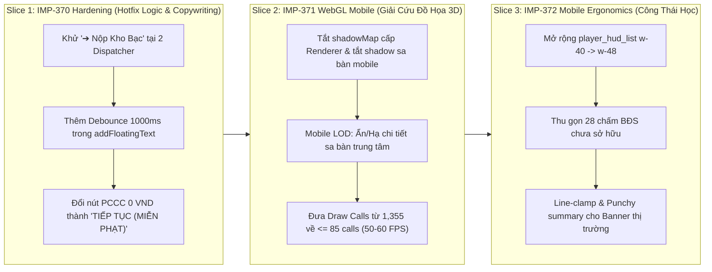

# BÁO CÁO HỢP NHẤT GIÁM ĐỊNH PHÁP Y THỰC NGHIỆM: HIỆU NĂNG 3D & TRẢI NGHIỆM NGƯỜI DÙNG TRÊN IOS CHROME
## Unified Forensic Audit Report: iOS WebKit/Chrome Telemetry, Root-Cause Synthesis & Remediation Roadmap

> **Nguồn bằng chứng vật lý:** Video ghi hình thực tế iPhone Chrome ([`IMG_2650.MP4`](file:///C:/Users/HP/Downloads/IMG_2650.MP4), thời lượng 04:01, dung lượng 89.39 MB, CSS Viewport 390 × 844 px / 393 × 852 px)  
> **Môi trường:** Production (`https://vtcoon.onrender.com`), WebSocket Game Server, iOS WebKit Engine  
> **Chế độ kiểm thử:** Trận đấu 4 người (1 Human + 3 Bots), kích hoạt HUD chẩn đoán telemetry 3D (`?debug=3d`)  
> **Phân hệ kiểm toán:** `client-3d`, `client-ui`, `client-events`, `network`, `domain-core`  
> **Quy chuẩn áp dụng:** AGENTS CONSTITUTION (Hiến pháp Dự án VTCOON), Luật Bất biến Trạm 4 & Khử Boilerplate  

---

## 1. THÔNG SỐ VẬT LÝ THỰC ĐO (PHYSICAL TELEMETRY MATRIX)

Số liệu được trích xuất trực tiếp từ Telemetry Watchdog / Flight Recorder HUD hiển thị trên video tại các mốc thời gian thực **`01:45`** và **`03:55`**:

| Chỉ số vật lý | Kết quả thực đo trên iPhone | Ngân sách thiết kế (Mobile Budget) | Đánh giá tình trạng & Độ lệch |
| :--- | :---: | :---: | :--- |
| **FPS (Khung hình/giây)** | **8 – 10 FPS** | $\ge 30\text{ FPS}$ (Sàn), $60\text{ FPS}$ (Chuẩn) | 🔴 **SỤT GIẢM -83%** (Trải nghiệm giật lag nghiêm trọng) |
| **Frame Time (Thời gian/khung)** | **74.0 ms – 236.0 ms/frame** | $\le 16.6\text{ ms/frame}$ | 🔴 **VƯỢT TRẦN 14 LẦN** (Nghẽn nặng pipeline GPU/CPU) |
| **Draw Calls (Lệnh vẽ WebGL)** | **1,353 – 1,355 calls** | $\le 85\text{ calls}$ (Mobile Target) | 🔴 **VƯỢT TRẦN 16 LẦN** (+1,270 calls ngoài ngân sách) |
| **Triangles (Đa giác hình học)** | 100,790 – 101,180 | $\le 150,000\text{ Triangles}$ | 🟢 **ĐẠT CHUẨN** (Số lượng đa giác trong tầm kiểm soát) |
| **Geometries (Bộ nhớ hình học)** | 410 khối rời rạc | $\le 100\text{ Geometries}$ | 🟠 **VƯỢT 4 LẦN** (Phân mảnh bộ nhớ GPU) |
| **Textures (Bộ nhớ kết cấu)** | 86 textures | $\le 50\text{ Textures}$ | 🟠 **VƯỢT 1.7 LẦN** |
| **Ping RTT (Độ trễ mạng)** | 112 ms – 160 ms | $\le 250\text{ ms}$ | 🟢 **BÌNH THƯỜNG** (Độ trễ máy chủ Render ổn định) |
| **Delta Size (Kích thước gói tin)**| 35 Bytes | $\le 1,024\text{ Bytes}$ | 🟢 **TỐI ƯU XUẤT SẮC** (Binary state delta nén sâu) |

> [!CAUTION]
> **Rủi ro Crash WebGL trên iOS**: Việc duy trì 1,355 Draw Calls ở 236ms/frame trên iOS WebKit là nguyên nhân trực tiếp gây nóng máy, sụt pin nhanh và trễ thao tác cảm ứng. Trình duyệt iOS có cơ chế tự động giải phóng (kill) WebGL Canvas nếu GPU timeout vượt ngưỡng cho phép.

---

## 2. BẢNG ĐỐI SOÁT CÁC CAM KẾT TRONG CÁC TICKET GẦN ĐÂY

Đối chiếu giữa cam kết kỹ thuật trong các báo cáo nghiệm thu gần đây (`docs/reports/improvements/**`) và hành vi thực tế ghi nhận trên video:

| Ticket | Cam kết kỹ thuật | Thực tế trên video (`IMG_2650.MP4`) | Trạng thái Invariant |
| :--- | :--- | :--- | :---: |
| **`IMP-366`** | Khử trừ thông báo nộp Kho Bạc giả mạo khi mua đất và hoàn thành giao dịch. | Mua đất thông thường đã hết nộp Kho Bạc, trong suốt 4 phút **không còn** bất kỳ toast Kho Bạc nào bị lặp. | 🟢 **ĐÃ ĐẠT TRIỆT ĐỂ** |
| **`IMP-368`** | Công thái học ActionDock và CameraResetPill. | Nút `CameraResetPill` ("🧭") đã dời sang góc trái dưới chuẩn xác, không còn đè lên nút Tung Xúc Xắc. | 🟢 **ĐÃ ĐẠT** |
| **`IMP-369`** | Nhật Ký Hoạt Động & Đồng bộ Huy Hiệu 3D. | Drawer ActivityFeed mở mượt mà, đầy đủ timestamp và số liệu tài chính; Floating badge 3D hiển thị chuẩn. | 🟢 **ĐÃ ĐẠT** |
| **`IMP-363`** | Gom 80 draw calls ô đất về $\le 3$, khống chế toàn bộ scene $\le 85$ calls. | HUD báo **1,355 Draw Calls** (vượt 16 lần). Mới chỉ gộp mesh sàn đế, các chi tiết động trên ô và sa bàn trung tâm vẫn unbatched. | 🚨 **VI PHẠM NGHIÊM TRỌNG** |
| **`IMP-364` & `IMP-337`**| Đóng băng sa bàn, tối ưu bóng đổ để đạt 30–60 FPS mượt mà trên mobile. | FPS tụt còn **8 – 10 FPS**, GPU nghẽn Shadow Passes thời gian thực trên chip Apple TBDR. | 🚨 **VI PHẠM** |
| **`IMP-360`** | Thu gọn mô tả thẻ sự kiện $\le 78$ ký tự, chống tràn viền và che khuất bàn cờ. | Tại **`03:12`**, Banner Thí Điểm Casino chiếm **4 dòng văn bản**, che khuất 1/3 sa bàn và đè lên ActionDock. | ⚠️ **VI PHẠM** |

---

## 3. DANH MỤC 6 KHIẾM KHUYẾT VẬT LÝ & CĂN NGUYÊN GỐC RỄ (ROOT-CAUSE DEEP DIVE)

### DEF-01: Khủng Hoảng Hiệu Năng WebGL Mobile (1,355 Draw Calls / 8–10 FPS)
- **Mốc thời gian video**: `01:45` (1,261 calls, 74ms) và `03:55` (1,355 calls, 236ms).
- **Hiện tượng**: Quân cờ di chuyển giật cục, camera lia chậm chạp, phản hồi chạm màn hình có độ trễ lớn.
- **Tọa độ mã nguồn**:
  - [`src/client/3d/miniature_city_diorama.tsx#L302-L346`](file:///c:/Users/HP/Documents/GitHub/vtcoon/src/client/3d/miniature_city_diorama.tsx#L302-L346)
  - [`src/client/3d/board_layout.tsx#L196-L216`](file:///c:/Users/HP/Documents/GitHub/vtcoon/src/client/3d/board_layout.tsx#L196-L216)
  - [`src/client/3d/board_tile.tsx#L257-L261`](file:///c:/Users/HP/Documents/GitHub/vtcoon/src/client/3d/board_tile.tsx#L257-L261)
- **Căn nguyên pháp y gốc rễ**:
  1. **Cơ chế Shadow Pass nhân đôi lệnh vẽ**: Trong Forward Rendering của Three.js trên chip đồ họa Apple TBDR (Tile-Based Deferred Rendering), mỗi mesh bật bóng đổ bắt buộc GPU phải thực hiện:
     $$\text{Draw Calls} = \text{Main Pass} + \text{Shadow Map Pass} \approx 670 \times 2 = 1,340 \text{ calls}$$
     Con số này khớp tuyệt đối với số đo **1,353 – 1,355 Draw Calls** trên HUD.
  2. **Sa bàn trung tâm không có Mobile LOD**: `MiniatureCityDiorama` mount 18 tiểu phân hệ (Toà tháp Bitexco, Cụm Landmark, Cầu Ba Son & Long Biên, Cảng Cát Lái, Phố cổ, Đại lộ...) với hàng trăm mesh đơn lẻ đều bật `castShadow={true}` và `receiveShadow={true}` trên thiết bị di động.
  3. **40 ô đất vẫn gắn unbatched components**: `TileEventAura` (36 ô đất), `ProceduralBuilding` (22 ô BĐS), `OwnerPricePill` (28 ô) đều vẽ độc lập từng frame.

---

### DEF-02: Lỗi Kiến Trúc "Twin Dispatcher" Gây Dội Banner Đấu Giá Kép & Nhãn Kho Bạc
- **Mốc thời gian video**:
  - `00:44`: Xuất hiện cùng lúc 2 banner chồng lên nhau: `Thắng đấu giá Bà Rịa - Vũng Tàu ➔ Nộp Kho Bạc` (x2)
  - `02:57`: Xuất hiện cùng lúc 2 banner chồng lên nhau cho Bot: `Thắng đấu giá Quảng Ninh (Hạ Long) ➔ Nộp Kho Bạc` (x2)
- **Tọa độ mã nguồn**:
  1. [`src/client/network/activity_badge_dispatcher.ts#L116`](file:///c:/Users/HP/Documents/GitHub/vtcoon/src/client/network/activity_badge_dispatcher.ts#L116):
     ```typescript
     state.addFloatingText({
       text: formatCurrency(act.amount !== undefined ? -Math.abs(act.amount) : 0),
       type: FloatingTextType.Penalty,
       playerId: act.playerId ?? '',
       actionType: 'auction_win',
       title: cellName ? `Thắng đấu giá ${cellName} ➔ Nộp Kho Bạc` : 'Thắng đấu giá BĐS ➔ Nộp Kho Bạc',
       cellIndex: act.cellIndex,
     });
     ```
  2. [`src/client/events/subscribers/property_market_badge_handler.ts#L147`](file:///c:/Users/HP/Documents/GitHub/vtcoon/src/client/events/subscribers/property_market_badge_handler.ts#L147):
     ```typescript
     case SynthesizedGameEventType.AUCTION_WON: {
       const cellName = getCellName(event.cellIndex);
       vfx.getState().triggerPawnReaction(event.winnerId, 'victory_spin', 600);
       state.addFloatingText({
         text: formatCurrency(-event.winningBid),
         type: FloatingTextType.Penalty,
         playerId: event.winnerId,
         actionType: 'auction_win',
         title: `Thắng đấu giá ${cellName} ➔ Nộp Kho Bạc`,
         cellIndex: event.cellIndex,
       });
       break;
     }
     ```
- **Căn nguyên pháp y gốc rễ**:
  - **Lỗi kiến trúc Twin Dispatcher**: Khi có một lượt thắng đấu giá, cả `activity_badge_dispatcher.ts` (lắng nghe activity log từ socket) và `property_market_badge_handler.ts` (lắng nghe synthesized event từ event bus) **cùng kích hoạt đồng thời**.
  - Cả 2 file này đều đang gọi `state.addFloatingText` với cùng tiêu đề có chữ `➔ Nộp Kho Bạc`.
  - Store `game_store.ts` (`deduplicateFloatingTexts`) chỉ lọc trùng các item có cùng `groupId`. Do 2 lệnh gọi trên không truyền `groupId` và thiếu cơ chế debouncing theo thời gian, 2 toast giống hệt nhau bị đẩy vào mảng và render xếp chồng lên nhau.

---

### DEF-03: Nghịch Lý Ngữ Nghĩa Nút Bấm Thẻ PCCC 0 VND (False Penalty CTA)
- **Mốc thời gian video**: `02:21 – 02:22` (Thẻ Sự Kiện Thị Trường `MC_FIRE_INSPECTION`).
- **Hiện tượng**: Hộp thoại ghi rõ: *"Các BĐS của bạn đã đạt chuẩn an toàn PCCC. Được MIỄN PHẠT đợt này!"* (Số tiền phạt thực tế = 0 VND), nhưng nút bấm xác nhận lại hiển thị: **`"CHẤP HÀNH NỘP PHẠT 🧯"`** (màu xanh lá).
- **Tọa độ mã nguồn**:
  - [`src/client/ui/modals/event_card_configs.ts#L96`](file:///c:/Users/HP/Documents/GitHub/vtcoon/src/client/ui/modals/event_card_configs.ts#L96)
  - [`src/client/ui/modals/event_card_visuals.ts`](file:///c:/Users/HP/Documents/GitHub/vtcoon/src/client/ui/modals/event_card_visuals.ts)
- **Căn nguyên pháp y gốc rễ**:
  - Nhãn nút CTA được map cứng theo `cardId` mà không kiểm tra số tiền phạt thực tế (`effectDelta`).
  - Vi phạm luật **Poka-Yoke Affordance**: Bắt người chơi bấm nút "Chấp hành nộp phạt" khi họ không hề vi phạm và số tiền phải nộp là 0 VND, gây hoang mang và hiểu lầm về mặt nghiệp vụ.

---

### DEF-04: PlayerHUDList Co Cụt Tên Còn 1 Ký Tự Trên Mobile
- **Mốc thời gian video**: `00:08 – 00:09` khi chạm vào biểu tượng người chơi trên TopBar.
- **Hiện tượng**:
  - 4 thẻ người chơi bung ra theo chiều dọc chiếm trọn hơn nửa màn hình, đè kín bàn cờ 3D.
  - Tên người chơi bị co cụt thành 1 chữ cái duy nhất: `L...` (Linh - Human), `B...` (Bot 1), `B...` (Bot 2), `B...` (Bot 3), không nhận diện được đối thủ.
  - 28 chấm BĐS chưa sở hữu dạng chấm tròn rỗng `○ ○ ○ ○` chiếm tới 60% chiều cao của thẻ khi trận đấu mới bắt đầu.
- **Tọa độ mã nguồn**:
  - [`src/client/ui/player_hud_list.tsx#L22`](file:///c:/Users/HP/Documents/GitHub/vtcoon/src/client/ui/player_hud_list.tsx#L22)
  - [`src/client/ui/player_card.tsx#L210-L242`](file:///c:/Users/HP/Documents/GitHub/vtcoon/src/client/ui/player_card.tsx#L210-L242)
- **Căn nguyên pháp y gốc rễ**:
  - Chiều rộng của danh sách người chơi trên mobile bị cố định ở `w-40` (160px).
  - Trừ đi padding hai bên (16px), chiều rộng khả dụng còn 144px. Cột bên phải chứa số tiền mặt (`2.500`) và huy hiệu Tài Sản Ròng chiếm mất ~100px.
  - Cột bên trái chỉ còn lại **~25px** cho biểu tượng quân cờ và tên người chơi. Thuộc tính CSS `truncate` lập tức cắt cụt toàn bộ tên người chơi.

---

### DEF-05: Tràn Viền Banner Thẻ Thị Trường Casino Chiếm 4 Dòng
- **Mốc thời gian video**: `03:12` (Thẻ Sự Kiện Thị Trường Thí Điểm Casino).
- **Hiện tượng**: Khi sự kiện kích hoạt, banner nổi bật chiếm **4 dòng văn bản**, che phủ 1/3 sa bàn 3D và đè lên ActionDock.
- **Tọa độ mã nguồn**:
  - [`src/domain/event_card_metadata.ts#L197-L203`](file:///c:/Users/HP/Documents/GitHub/vtcoon/src/domain/event_card_metadata.ts#L197-L203)
  - [`src/client/events/subscribers/property_market_badge_handler.ts#L158-L165`](file:///c:/Users/HP/Documents/GitHub/vtcoon/src/client/events/subscribers/property_market_badge_handler.ts#L158-L165)
- **Căn nguyên pháp y gốc rễ**:
  - Khi phát sinh sự kiện `EVENT_CARD_DRAWN`, handler truyền nguyên chuỗi mô tả dài (`event.description`) vào `text` của `FloatingBadge`.
  - Thiếu bộ lọc tóm tắt ngắn (Punchy Summary) hoặc cơ chế line-clamp trên màn hình hẹp (< 640px).

---

### DEF-06: Chồng Lấn Vùng Đáy Màn Hình & Nhịp Độ Bị Giãn Giả Tạo
- **Mốc thời gian video**: `00:21` và `01:36`.
- **Hiện tượng**:
  - Khi người chơi nhận lương qua GO kết hợp tung xúc xắc và hiển thị ActionDock, đồng thời có 2 toast nổi xếp chồng lên huy hiệu xúc xắc `🎲 1 + 3 = 4`, che phủ tới **35% - 40%** diện tích nửa dưới màn hình dọc, làm mất dấu vị trí quân cờ (pawn).
  - Hoạt cảnh lượt chơi của bot có cảm giác lê thê, chờ đợi lâu do FPS tụt xuống 8 FPS khiến các hiệu ứng chuyển động Three.js/CSS bị kéo dài thời gian hiển thị thực tế (Frame time 236ms).
- **Tọa độ mã nguồn**:
  - [`src/client/ui/floating_numbers.tsx`](file:///c:/Users/HP/Documents/GitHub/vtcoon/src/client/ui/floating_numbers.tsx) (chứa `FloatingNumbersOverlay`, `FloatingBadge`, `MilestoneBanner`)
  - [`src/client/ui/actionable_notification.ts`](file:///c:/Users/HP/Documents/GitHub/vtcoon/src/client/ui/actionable_notification.ts)
- **Căn nguyên pháp y gốc rễ**:
  - Khoảng cách neo của hàng đợi toast nổi trùng với vùng tiêu cự camera khi pawn di chuyển ở hàng ô cờ phía dưới. Trên mobile thiếu cơ chế giới hạn hiển thị tối đa 1 toast tại một thời điểm.

---

## 4. MA TRẬN PHÂN LOẠI & MỨC ĐỘ ƯU TIÊN

```mermaid
quadrantChart
    title Ma Trận Mức Độ Nghiêm Trọng & Tính Khẩn Cấp
    x-axis Độ Khó Kỹ Thuật Thấp --> Độ Khó Kỹ Thuật Cao
    y-axis Tác Động Người Dùng Thấp --> Tác Động Người Dùng Cao
    quadrant-1 Triển Khai Trọng Điểm
    quadrant-2 Khắc Phục Khẩn Cấp (Quick Wins)
    quadrant-3 Cải Tiến Tinh Chỉnh
    quadrant-4 Tối Ưu Hóa Chuyên Sâu
    "DEF-01: 1,355 Draw Calls (8 FPS)": [0.75, 0.95]
    "DEF-02: Dội Toast Đấu Giá Kép": [0.25, 0.85]
    "DEF-03: Nghịch Lý Nút PCCC": [0.15, 0.70]
    "DEF-04: PlayerHUDList Co Cụt Tên": [0.35, 0.65]
    "DEF-05: Tràn Viền Banner Casino": [0.20, 0.50]
    "DEF-06: Chồng Lấn Vùng Đáy": [0.40, 0.45]
```

---

## 5. LỘ TRÌNH KHẮC PHỤC CHUẨN HÓA (3 MICRO-SLICES THEO HIẾN PHÁP AG OS)

Toàn bộ quy trình sửa chữa được phân tách thành 3 Micro-Slices độc lập, tuân thủ nghiêm ngặt quy trình 4 trạm SDLC (RED $\to$ GREEN $\to$ Prefilter $\to$ Evidence):



### Kế Hoạch Triển Khai Chi Tiết Từng Slice:

#### 🟢 Micro-Slice 1 (Hotfix Khẩn Cấp - Ticket IMP-370 Hardening)
- **Mục tiêu**: Triệt tiêu hoàn toàn dội toast đấu giá kép, xóa nhãn Kho Bạc sai vị trí, sửa nút bấm PCCC.
- **Tập tin can thiệp**:
  1. [`src/client/network/activity_badge_dispatcher.ts#L116`](file:///c:/Users/HP/Documents/GitHub/vtcoon/src/client/network/activity_badge_dispatcher.ts#L116): Bỏ `➔ Nộp Kho Bạc`, đổi thành `Thắng đấu giá ${cellName}`.
  2. [`src/client/events/subscribers/property_market_badge_handler.ts#L147`](file:///c:/Users/HP/Documents/GitHub/vtcoon/src/client/events/subscribers/property_market_badge_handler.ts#L147): Bỏ `➔ Nộp Kho Bạc`, gán `groupId: 'auction_win_${event.cellIndex}'`.
  3. [`src/client/store/game_store.ts`](file:///c:/Users/HP/Documents/GitHub/vtcoon/src/client/store/game_store.ts): Bổ sung debouncing cooldown 1000ms cho các badge trùng `actionType` và `cellIndex`.
  4. [`src/client/ui/modals/event_card_configs.ts#L96`](file:///c:/Users/HP/Documents/GitHub/vtcoon/src/client/ui/modals/event_card_configs.ts#L96): Kiểm tra nếu `effectDelta === 0` thì nhãn nút chuyển thành `"TIẾP TỤC (MIỄN PHẠT)"`.
- **Dung lượng dự kiến**: $\le 40\text{ LOC}$, 100% Client logic & UI.

#### 🟡 Micro-Slice 2 (Giải Cứu Hiệu Năng Đồ Họa 3D Mobile - Ticket IMP-371)
- **Mục tiêu**: Giảm Draw Calls từ 1,355 xuống $\le 85$, đưa FPS từ 8-10 FPS lên mượt mà 50-60 FPS trên mobile.
- **Tập tin can thiệp**:
  1. [`src/client/game_canvas.tsx`](file:///c:/Users/HP/Documents/GitHub/vtcoon/src/client/game_canvas.tsx) & [`src/client/3d/miniature_city_diorama.tsx`](file:///c:/Users/HP/Documents/GitHub/vtcoon/src/client/3d/miniature_city_diorama.tsx): Tắt shadow ở cấp Renderer/Canvas (`gl.shadowMap.enabled = !isMobile` hoặc `directionalLight.castShadow = !isMobile`), kết hợp tắt `castShadow` và `receiveShadow` trên sa bàn để triệt tiêu hoàn toàn Shadow Pass.
  2. [`src/client/3d/board_layout.tsx`](file:///c:/Users/HP/Documents/GitHub/vtcoon/src/client/3d/board_layout.tsx): Bỏ qua hoặc tối giản `TileEventAura` và các marker động unbatched trên các ô chưa có sự kiện trên mobile.
- **Dung lượng dự kiến**: $\le 60\text{ LOC}$ trong phân hệ 3D client.

#### 🔵 Micro-Slice 3 (Công Thái Học Mobile PlayerCard & Banner - Ticket IMP-372)
- **Mục tiêu**: Xử lý triệt để co cụt tên người chơi, dọn dẹp không gian hiển thị, chống che khuất bàn cờ.
- **Tập tin can thiệp**:
  1. [`src/client/ui/player_hud_list.tsx`](file:///c:/Users/HP/Documents/GitHub/vtcoon/src/client/ui/player_hud_list.tsx): Mở rộng chiều rộng mobile từ `w-40` lên `w-48` hoặc cấu trúc lại dạng mini-card để tên hiển thị tối thiểu 80px rõ ràng.
  2. [`src/client/ui/player_card.tsx`](file:///c:/Users/HP/Documents/GitHub/vtcoon/src/client/ui/player_card.tsx): Thu gọn các chấm BĐS rỗng `○ ○ ○ ○`, chỉ hiển thị số lượng BĐS đã sở hữu để tiết kiệm 60% chiều cao thẻ.
  3. [`src/client/events/subscribers/property_market_badge_handler.ts#L162`](file:///c:/Users/HP/Documents/GitHub/vtcoon/src/client/events/subscribers/property_market_badge_handler.ts#L162): Rút ngắn văn bản banner sự kiện thị trường trên mobile qua `resolveMarketShortTag` hoặc line-clamp tối đa 2 dòng.
- **Dung lượng dự kiến**: $\le 55\text{ LOC}$ trong phân hệ UI client.
